# Hazel 游戏引擎笔记 015：把 Dear ImGui 接入引擎

> 本节来源：[The Cherno 游戏引擎系列第 15 讲“ImGui”](https://www.bilibili.com/video/BV1wtLazEEmC/?p=15)，时长约 27 分 57 秒。  
> 原课程与 Hazel 代码作者：The Cherno。代码参考提交：[`c65520c`](https://github.com/TheCherno/Hazel/tree/c65520c96289ab62ecd37995108063ce4019d4e9)。  
> 本文由视频字幕重构、翻译并整理，不是官方教材；术语和代码以原视频及同期 Hazel 仓库为准。

## 本节目标

上一讲加入 Glad 后，Hazel 已经能够加载现代 OpenGL 函数。本节把 Dear ImGui 接入窗口，第一次真正在 Hazel 窗口里绘制 UI。

本讲采用明确的三阶段原则：

1. **Make it work**：先让 ImGui 显示出来；
2. **Make it right**：以后让 ImGui 渲染经过 Hazel 自己的 Renderer；
3. **Make it fast**：最后再处理性能和更完整的抽象。

当前处于第一阶段，因此代码被称为一次“hack”：

- 直接包含 GLFW，并使用 ImGui 的 OpenGL3 示例渲染器；
- 直接包含 GLFW 和 Glad；
- 暂时复制 ImGui 示例渲染器；
- 键盘映射暂时借用 ImGui 的 GLFW 示例；
- 先显示 Demo Window；
- 事件交互留到下一讲。


为什么不等 Hazel 有自己的 Renderer 再做 ImGui？因为 ImGui 正是开发 Renderer 时的调试工具。先让 UI 显示出来，后续就能把渲染状态、纹理、着色器和性能数据直接显示在窗口中。


## 1. 为什么先做 GUI，再做 Renderer

*(参考时间: 00:01:30)*

当前 ImGui 直接调用 OpenGL。理想设计是：

```text
ImGui 后端
  -> Hazel Renderer API
  -> OpenGL / DirectX / Vulkan
```

但 Hazel 还没有自己的 Renderer。先写 Renderer，再写 ImGui，会让 Renderer 初期的调试非常困难；先接 ImGui，则可以：

- 在窗口中显示调试变量；
- 观察 Renderer 状态；
- 快速切换参数；
- 构建编辑器面板；
- 验证窗口、事件和 OpenGL 上下文是否正常。

因此本节接受临时耦合，之后再用 Hazel 的渲染抽象替换底层 OpenGL 调用。

## 2. 添加 ImGui 子模块

*(参考时间: 00:02:26)*

Cherno 使用自己维护的 Dear ImGui 分支，并为其准备了 Premake 文件。ImGui 与 GLFW 一样作为 Git 子模块加入：

```bash
git submodule add https://github.com/TheCherno/imgui Hazel/vendor/imgui
```

项目结构变为：

```text
Hazel/vendor/
  GLFW/
  imgui/
  spdlog/
```

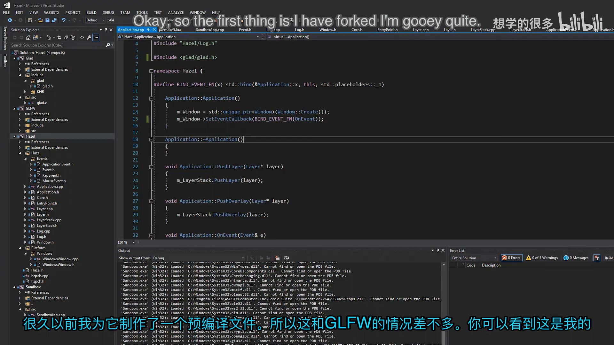

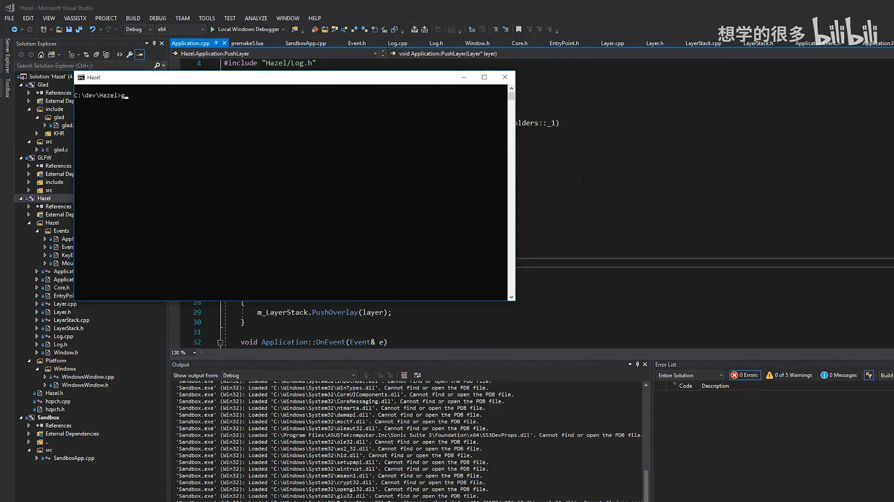

## 3. Premake 接入

*(参考时间: 00:03:37)*

主 Premake 文件增加：

- ImGui 头文件目录；
- 引入 ImGui 的 Premake 文件；
- 让 Hazel 链接 ImGui 静态库。

概念配置如下：

```lua
IncludeDir["ImGui"] = "Hazel/vendor/imgui"

include "Hazel/vendor/imgui"

includedirs
{
    "%{IncludeDir.ImGui}"
}

links
{
    "ImGui"
}
```

第一次重新生成项目时遗漏了顶层 `include "Hazel/vendor/imgui"`，所以解决方案中没有 ImGui 项目。补上后再运行项目生成脚本，Visual Studio 中才出现 ImGui，并能在 Hazel 引用中看到它。

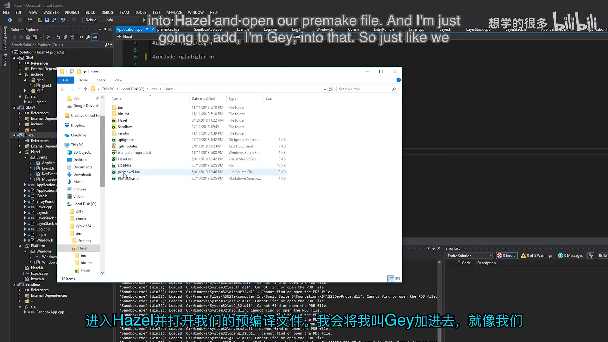

## 4. 创建 ImGuiLayer

*(参考时间: 00:05:18)*

ImGui 相关代码放在：

```text
Hazel/src/Hazel/ImGui/ImGuiLayer.h
Hazel/src/Hazel/ImGui/ImGuiLayer.cpp
```

`ImGuiLayer` 继承上一讲的 `Layer`：

```cpp
class HAZEL_API ImGuiLayer : public Layer
{
public:
    ImGuiLayer();
    ~ImGuiLayer();

    void OnAttach();
    void OnDetach();
    void OnUpdate();
    void OnEvent(Event& event);

private:
    float m_Time = 0.0f;
};
```

它将作为 **Overlay** 推入应用，确保最后渲染并最先收到事件：

```cpp
PushOverlay(new ImGuiLayer());
```

虽然 ImGui 常被看作调试工具，Cherno 暂时没有把目录直接命名为 `Debug`，因为 ImGui 也可能承担正式工具界面甚至应用 UI。

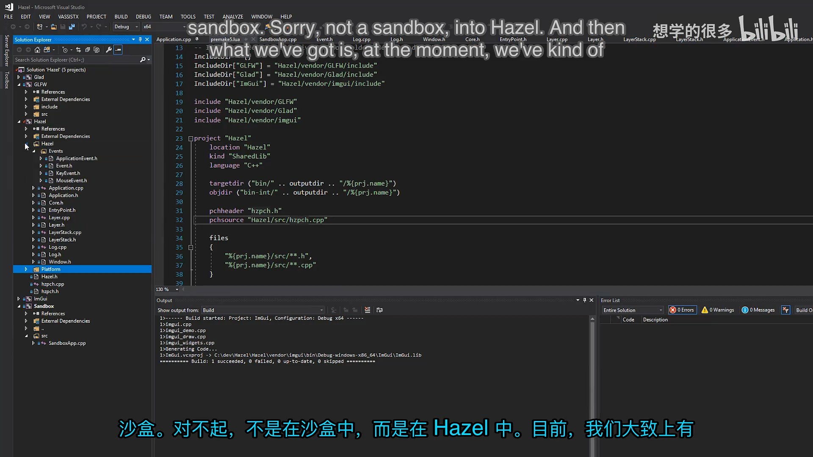

## 5. 复制 ImGui 示例后端

*(参考时间: 00:09:12)*

Dear ImGui 本身负责控件、布局和绘制数据，窗口集成与图形 API 调用分别由后端处理。本节参考两份官方示例：

- `imgui_impl_glfw`：窗口、输入和按键映射；
- `imgui_impl_opengl3`：生成 OpenGL 绘制调用。

Cherno 暂时把 OpenGL3 示例复制到：

```text
Hazel/src/Platform/OpenGL/ImGuiOpenGLRenderer.h
Hazel/src/Platform/OpenGL/ImGuiOpenGLRenderer.cpp
```

这些文件保留“示例代码”的命名风格，提醒开发者它们是临时实现，最终应经过 Hazel Renderer。

编译时出现两个问题：

1. Premake 中错误写成了不存在的 ImGui include 子目录；
2. 复制的 OpenGL 渲染器需要包含 Glad。

修正包含路径并加入 Glad 后，临时渲染器编译成功。

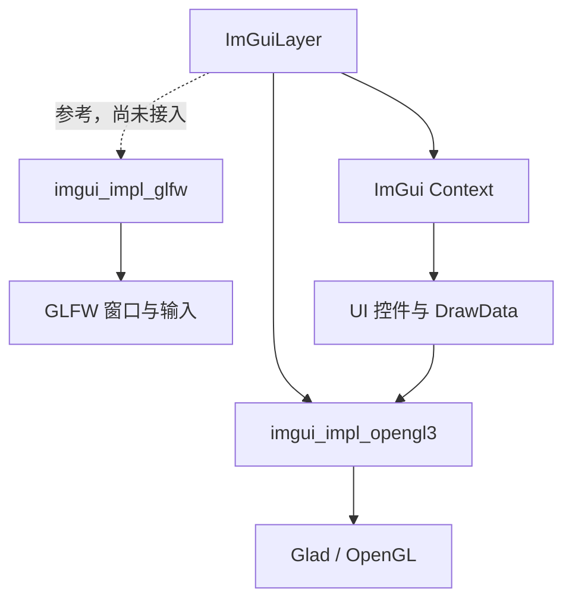

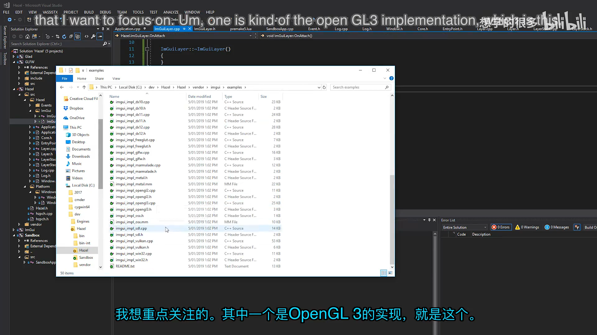

## 6. OnAttach：初始化 ImGui 与 OpenGL3 后端

*(参考时间: 00:13:10)*

Layer 被加入应用时调用 `OnAttach()`。此时窗口和 OpenGL 上下文已经存在。

初始化过程包括：

1. 创建 ImGui Context；
2. 设置深色样式；
3. 取得 `ImGuiIO`；
4. 设置后端能力标志；
5. 安装临时 GLFW 键码映射；
6. 初始化 OpenGL3 后端。

### 6.1 创建 Context 与样式

```cpp
ImGui::CreateContext();
ImGui::StyleColorsDark();
```

### 6.2 后端能力

```cpp
ImGuiIO& io = ImGui::GetIO();
io.BackendFlags |=
    ImGuiBackendFlags_HasMouseCursors;
io.BackendFlags |=
    ImGuiBackendFlags_HasSetMousePos;
```

这些标志告诉 ImGui：后端能够设置鼠标位置和鼠标光标。当前尚不能完整实现鼠标光标纹理，因此只是先声明能力。

### 6.3 临时键码映射

ImGui 键盘输入需要把窗口系统的键码转换成 ImGui 索引。GLFW 后端示例包含一份映射表，本节直接借用。

这是明显的临时方案：

- Hazel 最终应有自己的键码枚举；
- ImGuiLayer 不应直接依赖 GLFW；
- 输入系统还需要支持“当前键是否按下”的轮询。

### 6.4 初始化 OpenGL3 后端

```cpp
ImGui_ImplOpenGL3_Init("#version 410");
```

GLSL 版本暂时使用 `410`，与项目当前 OpenGL 环境和着色器版本保持一致。这里的 `ImGui_ImplOpenGL3_Init()` 来自刚刚复制进 Hazel 的 OpenGL3 示例渲染器，并不是完整的 GLFW 平台后端。

本讲还没有把 `imgui_impl_glfw` 中的窗口回调接进来，也没有调用 `ImGui_ImplGlfw_InitForOpenGL()`；GLFW 在 `OnAttach()` 中主要提供键码常量和 `glfwGetTime()`。这解释了为什么 Demo Window 能显示，却暂时不能交互。

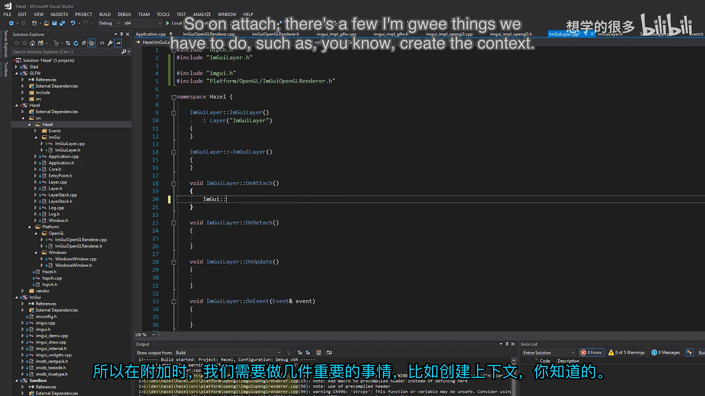

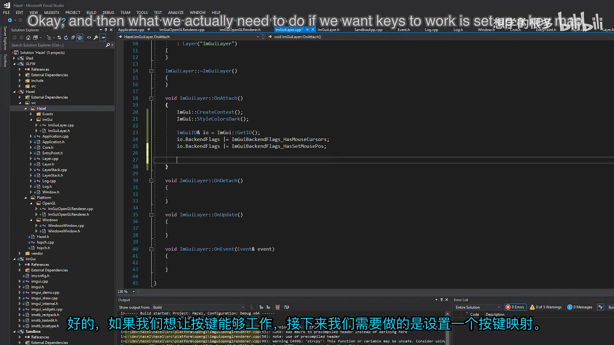

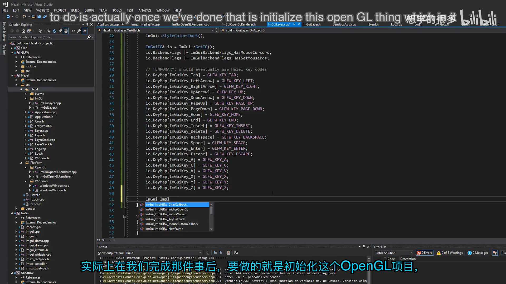

## 7. OnDetach：暂时留空

*(参考时间: 00:16:58)*

虽然 `ImGuiLayer` 声明并实现了 `OnDetach()`，但这一版函数体是空的：

```cpp
void ImGuiLayer::OnDetach()
{
}
```

当前目标仍然只是“先让它工作”，所以没有在移除 Layer 时调用 `ImGui_ImplOpenGL3_Shutdown()` 或 `ImGui::DestroyContext()`，析构函数也是空的。

编者说明：这属于本讲的临时技术债。实际应用在移除 `ImGuiLayer` 或关闭程序时，应按照初始化顺序的逆序释放后端资源并销毁 Context，否则全局 Context 和图形资源可能一直保留到进程结束。

## 8. OnUpdate：每帧流程

*(参考时间: 00:17:02)*

ImGui 每帧遵循固定顺序：

```text
设置 DisplaySize
  -> 更新 DeltaTime
NewFrame
  -> 声明 UI
  -> Render
  -> 提交 DrawData
```

框架代码对应：

```cpp
ImGuiIO& io = ImGui::GetIO();
Application& app = Application::Get();
io.DisplaySize = ImVec2(
    app.GetWindow().GetWidth(),
    app.GetWindow().GetHeight());

float time = (float)glfwGetTime();
io.DeltaTime = m_Time > 0.0f
    ? (time - m_Time)
    : (1.0f / 60.0f);
m_Time = time;

ImGui_ImplOpenGL3_NewFrame();
ImGui::NewFrame();

static bool show = true;
ImGui::ShowDemoWindow(&show);

ImGui::Render();
ImGui_ImplOpenGL3_RenderDrawData(
    ImGui::GetDrawData());
```

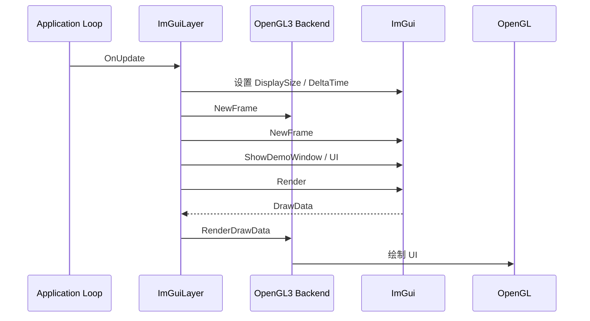

### 8.1 显示 Demo Window

ImGui 自带完整示例窗口，包含大量控件、布局和调试组件。最初设置一个布尔值控制是否显示 Demo Window，用它验证整个后端链路。

### 8.2 时间与 Delta Time

```cpp
float time = (float)glfwGetTime();
ImGuiIO& io = ImGui::GetIO();
io.DeltaTime = m_Time > 0.0f
    ? time - m_Time
    : 1.0f / 60.0f;
m_Time = time;
```

第一帧没有可靠的上一帧时间，因此用 `1/60` 秒作为默认值，避免 Delta Time 为零。

DisplaySize 和 DeltaTime 必须在 `ImGui::NewFrame()` 之前写入。第一次运行只修复了 `OnAttach()` 调用后，ImGui 又触发了 `Invalid DisplaySize value` 断言；查看调用栈后，Cherno 把窗口尺寸和计时代码移动到 `ImGui_ImplOpenGL3_NewFrame()` 与 `ImGui::NewFrame()` 之前，问题才消失。

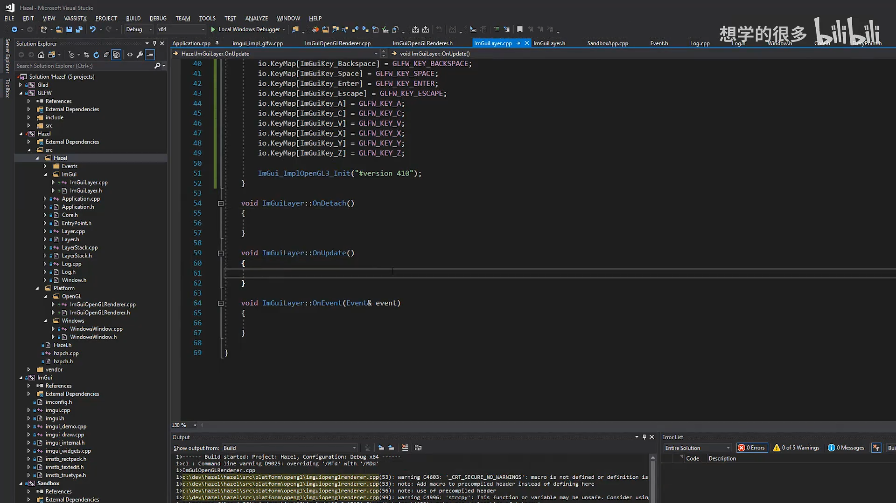

## 9. DisplaySize 与 Application 单例

*(参考时间: 00:19:32)*

ImGui 需要知道窗口客户区大小，否则会报告无效 DisplaySize。初始化顺序修正后，设置方式为：

```cpp
auto& app = Application::Get();
auto& window = app.GetWindow();

io.DisplaySize = ImVec2(
    (float)window.GetWidth(),
    (float)window.GetHeight());
```

`Application` 之前没有全局访问入口，因此本节增加：

```cpp
static Application& Get() { return *s_Instance; }

private:
    static Application* s_Instance;
```

构造函数中：

```cpp
HZ_CORE_ASSERT(s_Instance == nullptr,
               "Application already exists!");
s_Instance = this;
```

这明确表达“一个进程只应有一个 Application”的约束，同时让 ImGuiLayer 能读取当前窗口尺寸。

### 9.1 Application 增加 GetWindow

窗口尺寸由 Application 持有的 Window 提供：

```cpp
inline Window& GetWindow()
{
    return *m_Window;
}
```

ImGuiLayer 无需知道窗口由 GLFW 还是其他平台实现。

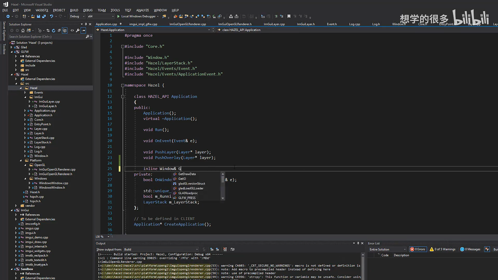

## 10. 公开 ImGuiLayer 并在 Sandbox 中作为 Overlay

*(参考时间: 00:22:30)*

为了让客户端创建 ImGuiLayer，`Hazel.h` 增加公开包含：

```cpp
#include "Hazel/ImGui/ImGuiLayer.h"
```

Sandbox 中把原先的 ExampleLayer 和 ImGuiLayer 一起加入：

```cpp
Sandbox()
{
    PushLayer(new ExampleLayer());
    PushOverlay(new ImGuiLayer());
}
```

ImGuiLayer 使用 Overlay：

- 在普通层之后渲染；
- 在事件传播中优先收到事件；
- 未来 UI 处理事件后，可以阻止游戏层收到同一次输入。

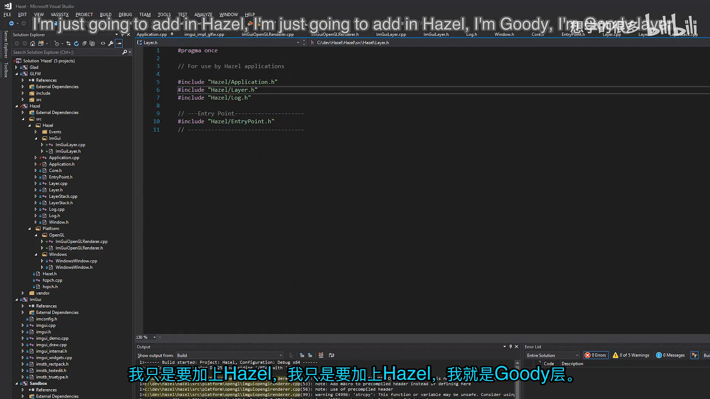

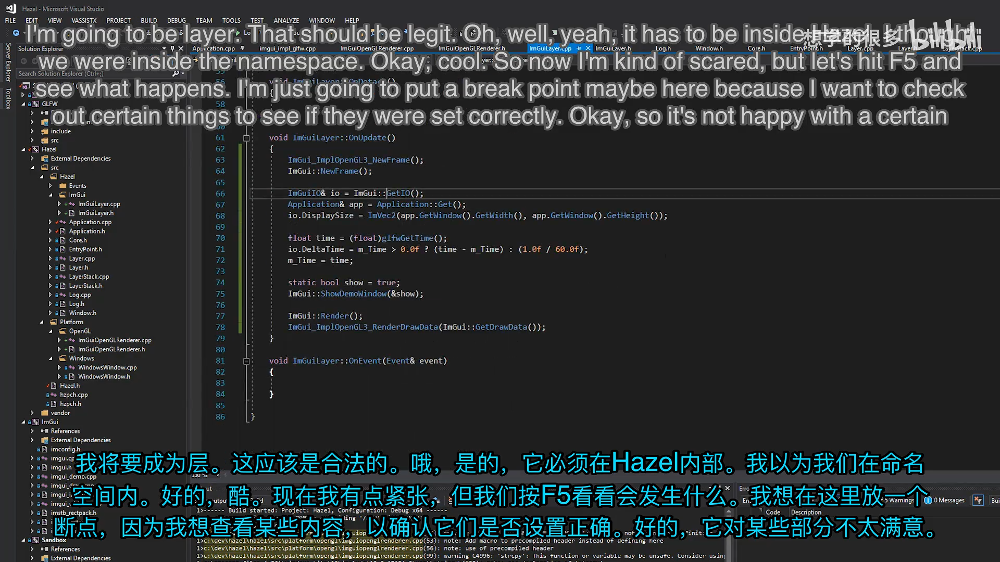

### 10.1 链接错误：导出 ImGuiLayer

第一次编译 Sandbox 时出现链接错误，提示找不到 `ImGuiLayer` 的无参数构造函数。实现明明已经存在，原因是类没有从 Hazel DLL 导出。

在类声明上加入 `HAZEL_API` 后，构造函数、析构函数和其它成员才会被正确导出，Sandbox 可以跨 DLL 边界创建 `ImGuiLayer`：

```cpp
class HAZEL_API ImGuiLayer : public Layer
```

这个错误说明：只要客户端要直接创建某个 Hazel 类型，类声明本身也必须处理好动态库导出，而不只是导出它继承的接口。

## 11. 修复 Layer 生命周期

*(参考时间: 00:23:50)*

链接问题修复后，程序继续运行，但 ImGui 立即触发断言。Cherno 判断 `ImGui::CreateContext()` 没有执行，随后发现 `Application::PushLayer()` 和 `Application::PushOverlay()` 只把 Layer 放进 `LayerStack`，却没有调用 `OnAttach()`。

修复后：

```cpp
void Application::PushLayer(Layer* layer)
{
    m_LayerStack.PushLayer(layer);
    layer->OnAttach();
}

void Application::PushOverlay(Layer* layer)
{
    m_LayerStack.PushOverlay(layer);
    layer->OnAttach();
}
```

问题修复在 `Application` 的入栈入口，而不是 `LayerStack` 自身；`LayerStack::PushLayer()` 和 `PushOverlay()` 仍然只负责容器操作。这样 ImGuiLayer 加入应用时才会执行 `OnAttach()`，创建 ImGui Context 并初始化 OpenGL3 渲染器。

编者说明：同一版本中的 `PopLayer()` 与 `PopOverlay()` 还没有调用 `OnDetach()`。从对称的生命周期设计看，之后应在移除 Layer 前补上；但这不是本讲提交里已经完成的行为。

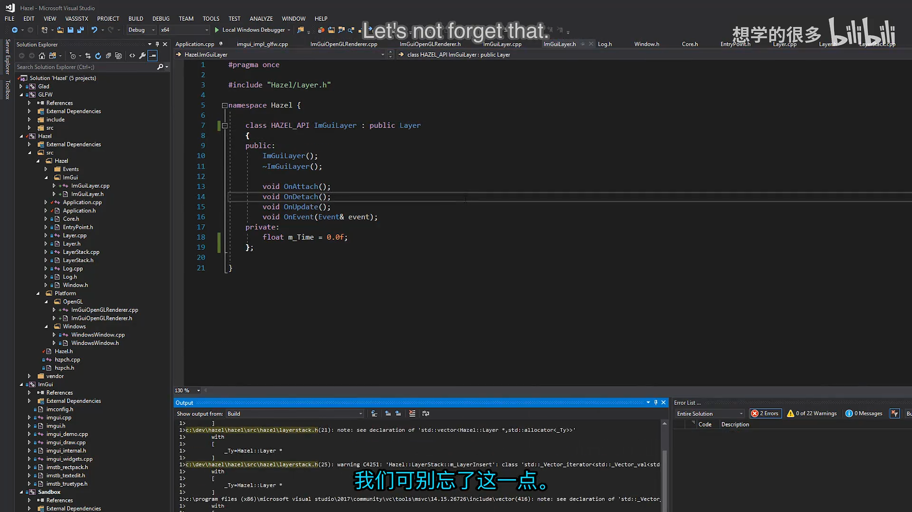

## 12. 第一次显示 ImGui

*(参考时间: 00:25:00)*

修复 `OnAttach()` 调用和 DisplaySize 初始化顺序后，Hazel 窗口中成功显示 ImGui Demo Window。

当前实现的状态：

| 能力 | 状态 |
|---|---|
| 创建 ImGui Context | 已完成 |
| GLFW 后端初始化 | 尚未接入 |
| OpenGL3 示例渲染器初始化 | 已完成 |
| 每帧 NewFrame / Render | 已完成 |
| Demo Window 渲染 | 已完成 |
| 鼠标移动、点击和键盘交互 | 尚未完成 |
| 鼠标光标形状 | 尚未完成 |
| 经过 Hazel Renderer | 后续重构 |
| OnDetach 资源清理 | 尚未实现 |

ImGui 已经能绘制，但无法移动、折叠或点击控件，因为没有把 Hazel 事件和 GLFW 输入状态同步到 `ImGuiIO`。鼠标位置、按钮状态、按键按下状态、修饰键和滚轮都需要在下一讲补齐。

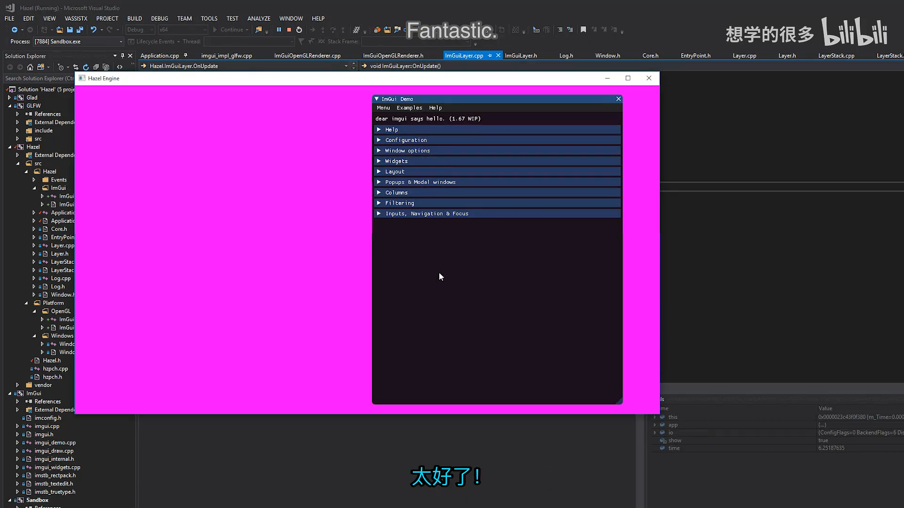

## 13. 事件交互的下一步

*(参考时间: 00:25:11)*

要让 ImGui 完全可交互，需要参考 `imgui_impl_glfw.cpp`：

- `KeyCallback`：设置 `io.KeysDown` 和修饰键；
- `CharCallback`：输入字符文本；
- `MouseButtonCallback`：更新鼠标按钮状态；
- `CursorPosCallback`：更新鼠标位置；
- `ScrollCallback`：更新滚轮；
- 每帧同步鼠标位置和按钮；
- 设置鼠标光标形状；
- 让 ImGui 消费事件并阻止游戏层误处理。

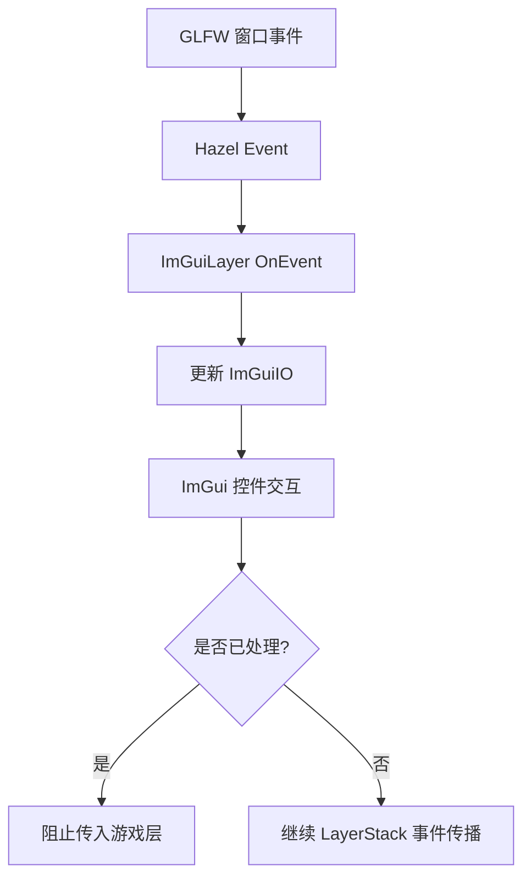

这段逻辑计划在下一讲完成。

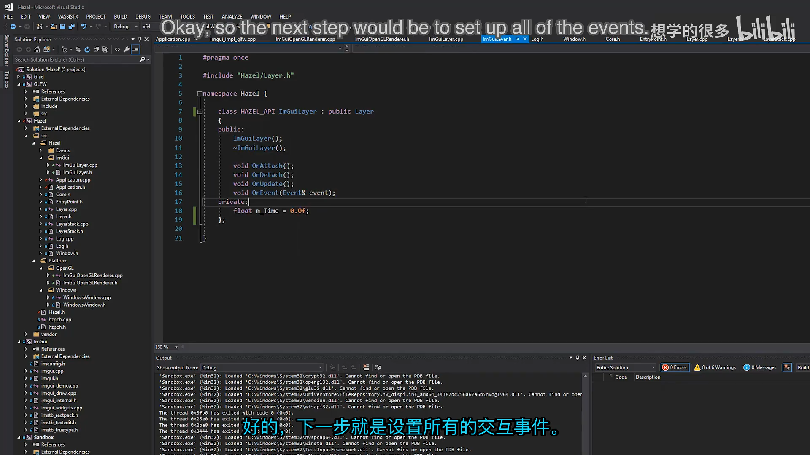

## 14. 当前实现的边界

本讲的目标是“先让它工作”，因此存在明确的技术债：

### 14.1 直接依赖 OpenGL

ImGui 的绘制数据直接交给 OpenGL3 后端，没有经过 Hazel Renderer。未来 Renderer 成熟后，应替换为 Hazel 的绘制接口。

### 14.2 直接依赖 GLFW

ImGuiLayer 暂时包含 GLFW，并使用 GLFW 的时间和键码。这破坏了平台抽象。

### 14.3 临时键映射

键映射直接来自 ImGui GLFW 示例。最终应转换为 Hazel 自己的键码。

### 14.4 事件尚未接入

本节只验证渲染链路。没有事件同步时，Demo Window 只是静态画面，无法交互。

### 14.5 Application 单例

当前增加单例是为了快速取得 DisplaySize。它解决眼前问题，但也把“一个进程只有一个 Application”的限制写进运行时约束。

### 14.6 OnDetach 尚未清理资源

`ImGuiLayer::OnDetach()` 和析构函数都是空的，没有关闭 OpenGL3 后端或销毁 ImGui Context。后续需要补齐资源释放，避免长期运行时留下全局状态。

这些限制不是最终设计，而是为下一阶段提供可运行的调试基础。

## 15. 本节结论

本节完成了 Hazel 的第一次真正 UI 渲染：

- 用 Git 子模块引入 Dear ImGui；
- 用 Premake 编译并链接 ImGui；
- 创建继承 Layer 的 ImGuiLayer；
- 给 ImGuiLayer 增加 `HAZEL_API` 导出，使 Sandbox 能跨 DLL 创建它；
- 在 `OnAttach()` 初始化 ImGui Context、键码映射和 OpenGL3 示例渲染器；
- 在 `OnUpdate()` 先同步 DisplaySize 和 DeltaTime，再执行 NewFrame、Render 和 RenderDrawData；
- 用 Application 单例和 GetWindow 设置 DisplaySize；
- 修复 Application 入栈入口未调用 OnAttach 的生命周期缺陷；
- 将 ImGuiLayer 作为 Overlay 显示 Demo Window。

虽然这是临时 hack，但它让 Hazel 第一次拥有了可视化调试界面。接下来先补全 ImGui 输入事件，再逐步把渲染从直接 OpenGL 重构到 Hazel Renderer。

## 附：官方参考

- [Bilibili 精译视频：015 - ImGui](https://www.bilibili.com/video/BV1wtLazEEmC/?p=15)
- [The Cherno 游戏引擎系列播放列表](https://www.youtube.com/playlist?list=PLlrATfBNZ98dC-V-N3m0Go4deliWHPFwT5)
- [The Cherno 的 Hazel 仓库](https://github.com/TheCherno/Hazel)
- [本期对应代码提交 `c65520c`](https://github.com/TheCherno/Hazel/tree/c65520c96289ab62ecd37995108063ce4019d4e9)
- [Dear ImGui](https://github.com/ocornut/imgui)
