# Hazel 游戏引擎笔记 016：把 ImGui 接入 Hazel 事件系统

> 本节来源：[The Cherno 游戏引擎系列第 16 讲“ImGui 事件”](https://www.bilibili.com/video/BV1wtLazEEmC/?p=16)，时长约 23 分 02 秒。  
> 原课程与 Hazel 代码作者：The Cherno。代码参考提交：[`709b40de`](https://github.com/TheCherno/Hazel/tree/709b40de15b6c46db7746c7feb4b2dd98397df99)。  
> 本文由视频字幕重构、翻译并整理，不是官方教材；术语和代码以原视频及同期 Hazel 仓库为准。

## 本节目标

上一讲已经能让 Dear ImGui 在 Hazel 窗口中显示 Demo Window，但它只能看、不能操作。本讲把 Hazel 的事件系统接进 `ImGuiLayer`，让鼠标、键盘和窗口缩放真正驱动 ImGui。

完成后的能力包括：

- 鼠标移动、点击、拖拽和滚轮；
- 移动、折叠 ImGui 窗口并操作控件；
- 键盘按键按下与释放状态；
- Ctrl、Shift、Alt、Super 修饰键；
- 向 ImGui 文本框输入字符；
- 窗口缩放后保持正确的显示尺寸和 OpenGL viewport。

整条链路可以概括为：

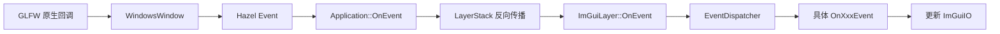

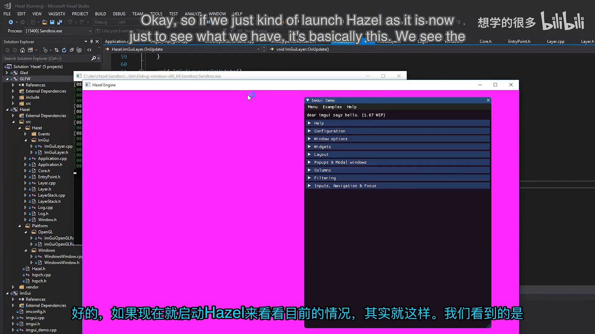

## 1. 从 ImGui 的 GLFW 后端借鉴实现

*(参考时间: 00:03:02)*

最直接的参考对象是 Dear ImGui 自带的 `imgui_impl_glfw.cpp`。其中已经处理了 GLFW 的回调，并把输入状态写入 `ImGuiIO`：

- Key callback 更新按键状态；
- Scroll callback 更新滚轮；
- Mouse button callback 更新鼠标按钮；
- Cursor position callback 更新鼠标位置；
- Char callback 提供实际输入的字符。

例如，键盘回调会执行类似逻辑：

```cpp
io.KeysDown[key] = true;
```

这里的 `key` 并不是直接作为 ImGui 内部数组下标使用，而是与上一讲配置的 `io.KeyMap` 对应。Hazel 本讲不会照搬整个后端，而是参考它的数据流，用 Hazel 自己的 `Event` 和 `EventDispatcher` 重新实现。

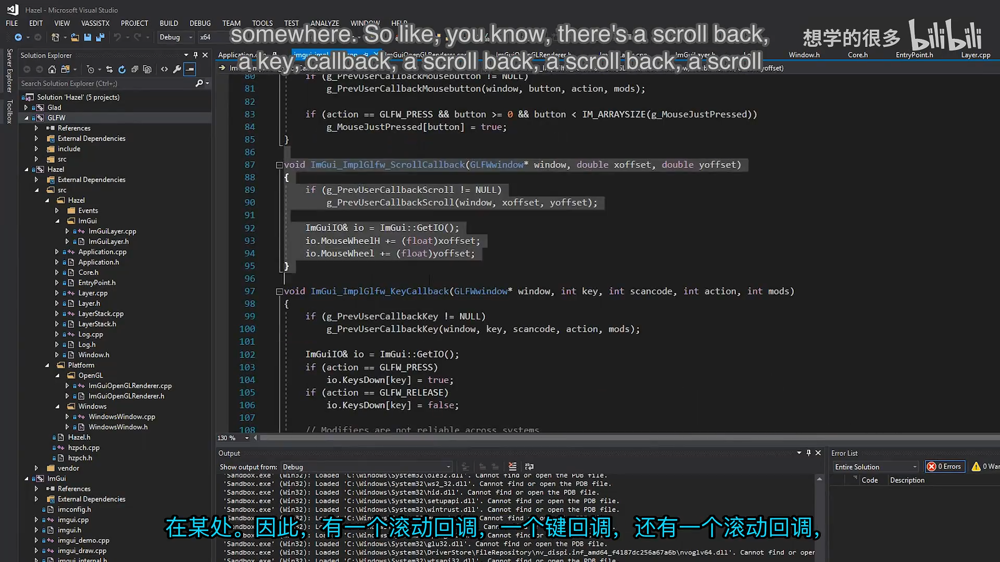

## 2. 在 ImGuiLayer 中声明事件处理函数

*(参考时间: 00:04:21)*

`ImGuiLayer` 需要处理几乎所有常见输入事件。头文件先包含三类 Hazel 事件：

```cpp
#include "Hazel/Events/ApplicationEvent.h"
#include "Hazel/Events/KeyEvent.h"
#include "Hazel/Events/MouseEvent.h"
```

然后为每类事件声明一个私有处理函数。处理函数返回 `bool`，表示该事件是否已经被消费：

```cpp
class HAZEL_API ImGuiLayer : public Layer
{
public:
    ImGuiLayer();
    ~ImGuiLayer();

    void OnAttach();
    void OnDetach();
    void OnUpdate();
    void OnEvent(Event& event);
private:
    bool OnMouseButtonPressedEvent(
        MouseButtonPressedEvent& e);
    bool OnMouseButtonReleasedEvent(
        MouseButtonReleasedEvent& e);
    bool OnMouseMovedEvent(MouseMovedEvent& e);
    bool OnMouseScrolledEvent(MouseScrolledEvent& e);
    bool OnKeyPressedEvent(KeyPressedEvent& e);
    bool OnKeyReleasedEvent(KeyReleasedEvent& e);
    bool OnKeyTypedEvent(KeyTypedEvent& e);
    bool OnWindowResizeEvent(WindowResizeEvent& e);
private:
    float m_Time = 0.0f;
};
```

事件处理的职责非常明确：把 Hazel 事件中的数据翻译成 ImGui 需要维护的状态。

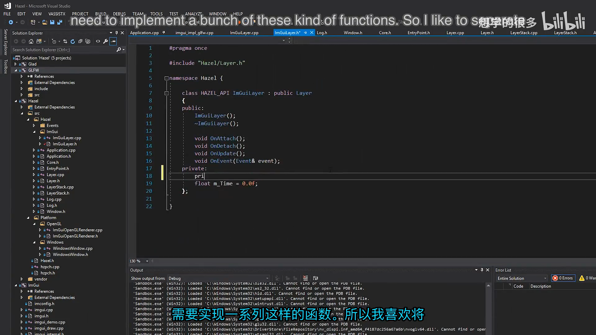

## 3. 用 EventDispatcher 分发事件

*(参考时间: 00:07:09)*

`ImGuiLayer::OnEvent()` 只负责判断事件类型，然后把事件转交给对应函数。判断工作交给 `EventDispatcher`：

```cpp
void ImGuiLayer::OnEvent(Event& event)
{
    EventDispatcher dispatcher(event);

    dispatcher.Dispatch<MouseButtonPressedEvent>(
        HZ_BIND_EVENT_FN(
            ImGuiLayer::OnMouseButtonPressedEvent));
    dispatcher.Dispatch<MouseButtonReleasedEvent>(
        HZ_BIND_EVENT_FN(
            ImGuiLayer::OnMouseButtonReleasedEvent));
    dispatcher.Dispatch<MouseMovedEvent>(
        HZ_BIND_EVENT_FN(ImGuiLayer::OnMouseMovedEvent));
    dispatcher.Dispatch<MouseScrolledEvent>(
        HZ_BIND_EVENT_FN(ImGuiLayer::OnMouseScrolledEvent));
    dispatcher.Dispatch<KeyPressedEvent>(
        HZ_BIND_EVENT_FN(ImGuiLayer::OnKeyPressedEvent));
    dispatcher.Dispatch<KeyTypedEvent>(
        HZ_BIND_EVENT_FN(ImGuiLayer::OnKeyTypedEvent));
    dispatcher.Dispatch<KeyReleasedEvent>(
        HZ_BIND_EVENT_FN(ImGuiLayer::OnKeyReleasedEvent));
    dispatcher.Dispatch<WindowResizeEvent>(
        HZ_BIND_EVENT_FN(ImGuiLayer::OnWindowResizeEvent));
}
```

### 3.1 减少回调绑定样板代码

成员函数需要绑定当前 `ImGuiLayer` 实例，再保留一个事件参数占位符。直接写 `std::bind` 会非常冗长，因此在 `Core.h` 中增加宏：

```cpp
#define HZ_BIND_EVENT_FN(fn) \
    std::bind(&fn, this, std::placeholders::_1)
```

于是 `HZ_BIND_EVENT_FN(ImGuiLayer::OnMouseMovedEvent)` 会生成一个可交给 `EventDispatcher` 调用的函数对象。

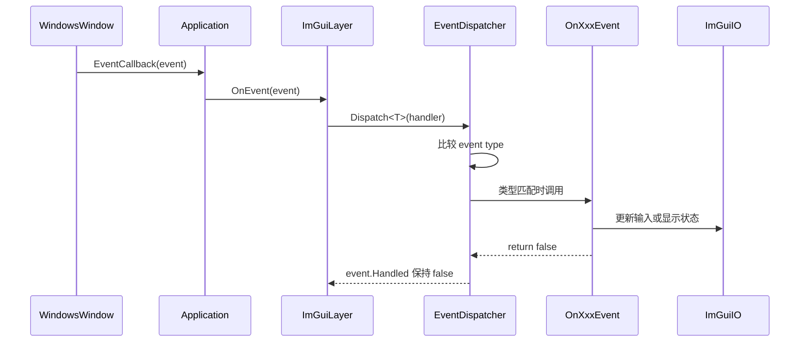

多个处理函数返回 `false`，表示 ImGuiLayer 更新了 ImGui 状态，但不独占事件。这样事件仍能继续传给其它 Layer。

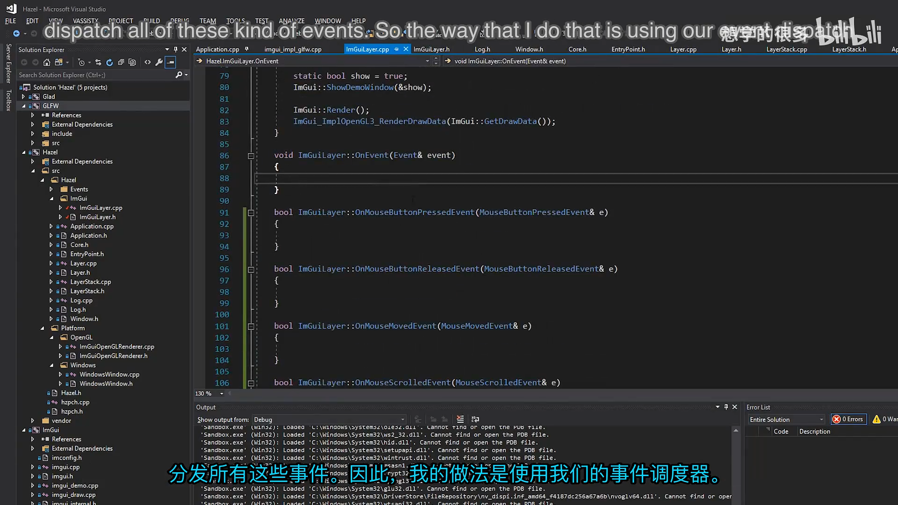

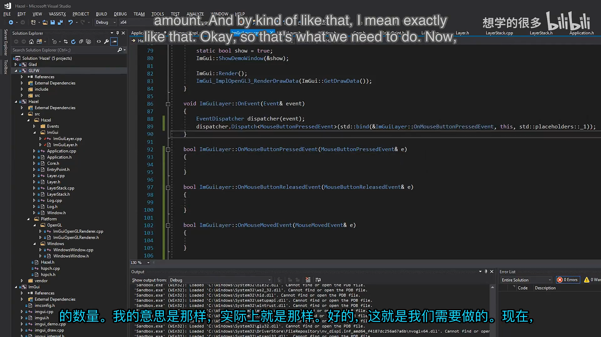

## 4. 接入鼠标事件

*(参考时间: 00:10:03)*

鼠标事件是验证整条链路最直接的一组输入。

### 4.1 鼠标按钮

按下时把对应按钮设为 `true`，释放时设为 `false`：

```cpp
bool ImGuiLayer::OnMouseButtonPressedEvent(
    MouseButtonPressedEvent& e)
{
    ImGuiIO& io = ImGui::GetIO();
    io.MouseDown[e.GetMouseButton()] = true;

    return false;
}

bool ImGuiLayer::OnMouseButtonReleasedEvent(
    MouseButtonReleasedEvent& e)
{
    ImGuiIO& io = ImGui::GetIO();
    io.MouseDown[e.GetMouseButton()] = false;

    return false;
}
```

虽然 ImGui 已经能收到按钮状态，但当前无法判断鼠标是否真的落在某个 ImGui 控件上，因此仍然返回 `false`。这样其它 Layer 也有机会处理同一次点击，而不是所有鼠标事件都被 ImGuiLayer 吃掉。

### 4.2 鼠标移动

```cpp
bool ImGuiLayer::OnMouseMovedEvent(MouseMovedEvent& e)
{
    ImGuiIO& io = ImGui::GetIO();
    io.MousePos = ImVec2(e.GetX(), e.GetY());

    return false;
}
```

### 4.3 滚轮

Hazel 的 `MouseScrolledEvent` 分别提供水平与垂直偏移：

```cpp
bool ImGuiLayer::OnMouseScrolledEvent(
    MouseScrolledEvent& e)
{
    ImGuiIO& io = ImGui::GetIO();
    io.MouseWheelH += e.GetXOffset();
    io.MouseWheel += e.GetYOffset();

    return false;
}
```

这里使用累加而不是直接赋值，因为一帧中可能收到多次滚轮事件。

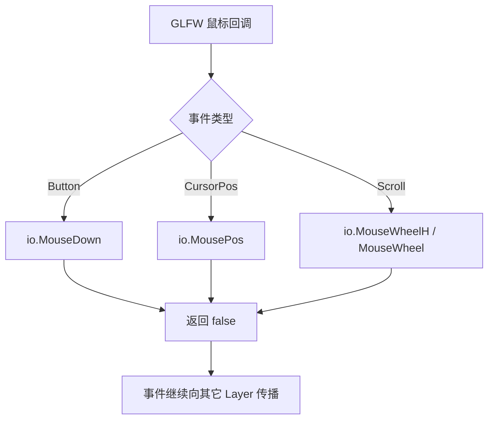

完成鼠标部分后，已经可以移动 ImGui 窗口、展开节点并对控件点击和拖拽。

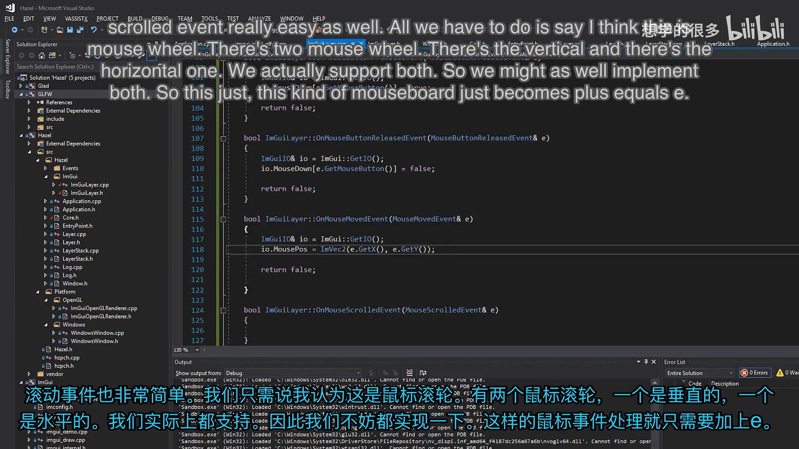

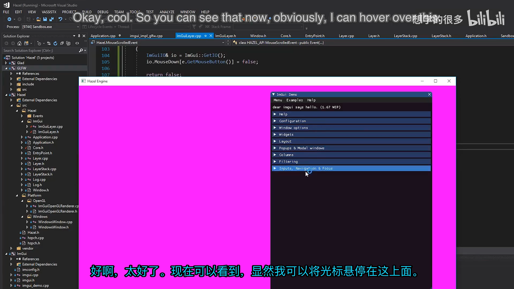

## 5. 处理窗口缩放

*(参考时间: 00:13:10)*

窗口尺寸变化不仅影响布局，也影响 ImGui 的显示区域和 OpenGL 的实际渲染范围。

第一次编译时提示找不到 `WindowResizeEvent`，因为 ImGuiLayer 还没有包含 `ApplicationEvent.h`。补上头文件后实现：

```cpp
bool ImGuiLayer::OnWindowResizeEvent(
    WindowResizeEvent& e)
{
    ImGuiIO& io = ImGui::GetIO();
    io.DisplaySize = ImVec2(e.GetWidth(), e.GetHeight());
    io.DisplayFramebufferScale = ImVec2(1.0f, 1.0f);

    glViewport(0, 0, e.GetWidth(), e.GetHeight());

    return false;
}
```

三个更新分别解决：

- `DisplaySize`：告诉 ImGui 新的逻辑窗口尺寸；
- `DisplayFramebufferScale`：暂时固定为 `1:1`，本讲不处理高 DPI；
- `glViewport`：把 OpenGL 输出映射到新的窗口区域。

`glViewport` 需要 Glad：

```cpp
#include <glad/glad.h>
```

这里直接修改 OpenGL viewport 是明确的临时方案，因为 Hazel 还没有自己的 Renderer。当前它能让缩放立即生效，但未来应由渲染抽象统一管理。

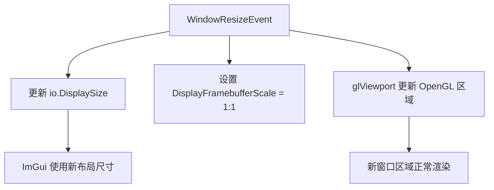

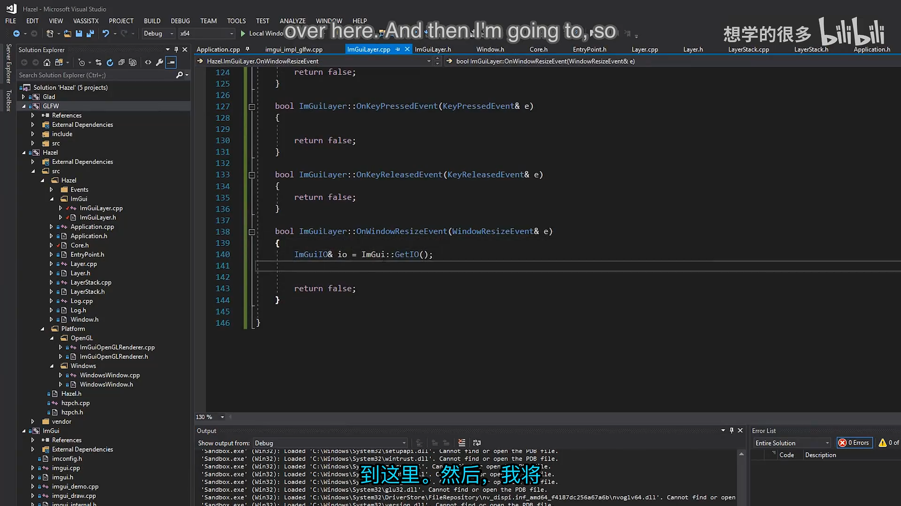

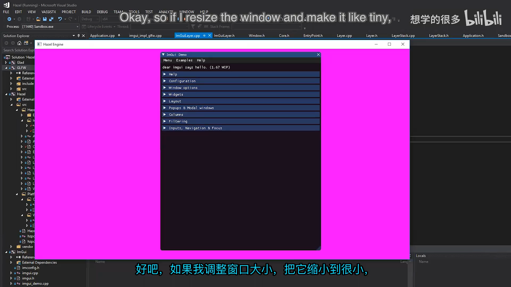

## 6. 接入键盘状态与修饰键

*(参考时间: 00:14:45)*

键盘按下与释放首先更新 ImGui 的按键数组：

```cpp
bool ImGuiLayer::OnKeyPressedEvent(KeyPressedEvent& e)
{
    ImGuiIO& io = ImGui::GetIO();
    io.KeysDown[e.GetKeyCode()] = true;
    // 随后更新修饰键

    return false;
}

bool ImGuiLayer::OnKeyReleasedEvent(KeyReleasedEvent& e)
{
    ImGuiIO& io = ImGui::GetIO();
    io.KeysDown[e.GetKeyCode()] = false;

    return false;
}
```

### 6.1 修饰键

ImGui 不直接依赖左右 Ctrl 或左右 Shift，而是使用统一的修饰键状态。`OnKeyPressedEvent()` 在更新按键数组后重新计算：

```cpp
io.KeyCtrl =
    io.KeysDown[GLFW_KEY_LEFT_CONTROL] ||
    io.KeysDown[GLFW_KEY_RIGHT_CONTROL];

io.KeyShift =
    io.KeysDown[GLFW_KEY_LEFT_SHIFT] ||
    io.KeysDown[GLFW_KEY_RIGHT_SHIFT];

io.KeyAlt =
    io.KeysDown[GLFW_KEY_LEFT_ALT] ||
    io.KeysDown[GLFW_KEY_RIGHT_ALT];

io.KeySuper =
    io.KeysDown[GLFW_KEY_LEFT_SUPER] ||
    io.KeysDown[GLFW_KEY_RIGHT_SUPER];
```

只要左右任意一侧按下，统一状态就为真。Super 对应 Windows 键或 macOS 的 Command 键，使用平台无关的命名。

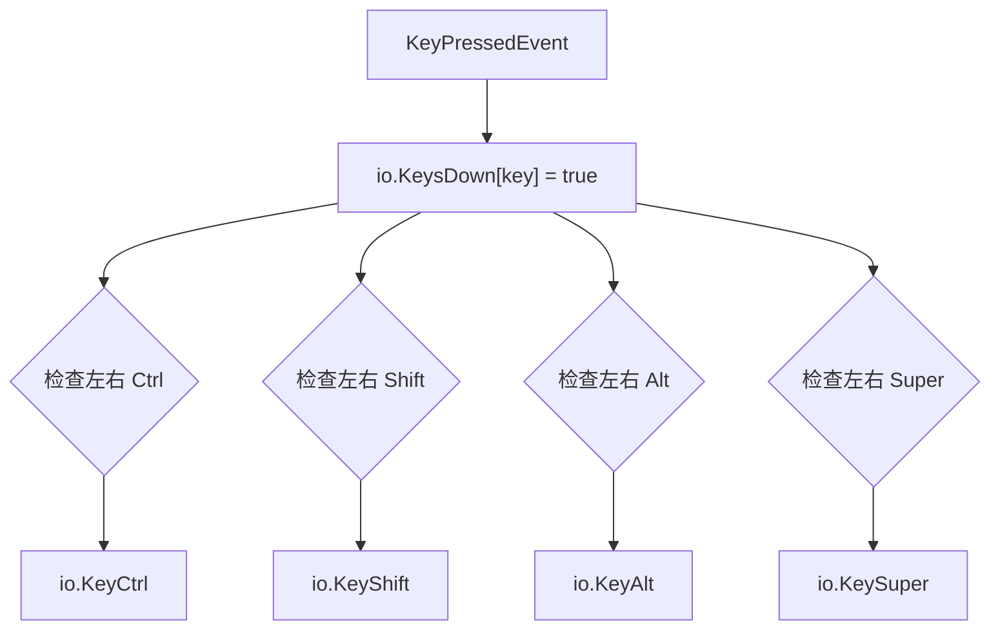

编者说明：该官方提交只在 `OnKeyPressedEvent()` 中重算修饰键，`OnKeyReleasedEvent()` 只把具体键设为 `false`。因此释放 Ctrl、Shift、Alt 或 Super 时，对应统一状态要等下一次按键事件才会刷新。这个细节与后续替换 Hazel 键码、完善输入系统的工作直接相关。

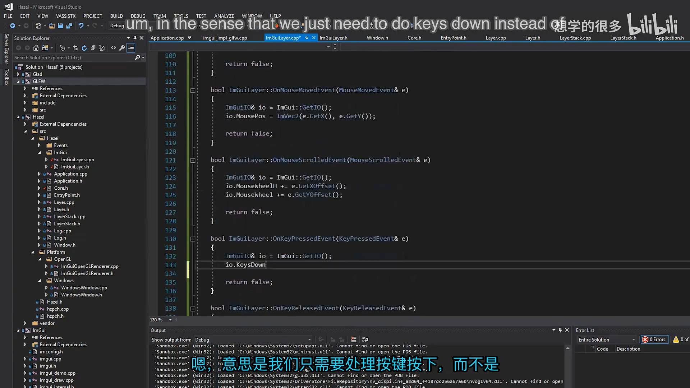

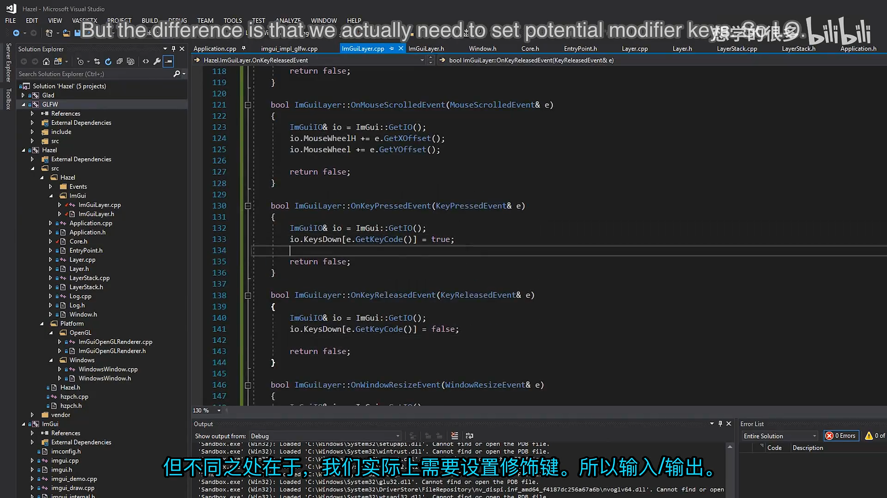

## 7. 新增 KeyTypedEvent

*(参考时间: 00:16:26)*

普通键盘事件传递的是物理键码，但文本框需要的是用户实际输入的字符。例如 Shift 与 `1` 可能产生 `!`，而不同键盘布局也可能生成不同字符。

ImGui 的 GLFW 后端使用 `glfwSetCharCallback` 处理这一层。Hazel 目前没有对应的“字符输入”事件，因此需要新增 `KeyTypedEvent`。

### 7.1 扩展事件类型

在 `Event.h` 的 `EventType` 中加入：

```cpp
enum class EventType
{
    None = 0,
    WindowClose, WindowResize, WindowFocus,
    WindowLostFocus, WindowMoved,
    AppTick, AppUpdate, AppRender,
    KeyPressed, KeyReleased, KeyTyped,
    MouseButtonPressed, MouseButtonReleased,
    MouseMoved, MouseScrolled
};
```

### 7.2 定义 KeyTypedEvent

`KeyTypedEvent` 复用 `KeyEvent` 的键码字段，但不再保存重复次数：

```cpp
class HAZEL_API KeyTypedEvent : public KeyEvent
{
public:
    KeyTypedEvent(int keycode)
        : KeyEvent(keycode) {}

    std::string ToString() const override
    {
        std::stringstream ss;
        ss << "KeyTypedEvent: " << m_KeyCode;
        return ss.str();
    }

    EVENT_CLASS_TYPE(KeyTyped)
};
```

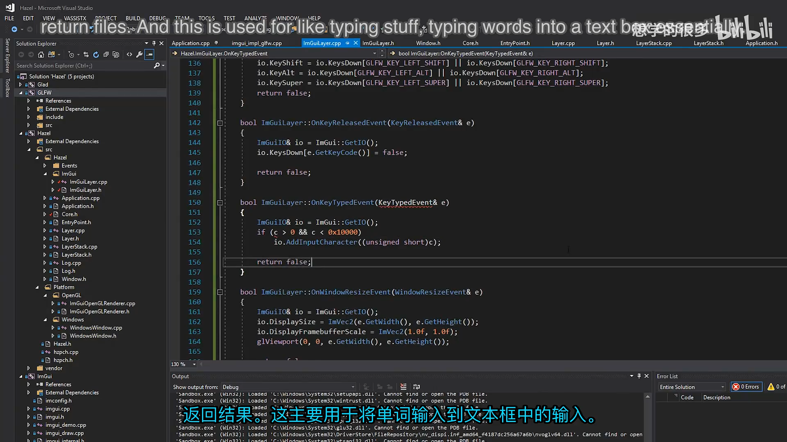

### 7.3 从 GLFW 捕获字符

`WindowsWindow` 除了设置 key callback，还增加 GLFW char callback：

```cpp
glfwSetCharCallback(
    m_Window,
    [](GLFWwindow* window, unsigned int keycode)
    {
        WindowData& data =
            *(WindowData*)glfwGetWindowUserPointer(window);

        KeyTypedEvent event(keycode);
        data.EventCallback(event);
    });
```

参数是无符号整数形式的 Unicode 字符码。

### 7.4 把字符交给 ImGui

```cpp
bool ImGuiLayer::OnKeyTypedEvent(KeyTypedEvent& e)
{
    ImGuiIO& io = ImGui::GetIO();
    int keycode = e.GetKeyCode();

    if (keycode > 0 && keycode < 0x10000)
        io.AddInputCharacter((unsigned short)keycode);

    return false;
}
```

`AddInputCharacter()` 接收 `unsigned short`，因此先检查字符码是否落在有效范围内，再安全转换。

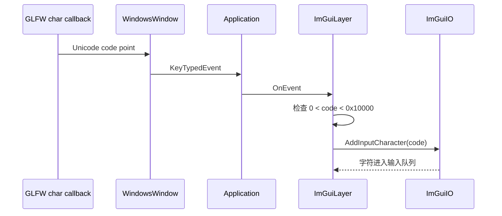

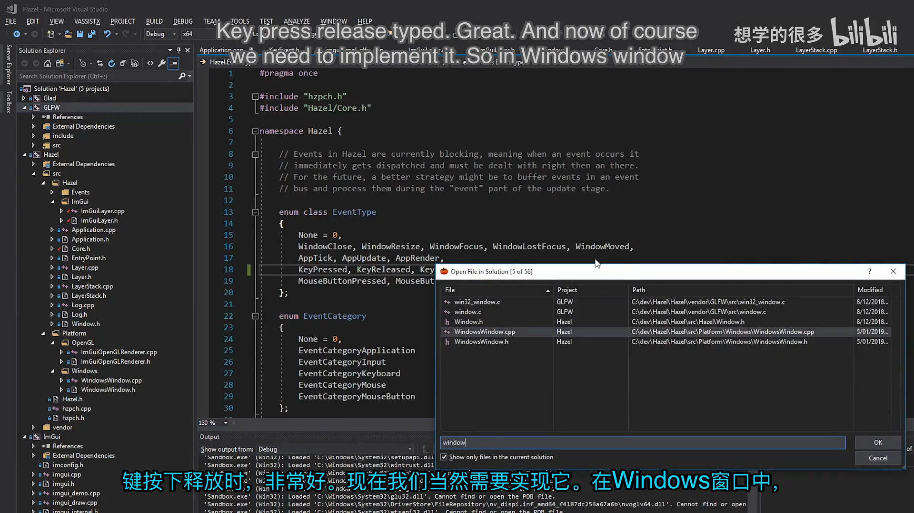

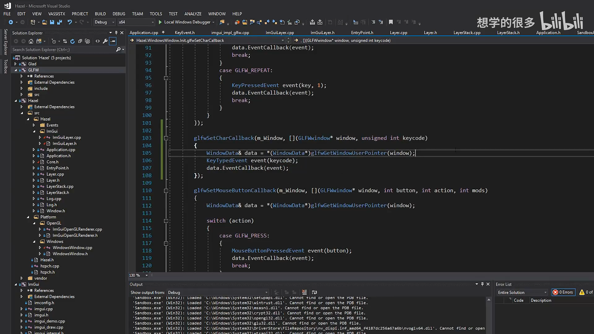

## 8. 完整交互测试

*(参考时间: 00:19:47)*

完成以上事件后，ImGui Demo Window 已经可以通过 Hazel 的事件系统完整接受常用输入：

| 输入 | 结果 |
|---|---|
| 鼠标移动 | 悬停与光标定位 |
| 鼠标点击、拖拽 | 按钮、节点、窗口移动 |
| 滚轮 | 列表和面板滚动 |
| 普通键 | 按键状态 |
| 字符输入 | 文本框字符 |
| Ctrl / Shift / Alt / Super | 修饰键状态 |
| 窗口缩放 | DisplaySize 与 viewport 同步 |

测试中可以打开 ImGui 的 Log 面板，在过滤框里输入 `hello`、数值或组合键操作，也能用 Ctrl+A 选中文本。

复制粘贴当时还不可用，因为 ImGui 的剪贴板回调尚未接入；视频把它留给读者作为练习。

Demo Window 的位置和尺寸也会保存到 `Sandbox/imgui.ini`，下次启动时可以恢复。

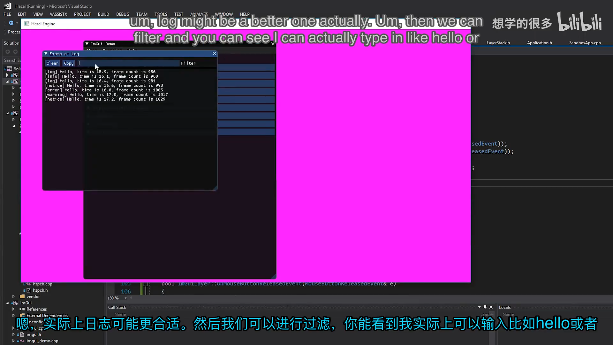

## 9. 当前实现的技术债

*(参考时间: 00:20:34)*

本讲让事件系统真正可用，但仍保留三处明显债务。

### 9.1 直接调用 glViewport

窗口缩放处理直接依赖 Glad 和 OpenGL：

```cpp
glViewport(0, 0, e.GetWidth(), e.GetHeight());
```

这是本讲最明显的临时耦合。未来 Hazel 有 Renderer 后，应通过渲染 API 设置 viewport。

### 9.2 仍使用 GLFW 键码

修饰键判断直接使用：

```cpp
GLFW_KEY_LEFT_CONTROL
GLFW_KEY_RIGHT_CONTROL
```

ImGuiLayer 仍然知道 GLFW 的具体键码。下一步应建立 Hazel 自己的键盘与鼠标编码，再由平台层完成转换。

### 9.3 只有事件，没有输入轮询

目前可以在输入发生时收到事件，但不能询问：

```text
Ctrl 现在是否按下？
鼠标左键现在是否按下？
```

客户端若只依赖事件，就必须自己维护所有键和鼠标按钮的当前状态。更好的设计是让 Hazel 内部保存状态，并提供统一的输入轮询 API。

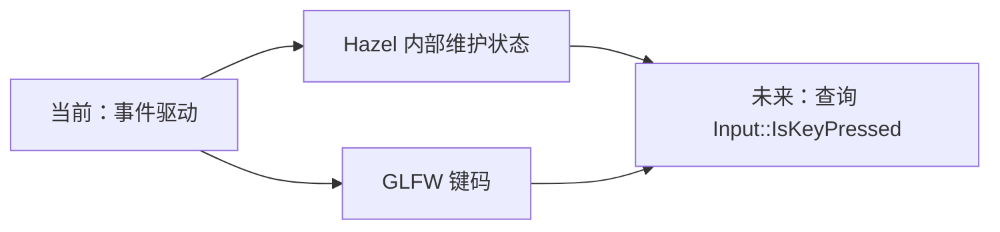

下一阶段预计会先处理 Hazel 键码与鼠标码，再继续实现输入轮询。

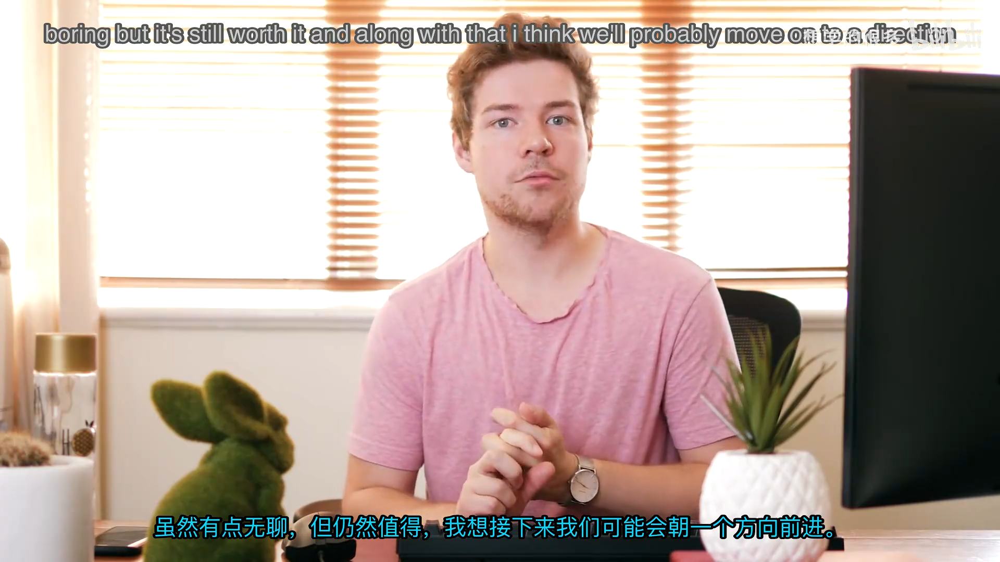

## 10. 本节结论

本讲把 Hazel 事件系统和 Dear ImGui 真正连接到一起：

- `ImGuiLayer` 增加鼠标、键盘和窗口缩放处理函数；
- `EventDispatcher` 根据事件类型路由到对应处理函数；
- `HZ_BIND_EVENT_FN` 简化成员函数绑定；
- 鼠标按钮、位置和滚轮状态写入 `ImGuiIO`；
- 窗口缩放同步 `DisplaySize`、framebuffer scale 与 OpenGL viewport；
- 按键状态和左右修饰键写入 ImGui；
- 新增 `KeyTypedEvent`、GLFW char callback 和 `AddInputCharacter()`；
- ImGui 窗口现在已经可以移动、点击、滚动和输入文本。

这段实现证明了 Hazel 事件系统已经具备实用价值。接下来需要消除 GLFW 键码依赖，并加入输入轮询，让引擎 API 不只知道“刚刚发生了什么”，也能回答“现在处于什么状态”。

## 附：参考

- [Bilibili 精译视频：016 - ImGui 事件](https://www.bilibili.com/video/BV1wtLazEEmC/?p=16)
- [The Cherno 游戏引擎系列播放列表](https://www.youtube.com/playlist?list=PLlrATfBNZ98dC-V-N3m0Go4deliWHPFwT5)
- [本期对应代码提交 `709b40de`](https://github.com/TheCherno/Hazel/tree/709b40de15b6c46db7746c7feb4b2dd98397df99)
- [Dear ImGui](https://github.com/ocornut/imgui)
