# Hazel 游戏引擎笔记 018：通过 Pull Request 协作

> 本节来源：[The Cherno 游戏引擎系列第 18 讲“拉取请求”](https://www.bilibili.com/video/BV1wtLazEEmC/?p=18)，时长约 24 分 03 秒。  
> 原课程与 Hazel 代码作者：The Cherno。  
> 本文由视频字幕重构、翻译并整理，不是官方教材；PR 编号、合并结果和代码变化已结合同期 Hazel 仓库记录核对。

## 本节目标

上一讲讨论了 GitHub 的基础协作方式。本讲直接查看 Hazel 仓库中正在等待处理的 Pull Request，并演示一个完整的维护者工作流：

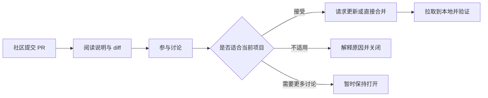

关键点不是“所有 PR 都必须合并”，而是让提案、理由、冲突和验证过程都公开可见。PR 同时承担三种功能：

- 提交代码变化；
- 讨论设计取舍；
- 记录为什么最终接受、修改或拒绝某项建议。

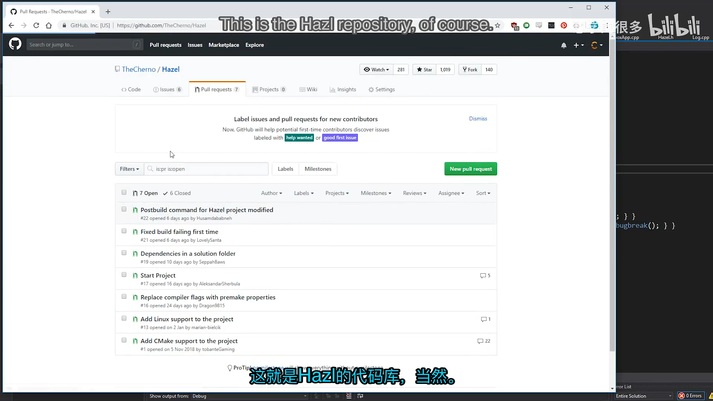

## 1. GitHub 协作不止是“提交代码”

*(参考时间: 00:00:15)*

很多编程教程只讲代码怎么写，却很少解释团队中如何共同维护同一套代码。Cherno 认为，Pull Request 是连接以下两件事的核心机制：

1. 代码在版本控制系统中如何演化；
2. 开发者如何讨论、审查和验证这些变化。

即使团队不使用 GitHub，分支、变更审查和合并的基本思想仍然适用于其它版本控制系统。PR 让一个改动从“某个人本地能运行”变成“项目可以共同理解和接受的变更”。

对学习 Hazel 的人来说，参与 PR 还有额外价值：读者不再只是逐集抄写代码，而是在真实分支、冲突、讨论和审查中体验软件工程。

### 1.1 讨论比“谁对谁错”更重要

Cherno 特别强调，社区讨论应该保持友好和安全。维护者可能忘记某个改动，也可能不知道更好的实现方式；参与者可以指出问题，但没有必要用技术优越感压制别人。

一个 PR 即使最终没有被合并，只要讨论清楚，也能成为所有参与者共同学习的记录。

## 2. 第一批讨论型 PR

*(参考时间: 00:03:46)*

仓库里有一些 PR 并没有立刻进入可合并状态，但它们很适合说明维护者如何评估提案。

### 2.1 用 unique_ptr 替换原始指针

> PR #2：`Use unique pointers instead of raw pointers`

提案希望把创建 Application 时的原始指针改成 `std::unique_ptr`，让资源自动释放。同时，PR 还增加了构建后复制 DLL 的步骤。

Cherno 解释了为什么不接受 unique_ptr 部分：

```cpp
int main(int argc, char** argv)
{
    Hazel::InitCore();

    auto app = Hazel::CreateApplication();
    app->Run();
    delete app;

    Hazel::ShutdownCore();
}
```

他的理由包括：

- Application 在进程生命周期中本来就只有一个；
- 他希望显式控制删除和 Shutdown 的顺序；
- `Hazel::Application*` 比 `std::unique_ptr<Hazel::Application>` 更直接；
- 原始指针并不自动等同于设计错误，关键是要有明确的所有权约定。

他还指出，`main()` 末尾的 `return 0;` 不是必需的，并引用 cppreference 对程序入口返回值的说明。构建后复制 DLL 的想法本身是好的，但下一集将切换到 Premake，手写 Visual Studio 工程的行为很快会过时。

这个 PR 展示了重要的一点：**提案可以包含多个变化，但维护者应逐项判断，而不是整包接受或整包拒绝。**

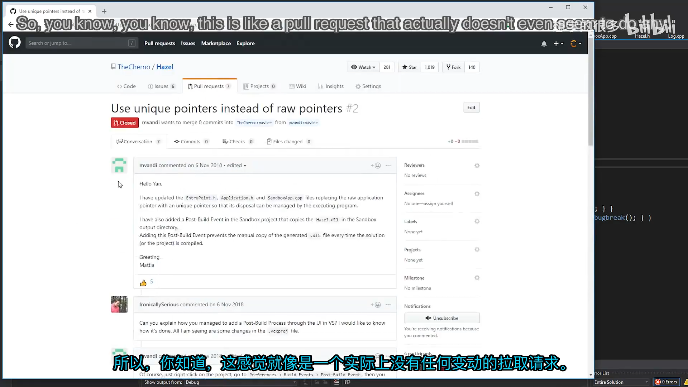

### 2.2 CMake 与 Premake 的重复维护

> PR #1：`Add CMake support to the project`

提案认为 CMake 能改善跨平台和 IDE 支持，尤其是在 CLion、VS Code 等环境中直接打开项目。讨论中支持者认为 CMake 通用，反对者则指出 Hazel 已经选择 Premake，同时维护两套构建系统会产生重复工作。

Cherno 倾向于继续使用 Premake：

- Premake 已经足够完成当前构建需求；
- Premake 使用 Lua 配置，语法更直接；
- 项目刚开始时同时引入 CMake 会增加维护面；
- 是否真正支持 Linux 和 macOS，还需要经过实际环境验证。

他在视频中没有立刻关闭这个 PR，而是保留讨论。

编者说明：从当前 GitHub 状态看，PR #1 后来被关闭且没有合并。视频记录的是当时的讨论状态，而不是最终仓库状态。

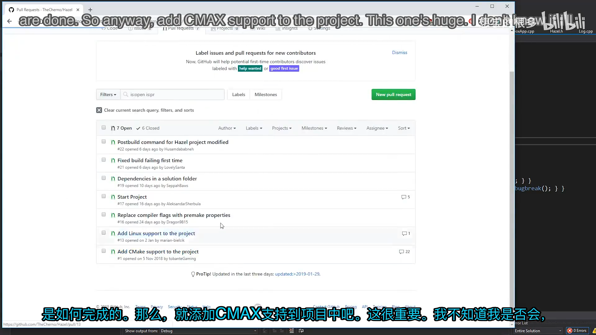

### 2.3 Linux 支持与分支冲突

> PR #13：`Add Linux support to the project`

Linux 支持涉及 Premake 配置、Linux 入口以及 GCC 编译问题，是一项比单个文件修复更大的改动。该 PR 当时已经产生冲突，说明它落后于主分支，不能直接合并。

Cherno 的回复不是简单拒绝，而是要求作者更新分支并确认可以构建：

```text
请更新这个分支，确认它已经准备好合并。
我很愿意把它合并进来。
```

这正是维护冲突 PR 的常见流程：

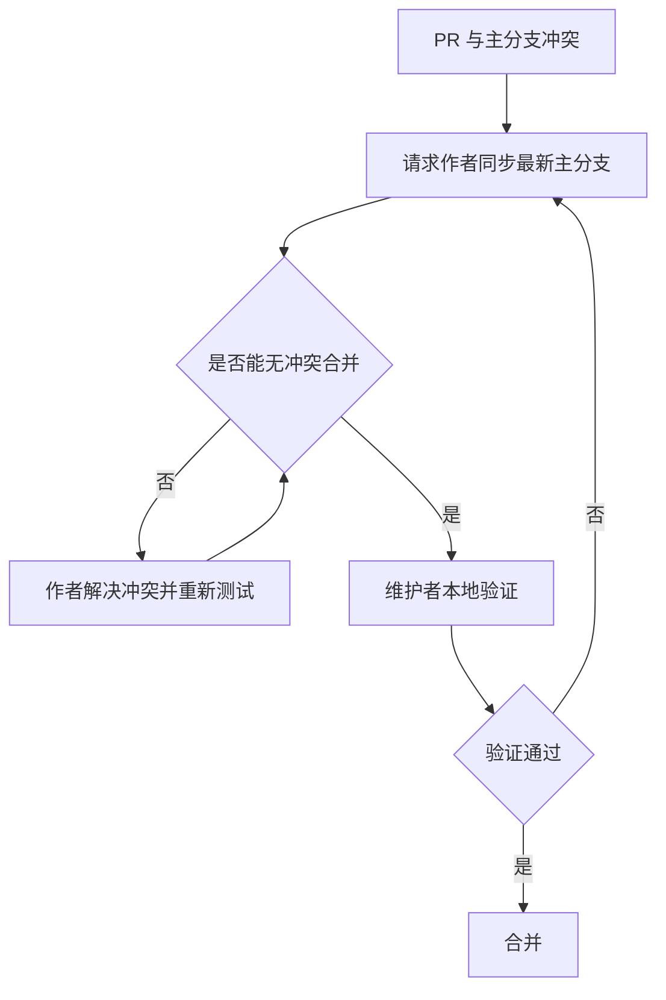

编者说明：该 PR 后来没有直接合并，而是转移到新的 Linux 支持 PR #27。

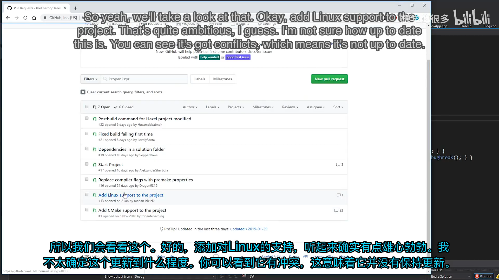

### 2.4 已经过时的编译参数 PR

> PR #16：`Replace compiler flags with premake properties`

该 PR 建议用 Premake 属性代替直接写 `/MDd`、`/MD` 等编译器参数：

```lua
filter "configurations:Debug"
    runtime "Debug"
    staticruntime "Off"

filter "configurations:Release"
    runtime "Release"
    staticruntime "Off"
```

但 Hazel 已经完成同类修改，因此这个 PR 不再需要。维护者把它标记为：

```text
Obsolete; this has already been done.
```

这提醒贡献者：**提交 PR 前先同步最新主分支，并检查是否已经有人完成相同改动。**

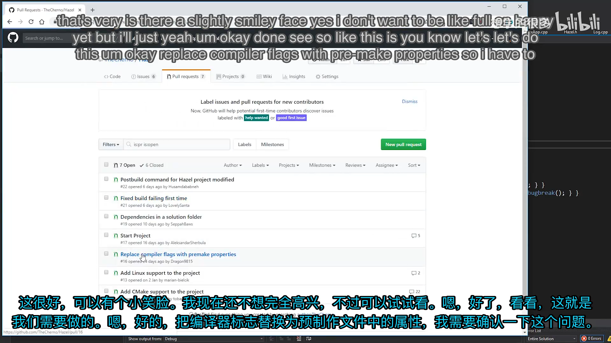

## 3. 合并 Start Project PR

*(参考时间: 00:10:00)*

一个较小 PR 为解决方案增加了启动项目。Premake 提供了 `startproject` 属性：

```lua
startproject "Sandbox"
```

这样 Visual Studio 打开解决方案后，会默认把 Sandbox 设为启动项目。

视频中先把这个属性放在项目作用域附近，随后 Premake 报错：

```text
Unable to set start project.
Project scope should be in workspace.
```

原因是 `startproject` 必须属于 workspace 作用域，而不是某个 project。正确位置是：

```lua
workspace "Hazel"
    architecture "x64"
    startproject "Sandbox"

    configurations
    {
        "Debug",
        "Release",
        "Dist"
    }
```

修正后，Sandbox 会立即成为默认启动项目。

这次错误也说明：**PR 被合并并不代表所有细节都已验证。维护者仍然应在本地拉取代码并运行。**

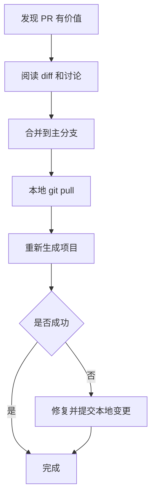

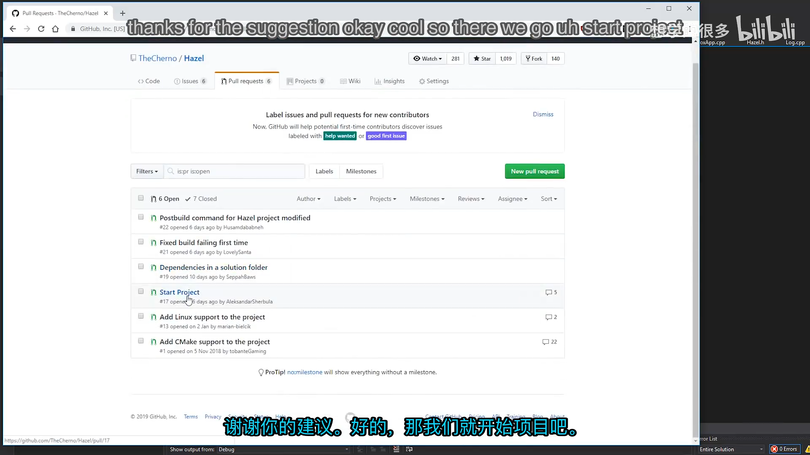

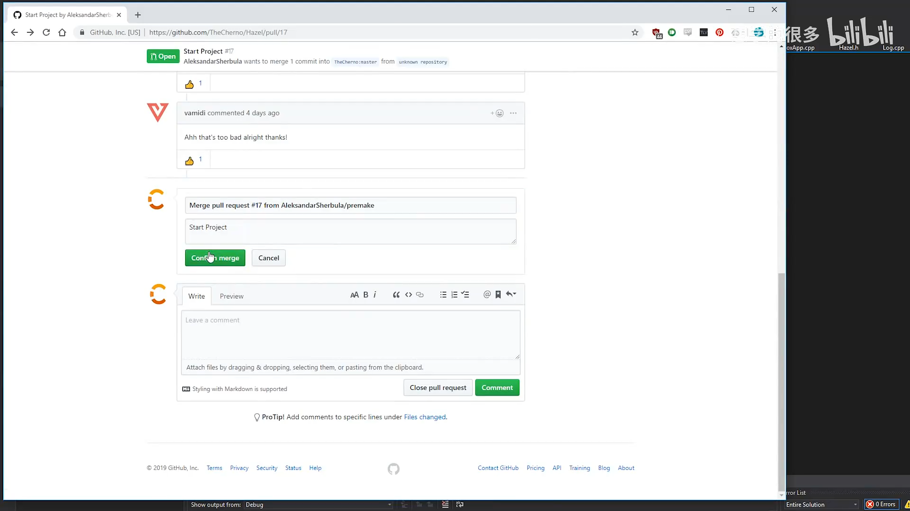

### 3.1 合并后同步本地仓库

*(参考时间: 00:11:27)*

GitHub 上的合并只改变远端仓库。维护者仍需要在本地执行同步：

```bash
git status
git pull
```

视频中本地还有未提交文件。此时先查看差异、补充提交，再拉取远端变化：

```bash
git add <files>
git commit -m "Now linking runtime library dynamically"
git push
git pull
```

如果本地提交和远端合并都修改了主分支，Git 可能生成一次 merge 提交。关键不是避免所有 merge commit，而是保证：

- 本地不存在误提交的临时文件；
- 提交信息能说明改动的目的；
- 拉取后重新构建并确认合并结果正常。

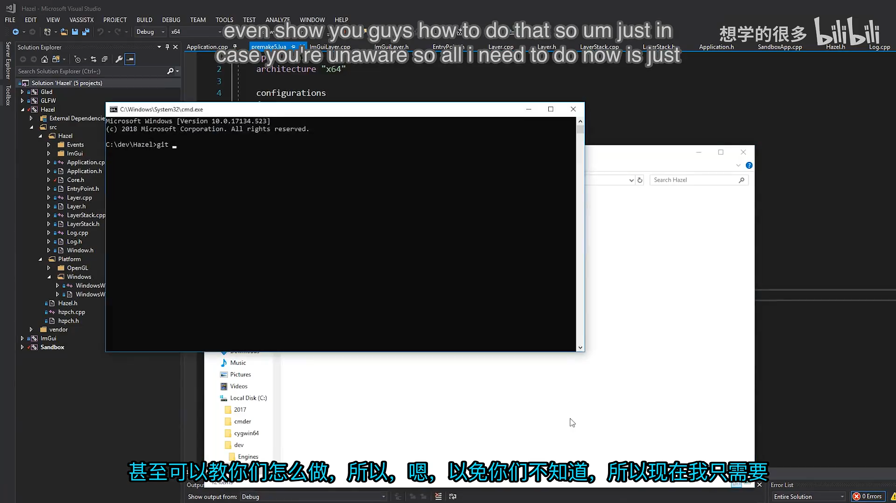

## 4. 解决依赖分组 PR 的冲突

*(参考时间: 00:14:07)*

> PR #19：`Dependencies in a solution folder`

该 PR 把第三方依赖从解决方案根目录移动到 `Dependencies` 分组，减少项目列表的杂乱程度：

```lua
group "Dependencies"
    include "Hazel/vendor/GLFW"
    include "Hazel/vendor/Glad"
    include "Hazel/vendor/imgui"

group ""
```

最后的 `group ""` 很重要，它表示依赖分组到此结束，后续项目重新回到默认分组。

不过维护者刚刚修改了同一个 `premake5.lua`，所以 PR 出现冲突，暂时不能合并。Cherno 要求作者更新分支：

```text
Please update this so that I can merge. 🙂
```

作者同步后回复 `There you go`，冲突被解决。

编者说明：该 PR 在视频之后才正式合并，但它展示的依赖分组方式最终进入了 Hazel 仓库。

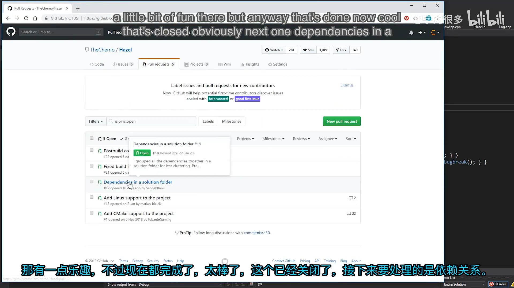

## 5. 修复首次构建失败

*(参考时间: 00:14:52)*

### 5.1 复现问题

问题发生在清理 `bin` 目录后第一次构建 Sandbox 时。Hazel DLL 已经生成，但构建后复制命令失败，因为目标 Sandbox 目录尚不存在。

复现过程是：

```text
删除 bin
  -> 重新生成 Visual Studio 工程
  -> 构建 Sandbox
  -> 后置复制命令失败
```

原命令类似：

```lua
postbuildcommands
{
    ("{COPY} %{cfg.buildtarget.relpath} ../bin/" ..
        outputdir .. "/Sandbox")
}
```

Premake 或 Windows 的复制行为把目标解释成文件而不是目录，导致第一次构建失败。

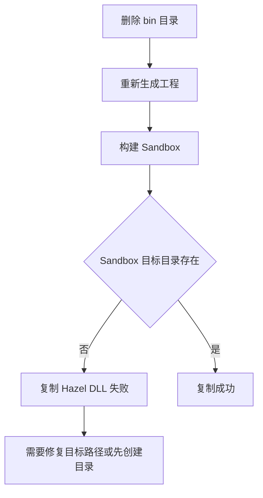

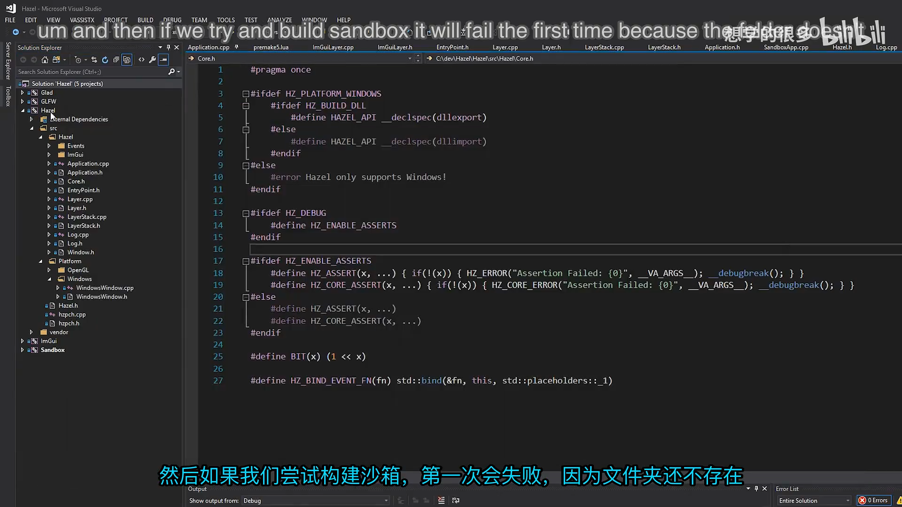

### 5.2 两种修复方案

> PR #21：`Fixed build failing first time`

第一种方案在复制前主动创建目录：

```lua
postbuildcommands
{
    ("IF NOT EXIST ../bin/" .. outputdir ..
        "/Sandbox mkdir ../bin/" .. outputdir .. "/Sandbox"),
    ("{COPY} %{cfg.buildtarget.relpath} ../bin/" ..
        outputdir .. "/Sandbox")
}
```

它能解决问题，但增加了一整条命令，而且只处理“目录不存在”这一种情况。

> PR #22：`Postbuild command for Hazel project modified`

第二种方案只修改目标路径格式：

```lua
postbuildcommands
{
    ("{COPY} %{cfg.buildtarget.relpath} " ..
        "\"../bin/" .. outputdir .. "/Sandbox/\"")
}
```

关键变化有两点：

- 目标路径增加引号；
- 路径末尾保留 `/`。

引号可以让 Premake 保留结尾斜杠，也避免路径中包含空格时被错误拆分。Windows 接收带结尾斜杠的路径后，会把它理解成目录。

Cherno 更喜欢第二种方案，因为改动更小、意图更清楚，不需要额外写 `IF NOT EXIST` 和 `mkdir`。

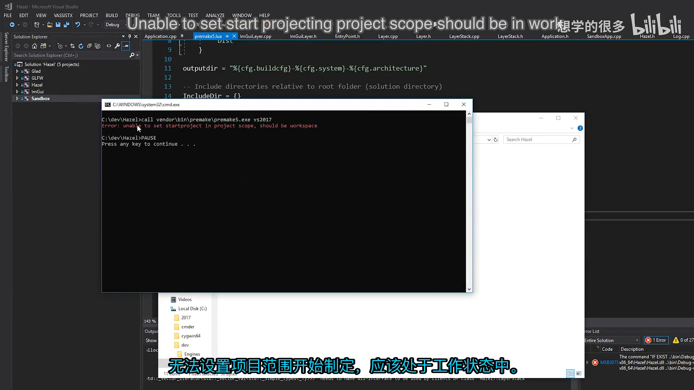

### 5.3 验证修复

修复后再次删除 `bin`，重新生成项目并构建 Sandbox。此次构建成功，说明路径在目录不存在时也能被正确创建或处理。

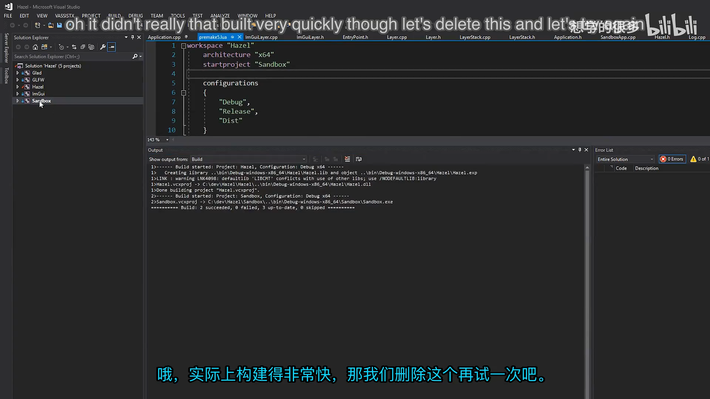

Cherno 没有直接替作者提交代码，而是请求贡献者更新自己的分支：

```text
Please update this so that I can merge it. 🙂
```

这样做既保留贡献记录，也让 PR 作者获得对应的协作信用。作者更新后，PR #22 被合并。

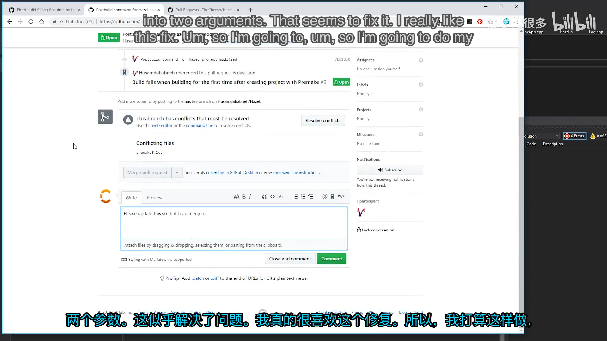

## 6. 如何自己提交一个 Pull Request

*(参考时间: 00:21:30)*

一个标准协作流程如下：

1. Fork Hazel 到自己的 GitHub 账号；
2. 克隆自己的 fork；
3. 创建描述明确的分支；
4. 完成修改并在本地构建、测试；
5. 提交并推送到自己的 fork；
6. 从功能分支向 Hazel 主分支发起 PR；
7. 在 PR 页面查看完整 diff；
8. 回应评论并更新分支；
9. 维护者验证后合并。

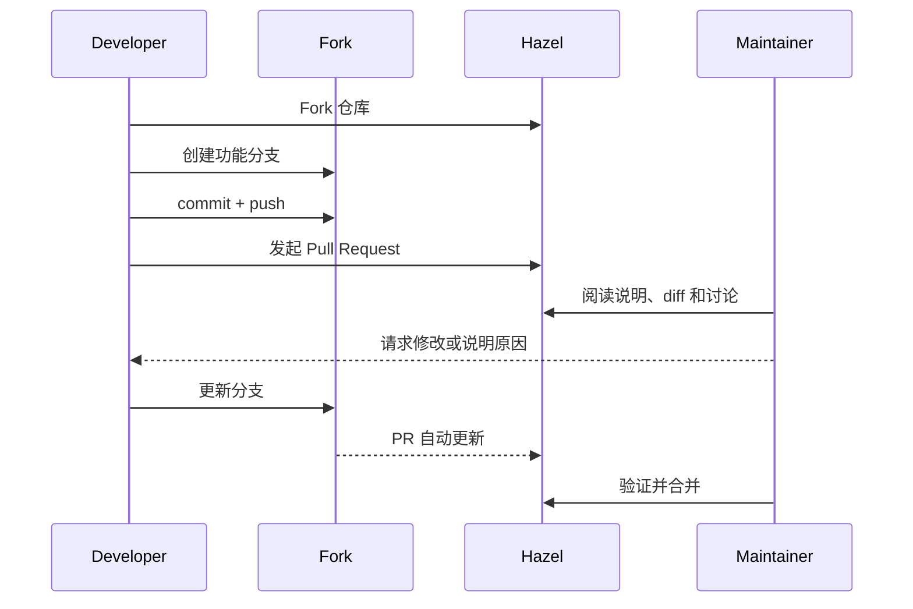

一个有效的 PR 说明至少应回答：

- 这个改动解决什么问题？
- 为什么采用当前方案？
- 修改了哪些模块？
- 如何构建和验证？
- 是否存在相关 Issue 或前序 PR？

在视频中，维护者会使用 `#22` 这样的引用链接把 PR 和 Issue 连接起来，保持讨论上下文可追踪。

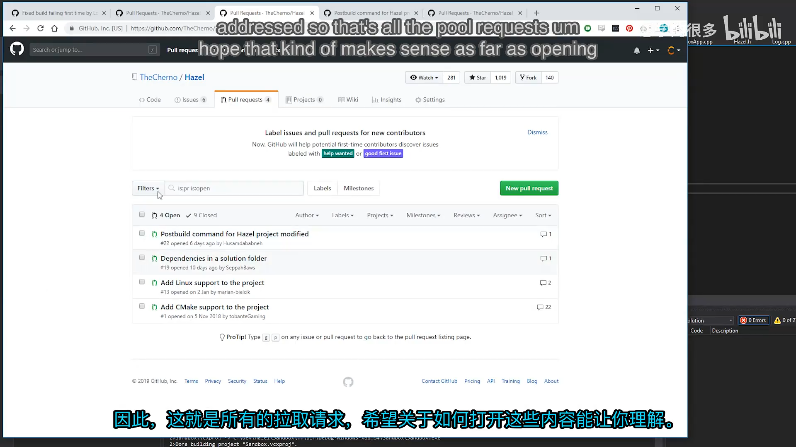

## 7. 维护者应该如何处理 Pull Request

本讲实际上给出了一个可复用的审查清单：

### 7.1 先理解动机，再看实现

PR 描述和讨论能说明作者为什么修改。只看 diff 容易把“设计方向不同”误判为“实现错误”。

### 7.2 逐项评估变化

一个 PR 可能有多个目的。维护者应分别判断每个部分，而不是整包接受。

### 7.3 在合并前测试

自动合并按钮不会替你运行项目。`startproject` 作用域错误和首次构建失败都说明，合并后仍需在本地重新生成并构建。

### 7.4 冲突时请求更新

如果 PR 落后于主分支，应要求作者 rebase 或合并最新主分支，而不是在维护者侧猜测冲突的正确解决方式。

### 7.5 给出明确结论

维护者可以选择：

| 结论 | 适用情况 |
|---|---|
| Merge | 方案合理、无冲突、验证通过 |
| Request update | 方向可行，但分支过期或实现需调整 |
| Keep open | 需要继续讨论，暂时不宜决定 |
| Close / obsolete | 已被其它改动覆盖 |
| Close / not planned | 与项目方向不一致，且已解释原因 |

### 7.6 保留贡献信用

如果贡献者有时间和能力更新分支，维护者不应直接复制代码替对方提交。请求作者更新既能让贡献记录归到正确的人，也能让贡献者真正参与完整流程。

## 8. 本节结论

本讲通过真实 PR 展示了团队协作的关键环节：

- PR 不只是代码提交，也是设计讨论与知识沉淀；
- 维护者需要区分已接受、待讨论、过时和与项目方向不符的提案；
- 合并 PR 后必须同步本地 `main` 并重新构建；
- 冲突通常由 PR 作者更新分支解决；
- `startproject` 必须位于 Premake workspace 作用域；
- 构建后复制路径使用引号和结尾斜杠，可以避免首次构建失败；
- 小型、目标清楚的修复通常更容易审查和合并；
- 请求贡献者更新分支，可以保留协作记录与贡献信用。

下一讲将回到 Hazel 的实际开发，开始处理键盘、鼠标编码与输入轮询。

## 附：相关 PR 与参考

- [Bilibili 精译视频：018 - 拉取请求](https://www.bilibili.com/video/BV1wtLazEEmC/?p=18)
- [PR #1：Add CMake support to the project](https://github.com/TheCherno/Hazel/pull/1)
- [PR #2：Use unique pointers instead of raw pointers](https://github.com/TheCherno/Hazel/pull/2)
- [PR #13：Add Linux support to the project](https://github.com/TheCherno/Hazel/pull/13)
- [PR #16：Replace compiler flags with premake properties](https://github.com/TheCherno/Hazel/pull/16)
- [PR #19：Dependencies in a solution folder](https://github.com/TheCherno/Hazel/pull/19)
- [PR #21：Fixed build failing first time](https://github.com/TheCherno/Hazel/pull/21)
- [PR #22：Postbuild command for Hazel project modified](https://github.com/TheCherno/Hazel/pull/22)
- [C++ 程序入口返回值说明](https://en.cppreference.com/w/cpp/language/main_function)
- [The Cherno 的 Hazel 仓库](https://github.com/TheCherno/Hazel)
