# Hazel 游戏引擎笔记 019：实现输入轮询

> 本节来源：[The Cherno 游戏引擎系列第 19 讲“输入轮询”](https://www.bilibili.com/video/BV1wtLazEEmC/?p=19)，时长约 25 分 40 秒。  
> 原课程与 Hazel 代码作者：The Cherno。代码参考提交：[`e1bb18d2`](https://github.com/TheCherno/Hazel/tree/e1bb18d2c8e9c514d959c2eeb55d24af00d169ff)。  
> 本文由视频字幕重构、翻译并整理，不是官方教材；术语和代码以原视频及同期 Hazel 仓库为准。

## 本节目标

Hazel 已经拥有事件系统：按键、鼠标移动或窗口变化发生时，Layer 会收到事件通知。但事件系统只回答“刚刚发生了什么”，无法回答“现在是否仍处于按下状态”。

本讲要补上另一套输入模型：**轮询（polling）**。客户端代码可以在任意时刻主动询问：

```cpp
Input::IsKeyPressed(keycode);
Input::IsMouseButtonPressed(button);
Input::GetMousePosition();
```

两种输入模型并不是互相替代，而是分别解决不同问题：

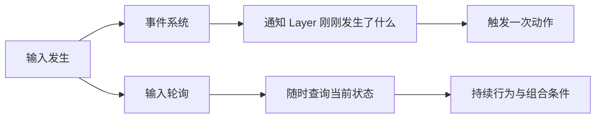

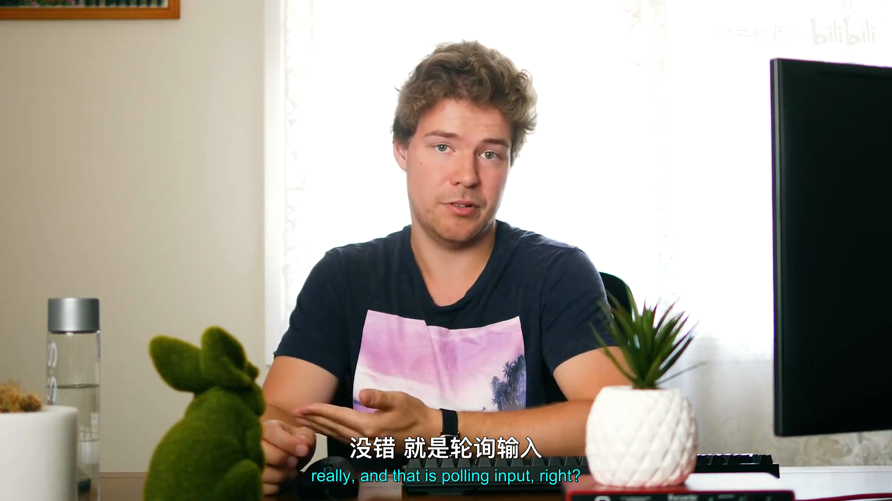

## 1. 为什么需要轮询

*(参考时间: 00:01:04)*

以 Maya 风格的相机控制为例，用户可能按住 Alt，再按住鼠标左键并移动鼠标。鼠标移动事件本身只提供坐标，控制器还需要同时判断：

```text
Alt 当前是否按下？
鼠标左键当前是否按下？
```

如果两者都成立，这次鼠标移动才应该旋转相机。

客户端完全可以在自己的 Layer 中维护这些状态：

- 收到鼠标按下事件时把状态设为 `true`；
- 收到鼠标释放事件时把状态设为 `false`；
- 每次动作再读取自己保存的布尔值。

但这意味着每个客户端都要重复实现同一套状态维护。更合理的做法是由 Hazel 统一保存和查询平台输入状态，并向所有客户端提供一致的输入 API。

## 2. 设计 Input 接口

*(参考时间: 00:02:51)*

Input 与 Window 的设计方式相近，但有一个重要差异：

- Window 将来可能有多个实例；
- Input 在本阶段设计为全局管理器，只有一个实例。

因此 `Input` 类本身只提供静态查询函数，具体行为由平台实现类完成。新增头文件：

```text
Hazel/src/Hazel/Input.h
```

接口内容如下：

```cpp
class HAZEL_API Input
{
public:
    inline static bool IsKeyPressed(int keycode)
    {
        return s_Instance->IsKeyPressedImpl(keycode);
    }

    inline static bool IsMouseButtonPressed(int button)
    {
        return s_Instance->IsMouseButtonPressedImpl(button);
    }

    inline static std::pair<float, float> GetMousePosition()
    {
        return s_Instance->GetMousePositionImpl();
    }

    inline static float GetMouseX()
    {
        return s_Instance->GetMouseXImpl();
    }

    inline static float GetMouseY()
    {
        return s_Instance->GetMouseYImpl();
    }

protected:
    virtual bool IsKeyPressedImpl(int keycode) = 0;
    virtual bool IsMouseButtonPressedImpl(int button) = 0;
    virtual std::pair<float, float> GetMousePositionImpl() = 0;
    virtual float GetMouseXImpl() = 0;
    virtual float GetMouseYImpl() = 0;

private:
    static Input* s_Instance;
};
```

### 2.1 静态外观与虚函数实现

调用者只需要写：

```cpp
Input::IsKeyPressed(keycode)
```

静态函数随后转发给 `s_Instance`。`s_Instance` 的实际类型是平台子类，例如 `WindowsInput`。

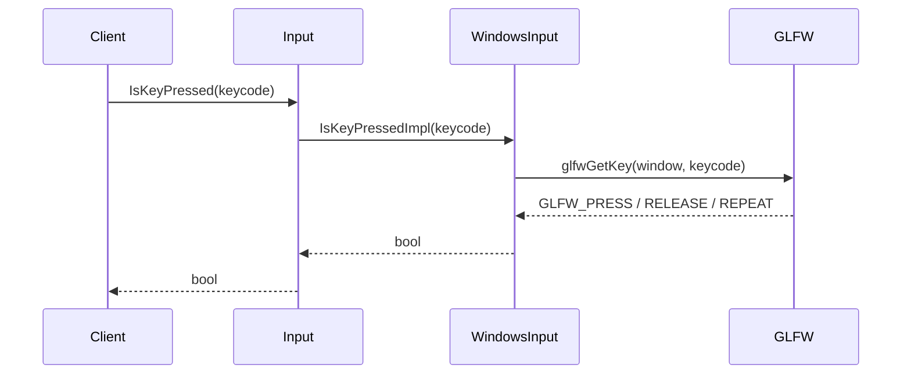

这种结构把“客户端看到什么 API”和“某个平台如何实现”隔开了。

`s_Instance` 是静态成员，它不属于任何一个 `Input` 对象。`Input` 本身因此没有实例数据，只是全局入口和平台接口。

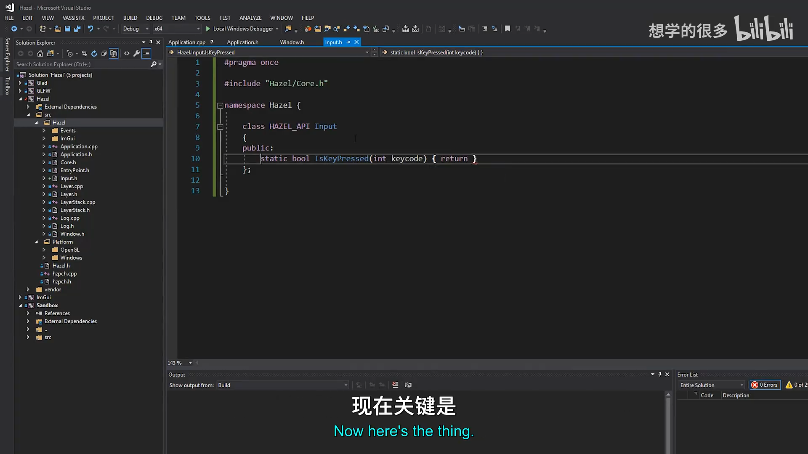

## 3. 创建 WindowsInput

*(参考时间: 00:07:32)*

平台实现放在：

```text
Hazel/src/Platform/Windows/WindowsInput.h
Hazel/src/Platform/Windows/WindowsInput.cpp
```

头文件继承 `Input` 并覆盖所有 `Impl` 函数：

```cpp
class WindowsInput : public Input
{
protected:
    virtual bool IsKeyPressedImpl(int keycode) override;
    virtual bool IsMouseButtonPressedImpl(int button) override;
    virtual std::pair<float, float> GetMousePositionImpl() override;
    virtual float GetMouseXImpl() override;
    virtual float GetMouseYImpl() override;
};
```

这里仍使用 GLFW 键码，但 GLFW 只出现在 Windows 平台实现中，没有进入通用 `Input` 接口。

新增 `.cpp` 文件后需要重新生成 Visual Studio 工程，以确保新实现被加入项目并参与编译。

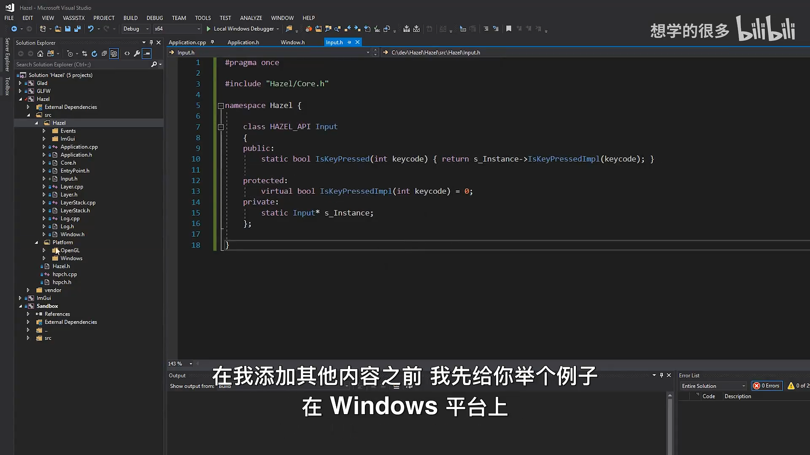

## 4. 暴露原生窗口

*(参考时间: 00:09:45)*

GLFW 输入函数需要 `GLFWwindow*`：

```cpp
glfwGetKey(GLFWwindow* window, int key);
```

但 `Window` 抽象层不能直接暴露 `GLFWwindow` 类型，否则 Hazel 的公开接口又会绑定到 GLFW。

可选方案包括：

1. 把 `m_Window` 设为 public；
2. 让 `WindowsInput` 成为 `WindowsWindow` 的 friend；
3. 在 `Window` 接口中提供通用的原生窗口句柄。

第一种方案破坏封装；第二种虽然可行，但限制较多。本讲选择第三种方案。

### 4.1 Window 接口

```cpp
virtual void* GetNativeWindow() const = 0;
```

返回类型使用 `void*`，因为不同平台和不同窗口库可能返回不同类型的原生句柄：

- Windows 可能返回 `GLFWwindow*`；
- 其它平台可能返回 HWND、X11 Window 或平台封装对象。

### 4.2 WindowsWindow 实现

```cpp
inline virtual void* GetNativeWindow() const
{
    return m_Window;
}
```

`m_Window` 的实际类型是 `GLFWwindow*`，返回时会隐式转换成 `void*`。

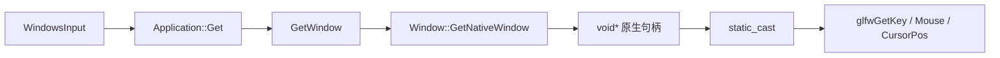

### 4.3 为什么覆盖函数继续写 virtual

基类中的函数只要声明为 `virtual`，派生类覆盖后仍然是虚函数。即使派生类不重复写 `virtual`，运行时多态也不会消失。

继续写 `virtual` 不是语言要求，而是可读性选择：它明确提醒读者这里仍在参与虚函数链。`override` 则更有实际价值，因为函数签名写错时会直接产生编译错误。

编者说明：这只是编码风格取舍，不是 C++ 语义上的必需写法。

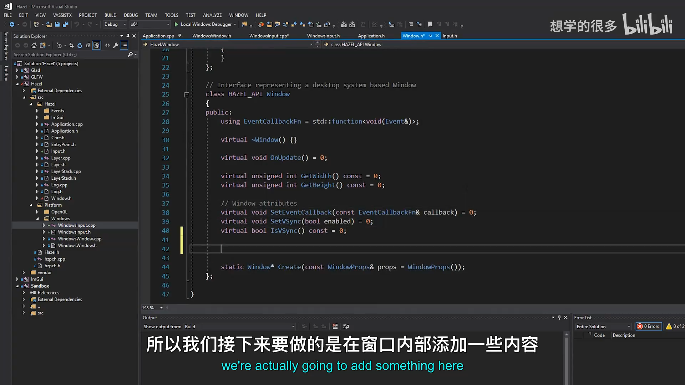

## 5. 实现键盘轮询

*(参考时间: 00:13:24)*

```cpp
bool WindowsInput::IsKeyPressedImpl(int keycode)
{
    auto window = static_cast<GLFWwindow*>(
        Application::Get()
            .GetWindow()
            .GetNativeWindow());

    auto state = glfwGetKey(window, keycode);

    return state == GLFW_PRESS ||
           state == GLFW_REPEAT;
}
```

执行步骤：

1. 从全局 Application 取得当前 Window；
2. 取得原生窗口句柄；
3. 转换为 `GLFWwindow*`；
4. 调用 `glfwGetKey()`；
5. 把 `GLFW_PRESS` 和 `GLFW_REPEAT` 都视为按键处于按下状态。

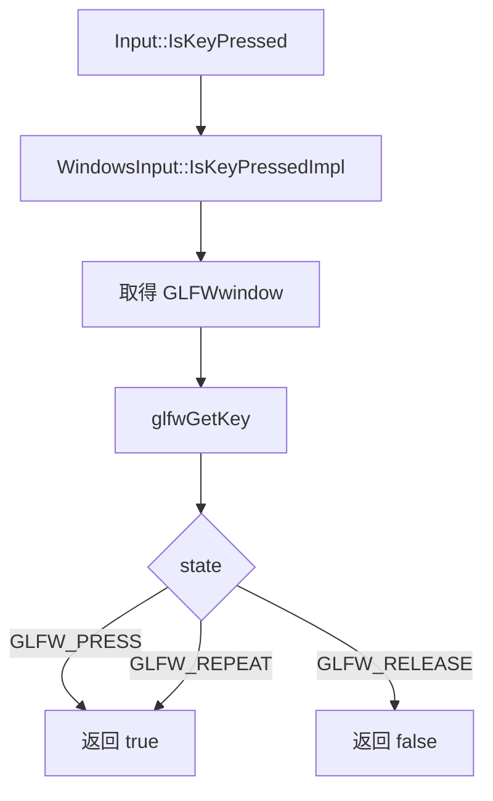

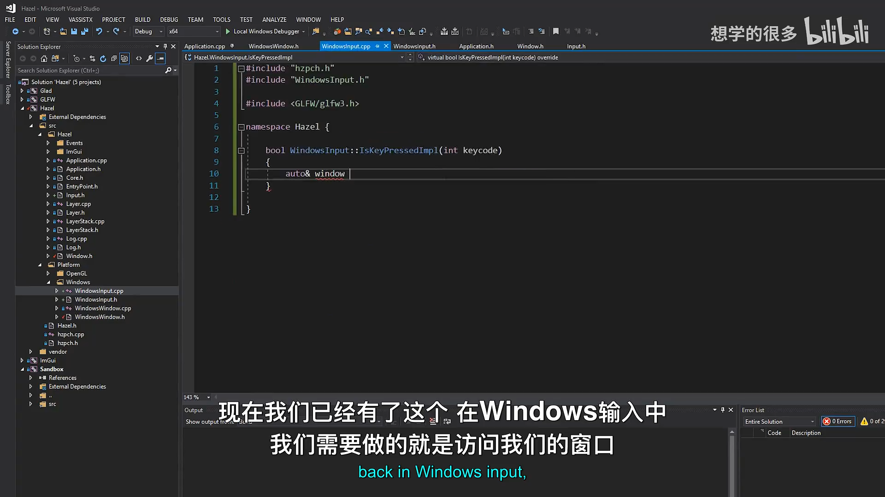

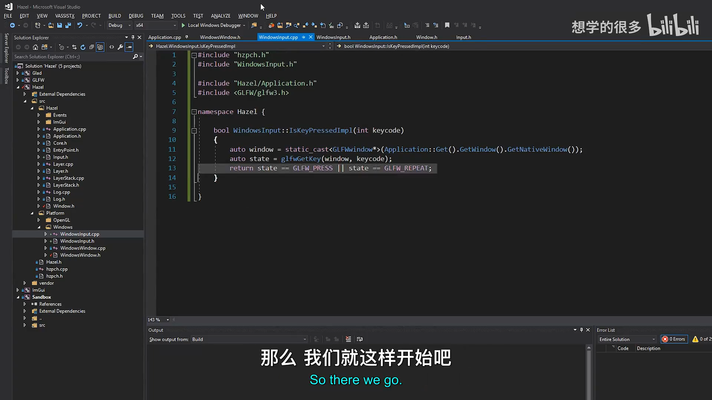

## 6. 实现鼠标轮询

*(参考时间: 00:17:09)*

鼠标接口包括按钮、位置和独立坐标。

### 6.1 鼠标按钮

```cpp
bool WindowsInput::IsMouseButtonPressedImpl(int button)
{
    auto window = static_cast<GLFWwindow*>(
        Application::Get()
            .GetWindow()
            .GetNativeWindow());

    auto state = glfwGetMouseButton(window, button);

    return state == GLFW_PRESS;
}
```

鼠标按钮没有 `GLFW_REPEAT` 状态，因此只需要判断 `GLFW_PRESS`。

### 6.2 鼠标位置

```cpp
std::pair<float, float> WindowsInput::GetMousePositionImpl()
{
    auto window = static_cast<GLFWwindow*>(
        Application::Get()
            .GetWindow()
            .GetNativeWindow());

    double xpos, ypos;
    glfwGetCursorPos(window, &xpos, &ypos);

    return { (float)xpos, (float)ypos };
}
```

`glfwGetCursorPos()` 接收两个输出参数指针，并返回 `double`。Hazel 的输入 API 暂时转换为 `float`，避免客户端直接处理 GLFW 的数据类型。

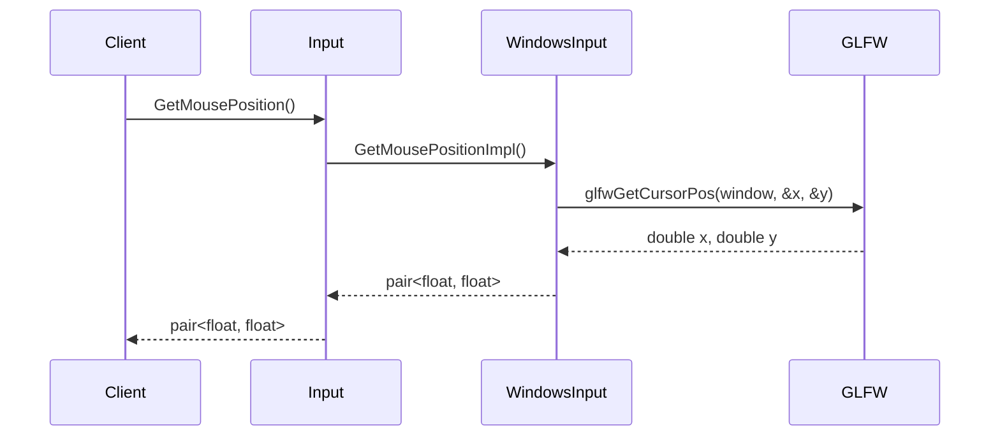

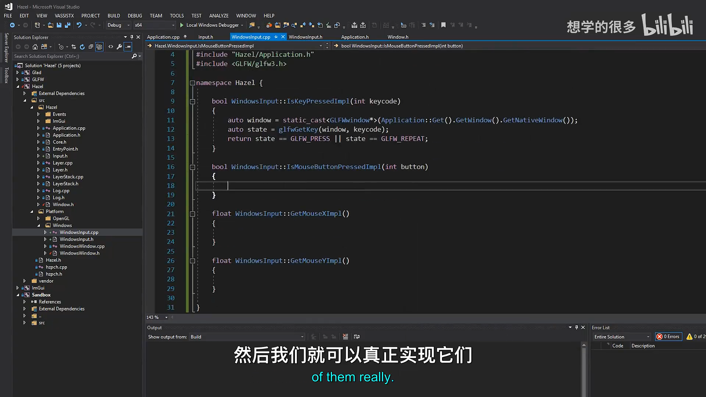

### 6.3 独立 X / Y 坐标

`GetMouseX()` 和 `GetMouseY()` 复用位置查询：

```cpp
float WindowsInput::GetMouseXImpl()
{
    auto[x, y] = GetMousePositionImpl();
    return x;
}

float WindowsInput::GetMouseYImpl()
{
    auto[x, y] = GetMousePositionImpl();
    return y;
}
```

这里使用 C++17 的结构化绑定，直接把 `std::pair<float, float>` 拆成两个具名变量。相比 C++14 时代的 `std::get<0>()` 和 `std::get<1>()`，代码更直观。

```cpp
auto [x, y] = Input::GetMousePosition();
```

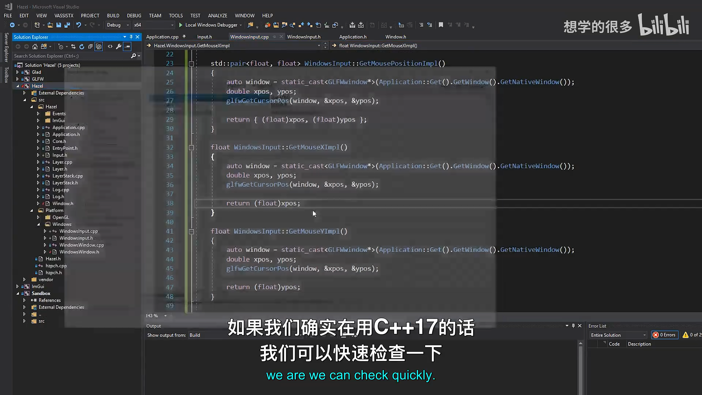

## 7. 初始化 Input 单例

*(参考时间: 00:22:18)*

`Input` 需要一个实际的平台实例。它不需要依赖 Application 或 Window 的构造函数，因此可以直接在 `WindowsInput.cpp` 中初始化：

```cpp
Input* Input::s_Instance = new WindowsInput();
```

这个静态对象在程序启动时创建。此时创建的是 `WindowsInput` 实例本身，并不会立即查询窗口；真正的 `Application::Get().GetWindow()` 调用发生在客户端轮询输入时。

因此初始化顺序可以理解为：

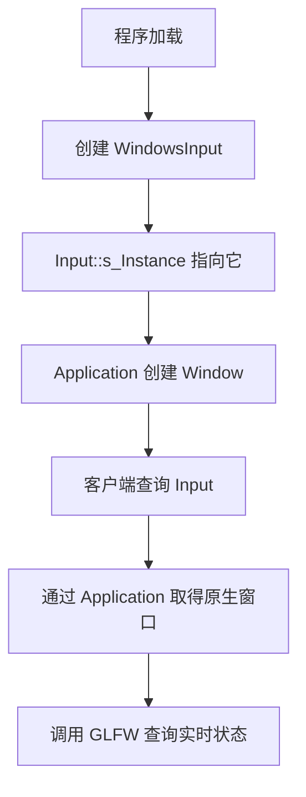

编者说明：`new WindowsInput()` 创建的对象在该版本中不会显式删除。它属于进程级单例，生命周期持续到程序结束，因此本讲没有处理释放；如果以后引入独立初始化和关闭顺序，应把这个生命周期改成明确管理的方案。

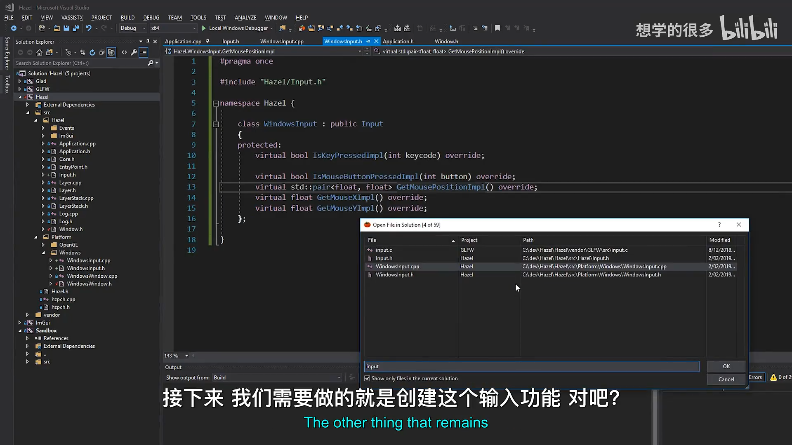

## 8. 测试输入轮询

*(参考时间: 00:23:36)*

为了验证链路，可以在 `Application::Run()` 的循环里读取鼠标位置并记录日志：

```cpp
auto [x, y] = Input::GetMousePosition();
HZ_CORE_TRACE("Mouse position: {0}, {1}", x, y);
```

运行 Sandbox 后，持续移动鼠标即可看到坐标变化，说明：

- `Input::s_Instance` 已正确初始化；
- `Application::Get()` 能取得当前窗口；
- `GetNativeWindow()` 返回了有效 GLFW 句柄；
- `glfwGetCursorPos()` 正在实时读取输入。

视频只实际测试了鼠标位置。键盘、鼠标按钮、`GetMouseX()` 和 `GetMouseY()` 被留作练习。

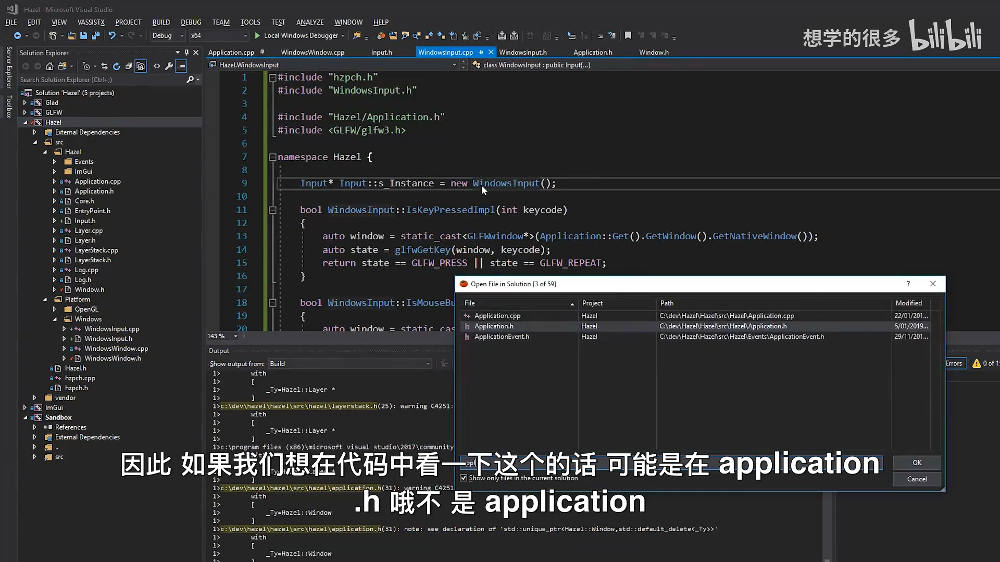

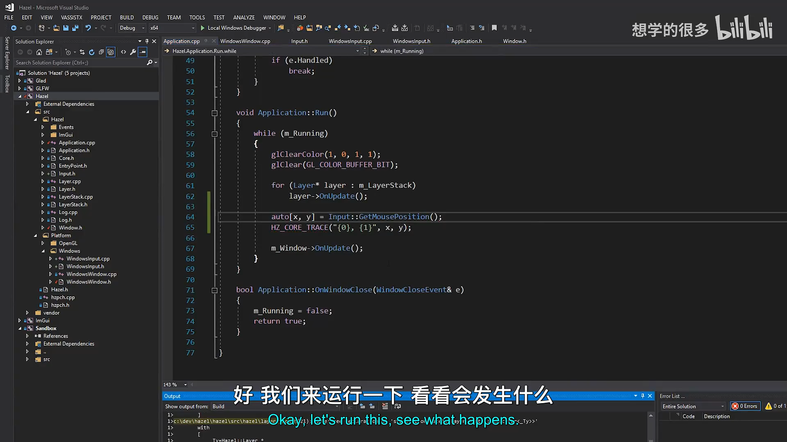

## 9. 当前实现的边界

### 9.1 仍使用 GLFW 键码

客户端目前仍需包含 GLFW 并使用：

```cpp
GLFW_KEY_TAB
GLFW_MOUSE_BUTTON_LEFT
```

这只是暂时的平台编码。最终 Hazel 应提供自己的键盘和鼠标枚举，使公共 API 不依赖 GLFW。

### 9.2 每次查询都会访问 Application 和原生窗口

`WindowsInput` 的每个 `Impl` 函数都通过：

```cpp
Application::Get().GetWindow().GetNativeWindow()
```

取得窗口。当前实现简单直接，但后续可以缓存句柄或在平台层提供更轻量的访问路径。

### 9.3 `GetMouseX()` 和 `GetMouseY()` 会查询两次光标位置

它们内部都调用 `GetMousePositionImpl()`。如果同一帧分别调用 X 和 Y，就会重复执行两次 `glfwGetCursorPos()`。客户端可以改用：

```cpp
auto [x, y] = Input::GetMousePosition();
```

一次取得两个值。

### 9.4 单例生命周期尚未显式管理

进程级实例没有删除，也没有初始化状态检查。当前依赖静态初始化顺序和程序长期运行，后续需要更完整的生命周期设计。

## 10. 本节结论

本讲完成了 Hazel 输入系统的轮询部分：

- 新增静态 `Input` 接口；
- 用 `s_Instance` 转发到平台实现；
- 新增 `WindowsInput`；
- 为 Window 增加 `GetNativeWindow()`；
- 使用 `glfwGetKey()` 查询键盘；
- 使用 `glfwGetMouseButton()` 查询鼠标按钮；
- 使用 `glfwGetCursorPos()` 查询鼠标位置；
- 提供 `GetMousePosition()`、`GetMouseX()` 和 `GetMouseY()`；
- 使用 C++17 结构化绑定简化 pair；
- 在窗口平台实现中初始化 Input 单例；
- 通过日志验证实时鼠标坐标。

事件系统负责“输入发生时通知”，输入轮询负责“当前是否正在输入”。两者结合后，Hazel 才能同时支持一次性动作和持续状态控制。下一讲将继续替换 GLFW 键码，建立 Hazel 自己的键码与鼠标按钮编码。

## 附：参考

- [Bilibili 精译视频：019 - 输入轮询](https://www.bilibili.com/video/BV1wtLazEEmC/?p=19)
- [The Cherno 游戏引擎系列播放列表](https://www.youtube.com/playlist?list=PLlrATfBNZ98dC-V-N3m0Go4deliWHPFwT5)
- [本期对应代码提交 `e1bb18d2`](https://github.com/TheCherno/Hazel/tree/e1bb18d2c8e9c514d959c2eeb55d24af00d169ff)
- [GLFW Input Guide](https://www.glfw.org/docs/latest/input_guide.html)

