# Hazel 游戏引擎笔记 020：建立 Hazel 键码与鼠标码

> 本节来源：[The Cherno 游戏引擎系列第 20 讲“键盘和鼠标代码”](https://www.bilibili.com/video/BV1wtLazEEmC/?p=20)，时长约 23 分 49 秒。  
> 原课程与 Hazel 代码作者：The Cherno。代码参考提交：[`6a5e6887`](https://github.com/TheCherno/Hazel/tree/6a5e6887)。  
> 本文由视频字幕重构、翻译并整理，不是官方教材；术语和代码以原视频及同期 Hazel 仓库为准。

## 本节目标

上一讲实现了输入轮询，但客户端仍需写：

```cpp
Input::IsKeyPressed(GLFW_KEY_SPACE);
```

这意味着使用 Hazel 的客户端必须包含 GLFW 头文件，并依赖 GLFW 的键码定义。GLFW 本来只是 Hazel 的内部平台实现，不应该泄漏到客户端 API。

本讲建立 Hazel 自己的键码和鼠标按钮码：

```cpp
Input::IsKeyPressed(HZ_KEY_SPACE);
Input::IsMouseButtonPressed(HZ_MOUSE_BUTTON_LEFT);
```

目标是让客户端只依赖 Hazel，同时为将来更换窗口后端留下转换空间。

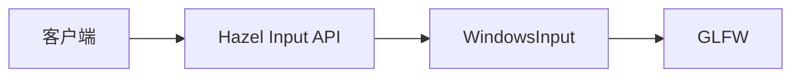


## 1. 为什么 GLFW 键码不能成为公共 API

*(参考时间: 00:00:20)*

当前问题有两层。

### 1.1 公共 API 泄漏平台依赖

客户端应用只想检查空格键是否按下，却必须包含 GLFW：

```cpp
#include <GLFW/glfw3.h>

Input::IsKeyPressed(GLFW_KEY_SPACE);
```

这会把 GLFW 从“Hazel 的内部实现细节”变成“客户端必须了解的依赖”。

### 1.2 不同窗口后端使用不同键码

GLFW 和 Win32 API 对同一个键可能给出完全不同的数值。例如 Tab：

```text
GLFW_KEY_TAB = 258
VK_TAB       = 9
```

如果 Hazel 将来在 Windows 改为直接使用 Win32，而在其它平台继续使用 GLFW，旧的 GLFW 常量就无法直接复用。

需要选择一种长期稳定的内部编码，并在访问具体后端时完成转换。否则每个调用点都会被后端差异污染。

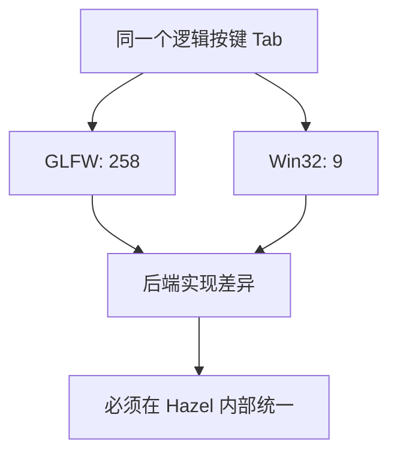

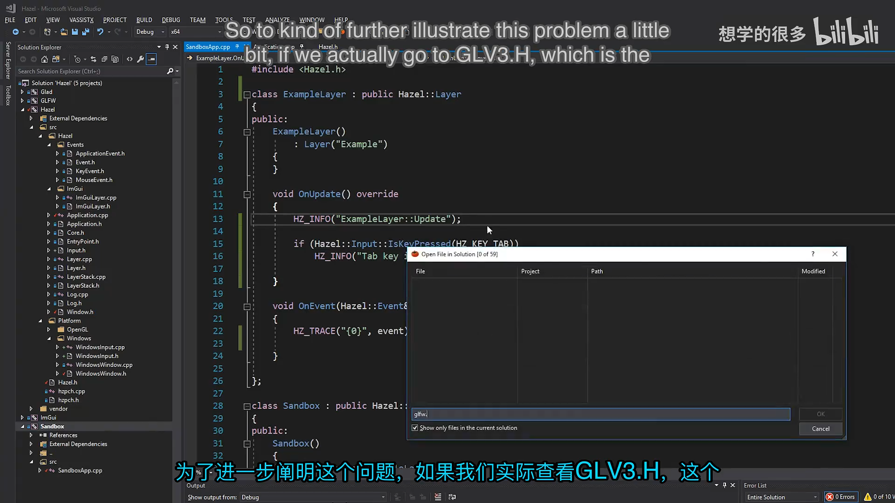

## 2. 创建 KeyCodes.h

*(参考时间: 00:06:49)*

新增：

```text
Hazel/src/Hazel/KeyCodes.h
```

最直接的做法是复制 GLFW 已定义好的键值，但把宏前綴从 `GLFW_` 改成 `HZ_`。例如：

```cpp
#pragma once

// From glfw3.h
#define HZ_KEY_SPACE              32
#define HZ_KEY_APOSTROPHE         39
#define HZ_KEY_COMMA              44
#define HZ_KEY_MINUS              45
#define HZ_KEY_PERIOD             46
#define HZ_KEY_SLASH              47

#define HZ_KEY_0                  48
#define HZ_KEY_1                  49
#define HZ_KEY_2                  50
#define HZ_KEY_3                  51
#define HZ_KEY_4                  52
#define HZ_KEY_5                  53
#define HZ_KEY_6                  54
#define HZ_KEY_7                  55
#define HZ_KEY_8                  56
#define HZ_KEY_9                  57

#define HZ_KEY_A                  65
#define HZ_KEY_B                  66
#define HZ_KEY_C                  67
// ...
```

完整文件还包括：

- 字母、数字和符号键；
- 左右 Shift、Ctrl、Alt、Super；
- Escape、Enter、Tab、Backspace；
- 方向键、Page、Home、End；
- F1 到 F25；
- 小键盘数字与运算键。

文件中保留了来源注释：

```cpp
// From glfw3.h
```

这是为了避免以后忘记这些数值的来源。

### 2.1 为什么不完全重新发明一套数值

可以随意指定：

```text
HZ_KEY_A = 10000
HZ_KEY_B = 10001
```

但这样没有任何直接收益，反而会让当前 GLFW 后端也需要额外转换。

直接复用 GLFW 的数值，同时使用 Hazel 的名字，可以得到两个结果：

1. 客户端不再直接依赖 GLFW 常量；
2. 当前 GLFW 后端因为数值一致，暂时不需要运行时转换。

这是一种渐进式隔离：先把依赖从公共 API 中移走，再在真正更换后端时补上转换层。

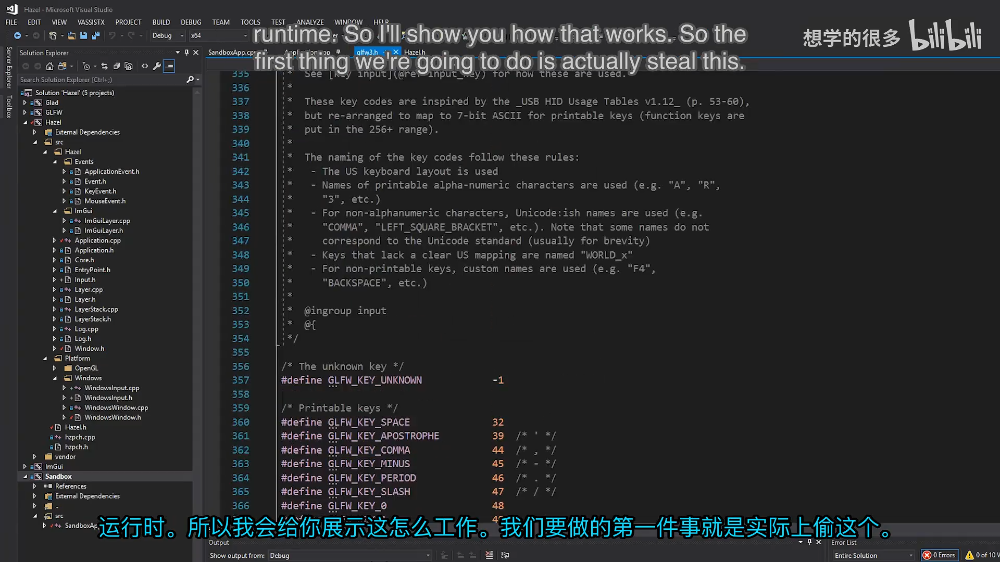

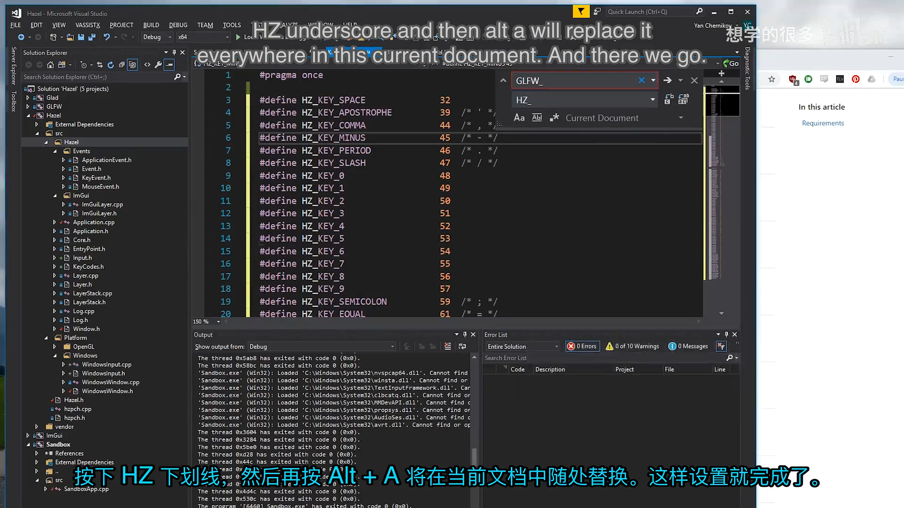

## 3. HZ_KEY_SUPER 与键盘语义

GLFW 使用 `SUPER` 表示系统级修饰键：

- Windows 上是 Windows 键；
- macOS 上是 Command 键；
- Linux 桌面环境中通常映射为 Super 键。

因此不把它改名为 `WINDOWS_KEY`。Hazel 目标是跨平台，键名也应描述功能而不是某一个操作系统。

左右修饰键分别保留：

```cpp
#define HZ_KEY_LEFT_SHIFT         340
#define HZ_KEY_LEFT_CONTROL       341
#define HZ_KEY_LEFT_ALT           342
#define HZ_KEY_LEFT_SUPER         343

#define HZ_KEY_RIGHT_SHIFT        344
#define HZ_KEY_RIGHT_CONTROL      345
#define HZ_KEY_RIGHT_ALT          346
#define HZ_KEY_RIGHT_SUPER        347
```

## 4. 创建 MouseButtonCodes.h

*(参考时间: 00:08:24)*

鼠标按钮采用同样方式：

```cpp
#pragma once

// From glfw3.h
#define HZ_MOUSE_BUTTON_1         0
#define HZ_MOUSE_BUTTON_2         1
#define HZ_MOUSE_BUTTON_3         2
#define HZ_MOUSE_BUTTON_4         3
#define HZ_MOUSE_BUTTON_5         4
#define HZ_MOUSE_BUTTON_6         5
#define HZ_MOUSE_BUTTON_7         6
#define HZ_MOUSE_BUTTON_8         7

#define HZ_MOUSE_BUTTON_LAST      HZ_MOUSE_BUTTON_8

#define HZ_MOUSE_BUTTON_LEFT      HZ_MOUSE_BUTTON_1
#define HZ_MOUSE_BUTTON_RIGHT     HZ_MOUSE_BUTTON_2
#define HZ_MOUSE_BUTTON_MIDDLE    HZ_MOUSE_BUTTON_3
```

这样客户端可以写：

```cpp
Input::IsMouseButtonPressed(
    HZ_MOUSE_BUTTON_LEFT);
```

不必知道 GLFW 把左键定义成整数 `0`。

GLFW 还有一些 modifier flags，但现代 GLFW 已经不再让用户主动传递这些 flags，因此本讲暂时不复制它们；将来确实需要时再补。

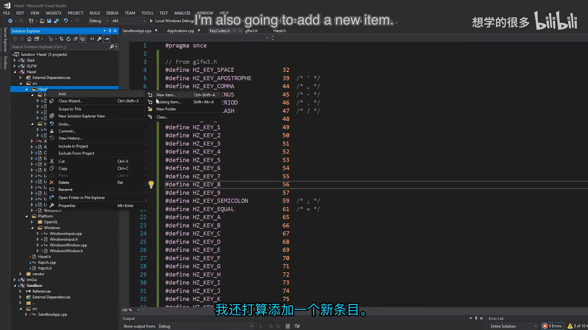

## 5. 通过 Hazel.h 暴露给客户端

*(参考时间: 00:09:07)*

`Hazel.h` 作为客户端总入口，增加：

```cpp
#include "Hazel/Input.h"
#include "Hazel/KeyCodes.h"
#include "Hazel/MouseButtonCodes.h"
```

客户端现在只需要：

```cpp
#include <Hazel.h>
```

就可以访问 Input API 与 Hazel 键码，不再需要：

```cpp
#include <GLFW/glfw3.h>
```

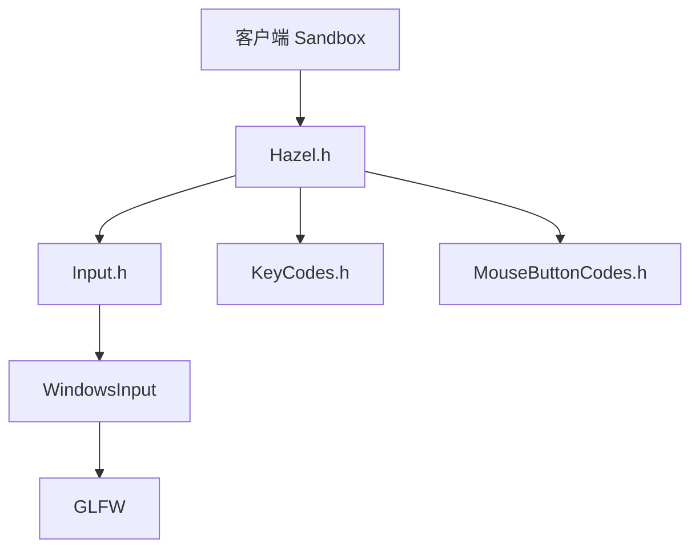

注意：GLFW 仍然是被 Hazel 平台层使用的实现依赖，只是不再出现在客户端源码中。

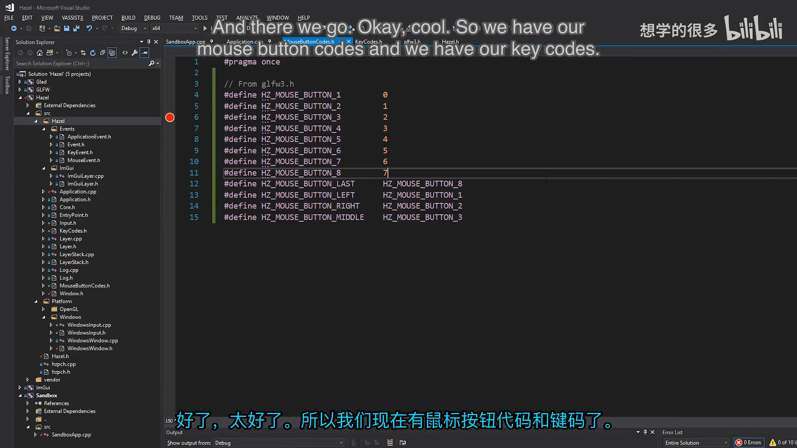

## 6. 在 Sandbox 中验证

*(参考时间: 00:09:45)*

ExampleLayer 可以使用 Hazel 键码测试轮询：

```cpp
void OnUpdate() override
{
    if (Input::IsKeyPressed(HZ_KEY_TAB))
        HZ_TRACE("Tab key is pressed (poll)!");
}
```

运行 Sandbox 后，按住 Tab 键就能持续看到 `Tab key is pressed (poll)!`。

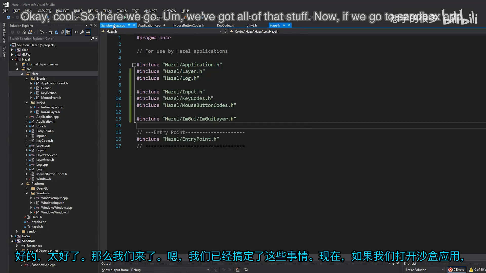

### 6.1 在事件系统中也使用 Hazel 键码

除了轮询，Hazel 事件也可以直接与 `HZ_KEY_*` 比较：

```cpp
void OnEvent(Event& event) override
{
    if (event.GetEventType() == EventType::KeyPressed)
    {
        KeyPressedEvent& e =
            static_cast<KeyPressedEvent&>(event);

        if (e.GetKeyCode() == HZ_KEY_TAB)
            HZ_TRACE("Tab key is pressed (event)!");

        HZ_TRACE("{0}", (char)e.GetKeyCode());
    }
}
```

这里的 `static_cast` 比 C 风格强制转换更明确地表达事件类型检查后的向下转换。

官方提交中使用了 C 风格转换，本段为便于理解改用 `static_cast`；运行语义相同。

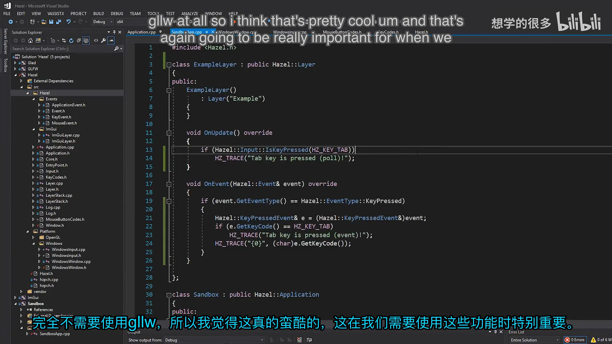

## 7. 后端切换时如何转换键码

*(参考时间: 00:10:33)*

现在 Hazel 键码与 GLFW 数值相同，所以 GLFW 后端不需要转换。但未来如果 Windows 改用 Win32，就可能需要把 Hazel 键码和 Win32 虚拟键码互相转换。

主要有两种方案。

### 7.1 编译时选择平台键值

在头文件中根据目标平台定义不同的数值：

概念示意：

```cpp
#ifdef HZ_PLATFORM_WINDOWS
    #define HZ_KEY_TAB 9
#else
    #define HZ_KEY_TAB 258
#endif
```

优点：

- 运行时没有转换成本；
- 调用点最简单。

缺点：

- 同一逻辑键在不同平台具有不同数值；
- 如果保存按键映射或输入配置，跨平台文件不兼容。

例如 Windows 上保存 Tab 为 `9`，把配置文件复制到 macOS 后，macOS 认为 Tab 是 `258`，原设置无法直接使用。

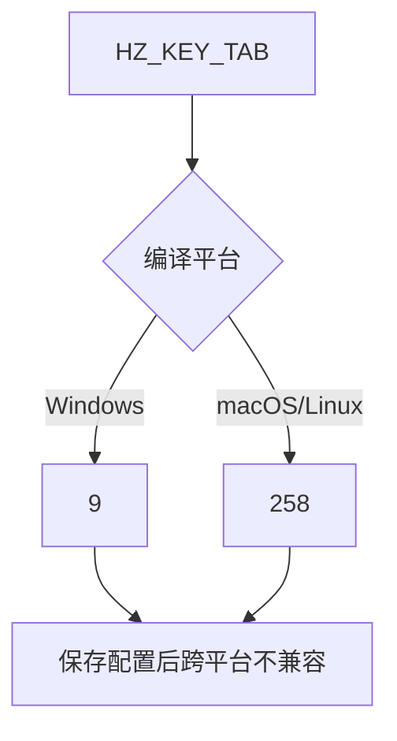

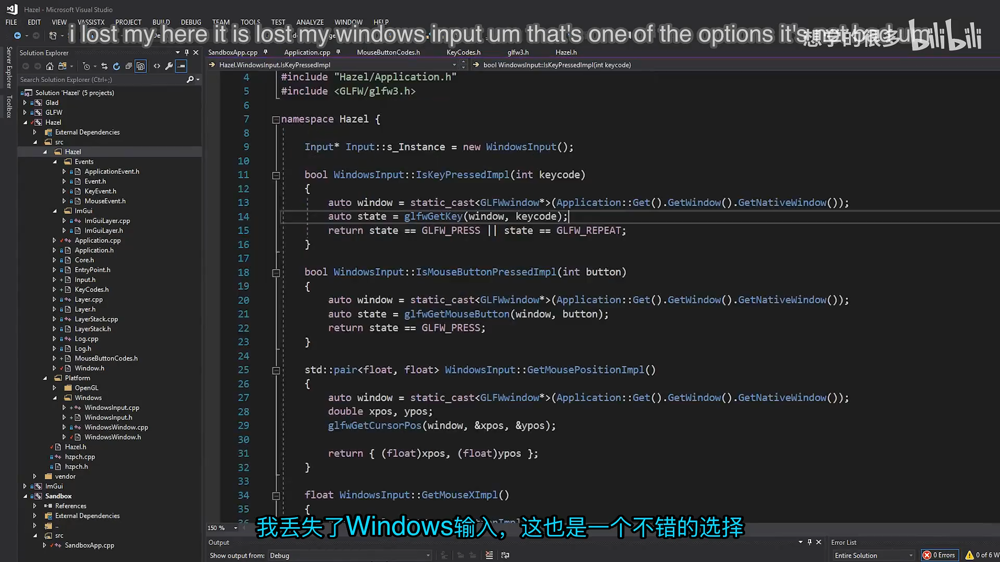

### 7.2 运行时执行转换

让 Hazel 键码始终保持统一定义，当调用具体后端时再转换：

```text
后端事件 -> GLFW key -> Hazel key
Hazel key -> GLFW key -> 后端轮询
```

例如事件方向需要一个：

```cpp
GLFWKeyToHZKey(glfwKey)
```

轮询方向需要：

```cpp
HZKeyToGLFWKey(hzKey)
```

两者都可以通过查表实现。

运行时会增加一次查找，但 Cherno 认为这不会成为游戏引擎的性能瓶颈。相比少量查找开销，按键映射的跨平台可移植性更重要。

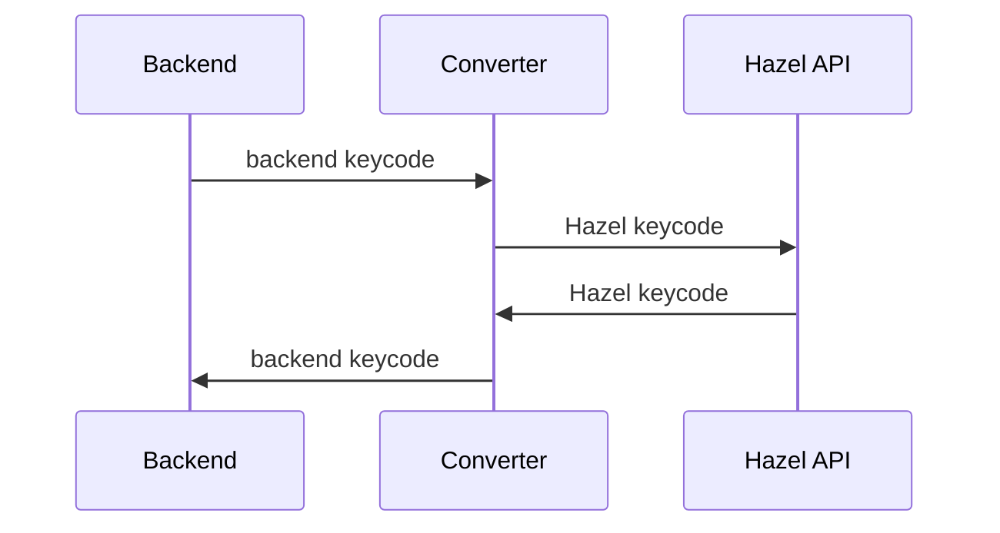

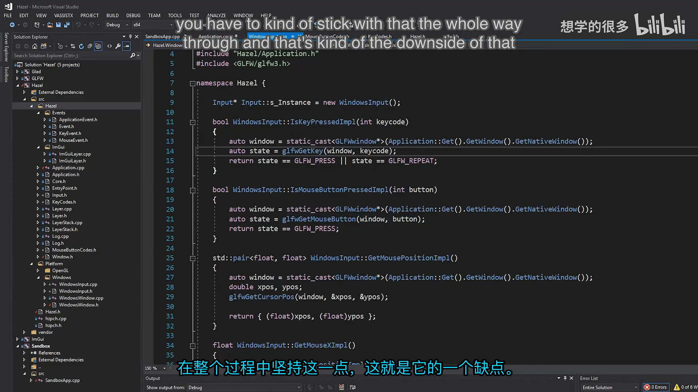

### 7.3 当前选择

当前仍使用 GLFW，而 `HZ_KEY_*` 的数值直接来自 GLFW。因此本讲不需要真正写转换函数：

- WindowsWindow 收到 GLFW 键码时可直接构造事件；
- WindowsInput 收到 Hazel 键码时可直接传给 GLFW。

未来接入不同后端时，再在平台边界增加转换表即可。

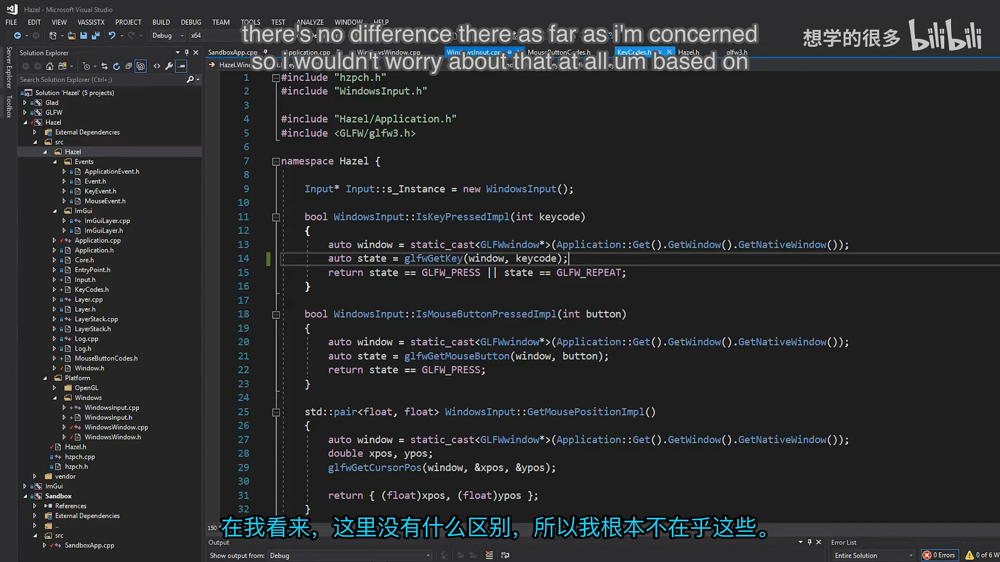

## 8. 字母键码与 ASCII 的便利

*(参考时间: 00:17:00)*

GLFW 的字母键值直接对应 ASCII：

```text
HZ_KEY_A = 65
HZ_KEY_B = 66
...
```

这带来一个实际便利：可以把字母键码转换为 `char` 并直接打印：

```cpp
HZ_TRACE("{0}", (char)e.GetKeyCode());
```

按键输入 `public` 时，日志可以直接看到字符序列：

```text
p
u
b
l
i
c
```

非 ASCII 键不会得到有意义字符。例如 Tab 对应的数字转换为 `char` 并不是可见的英文字符。

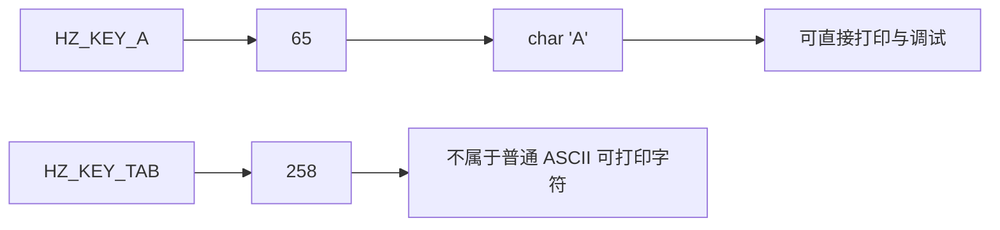

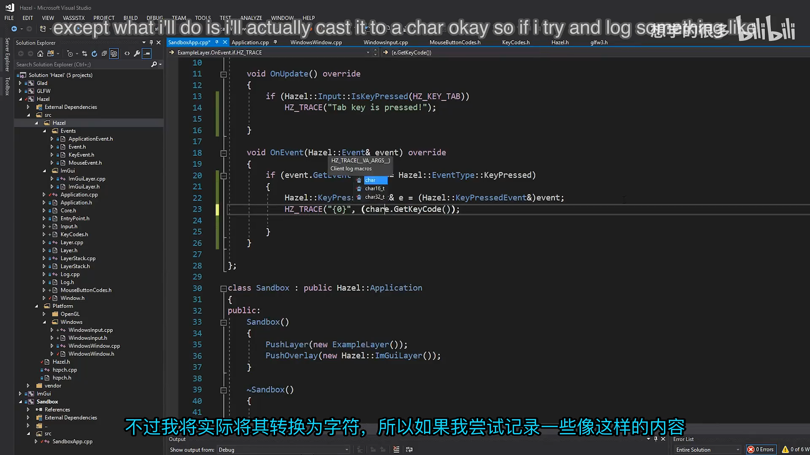

## 9. 最终效果

ExampleLayer 现在同时支持两种输入路径：

- `Input::IsKeyPressed(HZ_KEY_TAB)`：每帧轮询；
- `e.GetKeyCode() == HZ_KEY_TAB`：只在按键事件发生时处理。

轮询与事件都使用统一的 Hazel 键码，不再需要客户端包含 GLFW。

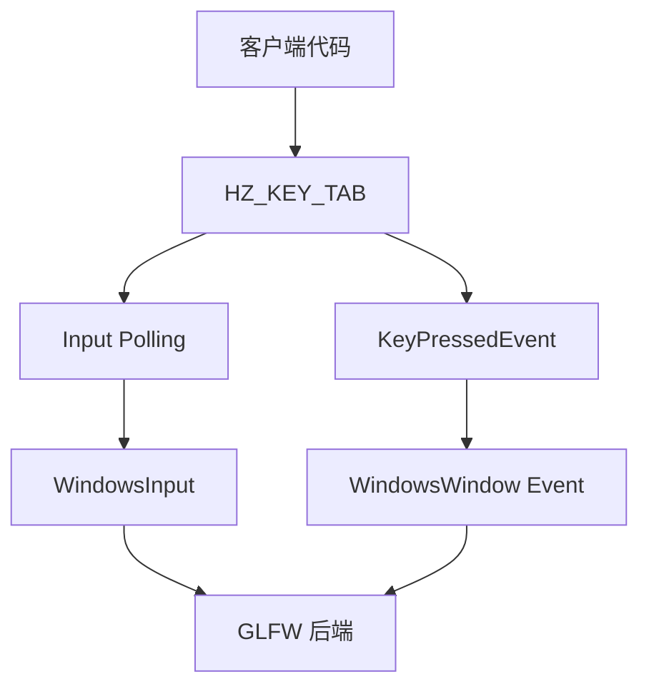


## 10. 本节结论

本讲完成了键码与鼠标码的第一层抽象：

- 识别出公共 API 直接暴露 GLFW 常量的问题；
- 新增 `KeyCodes.h`；
- 新增 `MouseButtonCodes.h`；
- 复制 GLFW 数值并重命名为 `HZ_KEY_*`、`HZ_MOUSE_BUTTON_*`；
- 在 `Hazel.h` 中统一公开这些头文件；
- 客户端可以直接使用 Hazel 键码进行轮询和事件比较；
- 解释了编译时平台键值与运行时转换的取舍；
- 确认当前 GLFW 数值一致，因此暂时无需转换；
- 利用字母键码与 ASCII 对齐，直接输出输入字符进行验证。

Hazel 还没有完全摆脱 GLFW，但客户端 API 已经不再要求用户了解 GLFW。这是一种重要的边界调整：平台实现可以继续使用第三方库，公共接口则保持稳定、统一和可迁移。

## 附：参考

- [Bilibili 精译视频：020 - 键盘和鼠标代码](https://www.bilibili.com/video/BV1wtLazEEmC/?p=20)
- [The Cherno 游戏引擎系列播放列表](https://www.youtube.com/playlist?list=PLlrATfBNZ98dC-V-N3m0Go4deliWHPFwT5)
- [本期对应代码提交 `6a5e6887`](https://github.com/TheCherno/Hazel/tree/6a5e6887)
- [GLFW Input Guide](https://www.glfw.org/docs/latest/input_guide.html)
