# Hazel 游戏引擎笔记 022：ImGui 停靠与视口

> 本节来源：[The Cherno 游戏引擎系列第 22 讲“ImGui 停靠与视口”](https://www.bilibili.com/video/BV1wtLazEEmC/?p=22)，时长约 31 分 34 秒。  
> 原课程与 Hazel 代码作者：The Cherno。代码参考提交：[`7c02b786`](https://github.com/TheCherno/Hazel/tree/7c02b7863f1d70af88b7c447b223c9da4dc9e04a)。  
> 本文由视频字幕重构、翻译并整理，不是官方教材；术语和代码以原视频及同期 Hazel 仓库为准。

## 本节目标

上一讲的 ImGui 集成是 Hazel 自己根据 ImGui GLFW 示例重写的：Hazel 事件被手动翻译为 `ImGuiIO` 状态，渲染也依赖复制进项目的 OpenGL3 示例代码。

这套实现适合理解原理，但 ImGui 正在快速增加 Docking 和 Viewports 等复杂功能。继续分叉维护会让 Hazel 越来越难追上上游。

本讲决定改成：

1. 使用 ImGui docking 分支；
2. 直接编译官方 GLFW 与 OpenGL3 后端；
3. 尽量不修改官方后端代码；
4. Hazel 只负责生命周期和 Begin / End 阶段；
5. 让所有 Layer 都能通过 `OnImGuiRender()` 绘制 UI。

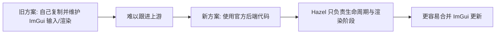


## 1. Docking 与 Viewports 的价值

### 1.1 Docking：把窗口组织成 Dock Space

Docking 允许像 Visual Studio 一样拖动面板、拆分区域、形成标签页。Hazel 未来的关卡编辑器可以直接把场景、资源浏览器、属性面板和日志放进 Dock Space，而不需要引入 Qt、WPF 或 WinForms。

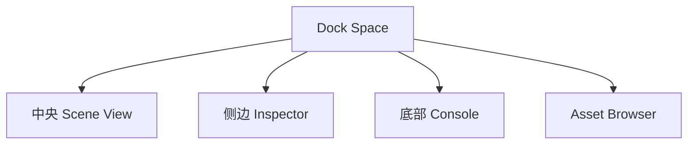

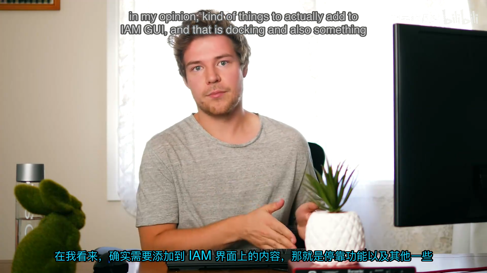

### 1.2 Viewports：窗口可拖出主应用

Viewports 让 ImGui 窗口可以离开主应用窗口。ImGui 会为它创建新的平台窗口和渲染上下文，使一个面板看起来像独立操作系统窗口。

这对多显示器开发非常实用。例如，可以把 Scene View 或 Console 拖到第二块屏幕，而主窗口继续保留编辑器布局。

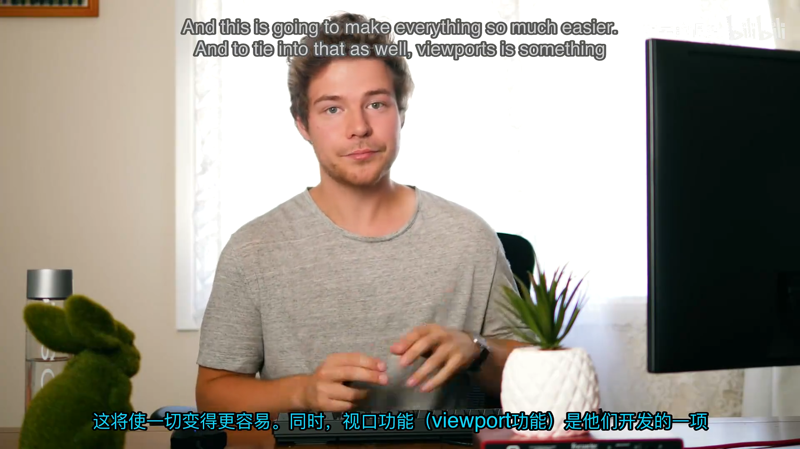

### 1.3 为什么不再自己实现

Docking 分支尚未并入 ImGui `master`，功能仍在变化。如果 Hazel 复制后大量修改，每次上游更新都要手工合并。

因此本讲采用官方提供的：

- `imgui_impl_glfw.cpp`；
- `imgui_impl_opengl3.cpp`；
- 对应头文件。

目标是让 Hazel 与 ImGui 代码尽量不产生分叉。

## 2. 切换 ImGui 子模块到 docking 分支

*(参考时间: 00:08:51)*

ImGui 是 Git 子模块。先进入子模块目录：

```bash
cd Hazel/vendor/imgui
git status
git checkout docking
```

然后返回 Hazel 根目录，把子模块的新提交记录到主仓库：

```bash
cd ../../..
git status
git add Hazel/vendor/imgui
git commit -m "Switch ImGui to docking branch"
```

切分支的本质不是修改子模块内容，而是修改主仓库记录的子模块提交指针。

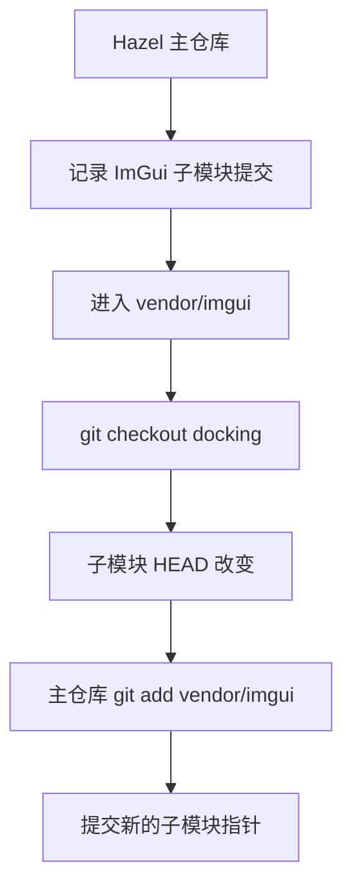

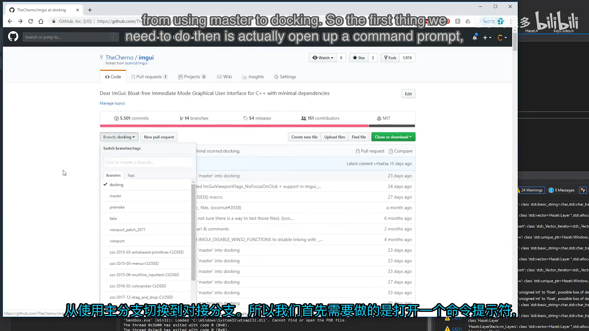

## 3. 编译官方 ImGui 后端

*(参考时间: 00:10:34)*

docking 分支中需要编译两个实现文件：

```text
Hazel/vendor/imgui/examples/imgui_impl_glfw.cpp
Hazel/vendor/imgui/examples/imgui_impl_opengl3.cpp
```

不直接把两个文件逐项加入 Premake，而是新增一个统一编译单元：

```text
Hazel/src/Hazel/ImGui/ImGuiBuild.cpp
```

内容如下：

```cpp
#include "hzpch.h"

#define IMGUI_IMPL_OPENGL_LOADER_GLAD

#include "examples/imgui_impl_opengl3.cpp"
#include "examples/imgui_impl_glfw.cpp"
```

### 3.1 为什么使用包含 `.cpp` 的方式

这是一种小型 unity build：

- 只增加一个 Hazel 编译文件；
- 明确由 Hazel 控制宏定义；
- 不修改 ImGui 子模块；
- 需要调整 loader 时只改一处。

`IMGUI_IMPL_OPENGL_LOADER_GLAD` 告诉 ImGui 的 OpenGL3 后端使用 Glad 加载 OpenGL 函数，而不是使用它默认假设的加载器。

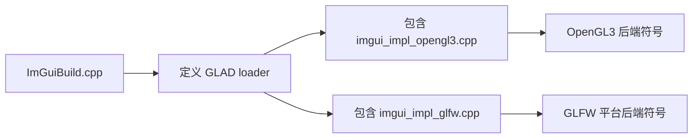

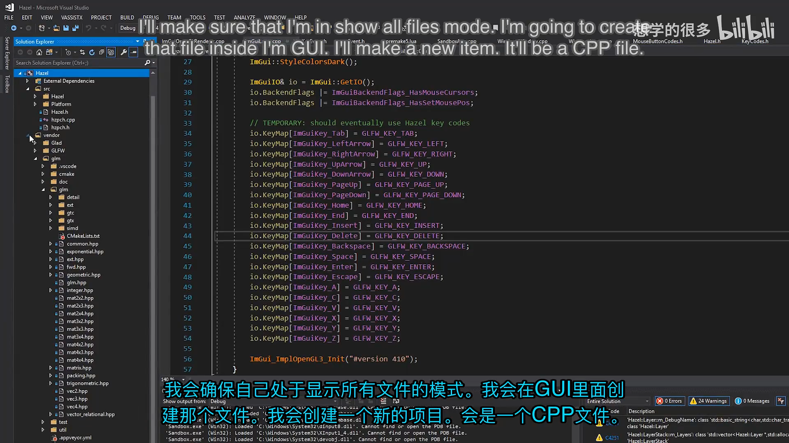

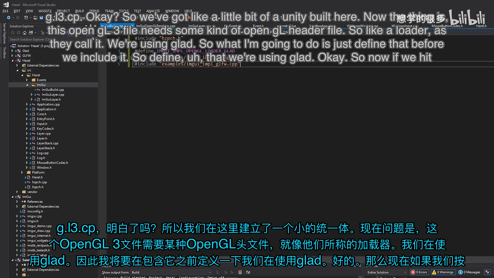

旧的 `Hazel/src/Platform/OpenGL/ImGuiOpenGLRenderer.*` 随之删除，不再维护复制版 OpenGL 渲染器。

## 4. 重写 ImGuiLayer

*(参考时间: 00:12:55)*

### 4.1 删除手写事件翻译

旧 `ImGuiLayer` 包含大量：

- MouseButton pressed / released；
- MouseMoved / MouseScrolled；
- KeyPressed / KeyReleased / KeyTyped；
- WindowResize；
- 键盘映射与鼠标状态同步。

官方 GLFW 后端已经能处理这些输入，并会在 `ImGui_ImplGlfw_NewFrame()` 中同步状态。因此这些自定义处理代码全部删除。

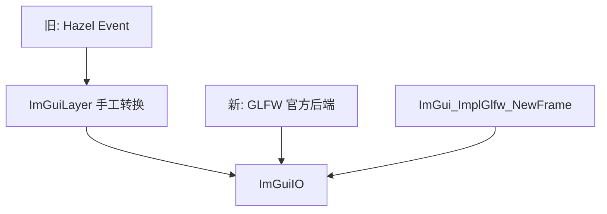

这不是放弃 Hazel 事件系统，而是避免把 ImGui 输入适配层重复维护在 Hazel 中。

### 4.2 ImGuiLayer 接口

```cpp
class HAZEL_API ImGuiLayer : public Layer
{
public:
    ImGuiLayer();
    ~ImGuiLayer();

    virtual void OnAttach() override;
    virtual void OnDetach() override;
    virtual void OnImGuiRender() override;

    void Begin();
    void End();

private:
    float m_Time = 0.0f;
};
```

`OnUpdate()` 和 `OnEvent()` 不再需要。真正由外层控制的是 `Begin()` 与 `End()`。

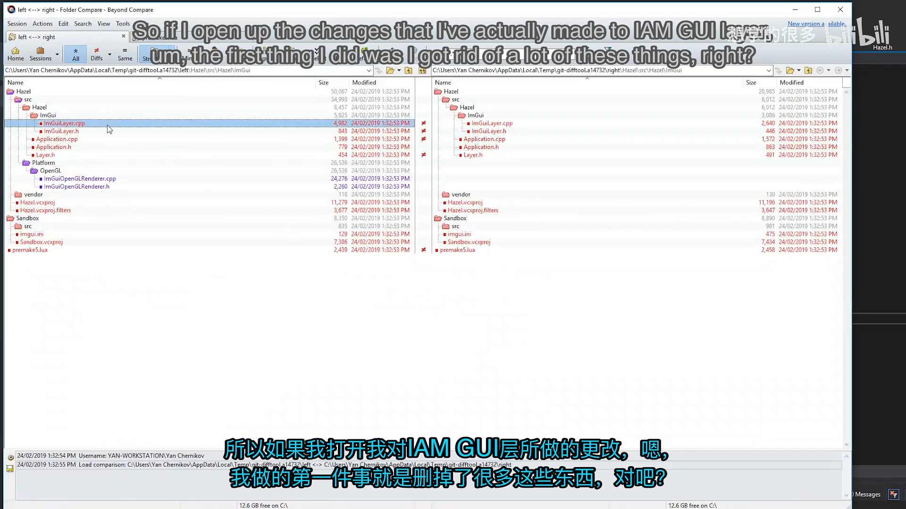

## 5. OnAttach：配置 ImGui 与官方后端

参考提交中的初始化：

```cpp
void ImGuiLayer::OnAttach()
{
    IMGUI_CHECKVERSION();
    ImGui::CreateContext();

    ImGuiIO& io = ImGui::GetIO();
    io.ConfigFlags |=
        ImGuiConfigFlags_NavEnableKeyboard;
    io.ConfigFlags |=
        ImGuiConfigFlags_DockingEnable;
    io.ConfigFlags |=
        ImGuiConfigFlags_ViewportsEnable;

    ImGui::StyleColorsDark();

    ImGuiStyle& style = ImGui::GetStyle();
    if (io.ConfigFlags & ImGuiConfigFlags_ViewportsEnable)
    {
        style.WindowRounding = 0.0f;
        style.Colors[ImGuiCol_WindowBg].w = 1.0f;
    }

    Application& app = Application::Get();
    GLFWwindow* window =
        static_cast<GLFWwindow*>(
            app.GetWindow().GetNativeWindow());

    ImGui_ImplGlfw_InitForOpenGL(window, true);
    ImGui_ImplOpenGL3_Init("#version 410");
}
```

各配置项作用：

| Flag | 作用 |
|---|---|
| `NavEnableKeyboard` | 允许键盘导航 ImGui |
| `DockingEnable` | 启用窗口停靠 |
| `ViewportsEnable` | 允许 ImGui 窗口创建独立平台窗口 |

启用 Viewports 后，主窗口与浮动平台窗口要保持统一外观，因此把：

```cpp
style.WindowRounding = 0.0f;
style.Colors[ImGuiCol_WindowBg].w = 1.0f;
```

### 5.1 官方后端初始化

```cpp
ImGui_ImplGlfw_InitForOpenGL(window, true);
ImGui_ImplOpenGL3_Init("#version 410");
```

第二个参数 `true` 表示由 ImGui 后端安装 GLFW 输入回调。此前的 Hazel 手写事件同步因此不再需要。

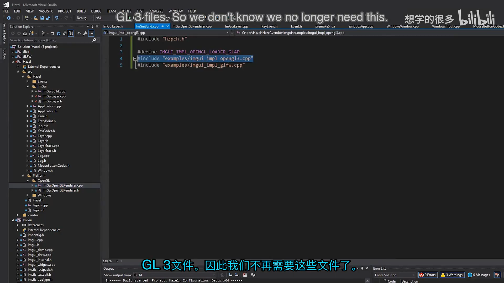

## 6. Begin：开始一帧

```cpp
void ImGuiLayer::Begin()
{
    ImGui_ImplOpenGL3_NewFrame();
    ImGui_ImplGlfw_NewFrame();
    ImGui::NewFrame();
}
```

顺序很重要：

1. 准备 OpenGL3 渲染后端；
2. 准备 GLFW 平台后端并同步输入；
3. 开始 ImGui 逻辑帧。

Begin 与 End 之间的这段时间，任何 Layer 都可以提交 ImGui UI。

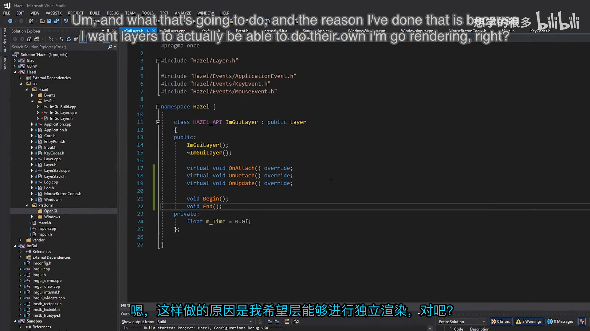

## 7. OnImGuiRender：让 Layer 绘制 UI

在 `Layer` 基类增加：

```cpp
virtual void OnImGuiRender() {}
```

之后 ExampleLayer 可以重写：

```cpp
virtual void OnImGuiRender() override
{
    static bool show = true;
    ImGui::ShowDemoWindow(&show);
}
```

或者：

```cpp
void OnImGuiRender() override
{
    ImGui::Begin("Test");
    ImGui::Text("Hello World");
    ImGui::End();
}
```

Layer 不再需要知道：

```cpp
ImGui::NewFrame();
ImGui::Render();
ImGui_ImplOpenGL3_RenderDrawData(...);
```

它只负责声明自己的 UI。

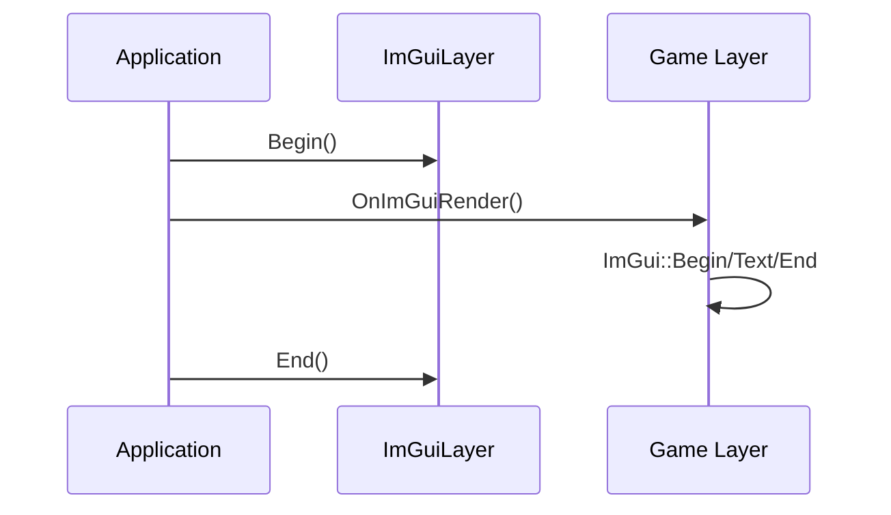

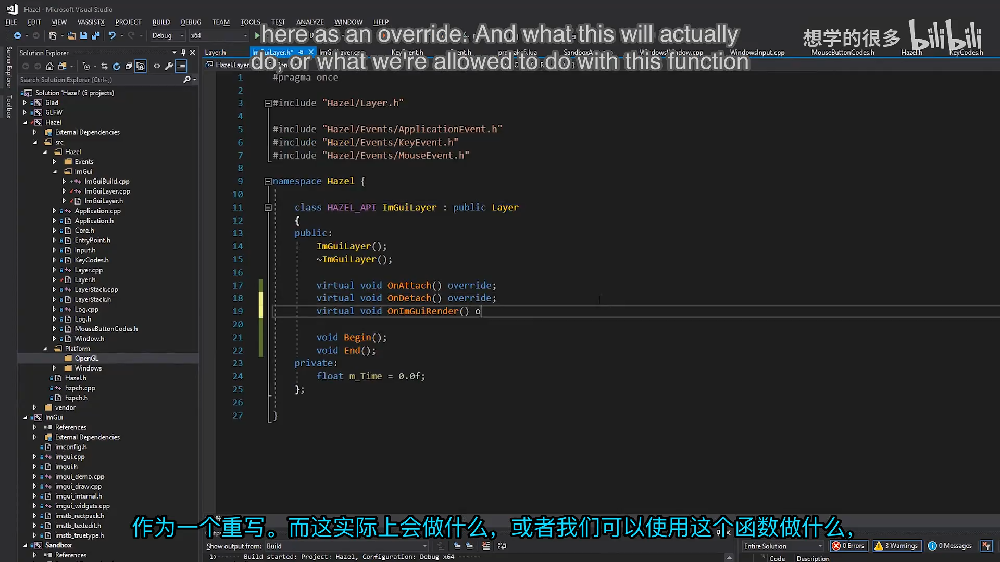

## 8. End：渲染 UI 与平台窗口

*(参考时间: 00:17:27)*

```cpp
void ImGuiLayer::End()
{
    ImGuiIO& io = ImGui::GetIO();
    Application& app = Application::Get();

    io.DisplaySize = ImVec2(
        app.GetWindow().GetWidth(),
        app.GetWindow().GetHeight());

    ImGui::Render();
    ImGui_ImplOpenGL3_RenderDrawData(
        ImGui::GetDrawData());

    if (io.ConfigFlags & ImGuiConfigFlags_ViewportsEnable)
    {
        GLFWwindow* backup_current_context =
            glfwGetCurrentContext();

        ImGui::UpdatePlatformWindows();
        ImGui::RenderPlatformWindowsDefault();

        glfwMakeContextCurrent(backup_current_context);
    }
}
```

### 8.1 设置 DisplaySize

主 ImGui 上下文需要知道主窗口尺寸：

```cpp
io.DisplaySize = ImVec2(width, height);
```

### 8.2 渲染主窗口 DrawData

```cpp
ImGui::Render();
ImGui_ImplOpenGL3_RenderDrawData(
    ImGui::GetDrawData());
```

### 8.3 处理浮动平台窗口

```cpp
ImGui::UpdatePlatformWindows();
ImGui::RenderPlatformWindowsDefault();
```

这些调用会更新并渲染被拖出主窗口的 ImGui 平台窗口。

渲染平台窗口时可能切换 OpenGL 上下文。为了不影响 Hazel 后续渲染，需要先保存并恢复原来的上下文：

```cpp
GLFWwindow* backup_current_context =
    glfwGetCurrentContext();

// ...
glfwMakeContextCurrent(backup_current_context);
```

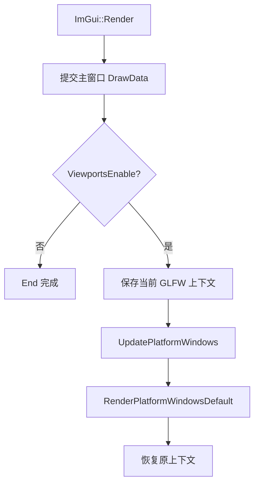

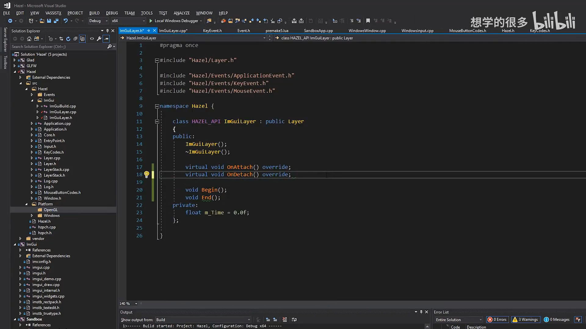

## 9. 由 Application 统一拥有 ImGuiLayer

*(参考时间: 00:20:00)*

旧 Sandbox 手动执行：

```cpp
PushOverlay(new Hazel::ImGuiLayer());
```

新设计中，ImGui 是 Hazel Runtime 的基础 UI 设施，因此由 Application 自动创建：

```cpp
m_ImGuiLayer = new ImGuiLayer();
PushOverlay(m_ImGuiLayer);
```

Sandbox 不再需要创建 ImGuiLayer。

### 9.1 所有权必须与 LayerStack 一致

视频中最初尝试把 ImGuiLayer 写成 `std::unique_ptr`，随后发现不正确：`PushOverlay()` 会把指针交给 LayerStack，LayerStack 负责最终删除。

因此成员声明应保持裸指针：

```cpp
ImGuiLayer* m_ImGuiLayer;
```

这里使用裸指针不是忽略所有权，而是因为所有权已经明确转移给 LayerStack。


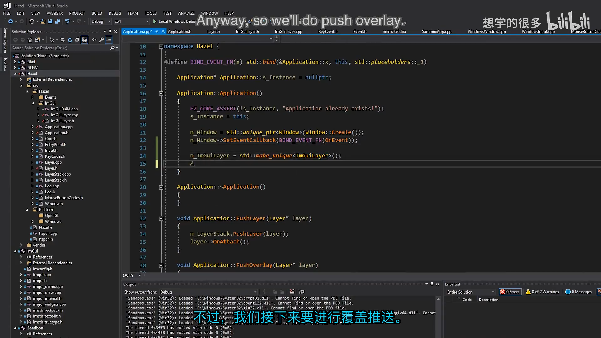

### 9.2 Application 主循环

```cpp
while (m_Running)
{
    glClearColor(1, 0, 1, 1);
    glClear(GL_COLOR_BUFFER_BIT);

    for (Layer* layer : m_LayerStack)
        layer->OnUpdate();

    m_ImGuiLayer->Begin();

    for (Layer* layer : m_LayerStack)
        layer->OnImGuiRender();

    m_ImGuiLayer->End();

    m_Window->OnUpdate();
}
```

所有 Layer 的 ImGui 代码都夹在同一组 Begin / End 之间。

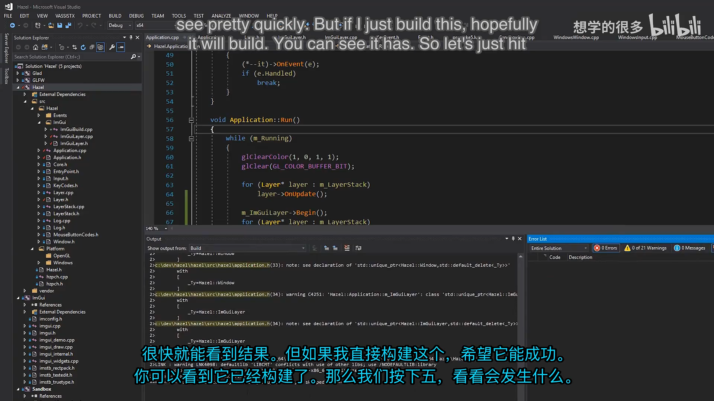

## 10. 修复 LayerStack 迭代器失效

*(参考时间: 00:24:24)*

旧 LayerStack 保存一个迭代器：

```cpp
std::vector<Layer*>::iterator m_LayerInsert;
```

当 `std::vector` 扩容时，已有迭代器会失效。继续使用它会产生未定义行为。

新实现改用索引：

```cpp
unsigned int m_LayerInsertIndex = 0;
```

PushLayer：

```cpp
void LayerStack::PushLayer(Layer* layer)
{
    m_Layers.emplace(
        m_Layers.begin() + m_LayerInsertIndex,
        layer);
    m_LayerInsertIndex++;
}
```

PopLayer：

```cpp
m_LayerInsertIndex--;
```

索引不会因为 vector 重新分配而失效，因此比保存迭代器更稳健。

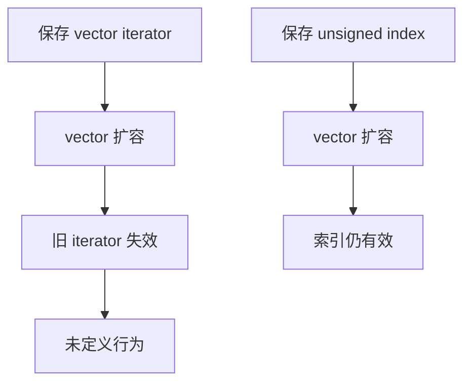

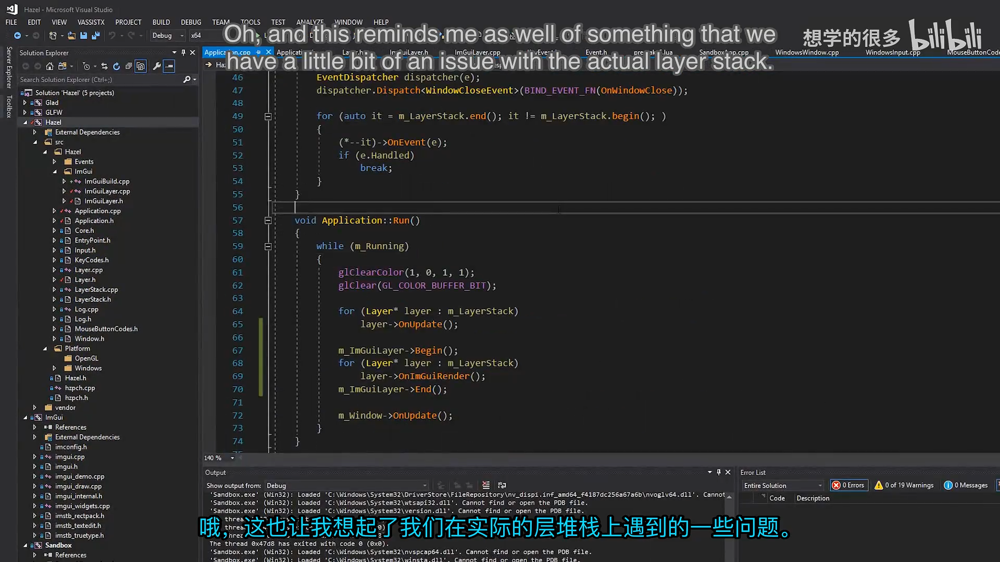

## 11. 为 Sandbox 暴露 ImGui 头文件

*(参考时间: 00:28:00)*

Sandbox 希望直接写：

```cpp
#include "imgui/imgui.h"
```

因此 Premake 的 Sandbox `includedirs` 增加：

```lua
"Hazel/vendor"
```

这样 `imgui/imgui.h` 可以从 vendor 根目录解析。

重新生成项目后，Sandbox 就能声明自己的 ImGui 面板。

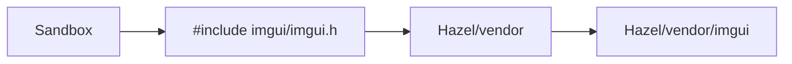

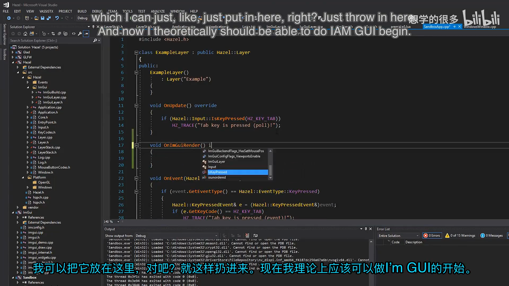

## 12. 新功能演示

*(参考时间: 00:26:18)*

### 12.1 多视口

ImGui Demo Window 可以被直接拖出主应用窗口。松开后，它变成独立窗口；拖回主窗口后重新嵌入。

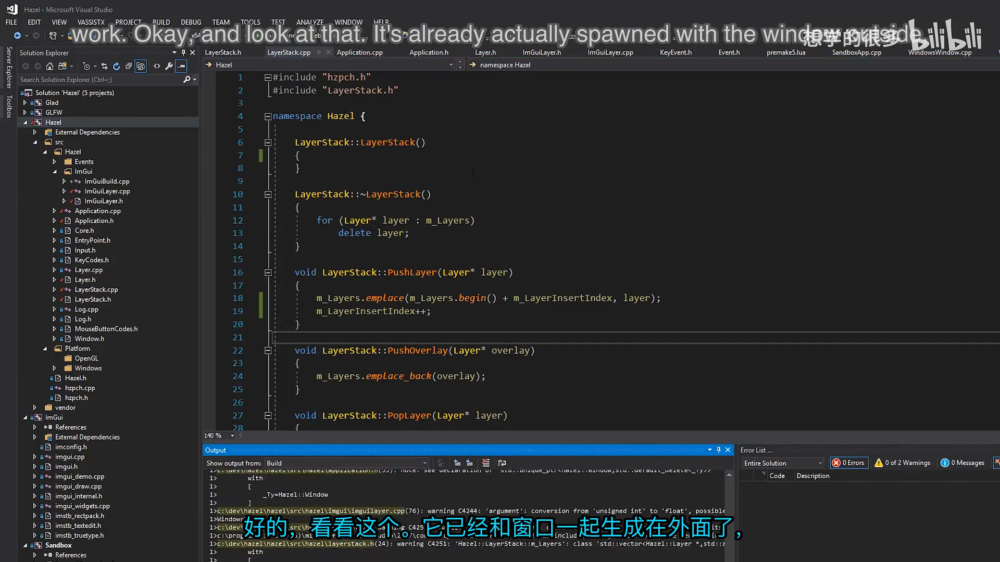

还可以同时打开 Log 等窗口，并把它们放在不同显示器或不同位置。

### 12.2 Dock Space

打开 `Examples -> DockSpace` 后得到一个可停靠区域。把 Demo、Log、Console 拖入后，界面已经接近 Visual Studio 一类编辑器。

这为 Hazel 未来直接构建关卡编辑器提供了基础。

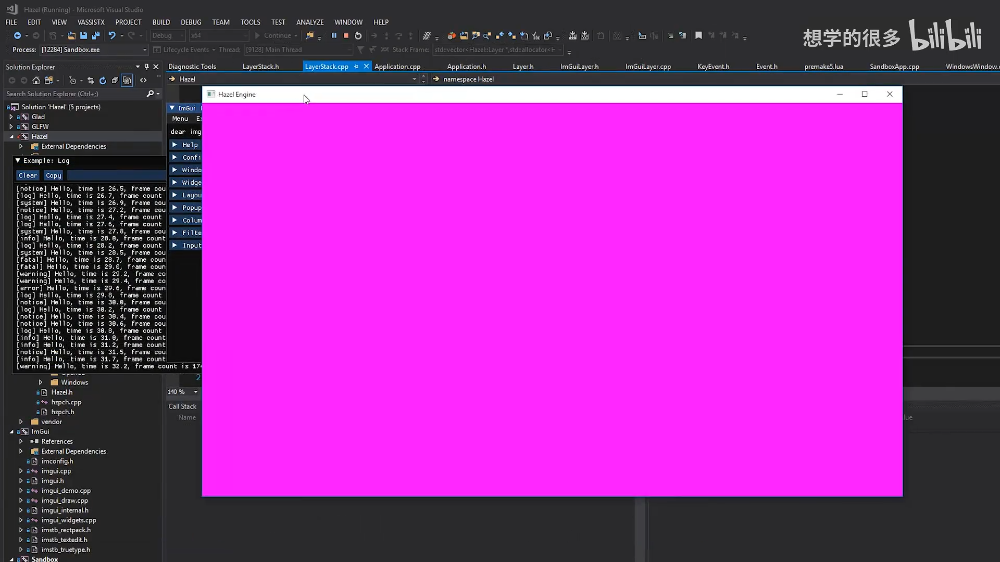

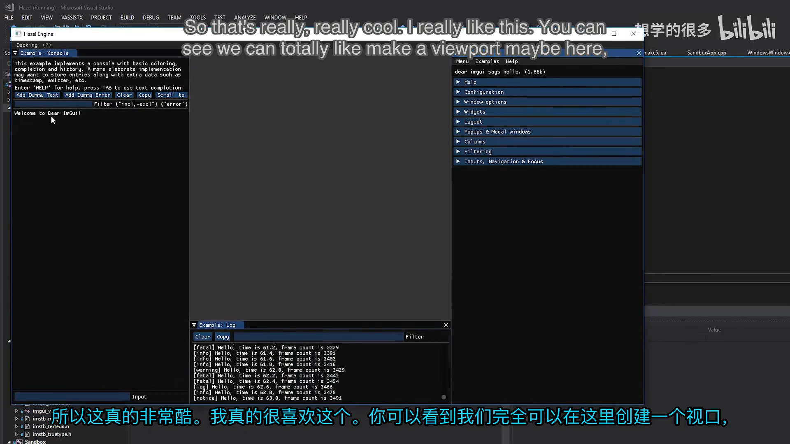

## 13. 视频末尾的练习：DLL 符号问题

*(参考时间: 00:29:37)*

Sandbox 加入自己的 ImGui 窗口后，编译成功，但链接阶段出现 Error：

```text
unresolved external symbol ...
ImGui::Begin
ImGui::End
```

当前结构大致是：

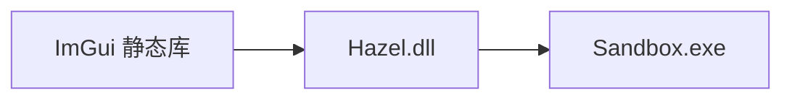

问题不在于 ImGui 没有被编译，而在于 Sandbox 直接调用的 `ImGui::Begin()`、`ImGui::End()` 等符号没有从 Hazel DLL 中导出。

视频把这个问题留作作业，没有在本集给出最终修复。可选思考方向包括：

- 调整导入/导出机制；
- 调整 ImGui 与 Hazel 的链接方式；
- 避免让 Sandbox 直接链接到未导出的 ImGui 符号。

编者说明：这里列出的是问题分析方向，不是视频中已经确定的解决方案。实际提交在这次视频对应的 `7c02b786` 之后仍继续调整。

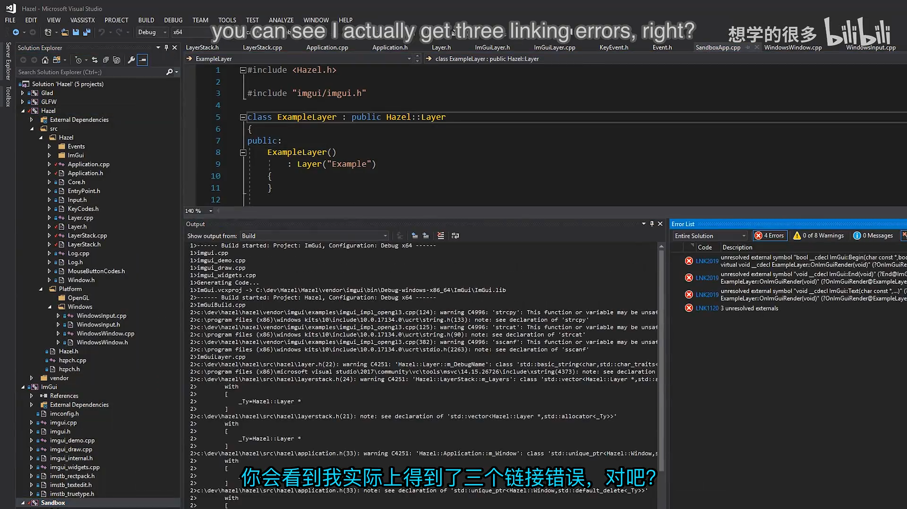

## 14. 本节结论

本讲把 Hazel 的 ImGui 集成升级为 Docking 与 Viewports：

- ImGui 子模块切换到 docking 分支；
- 使用官方 GLFW 与 OpenGL3 后端；
- 通过 `ImGuiBuild.cpp` 编译官方后端实现；
- 删除自定义 ImGui 输入事件同步与 OpenGL renderer；
- `ImGuiLayer` 改为 `OnAttach`、`OnDetach`、`Begin`、`End`、`OnImGuiRender`；
- 启用键盘导航、Docking 和 Viewports；
- Application 自动创建并持有 ImGuiLayer；
- 所有 Layer 都能通过 `OnImGuiRender()` 绘制 UI；
- End 阶段处理主窗口 DrawData 和浮动平台窗口；
- LayerStack 用索引替代易失效的迭代器；
- 演示了多视口、Dock Space 和编辑器式布局；
- 留下 DLL 符号导出问题作为练习。

这次重构的重点不是增加几个界面，而是调整维护边界：Hazel 不再复制 ImGui 的内部实现，而是依赖官方后端，让上游更新可以更容易地进入引擎。

## 附：参考

- [Bilibili 精译视频：022 - ImGui 停靠与视口](https://www.bilibili.com/video/BV1wtLazEEmC/?p=22)
- [The Cherno 游戏引擎系列播放列表](https://www.youtube.com/playlist?list=PLlrATfBNZ98dC-V-N3m0Go4deliWHPFwT5)
- [本期对应代码提交 `7c02b786`](https://github.com/TheCherno/Hazel/tree/7c02b7863f1d70af88b7c447b223c9da4dc9e04a)
- [Dear ImGui](https://github.com/ocornut/imgui)
- [Dear ImGui Docking 分支](https://github.com/ocornut/imgui/tree/docking)

