# Hazel 游戏引擎笔记 023：渲染入门与架构讨论

> 本节来源：[The Cherno 游戏引擎系列第 23 讲“渲染入门”](https://www.bilibili.com/video/BV1wtLazEEmC/?p=23)，时长约 28 分 42 秒。  
> 原课程与 Hazel 代码作者：The Cherno。  
> 本文由视频字幕重构、翻译并整理，不是官方教材。  
> 编者说明：本讲是纯讨论与设计准备，没有对应代码提交；下一讲才进一步设计渲染 API 抽象。

## 本节目标

ImGui、输入和基础平台层已经搭建完成，Hazel 接下来进入最大、最复杂的系统：渲染。

本讲没有编写代码，而是先回答几个根本问题：

- 渲染到底是什么？
- 为什么必须使用 GPU？
- 图形 API 之间有什么区别？
- 为什么一个图形 API 不足够？
- 抽象层应该画在哪里？
- Renderer 与 RendererAPI 分别负责什么？
- 为什么游戏线程与渲染线程之间需要命令队列？

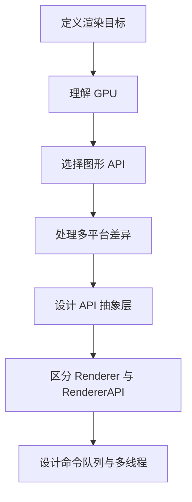


## 1. 什么是对实时渲染

*(参考时间: 00:03:04)*

视频把渲染定义为：把场景、模型或图形绘制到屏幕上。

游戏渲染与离线渲染的关键区别是“实时”：

- 目标通常是 60 FPS；
- 每帧只有约 `16.7ms`；
- 输入与画面之间需要低延迟；
- 场景和相机可能持续变化。

如果每帧预算是：

```text
1 秒 / 60 帧 = 16.67ms
```

那么 CPU 更新、物理、动画、排序、提交绘制命令和 GPU 绘制都必须在这个时间预算内完成。

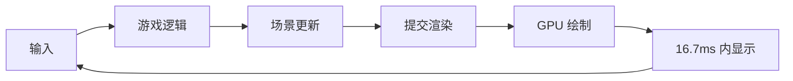


## 2. 高保真与真实感

“高保真”没有绝对定义，但游戏行业通常把越来越接近照片或电影画面的渲染视为高保真目标。

相关技术包括：

- 物理基础渲染（PBR）；
- 基于物理表面属性的光照；
- 光线追踪；
- 实时与离线渲染的结合。

影视离线渲染可以使用几秒、几分钟甚至几小时计算一帧，因此更容易使用高成本光线追踪。游戏必须在十几毫秒内完成，所以需要在视觉质量与计算成本之间权衡。

编者说明：视频提到的 RTX 与 Battlefield V 代表 2019 年前后刚开始普及的硬件光追方向；这是讲师的实时背景判断，不是本节代码接口的一部分。

## 3. 为什么需要 GPU

*(参考时间: 00:06:07)*

GPU 是图形处理单元，是专门执行图形与并行计算任务的硬件。视频把原因归纳为两点。

### 3.1 大规模并行

1920×1080 大约有 200 万个像素。确定每个像素颜色的计算通常彼此独立，因此非常适合并行执行。

CPU 核心数量较少，但单核控制能力更强；GPU 适合同时处理大量相似任务。

### 3.2 图形相关数学高度专门化

图形计算经常使用：

- 四分量向量；
- 4×4 矩阵；
- 大量浮点乘加；
- 顶点与像素的类似操作。

GPU 为这些运算提供大量并行单元和硬件优化。

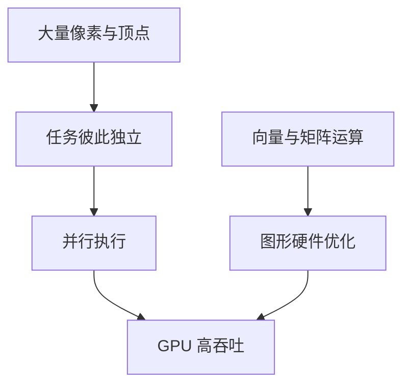


## 4. 图形 API：与 GPU 沟通的接口

*(参考时间: 00:07:49)*

应用不能直接假设所有显卡共享同一套底层指令。要与 GPU 通信，通常需要使用图形 API：

- OpenGL；
- Vulkan；
- DirectX 11 / 12；
- Metal；
- 平台专有 API。

不同 API 处于不同抽象层级。视频用大致“高层到低层”的方式描述：

```text
OpenGL          更高层，概念简洁
Metal           中等
DirectX 11      中等
DirectX 12      更接近硬件
Vulkan          极低层、显式、复杂
```

这不是严格数值排序，而是表达 API 让开发者承担多少显式管理责任。


## 5. 为什么 Hazel 先选择 OpenGL

*(参考时间: 00:09:39)*

如果目标是 2019 年最前沿的渲染技术，Vulkan 或 DirectX 12 通常更合适。但 Hazel 是一门教学过程，需要先让读者看到结果并逐步理解系统。

Vulkan 的问题包括：

- 初始化概念极多；
- 需要 physical device、logical device、instance、queue、swap chain 等大量对象；
- 只绘制一个三角形也可能需要大量代码；
- 学习曲线会淹没后续渲染知识。

因此第一版 RendererAPI 使用 OpenGL。

这不是声称 OpenGL 是最高性能选择，而是教育节奏和系统复杂度的取舍：

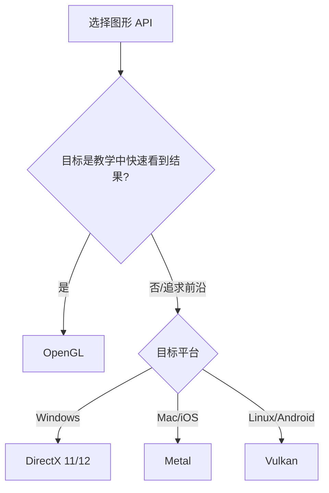


## 6. 一个图形 API 不足够

*(参考时间: 00:13:24)*

视频列出不同平台常见的首选 API：

| 平台 | 常见首选 |
|---|---|
| Windows | DirectX 11 / 12 |
| macOS / iOS | Metal |
| Linux | Vulkan |
| Android | Vulkan，较旧设备可能使用 OpenGL ES |
| Xbox | DirectX 12 |
| PlayStation | Sony 专有 API |
| Nintendo Switch | 视频中不确定，可能使用 Vulkan |

OpenGL 过去几乎到处可用，因此很像跨平台图形层的“最大公约数”。但它逐渐不再是各平台的性能与功能首选。

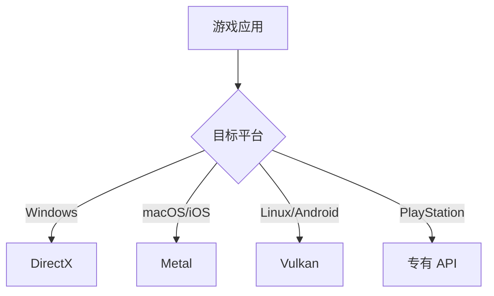

因此只选一个 API 会把 Hazel 限制在某种平台或某个功能层级。


## 7. 设计渲染 API 抽象层

*(参考时间: 00:14:40)*

目标是让客户端只调用 Hazel 的通用渲染接口：

```text
上传顶点缓冲
上传纹理
设置 Shader
提交 Draw Call
```

Hazel 在内部根据平台和当前后端选择：

```text
OpenGL
Vulkan
DirectX
Metal
```

应用代码不应该因为运行平台不同而改变。

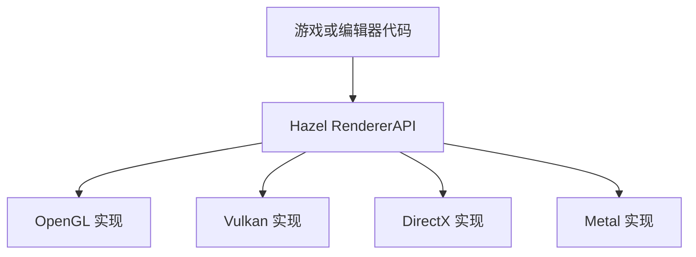


## 8. 难点：抽象线画在哪里

*(参考时间: 00:16:11)*

设计 API 最难的部分之一，是决定“暴露多少细节”。

两个极端：

```text
高层接口:
在这个位置画一个三角形

低层接口:
释放某个 Vulkan semaphore，或插入内存 fence
```

抽象线太靠上：

- 简单易用；
- 但高级技术需要更多控制时会被限制。

抽象线太靠下：

- 保留控制能力；
- 但客户端又必须理解底层细节，跨后端差异也无法真正隐藏。

视频当前倾向于在概念资源层画线。概念 API 可能包括：

```cpp
class VertexBuffer;
class IndexBuffer;
class Texture;
class Shader;
class RendererAPI;
```

顶点缓冲 API 可能提供：

```text
Create
Bind
UploadData
SetLayout
GetSize
```

但这还不是最终规格。随着高级渲染技术出现，抽象线可能上下移动。

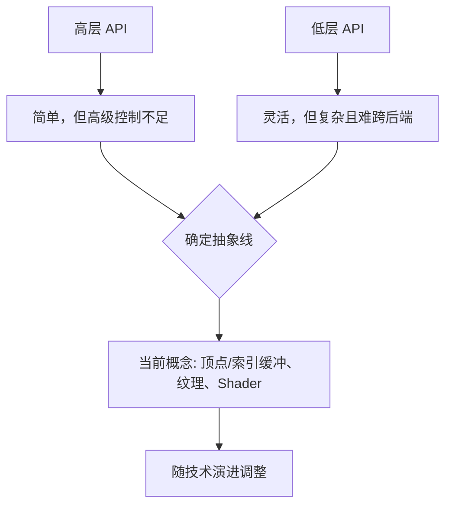


## 9. 从“画三角形”理解后端差异

*(参考时间: 00:19:12)*

无论 OpenGL 还是 Vulkan，概念步骤大致相同：

1. 创建渲染上下文；
2. 创建渲染 framebuffer；
3. 上传 vertex buffer；
4. 上传 index buffer；
5. 上传 shader；
6. 设置 viewport 与渲染状态；
7. 发出 draw call。

Vulkan 需要显式创建更多对象：

- instance；
- physical device；
- logical device；
- queue；
- swap chain；
- 每个 swap chain image 对应的 framebuffer；
- command buffer 等。

OpenGL 会隐藏更多步骤，因此代码短得多。但概念可以抽象为相同的高层步骤，于是 Hazel 能够在这条线上设计统一接口。

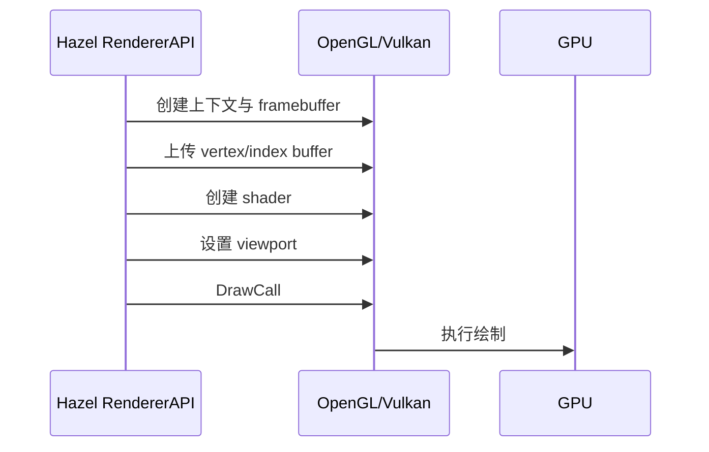


## 10. Renderer 与 RendererAPI 的分层

*(参考时间: 00:21:41)*

RendererAPI 不应等同于整个 Renderer。

### 10.1 RendererAPI：偏底层资源与命令

负责：

- 上传 vertex / index buffer；
- 上传纹理；
- 管理 shader；
- 设置待绘制状态；
- 提交 draw call。

### 10.2 Renderer：偏上层组织与决策

负责：

- Scene Graph；
- Render Sorting；
- Batching；
- Culling；
- 把场景转换成一系列渲染命令。

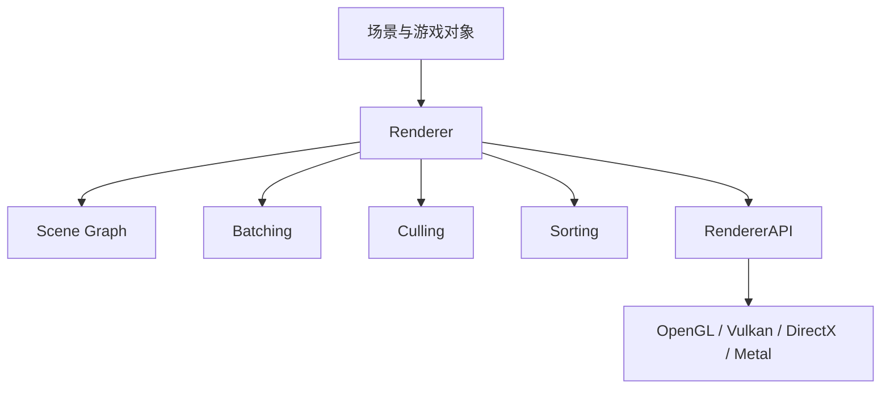

本讲只准备设计最下面的 RendererAPI 抽象，Renderer 上层将在后续继续讨论。


## 11. 多线程与 Render Command Queue

*(参考时间: 00:22:45)*

游戏引擎常把更新与渲染拆到不同线程：

```text
游戏线程:
更新逻辑、动画、物理，提交渲染命令

渲染线程:
按顺序消费命令并调用图形 API
```

命令不能直接依赖游戏线程中的临时对象，因为后者可能在执行前被修改或销毁。典型方案是命令编码器把：

- 命令类型；
- 参数数据；
- 函数指针或执行逻辑；

复制到连续内存缓冲区。渲染线程像读取 CPU 指令流一样依次解释：

```text
opcode
data size
parameters
```

这种方式更缓存友好，也可以减少线程同步成本。

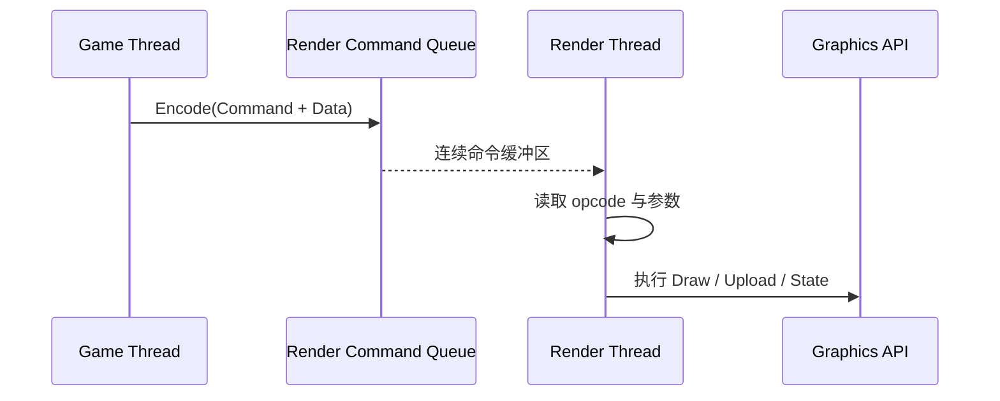

Vulkan 与 DirectX 12 本身有命令队列和显式命令提交模型；OpenGL 没有同等抽象，因此 Hazel 可能需要自己建立跨 API 的 Render Command Queue。

这能带来效率和线程解耦，但也增加：

- 生命周期管理；
- 同步；
- 调试困难；
- 命令编码复杂度。


## 12. 为什么先讨论，不直接写代码

*(参考时间: 00:25:46)*

渲染是 Hazel 目前最大的子系统，也是最难在后期修改边界的部分。

如果抽象线画错：

- 上层 Renderer 会被错误接口束缚；
- 后端实现会产生大量特殊分支；
- 高级渲染技术可能要求重写公共 API；
- 多线程命令系统会放大生命周期错误。

因此本节选择先把问题、平台差异和术语讲清楚。下一讲计划用正式演示和图表讨论 RendererAPI 的架构，并根据社区反馈调整设计。

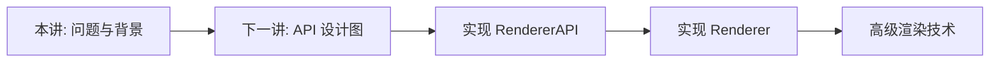


## 13. 本节结论

本讲没有新增 Hazel 代码，但建立了后续渲染实现的概念框架：

- 渲染是把场景实时绘制到屏幕；
- 60 FPS 意味着每帧约 `16.7ms`；
- GPU 擅长并行像素计算和图形数学；
- 图形 API 是与 GPU 通信的接口；
- OpenGL 被选为第一版教学后端，因为概念更简单；
- 不同平台首选 DirectX、Metal、Vulkan 等不同 API；
- Hazel 需要 RendererAPI 抽象层；
- 抽象线必须在易用性与底层控制之间取舍；
- Renderer 负责场景、排序、批处理与剔除，RendererAPI 负责资源和绘制命令；
- 渲染命令队列可以把游戏线程与渲染线程解耦；
- 渲染架构应先设计，再进入长期实现。

下一讲将从这组概念出发，正式设计 Hazel 的渲染 API 抽象。

## 附：参考

- [Bilibili 精译视频：023 - 渲染入门](https://www.bilibili.com/video/BV1wtLazEEmC/?p=23)
- [The Cherno 游戏引擎系列播放列表](https://www.youtube.com/playlist?list=PLlrATfBNZ98dC-V-N3m0Go4deliWHPFwT5)
- [The Cherno 的 Hazel 仓库](https://github.com/TheCherno/Hazel)

> 编者说明：本讲没有对应的代码提交，因此书首与文末不标注特定 Hazel commit。

