# Hazel 游戏引擎笔记 024：渲染架构

> 本节来源：[The Cherno 游戏引擎系列第 24 讲“渲染架构”](https://www.bilibili.com/video/BV1wtLazEEmC/?p=24)，时长约 27 分 53 秒。  
> 原课程与 Hazel 代码作者：The Cherno。  
> 本文由视频字幕重构、翻译并整理，不是官方教材。  
> 编者说明：本讲是架构设计演示，没有对应代码提交；文中的接口与职责分层是设计方向，不是已经完成的实现。

## 本节目标

上一讲讨论了为什么渲染困难。本讲把问题拆成两个主要区域：

1. **Render API**：与 OpenGL、Vulkan、DirectX、Metal 等具体图形 API 绑定的底层实现；
2. **Renderer**：与图形 API 无关的场景组织、排序、剔除、材质和渲染技术。

目标是让上层 Renderer 只使用 Hazel 自己定义的抽象接口。将来更换图形后端时，Renderer 的业务逻辑尽量保持不变。

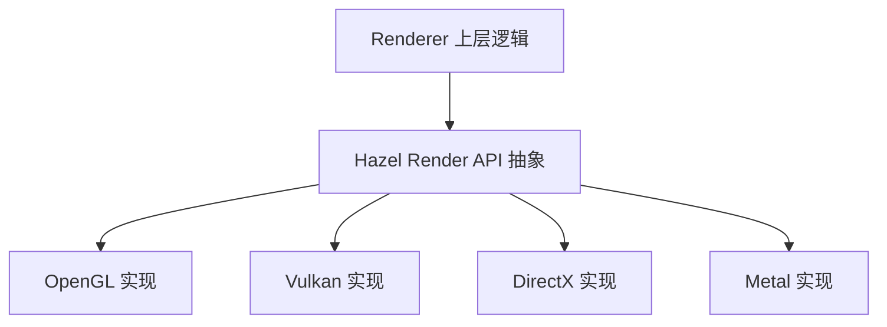

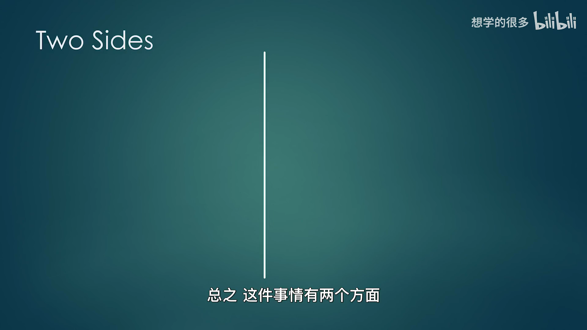

## 1. 术语约定

视频明确说明，“Render API”这个术语不是来自统一教材，而是为了本系列讨论而采用的命名。

本文沿用：

- **Render API**：Hazel 为图形后端建立的抽象，以及它在 OpenGL、Vulkan 等后端上的具体实现；
- **Renderer**：使用 Render API 的高层渲染系统；
- **图形 API**：OpenGL、Vulkan、DirectX、Metal 等第三方接口。

“API”一词在这个系列中有两种语境，需要根据上下文判断。

## 2. Render API 区域

*(参考时间: 00:04:00)*

Render API 区域负责与具体图形 API 直接交互。最重要的抽象资源包括：

| 抽象资源 | 作用 |
|---|---|
| Render Context | 管理当前图形上下文 |
| Swap Chain | 管理可显示图像并提交到屏幕 |
| Framebuffer | 作为渲染输出目标 |
| Vertex Buffer | 上传顶点数据 |
| Index Buffer | 上传索引数据 |
| Texture | 管理纹理资源 |
| Shader | 管理着色器与相关反射信息 |
| States | 保存渲染状态 |
| Pipeline | 描述固定功能与着色器阶段组合 |
| Render Pass | 描述一组渲染输出与附件 |

这些对象在不同图形 API 中差异很大，因此需要多个后端实现。

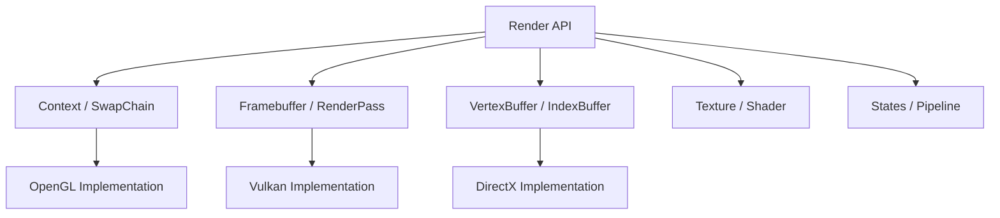

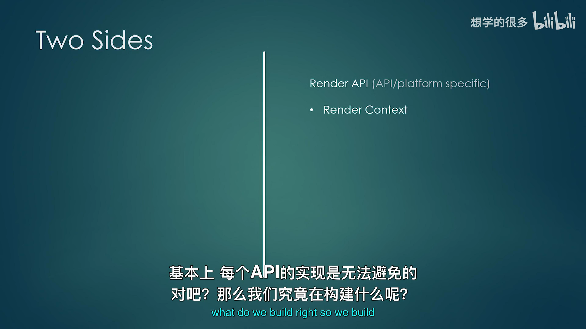

## 3. 用抽象资源绘制三角形

*(参考时间: 00:05:50)*

Renderer 不应直接写：

```text
glGenBuffers
glBindBuffer
vkCmdBindPipeline
vkCmdDraw
```

它应该使用 Hazel 的抽象资源：

```text
创建 Render Context 与 Swap Chain
创建 Framebuffer
上传 Vertex Buffer
上传 Index Buffer
创建 Shader
创建 Render Pass / Pipeline
提交 Draw Call
```

当 Hazel 从 OpenGL 切换到 Vulkan 或 DirectX 12 时，这段 Renderer 逻辑理论上不需要改变。

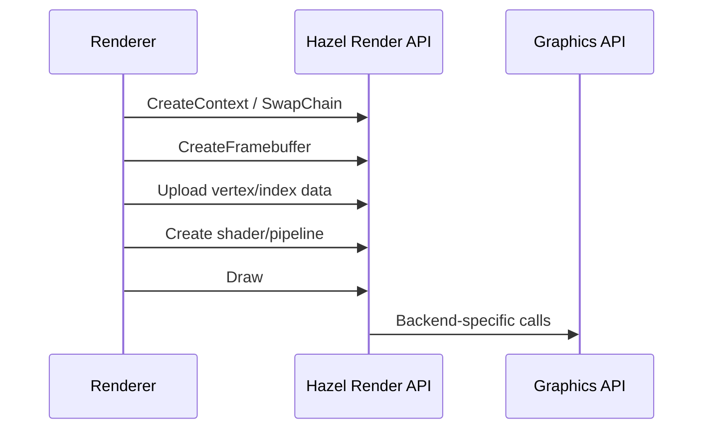

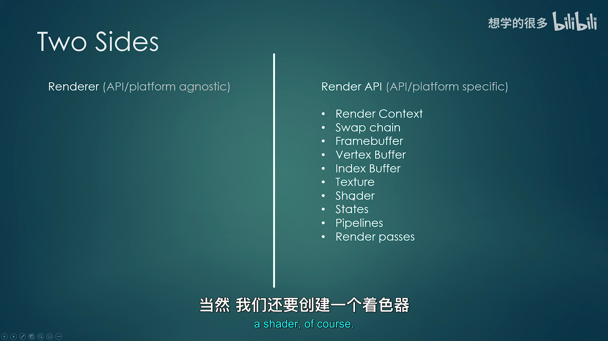

## 4. Renderer 区域

*(参考时间: 00:07:45)*

Renderer 负责与具体图形 API 无关的逻辑。

### 4.1 2D / 3D Renderer

Renderer2D、Renderer3D 或 forward、deferred 等高层渲染方案主要建立在 Render API 原语之上。

### 4.2 Scene Graph / Scene Manager

场景和图结构描述“世界里有什么”，不应该包含原始 OpenGL 调用。

### 4.3 Render Sorting

排序目标包括：

- 保持透明物体正确绘制顺序；
- 让使用相同 Material、Shader 或 Texture 的物体连续绘制；
- 减少状态切换。

### 4.4 Culling

包括视锥剔除、遮挡剔除等，只保留可能出现在画面中的对象。

### 4.5 LOD

根据距离选择不同精度模型，减少远处网格的三角形数量。

### 4.6 Animation

骨骼、关键帧、蒙皮等动画系统不直接依赖图形 API。

### 4.7 Camera

Camera 确定观察矩阵、投影矩阵和可能的 Render Target。

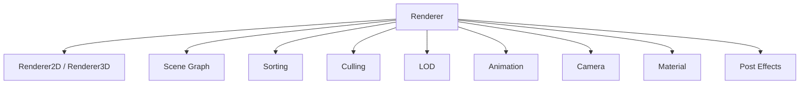

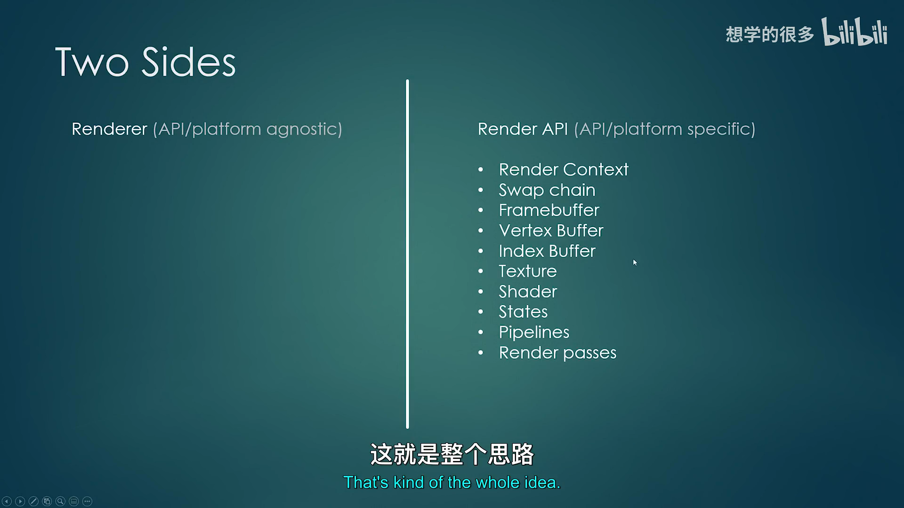

## 5. Material 与 Material Instance

*(参考时间: 00:13:58)*

视频把 Material 简化定义为：

```text
Material = Shader + Uniform Data
```

Material 保存与某个 Shader 配套的参数。Material Instance 基于同一个 Material，但拥有不同的参数值，例如不同的颜色、粗糙度或纹理。

如果每个材质实例都重新创建一个 Shader 或重新编译变体，成本会非常高。因此典型设计是：

- 多个实例共享 Shader；
- 每个实例保存自己的 Uniform / 参数数据；
- 渲染时绑定共享 Shader，再上传实例参数。

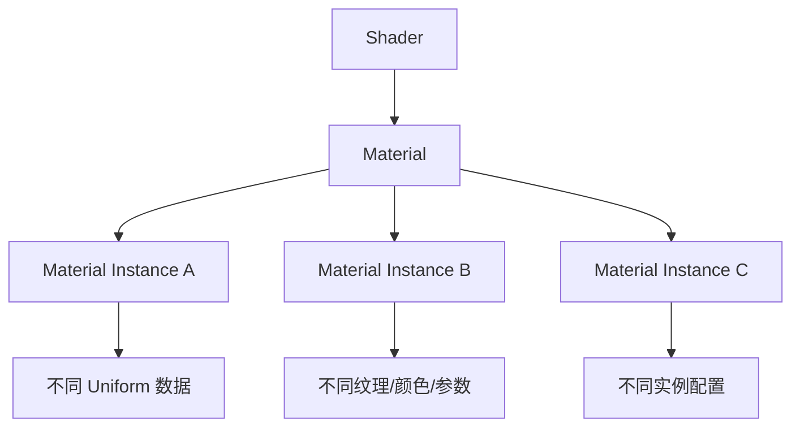

Material 属于 Renderer 层，因为它描述的是资源和参数如何组织，而不是某个图形 API 的创建步骤。

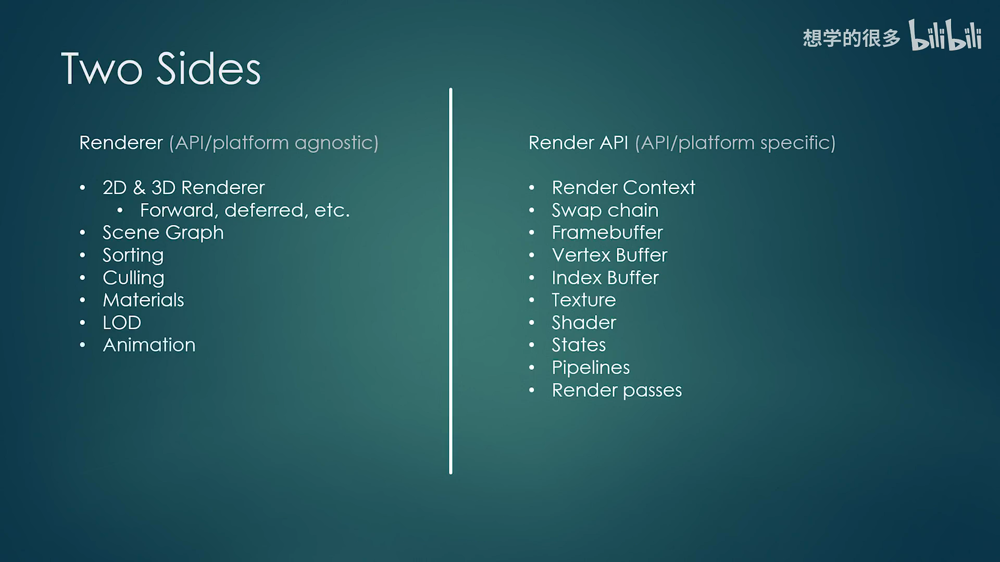

## 6. 哪些功能必须下沉到 Render API

Renderer 希望尽量通用，但某些高级功能需要图形 API 提供额外能力。

例如：

- Vulkan 有 pipeline、descriptor set、fence、semaphore；
- OpenGL 很多状态和资源管理更隐式；
- 延迟渲染在 OpenGL 与 Vulkan 中的实现方式可能差异很大；
- 实例化需要底层 API 支持；
- Render Pass / Pipeline 的粒度可能直接影响性能。

当通用原语不足时，可以把特定实现下沉到 Render API 区域：

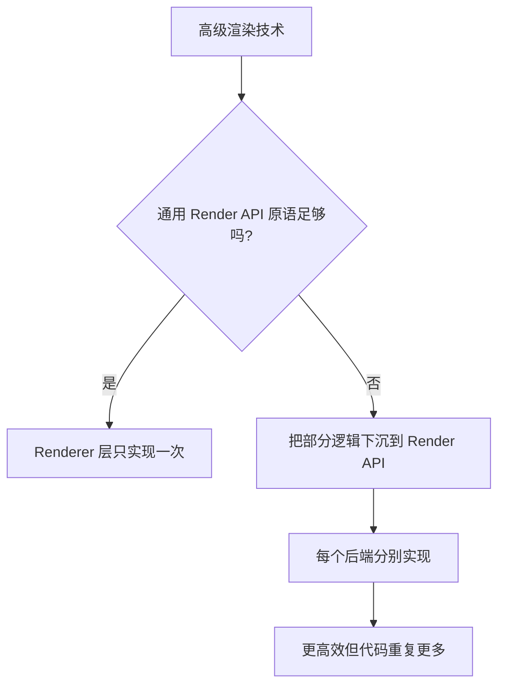

下移代码的收益是性能和控制力，代价是需要为每个后端分别写出对应实现。


## 7. 通用抽象与性能的矛盾

*(参考时间: 00:17:43)*

理想情况下，一个强大的 Render API 可以让所有渲染技术只写一次，然后自动适配所有后端。

但“通用”本身会带来代价：

- 接口必须兼容所有后端；
- 只能暴露最小的公共能力；
- 高级技术可能需要绕过抽象；
- 完全通用并不等于极致性能。

视频把这个问题类比为通用游戏引擎与专用游戏引擎：

- 通用引擎适用于更多项目；
- 针对单个游戏定制的引擎通常能做得更快、更合适；
- 因此通用 Render API 不可能在所有场景下都等同于直接使用 DirectX 12 或 Vulkan。

这不是否定抽象，而是提醒后续设计必须持续衡量抽象层与性能。


## 8. Renderer 与 Render API 的职责表

| 功能 | Render API | Renderer |
|---|---:|---:|
| Context / Swap Chain | Yes | No |
| Framebuffer | Yes | Uses |
| Vertex / Index Buffer | Yes | Uses |
| Texture / Shader | Yes | Uses |
| Pipeline / Render Pass | Yes | Uses |
| Renderer2D / 3D | No | Yes |
| Scene Graph | No | Yes |
| Sorting / Culling | No | Yes |
| Material System | No | Yes |
| Material Instance | No | Yes |
| LOD / Animation | No | Yes |
| Camera | No | Yes |
| Post Effects System | Partly | Yes |
| Instancing | Yes | Uses |
| Batching | No | Yes |

边界并不总是绝对。例如 Render Pass 既像底层原语，又被 Renderer 控制；Visual Effects 也可能需要 API 支持。

## 9. Render Command Queue

*(参考时间: 00:19:22)*

Renderer 与 Render API 之间还需要命令队列。

基本流程：

1. 游戏线程提交 Render Command；
2. 命令被编码到连续内存缓冲区；
3. 渲染线程读取命令；
4. 渲染线程调用 Render API 执行；
5. 主线程继续处理下一条游戏逻辑或下一帧命令。

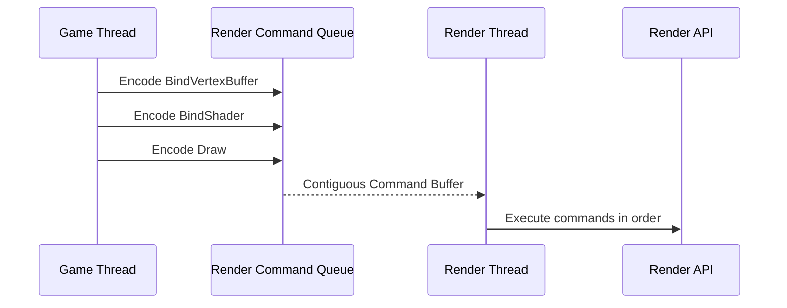

Vulkan 原生有 command queue / command buffer 概念；OpenGL 没有同样完善的显式命令模型，因此 Hazel 可能需要自己建立。

设计参考有两种方向：

- 尽量模仿 DirectX 的命令风格；
- 设计 Hazel 自己的模型。

视频没有在此时定案。

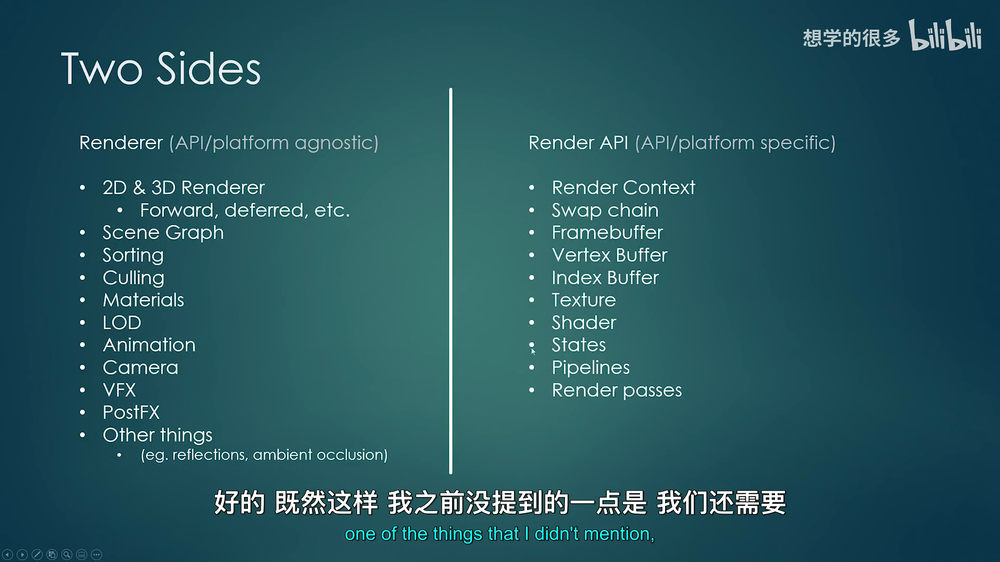

## 10. 实现路线

*(参考时间: 00:21:11)*

### 10.1 第一步：建立 Render API

先实现 OpenGL 版本：

- Context；
- Swap Chain；
- Framebuffer；
- Vertex / Index Buffer；
- Texture；
- Shader；
- State / Pipeline；
- Render Pass。

目标是至少可以画出一个三角形。

### 10.2 第二步：建立基础 Renderer

一旦 Render API 能绘制三角形，就开始实现 Renderer，并持续迭代。

随后逐步增加：

- Framebuffer / Render Texture；
- Material System；
- Shader Parser；
- PBR；
- 3D 模型；
- Post Effects；
- 其他高级技术。

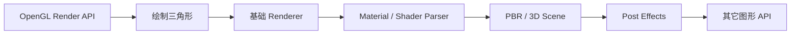

### 10.3 第三步：可选地实现其它后端

Vulkan、DirectX 11 / 12、Metal 会在 OpenGL 路线稳定后讨论。也可能先做场景系统、关卡编辑器、序列化、组件系统和脚本，再回到新图形后端。

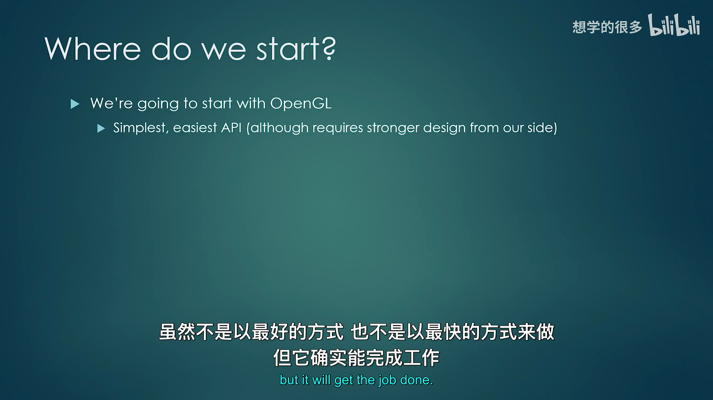

## 11. 为什么仍然先选 OpenGL

*(参考时间: 00:21:11)*

如果只考虑个人高性能引擎，可能会直接选择 Vulkan。但本项目需要：

- 尽快看到画面；
- 让观众看到可展示结果；
- 避免数集都耗在交换链初始化；
- 留出时间实现场景、编辑器、序列化和脚本等游戏引擎系统。

OpenGL 简单，但不代表设计可以粗糙。因为 OpenGL 隐藏了许多显式控制，Renderer API 反而需要更认真地组织资源与状态。

## 12. 本节结论

本讲形成了 Hazel 渲染架构的第一版设计：

- 系统分为 platform/API-specific 的 Render API 与 platform/API-agnostic 的 Renderer；
- Render API 负责 Context、Swap Chain、Framebuffer、Buffer、Texture、Shader、Pipeline、Render Pass；
- Renderer 负责 2D/3D、场景图、排序、剔除、LOD、动画、相机、材质与 Post Effects；
- Material 由 Shader 与 Uniform 数据组成；
- Material Instance 共享 Shader，但拥有各自的参数；
- 高级技术可能需要下沉到 Render API 区域；
- 通用抽象与最高性能之间存在固有矛盾；
- Render Command Queue 可以解耦游戏线程与渲染线程；
- 先从 OpenGL 开始，目标是尽快画出三角形；
- 之后再扩展到 Vulkan、DirectX、Metal 等后端。

下一阶段的重点是从最小可运行实现开始，而不是一次设计完整个 Renderer。

## 附：参考

- [Bilibili 精译视频：024 - 渲染架构](https://www.bilibili.com/video/BV1wtLazEEmC/?p=24)
- [The Cherno 游戏引擎系列播放列表](https://www.youtube.com/playlist?list=PLlrATfBNZ98dC-V-N3m0Go4deliWHPFwT5)
- [The Cherno 的 Hazel 仓库](https://github.com/TheCherno/Hazel)

> 编者说明：本讲是架构演示，没有对应的代码提交，因此不标注特定 Hazel commit。

