# Hazel 游戏引擎笔记 025：渲染前维护与静态库决策

> 本节来源：[The Cherno 游戏引擎系列第 25 讲“渲染与维护”](https://www.bilibili.com/video/BV1wtLazEEmC/?p=25)，时长约 24 分 59 秒。  
> 原课程与 Hazel 代码作者：The Cherno。  
> 本文由视频字幕重构、翻译并整理，不是官方教材。  
> 编者说明：本讲没有直接对应的代码提交。后续 Hazel 提交 `440d937a` 实现了“改为静态库并修复警告”，可视为本讲讨论的落地结果。

## 本节目标

本讲原计划开始渲染器，但清理代码时发现 Hazel 仍存在 ImGui DLL 符号导出问题。因此视频临时转向维护工作，讨论：

- ImGui 静态库链接进 Hazel DLL 后为什么丢失符号；
- 如何用导出宏临时解决；
- 如何用 `.def` 模块定义文件长期解决；
- 为什么最终更倾向于把 Hazel 改成静态库；
- 下一阶段渲染器的实现顺序。

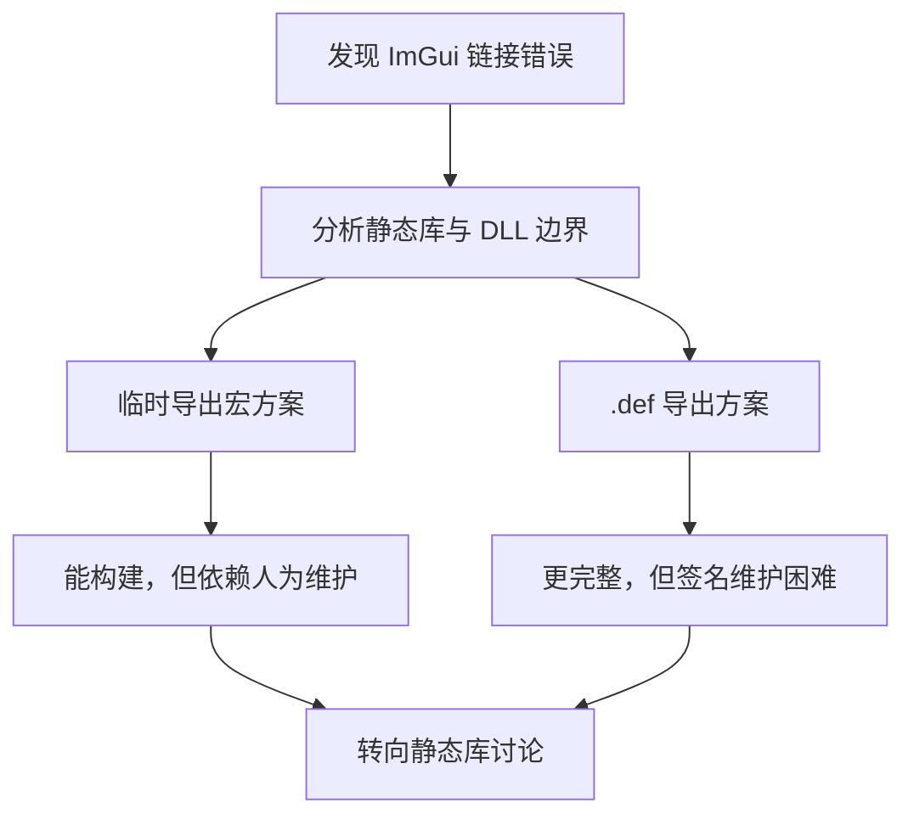


## 1. 当前构建结构

*(参考时间: 00:02:04)*

ImGui 被编译为静态库：

```text
ImGui.lib
```

它与 Hazel 链接：

```text
ImGui.lib -> Hazel.dll
```

Sandbox 又链接 Hazel：

```text
Hazel.dll -> Sandbox.exe
```

完整结构：


Sandbox 如果直接调用：

```cpp
ImGui::Begin("Test");
ImGui::End();
```

链接器会尝试从 Hazel DLL 导入 `ImGui::Begin`、`ImGui::End` 等符号。

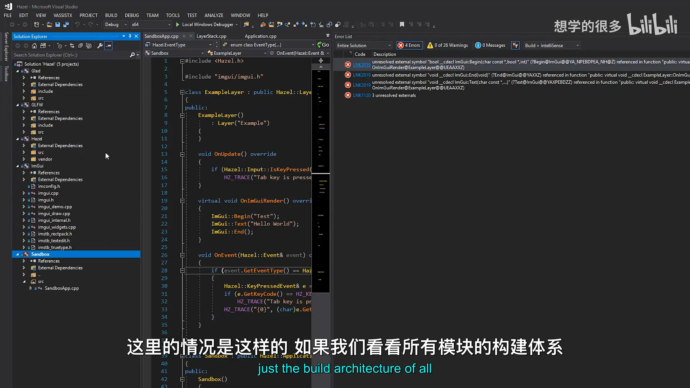

## 2. 为什么会丢失 ImGui 符号

*(参考时间: 00:04:33)*

DLL 的链接器会丢弃未被 Hazel 内部使用的符号。

如果 Hazel DLL 自己没有调用：

```cpp
ImGui::Begin
ImGui::End
ImGui::ColorEdit4
```

那么它们可能不会出现在最终的 `Hazel.dll` 导出表中。Sandbox 之后想使用这些函数，就得到：

```text
unresolved external symbol
```

问题不一定是“ImGui 没编译”，而是：

1. ImGui 静态库已经进入 Hazel 链接流程；
2. Hazel DLL 没有使用其中某些函数；
3. 链接器优化掉死代码；
4. 这些符号既没有被保留，也没有被导出；
5. Sandbox 最终无法导入。

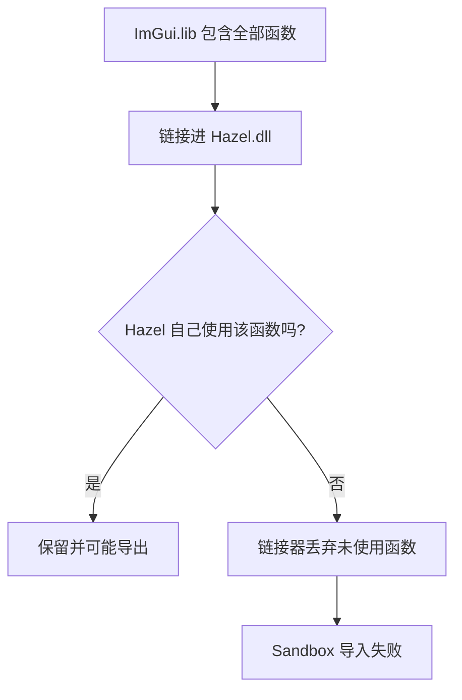

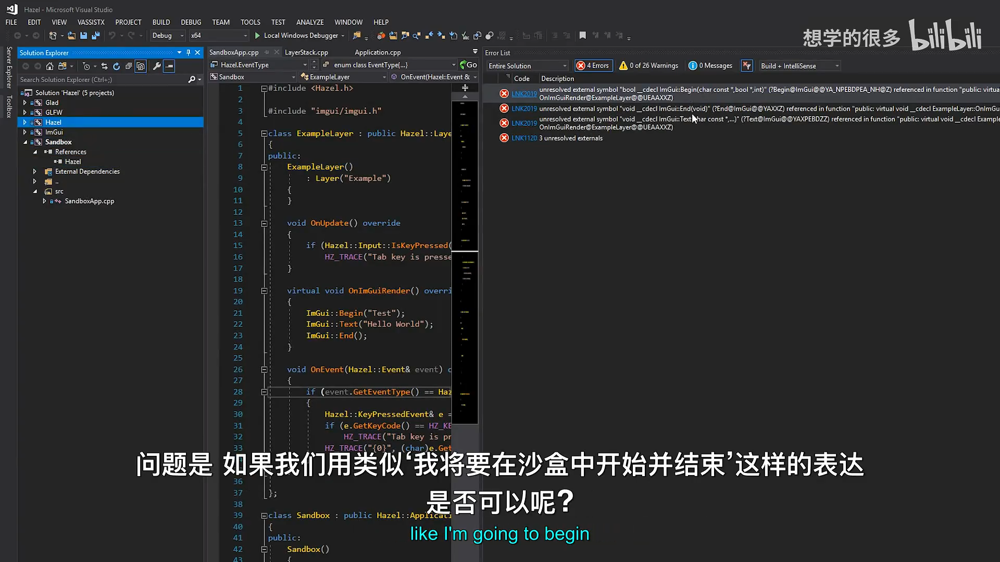

## 3. 临时方案一：强制使用并导出符号

*(参考时间: 00:06:54)*

第一种方案是：

1. 在 Hazel 内部真的调用相关 ImGui 函数，防止它们被丢弃；
2. 把 `IMGUI_API` 在不同模块中定义为不同属性。

构建 ImGui 与 Hazel 时：

```cpp
#define IMGUI_API __declspec(dllexport)
```

构建 Sandbox 时：

```cpp
#define IMGUI_API __declspec(dllimport)
```

这样可以显式导出和导入 ImGui 符号，Sandbox 中会出现 `Hello World` 窗口，并且该窗口仍可拖出主应用，说明多视口功能正常。

但该方案依赖“符号刚好被使用”，对于未使用的函数仍可能失败。它适合快速验证，不是稳定长期方案。

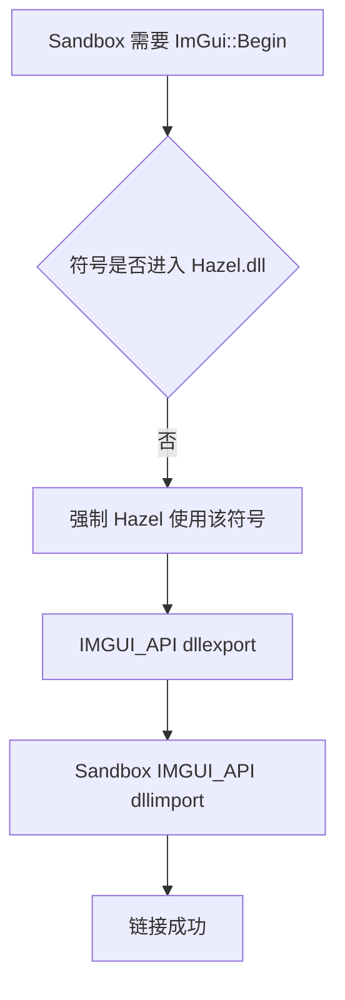

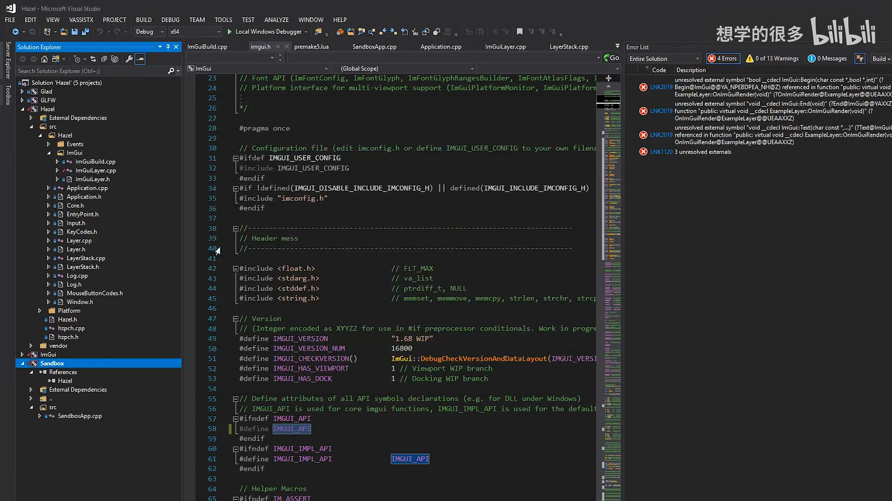

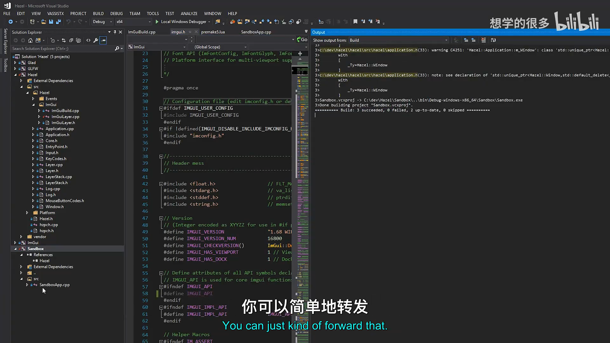

## 4. 长期方案二：使用 .def 模块定义文件

*(参考时间: 00:09:39)*

更完整的做法是为 Hazel DLL 增加 Modules Definition File：

```text
Hazel.def
```

`.def` 文件列出希望从 DLL 导出的函数签名。

概念结构：

```text
LIBRARY Hazel

EXPORTS
    ; ImGui functions required by clients
    ...
```

如果某个 ImGui 函数出现在 `.def` 中，链接器就必须把它保留在 Hazel DLL 并导出，即使 Hazel 自己没有调用它。

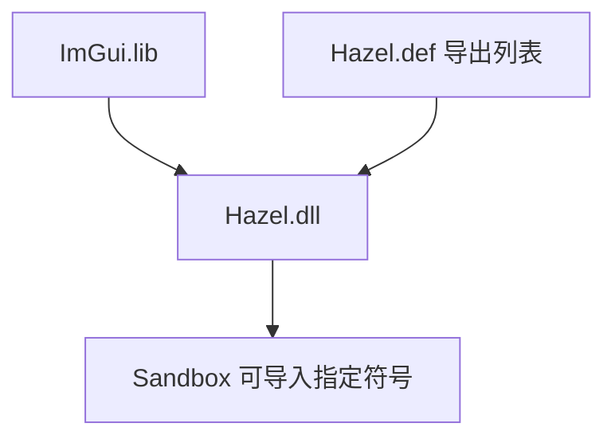

视频展示了一份开发分支中的实际 `.def` 文件，其中包括：

- ShowDemoWindow；
- Begin；
- End；
- ColorEdit4；
- 其它客户端需要的 ImGui 函数。

### 4.1 .def 的问题

`.def` 文件很有效，但维护困难：

- 必须手写函数签名；
- 不能简单依赖编译器自动生成；
- 新加客户端函数时容易忘记同步；
- 不同编译器或 ABI 下需要仔细处理名称修饰；
- 导出列表可能越来越长。

因此它是“正确问题”的“麻烦方案”，但不是最省心的长期工作流。

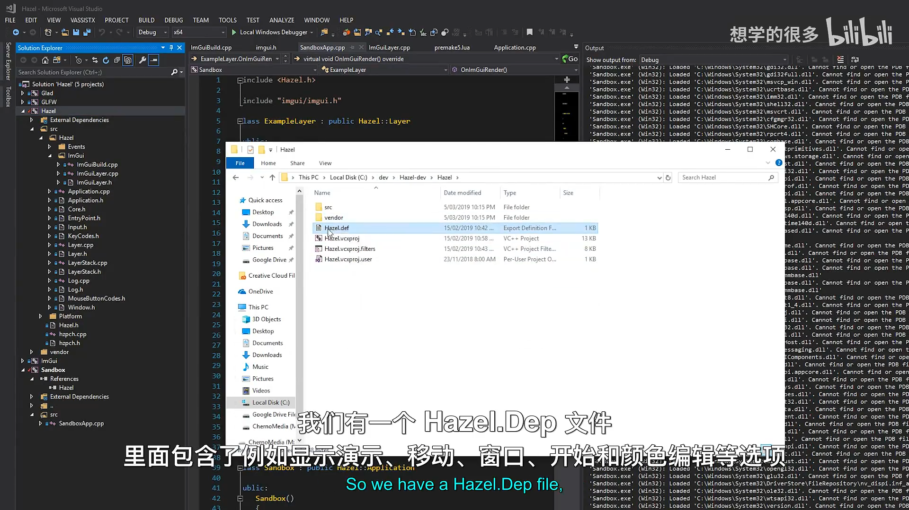

## 5. 转向讨论：Hazel 是否应该继续使用 DLL

*(参考时间: 00:11:10)*

Cherno 开始重新评估 Hazel 的库类型。

最初使用 DLL 的理由：

- 方便客户端只链接 Hazel；
- 理论上支持热替换引擎代码；
- 可以减少某些客户端的链接配置。

但在实际开发中，DLL 带来了大量问题：

- 每个公共类型都需要 `HAZEL_API`；
- `export / import` 宏遍布代码；
- `std::shared_ptr` 跨 DLL 边界产生警告；
- 模板跨 DLL 边界容易出问题；
- 不同模块可能链接不同版本的 C++ Runtime；
- 分发时需要携带多个 DLL；
- 链接器可能丢弃未被引擎内部使用的符号；
- Sandbox 需要强制导入大量 ImGui 符号。

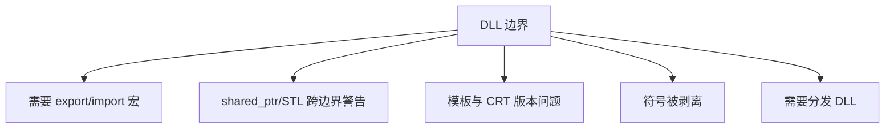

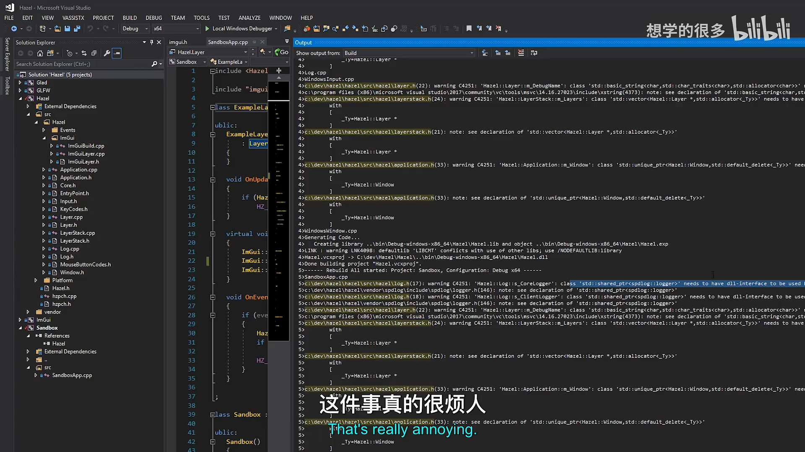

## 6. 静态库的优势

*(参考时间: 00:12:16)*

如果 Hazel 改成静态库：

```text
ImGui.lib + Hazel.lib -> Sandbox.exe
```

优点包括：

- 最终可执行文件直接包含所需代码；
- 不需要 `__declspec(dllexport/dllimport)`；
- 不会出现 DLL 导出表缺失符号问题；
- C++ Runtime 版本更统一；
- 不需要分发一堆 DLL；
- 链接器可以在整个程序范围内做内联等优化；
- 能消除大量 DLL 边界警告；
- 客户端构建流程更一致。

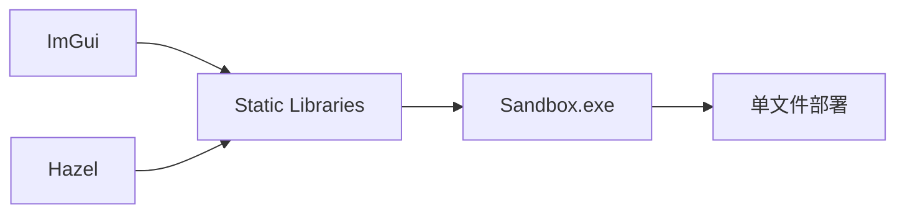


## 7. 那么热重载怎么办

*(参考时间: 00:15:49)*

热重载仍然有价值，但需要区分两部分：

### 7.1 游戏代码

游戏代码经常变化，适合：

- 编译为 DLL；
- 运行中替换；
- 快速迭代玩法。

### 7.2 引擎代码

对于使用 Hazel 制作游戏的客户端，引擎通常已经稳定：

- 不应该频繁修改引擎源码；
- 真正需要热重载的是游戏代码；
- 把 Hazel 本身做成 DLL 并不一定带来实际收益。

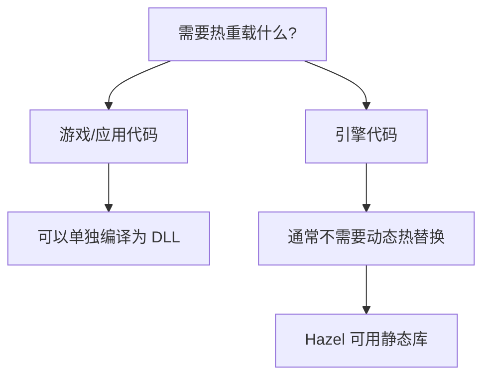

未来也可以采用类似 id Software 的方案：

- 引擎本体为静态库或可执行程序；
- 游戏模块单独做成 DLL；
- 引擎负责加载和替换游戏 DLL。


## 8. 支持两种构建方式是否值得

视频讨论了同时支持 DLL 和静态库的可能，但最终倾向只选择一种。

原因不是技术上做不到，而是：

- 项目主要由一个人维护；
- 多套构建路径会增加测试矩阵；
- 某些代码必须针对 DLL 边界特殊处理；
- 多余的灵活性会制造长期维护成本；
- 对 Hazel 来说，建立清晰、稳定的工作流更重要。

这与上一讲讨论 Render API 时的观点一致：通用和灵活并不自动等于更好，项目需要找到合适的边界。

## 9. 维护任务

*(参考时间: 00:20:42)*

转换静态库时会顺带处理：

1. 移除不再需要的 `HAZEL_API` 导出宏；
2. 清理 Premake 配置；
3. 为第三方 ImGui 定义 `_CRT_SECURE_NO_WARNINGS`；
4. 处理已有 C++ 警告；
5. 验证干净检出能够直接构建；
6. 尝试让 Hazel 在零警告条件下构建。

第三方代码使用旧的 CRT 函数时，Hazel 不应直接修改 ImGui，而是在构建 ImGui 模块时用预处理器宏抑制相关警告。


## 10. 下一阶段渲染实现计划

*(参考时间: 00:22:04)*

维护完成后，渲染从最小闭环开始。

### 10.1 OpenGL Render Context

建立：

- OpenGL Context；
- Swap Chain；
- 必要的窗口与图形上下文连接。

### 10.2 Shader Compilation Helper

增加一个基础 Shader 编译辅助模块，方便快速创建和调试 Shader。

### 10.3 每集都尽量看到结果

视频明确计划避免“连续五集只写底层，最后才看到三角形”。实现策略是：

1. 先写最小的 OpenGL 客户端代码；
2. 立即让三角形显示在屏幕上；
3. 再把代码逐步提取到类；
4. 提取到 Hazel Render API；
5. 最后抽象为 Renderer。

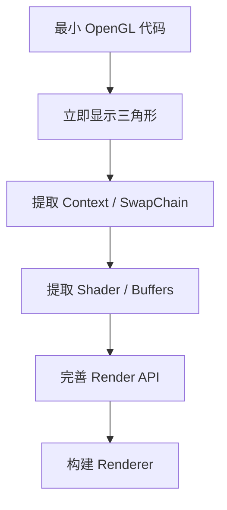


## 11. 本讲结论

本讲没有完成新渲染功能，但解决了渲染长期维护的前置问题：

- 定位 ImGui 静态库链接进 Hazel DLL 后的符号剥离问题；
- 用 `IMGUI_API dllexport/dllimport` 临时修复；
- 介绍 `.def` 模块定义文件的长期导出方案；
- 认识到 `.def` 维护成本很高；
- 重新评估 Hazel 使用 DLL 的收益与成本；
- 倾向改为静态库；
- 区分引擎热重载与游戏代码热重载；
- 决定优先建立简单、稳定的构建工作流；
- 规划静态库转换、警告清理和零警告构建；
- 渲染从 OpenGL Context、Swap Chain 和 Shader Helper 开始；
- 后续每集都尽量在屏幕上展示结果。

编者说明：后续 Hazel 提交 `440d937a` 完成了“改为静态库并修复警告”，证明本讲讨论的方向最终进入了仓库。

下一阶段将先完成静态库转换和仓库清理，再正式实现 OpenGL 渲染上下文与第一个三角形。

## 附：参考

- [Bilibili 精译视频：025 - 渲染与维护](https://www.bilibili.com/video/BV1wtLazEEmC/?p=25)
- [The Cherno 游戏引擎系列播放列表](https://www.youtube.com/playlist?list=PLlrATfBNZ98dC-V-N3m0Go4deliWHPFwT5)
- [The Cherno 的 Hazel 仓库](https://github.com/TheCherno/Hazel)

> 编者说明：本讲本身没有代码提交；文末参考了后续静态库转换提交，仅用于说明讨论结果。

