# Hazel 游戏引擎笔记 026：静态库与零警告

> 本节来源：[The Cherno 游戏引擎系列第 26 讲“静态库和零警告”](https://www.bilibili.com/video/BV1wtLazEEmC/?p=26)，时长约 22 分 51 秒。  
> 原课程与 Hazel 代码作者：The Cherno。代码参考提交：[`440d937a`](https://github.com/TheCherno/Hazel/tree/440d937a)。  
> 本文由视频字幕重构、翻译并整理，不是官方教材；术语和代码以原视频及同期 Hazel 仓库为准。

## 本节目标

上一讲决定把 Hazel 从动态库改成静态库。本讲实际执行转换，并把整个解决方案的警告降到零。

主要任务：

- 把 Hazel 的项目类型从 `SharedLib` 改为 `StaticLib`；
- 在所有依赖项目中启用静态 Runtime；
- 移除复制 DLL 的后构建步骤；
- 让 `HAZEL_API` 在静态链接时变为空；
- 统一 Debug / Release / Dist 的 Runtime 配置；
- 处理 ImGui 使用旧 CRT 函数产生的警告；
- 处理跨 DLL 边界的 shared_ptr 和模板警告；
- 实现零警告构建；
- 验证 Sandbox 仍能正常运行。

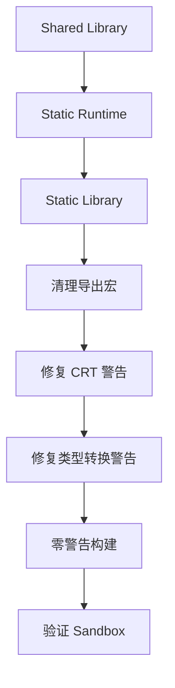


## 1. 转换前的警告状态

*(参考时间: 00:03:32)*

清理后重新构建，会看到多种警告。

### 1.1 DLL 边界警告

`std::shared_ptr`、模板类型和 STL 类型跨越 DLL 边界时，会产生类似警告：

```text
needs to have dll-interface to be used by clients
```

这些警告不一定意味着代码立即出错，但说明 DLL 边界正在让类型系统与 ABI 变得复杂。

### 1.2 Runtime 冲突

不同静态库或 DLL 可能链接不同版本的 C++ Runtime，从而产生默认库冲突：

```text
conflicts with use of other libs
```

Debug Runtime 和 Release Runtime 的内存分配方式可能不同。如果某个模块用 Debug Runtime 分配内存，再由 Release Runtime 释放，可能导致崩溃或内存破坏。

### 1.3 CRT 弃用警告

ImGui 示例代码中使用了：

```cpp
strcpy
sprintf
```

这类旧 CRT 函数，编译器会建议使用带缓冲区大小的安全版本，例如 `strcpy_s`、`sprintf_s`。

ImGui 是第三方代码，因此 Hazel 不应直接大面积修改它，而是考虑在构建 ImGui 的翻译单元中抑制警告。

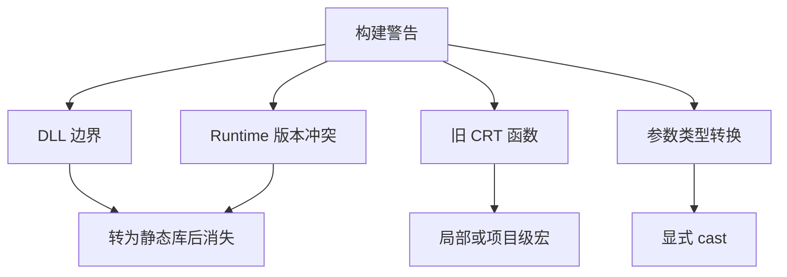

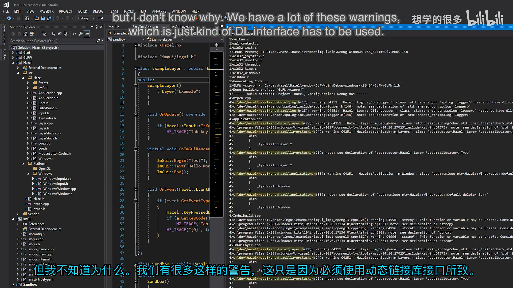

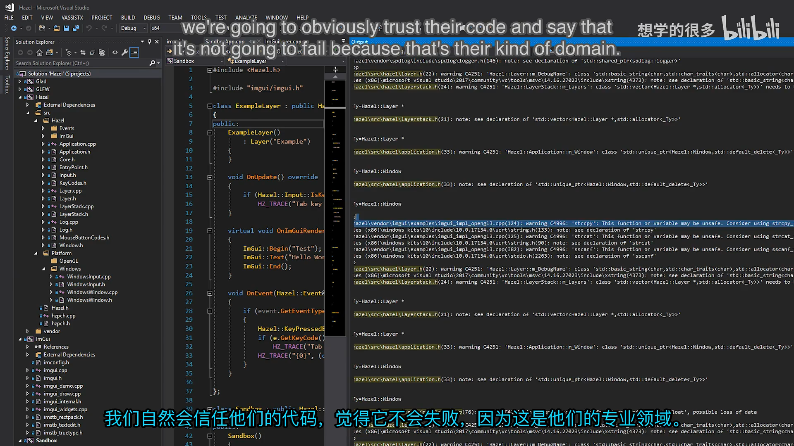

## 2. Premake：把 Hazel 改为静态库

*(参考时间: 00:06:30)*

原配置：

```lua
project "Hazel"
    kind "SharedLib"
    staticruntime "off"
```

新配置：

```lua
project "Hazel"
    kind "StaticLib"
    language "C++"
    cppdialect "C++17"
    staticruntime "on"
```

核心就是把 `SharedLib` 改为 `StaticLib`，并启用静态 Runtime。

### 2.1 为什么静态库应使用静态 Runtime

DLL 是独立最终模块，需要自带 Runtime 实现。不同 DLL 可能使用：

- Debug Runtime；
- Release Runtime；
- 不同版本或不同配置的 CRT。

静态库最终会进入同一个 EXE 链接过程，因此更适合同样使用静态 Runtime：

```text
Hazel.lib + ImGui.lib + GLFW.lib + Glad.lib
  -> Sandbox.exe
  -> 单一 Runtime
```

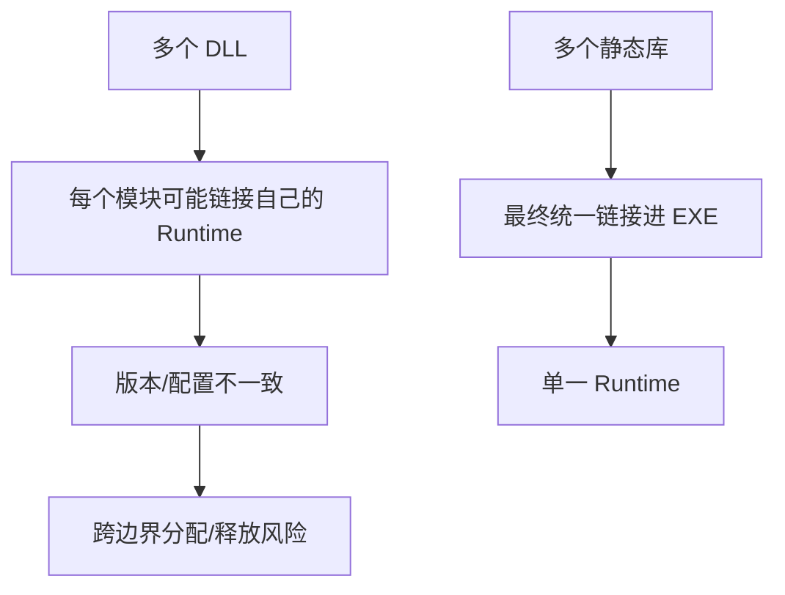

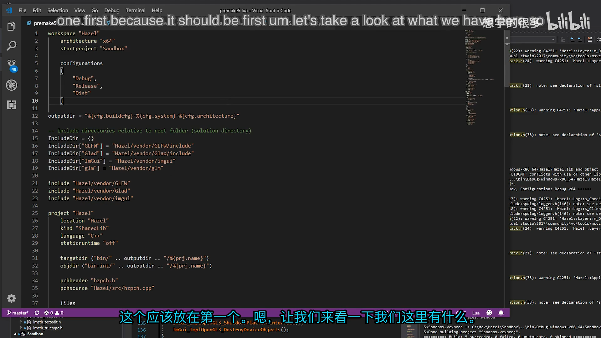

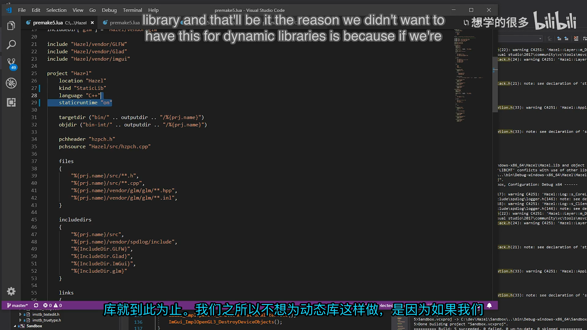

## 3. 清理 Premake 配置

*(参考时间: 00:08:04)*

### 3.1 移动通用设置

`cppdialect` 不只是 Windows 设置，因此从 `filter "system:windows"` 移到项目通用设置。

### 3.2 删除 DLL 复制步骤

原后构建命令用于复制 Hazel DLL 到 Sandbox：

```lua
postbuildcommands
{
    "{COPY} ... Hazel.dll ... Sandbox/"
}
```

静态库不再生成 `Hazel.dll`，因此后构建复制步骤应删除。

### 3.3 统一配置写法

```lua
filter "configurations:Debug"
    defines "HZ_DEBUG"
    runtime "Debug"
    symbols "on"

filter "configurations:Release"
    defines "HZ_RELEASE"
    runtime "Release"
    optimize "on"

filter "configurations:Dist"
    defines "HZ_DIST"
    runtime "Release"
    optimize "on"
```

配置设计：

| 配置 | Runtime | 符号 | 优化 |
|---|---|---|---|
| Debug | Debug | On | Off |
| Release | Release | Off | On |
| Dist | Release | Off | On |

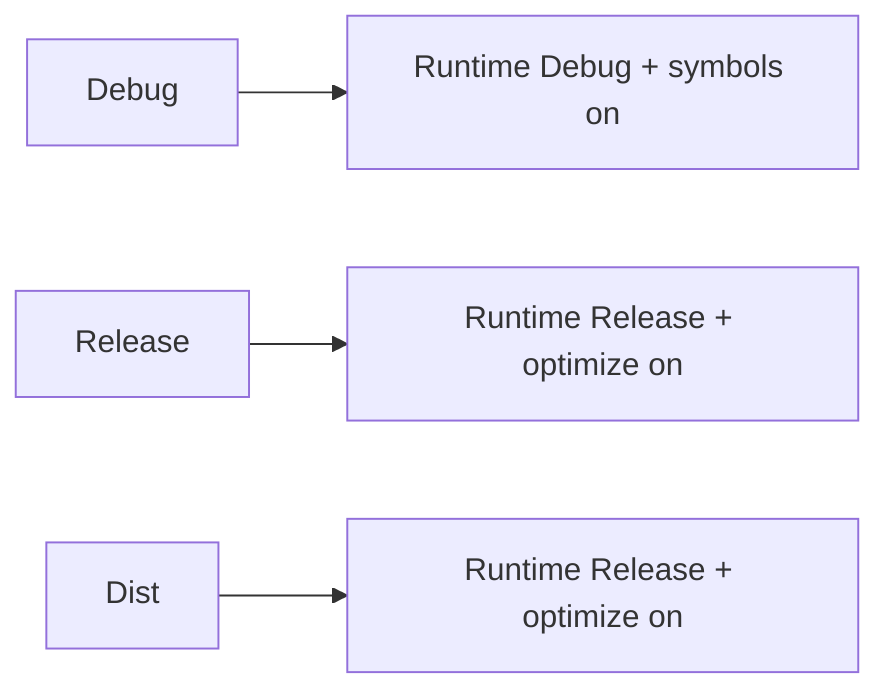

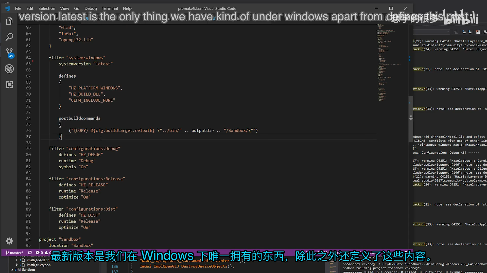

## 4. 同步依赖项目的 Premake

*(参考时间: 00:09:47)*

依赖项目也需要统一 Runtime 配置：

- GLFW；
- Glad；
- ImGui。

### 4.1 GLFW

- 保持 `StaticLib`；
- `staticruntime "on"`；
- 只保留 Debug / Release；
- Debug 生成符号；
- Release 开启优化；
- 删除无意义的 Windows 编译参数。

### 4.2 Glad

Glad 同样是 C 静态库：

```lua
project "Glad"
    kind "StaticLib"
    language "C"
    staticruntime "on"
```

并为 Debug / Release 分别设置 runtime、symbols 和 optimize。

### 4.3 ImGui

ImGui 也改为静态 Runtime，并统一 C++17 与静态链接设置。

所有依赖最终都必须使用相同的 Runtime 选择，否则链接冲突仍可能出现。

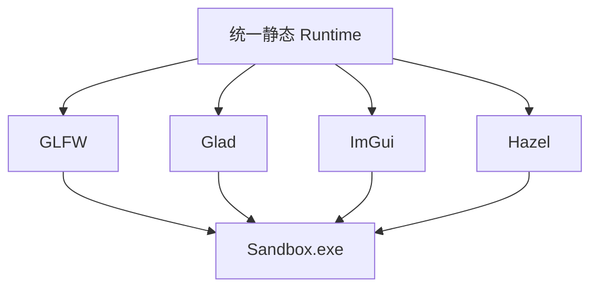

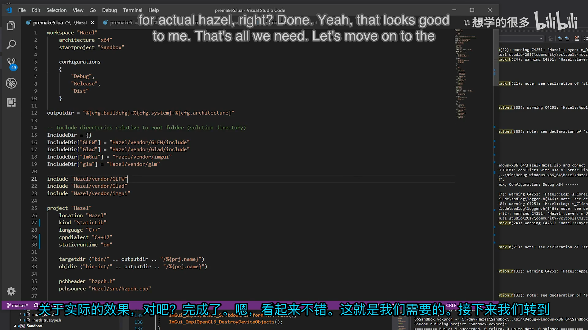

## 5. 重新生成与验证静态库

*(参考时间: 00:14:00)*

执行：

```text
GenerateProjects.bat
```

回到 Visual Studio 后重新加载解决方案，确认 Hazel 的配置类型已经从：

```text
DynamicLibrary
```

变为：

```text
StaticLibrary
```

接着执行“超干净构建”：

1. 删除 `bin`；
2. 删除 `bin-int`；
3. 重新生成工程；
4. 重新构建整个解决方案。

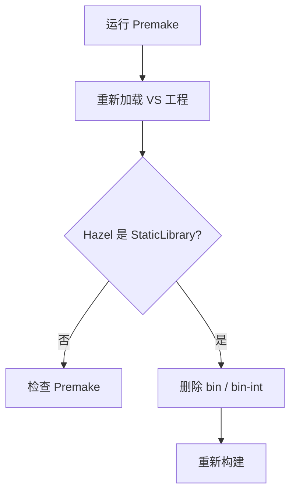

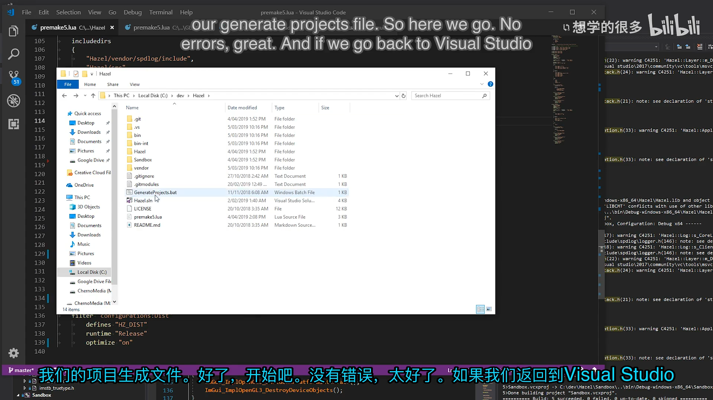

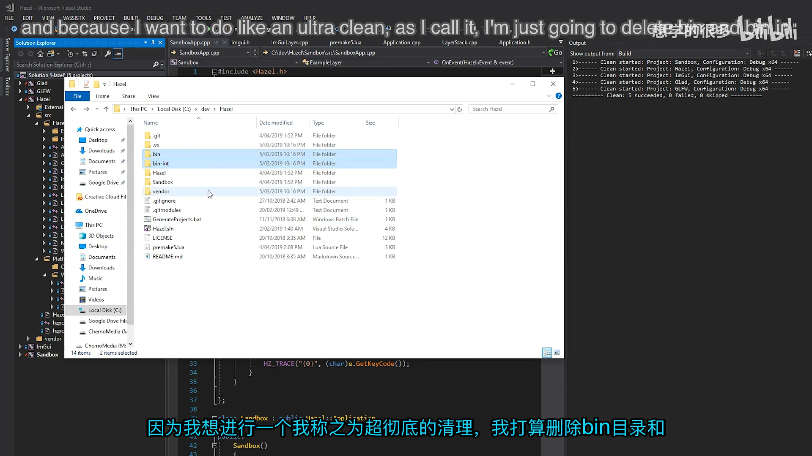

## 6. Core.h：动态链接与静态链接兼容

*(参考时间: 00:15:00)*

旧代码始终根据 `HZ_BUILD_DLL` 选择导入或导出：

```cpp
#ifdef HZ_BUILD_DLL
    #define HAZEL_API __declspec(dllexport)
#else
    #define HAZEL_API __declspec(dllimport)
#endif
```

静态库不需要这些属性。新增 `HZ_DYNAMIC_LINK` 条件：

```cpp
#ifdef HZ_PLATFORM_WINDOWS
    #if HZ_DYNAMIC_LINK
        #ifdef HZ_BUILD_DLL
            #define HAZEL_API __declspec(dllexport)
        #else
            #define HAZEL_API __declspec(dllimport)
        #endif
    #else
        #define HAZEL_API
    #endif
#else
    #error Hazel only supports Windows!
#endif
```

当 `HZ_DYNAMIC_LINK` 没有定义时，`HAZEL_API` 展开为空，因此类声明不再需要导入导出语义。

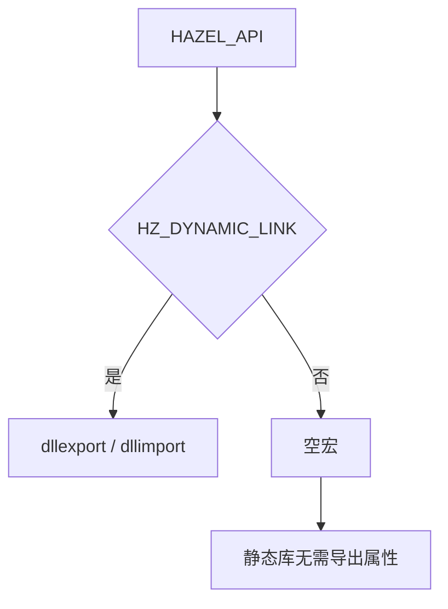

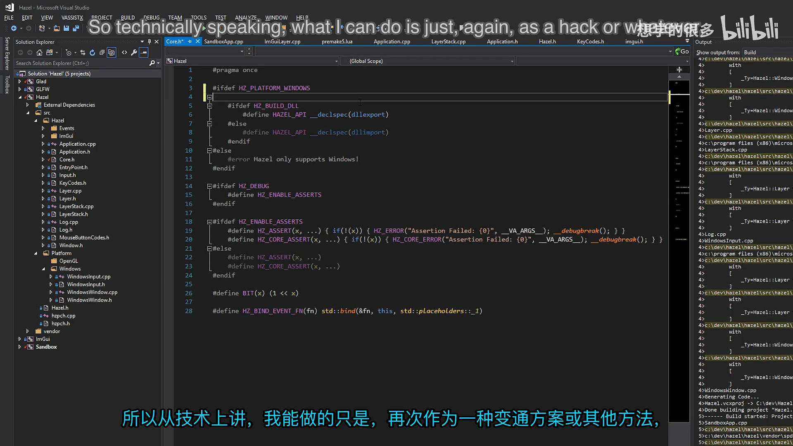

### 6.1 为什么不直接删除 HAZEL_API

未来仍然可能出现动态加载的模块，例如：

- 游戏代码 DLL；
- 编辑器模块；
- 热替换插件。

静态 Hazel 核心库与“动态游戏模块”并不冲突。保留 `HZ_DYNAMIC_LINK` 开关，可以避免当前阶段进行大规模全项目搜索替换。

## 7. 修复剩余警告

*(参考时间: 00:16:10)*

### 7.1 整数到浮点转换

ImGuiLayer 把窗口宽高从 `unsigned int` 转成 `float`：

```cpp
io.DisplaySize = ImVec2(
    (float)app.GetWindow().GetWidth(),
    (float)app.GetWindow().GetHeight());
```

显式 cast 清楚表达这是有意转换，也消除 C++ 警告。

### 7.2 第三方 CRT 弃用函数

ImGui 的 OpenGL3 示例使用 `strcpy`、`sprintf` 等旧函数。Hazel 不想修改第三方代码，因此可以定义：

```cpp
#define _CRT_SECURE_NO_WARNINGS
```

第一次尝试把宏放在 `ImGuiBuild.cpp` 中，但由于预编译头已经包含 `string.h`，弃用属性在宏生效前就已经出现，警告没有完全消失。

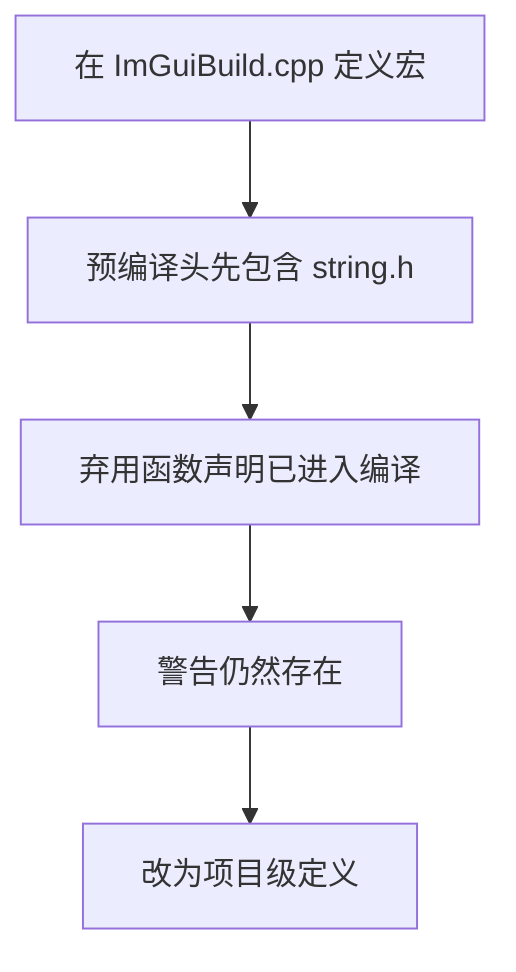

最后把 `_CRT_SECURE_NO_WARNINGS` 放到 Hazel 项目的通用定义中：

```lua
defines
{
    "_CRT_SECURE_NO_WARNINGS"
}
```

这会让整个 Hazel 项目都不再报告这些 CRT 弃用警告。视频承认这不是最细粒度方案，但能保持第三方代码不改动。

编者说明：如果这些函数出现在 Hazel 自有代码中，更合理的做法通常是改用带边界检查的安全版本；本项目的宏主要是为第三方 ImGui 代码服务。

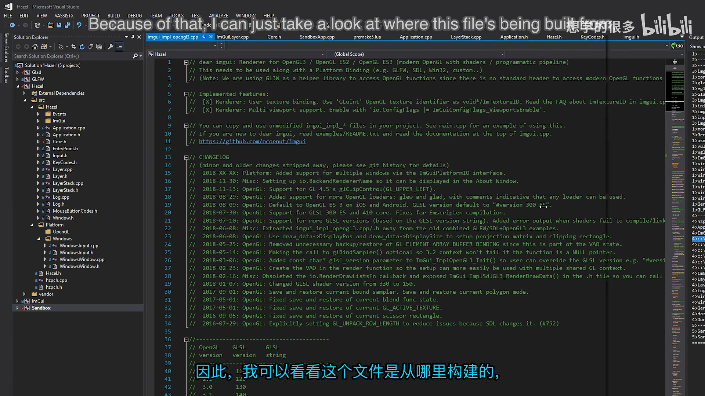

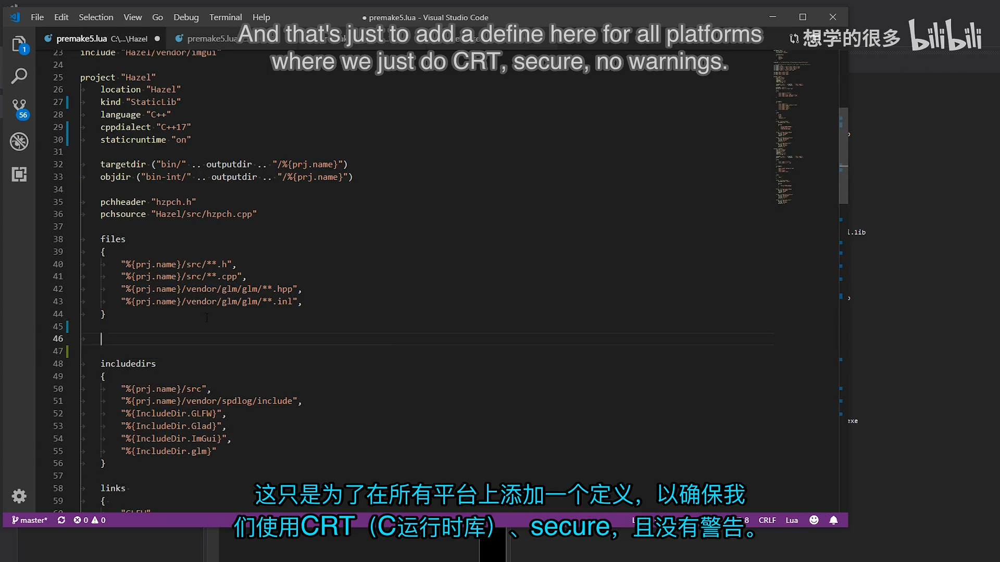

## 8. 零警告构建

*(参考时间: 00:21:16)*

再次清理并构建后：

```text
Build succeeded
0 Errors
0 Warnings
```

Sandbox 启动后仍能正常工作，说明静态库转换没有破坏原功能。

视频还提到可以选择打开“Treat Warnings as Errors”，但担心后期开发中被临时警告阻塞，因此当前没有启用。


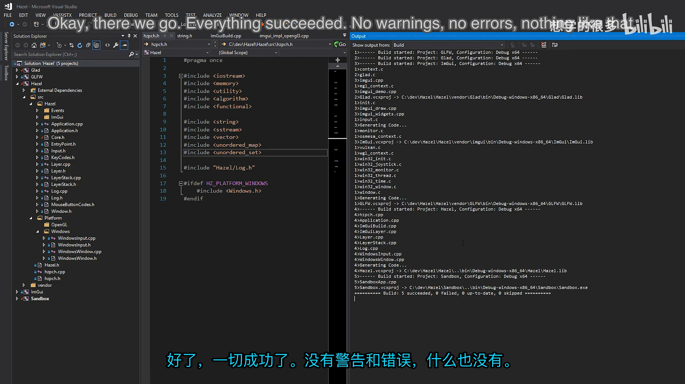

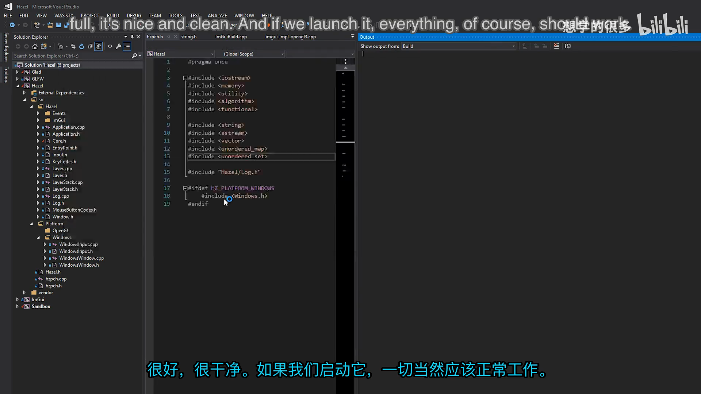

## 9. 本节结论

本讲完成了 Hazel 架构的一次重要简化：

- 把 Hazel 从 `SharedLib` 改为 `StaticLib`；
- 在 Hazel、GLFW、Glad、ImGui 中统一启用静态 Runtime；
- 删除复制 DLL 的后构建步骤；
- 简化 Premake 与 Visual Studio 工程配置；
- 用 `HZ_DYNAMIC_LINK` 控制 `HAZEL_API`；
- 静态构建时让导出宏变为空；
- 修复整数到浮点转换警告；
- 解决 ImGui 旧 CRT 函数的弃用警告；
- 通过超干净构建得到零错误、零警告；
- 保留未来动态加载游戏模块或插件的可能。

静态链接让 Hazel 核心库更简单、更统一，也为后续 RendererAPI 类的大量新增代码减少了 DLL 边界负担。

下一阶段将在这个干净的构建基础上正式开始 OpenGL Render Context、Swap Chain 和第一个渲染结果。

## 附：参考

- [Bilibili 精译视频：026 - 静态库和零警告](https://www.bilibili.com/video/BV1wtLazEEmC/?p=26)
- [The Cherno 游戏引擎系列播放列表](https://www.youtube.com/playlist?list=PLlrATfBNZ98dC-V-N3m0Go4deliWHPFwT5)
- [本期对应代码提交 `440d937a`](https://github.com/TheCherno/Hazel/tree/440d937a)

