# Hazel 游戏引擎笔记 027：实现渲染上下文

> 本节来源：[The Cherno 游戏引擎系列第 27 讲“渲染上下文”](https://www.bilibili.com/video/BV1wtLazEEmC/?p=27)，时长约 27 分 03 秒。  
> 原课程与 Hazel 代码作者：The Cherno。代码参考提交：[`55fc4392`](https://github.com/TheCherno/Hazel/tree/55fc4392)。  
> 本文由视频字幕重构、翻译并整理，不是官方教材；术语和代码以原视频及同期 Hazel 仓库为准。

## 本节目标

静态库转换和零警告构建已经完成，终于可以开始 Renderer 的第一块基础设施：**渲染上下文**。

当前 `WindowsWindow::Init()` 直接调用：

```cpp
glfwMakeContextCurrent(m_Window);
gladLoadGLLoader(...);
```

`WindowsWindow::OnUpdate()` 直接调用：

```cpp
glfwSwapBuffers(m_Window);
```

这些操作都是 OpenGL 专用代码，却放在“Windows 窗口”实现中。未来 Hazel 还要支持 DirectX、Vulkan 和 Metal，因此需要把上下文逻辑移入 API 专用类。

本讲设计：

```text
GraphicsContext
    ^
    |
OpenGLContext
```

WindowsWindow 只持有 `GraphicsContext*`，不再直接依赖 Glad 或具体 OpenGL 初始化流程。

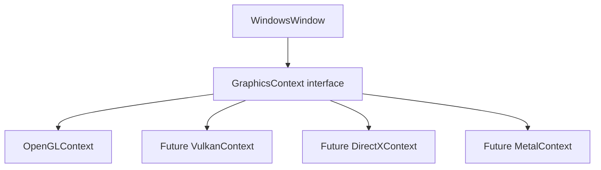


## 1. 什么是渲染上下文

*(参考时间: 00:03:01)*

图形 API 需要先建立上下文，才能执行渲染命令。

OpenGL 中，GLFW 已经帮助处理大量平台细节：

```cpp
glfwMakeContextCurrent(window);
gladLoadGLLoader(...);
```

OpenGL Context 创建后，当前线程后续的 OpenGL 调用就会作用于该上下文。

Vulkan 则复杂得多，还可能涉及：

- Instance；
- Physical Device；
- Logical Device；
- Queue；
- Swap Chain；
- Framebuffer；
- 平台 Surface。

不同 API 的上下文逻辑差异巨大，因此必须由不同实现类负责。

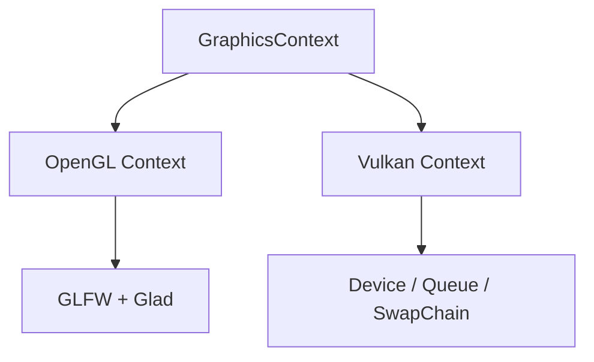


## 2. 为什么要在 GLFW 之上再抽象

*(参考时间: 00:06:40)*

GLFW 能帮助创建 OpenGL 和 Vulkan 上下文，但不负责 DirectX 和 Metal。

如果 WindowsWindow 直接写：

```cpp
glfwMakeContextCurrent(m_Window);
```

那么它隐含地假设所有 Windows 窗口都使用 GLFW 创建的 OpenGL 或 Vulkan 上下文。

未来如果运行时选择 DirectX 或 Metal，这段代码就不适用。

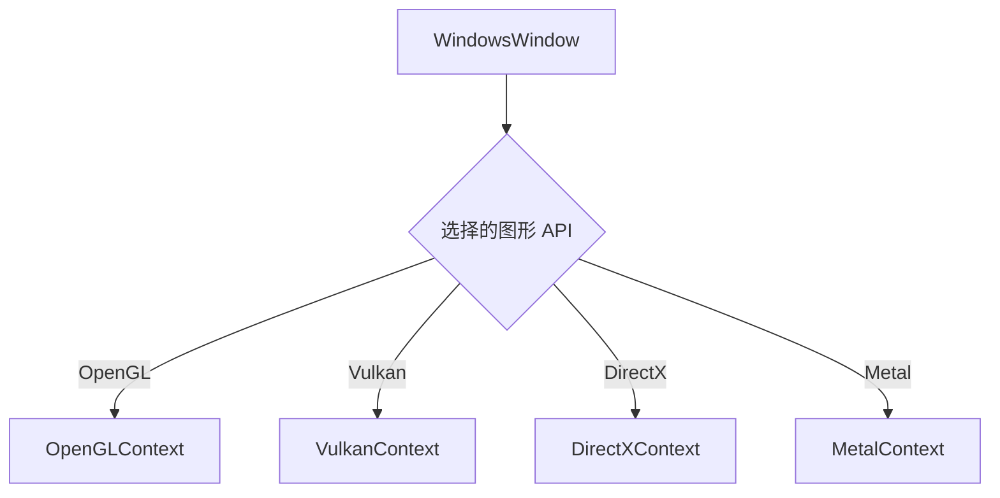

额外的 Context 抽象层不是重复 GLFW，而是为了把将来不属于 GLFW 的 API 也纳入同一生命周期接口。


## 3. 上下文所有权设计讨论

*(参考时间: 00:10:00)*

视频先讨论 Context 应如何存储。

### 3.1 栈对象

```cpp
OpenGLContext context(window);
```

优点是生命周期自动管理，但 Context 需要多态。

如果成员写成具体类型：

```cpp
OpenGLContext m_Context;
```

以后替换成 DirectXContext 时，WindowsWindow 类型仍被写死。

### 3.2 指针与多态

```cpp
GraphicsContext* m_Context;
```

这样 WindowsWindow 只依赖抽象接口，可以指向不同后端实现。


### 3.3 Context 是否全局或静态

视频还讨论过静态 Context：

- 一个窗口通常只有一个渲染 API Context；
- 但高级引擎可能让 DirectX 与 Vulkan 在同一窗口中混合渲染；
- 也可能同时存在多个窗口和多个 Context。

这类高级用法会让静态设计失效。

当前 Hazel 只有一个窗口和一个上下文，因此先选择简单方案：

```text
一个 Hazel Window 拥有一个 GraphicsContext
```

编者说明：视频明确表示这些设计不是最终方案，后续遇到多窗口或跨 API 需求时可以调整。

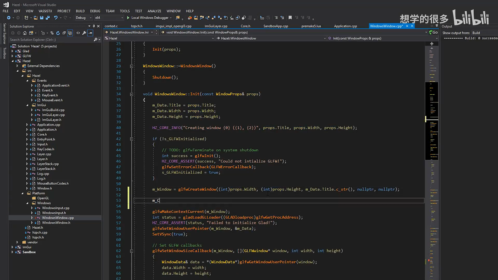


## 4. 创建 GraphicsContext 接口

*(参考时间: 00:15:15)*

新增目录与文件：

```text
Hazel/src/Hazel/Renderer/
    GraphicsContext.h

Hazel/src/Platform/OpenGL/
    OpenGLContext.h
    OpenGLContext.cpp
```

`GraphicsContext.h`：

```cpp
#pragma once

namespace Hazel {

class GraphicsContext
{
public:
    virtual void Init() = 0;
    virtual void SwapBuffers() = 0;
};

}
```

当前接口只包含两个最小功能：

- `Init()`：初始化图形上下文；
- `SwapBuffers()`：提交当前帧并交换前后缓冲。

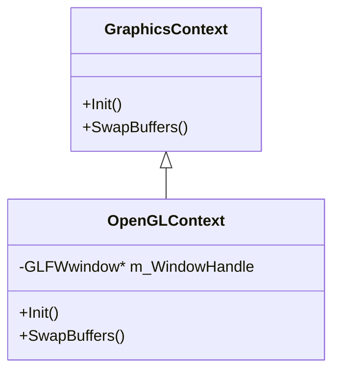

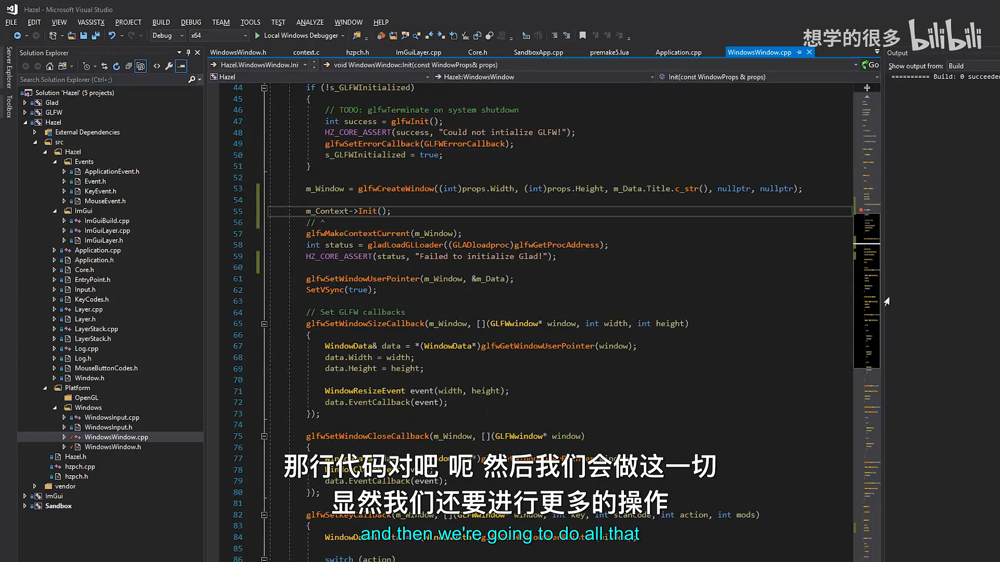

## 5. OpenGLContext 头文件

*(参考时间: 00:17:40)*

```cpp
#pragma once

#include "Hazel/Renderer/GraphicsContext.h"

struct GLFWwindow;

namespace Hazel {

class OpenGLContext : public GraphicsContext
{
public:
    OpenGLContext(GLFWwindow* windowHandle);

    virtual void Init() override;
    virtual void SwapBuffers() override;

private:
    GLFWwindow* m_WindowHandle;
};

}
```

### 5.1 为什么使用前向声明

头文件只需要知道 `GLFWwindow` 是一个类型，不需要完整定义：

```cpp
struct GLFWwindow;
```

因此无需把 `<GLFW/glfw3.h>` 放进公共头文件。

真正访问 GLFW API 的 `.cpp` 才包含完整头文件。

视频中出现了一个编译警告：

```cpp
class GLFWwindow;
```

但 GLFW 将其定义为 `struct`。改为：

```cpp
struct GLFWwindow;
```

警告即可消失。

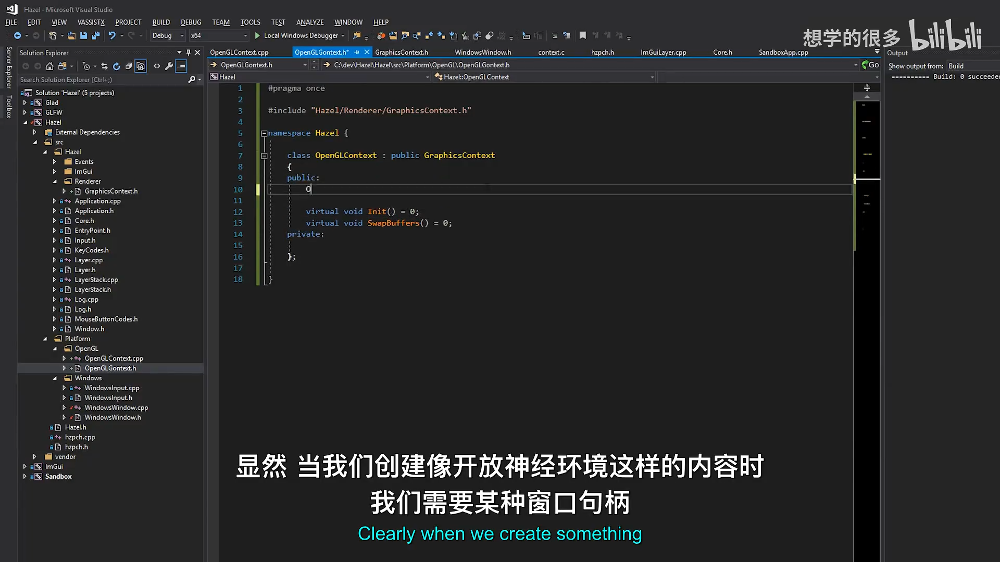

## 6. OpenGLContext 实现

*(参考时间: 00:20:43)*

```cpp
#include "hzpch.h"
#include "OpenGLContext.h"

#include <GLFW/glfw3.h>
#include <glad/glad.h>
#include <GL/GL.h>

namespace Hazel {

OpenGLContext::OpenGLContext(GLFWwindow* windowHandle)
    : m_WindowHandle(windowHandle)
{
    HZ_CORE_ASSERT(windowHandle, "Window handle is null!");
}

void OpenGLContext::Init()
{
    glfwMakeContextCurrent(m_WindowHandle);

    int status = gladLoadGLLoader(
        (GLADloadproc)glfwGetProcAddress);

    HZ_CORE_ASSERT(status, "Failed to initialize Glad!");
}

void OpenGLContext::SwapBuffers()
{
    glfwSwapBuffers(m_WindowHandle);
}

}
```

初始化顺序：

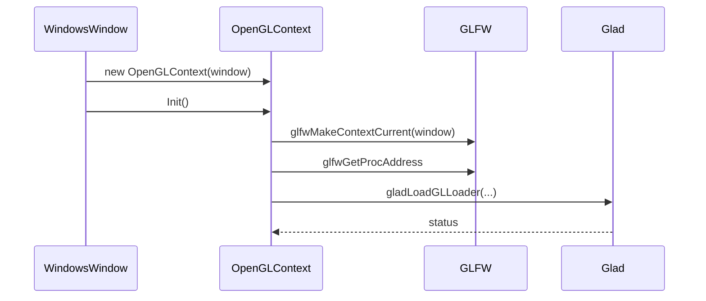

构造函数只保存窗口句柄并校验非空；真正的 OpenGL 初始化放在 `Init()` 中，使生命周期更明确。

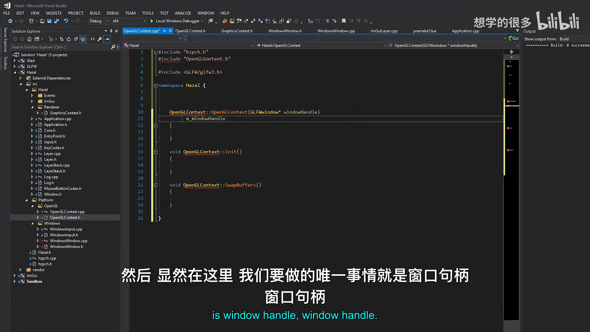

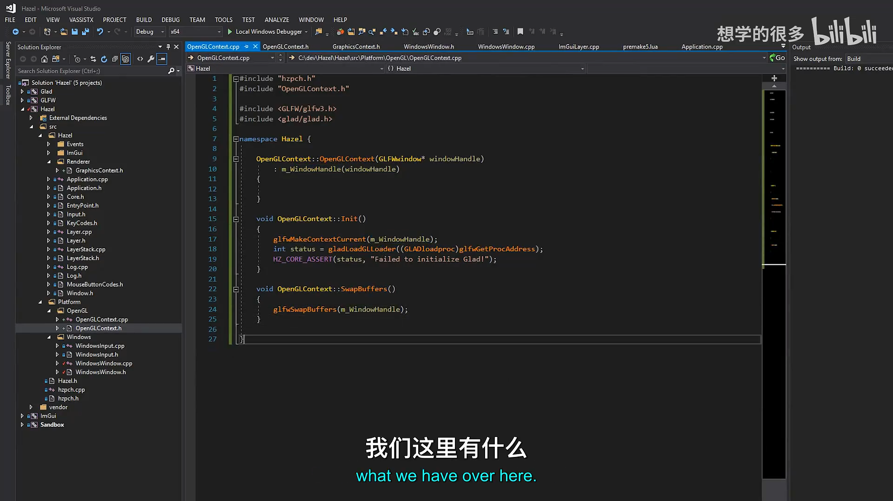

## 7. 修改 WindowsWindow

*(参考时间: 00:19:18)*

WindowsWindow 不再直接初始化 Glad。

### 7.1 创建上下文

```cpp
m_Window = glfwCreateWindow(
    (int)props.Width,
    (int)props.Height,
    m_Data.Title.c_str(),
    nullptr,
    nullptr);

m_Context = new OpenGLContext(m_Window);
m_Context->Init();
```

之后继续设置窗口回调和 VSync。

### 7.2 每帧交换缓冲

旧代码：

```cpp
glfwSwapBuffers(m_Window);
```

新代码：

```cpp
m_Context->SwapBuffers();
```

WindowsWindow 不再知道当前使用的是 OpenGL。

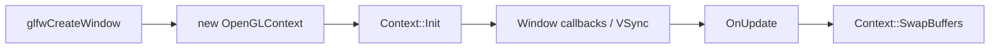

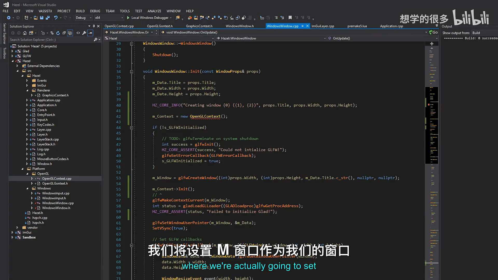

## 8. 移除窗口中的 OpenGL 依赖

Window 层不再需要：

```cpp
#include <glad/glad.h>
glfwMakeContextCurrent(...)
gladLoadGLLoader(...)
glfwSwapBuffers(...)
```

这些代码全部集中到 OpenGLContext。

于是：

- WindowsWindow 只负责窗口生命周期与平台事件；
- OpenGLContext 负责 OpenGL 上下文与缓冲交换；
- 未来可以由其它 Context 替换 OpenGL 实现。

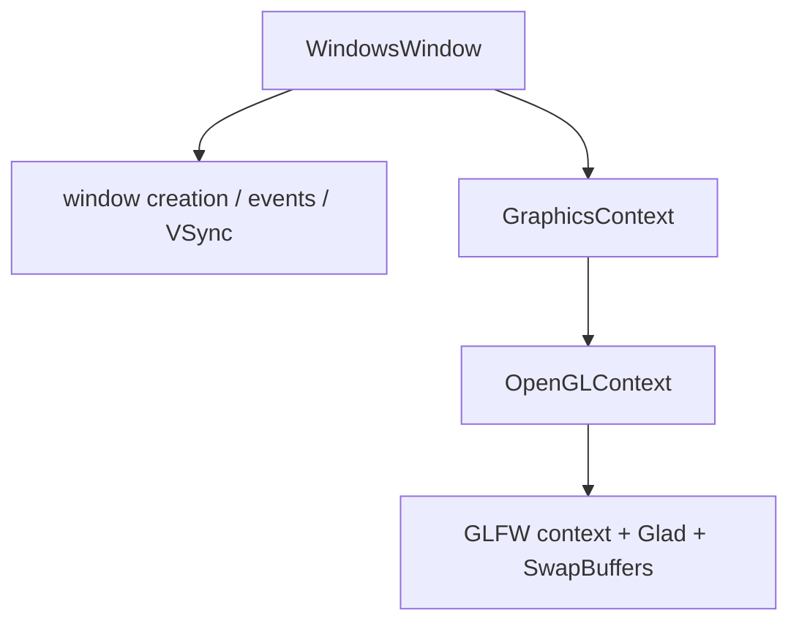

## 9. 编译与运行验证

*(参考时间: 00:22:15)*

构建过程中出现 `class GLFWwindow` 与 `struct GLFWwindow` 不一致的警告，改为 `struct` 后消失。

运行 Sandbox 后：

- 窗口可以正常创建；
- 原有粉色清屏仍然显示；
- Context 初始化成功；
- SwapBuffers 仍能正常提交画面。

测试时尝试使用 OpenGL Immediate Mode 画图形，但没有成功。原因是：

- 项目使用 Core Profile；
- 现代 OpenGL 不再支持 `glBegin` / `glEnd` 一类立即模式函数；
- 当前也没有可用的 Vertex Buffer 与 Shader 封装。

因此本讲的目标不是画三角形，而是先建立一个可用的上下文底座。

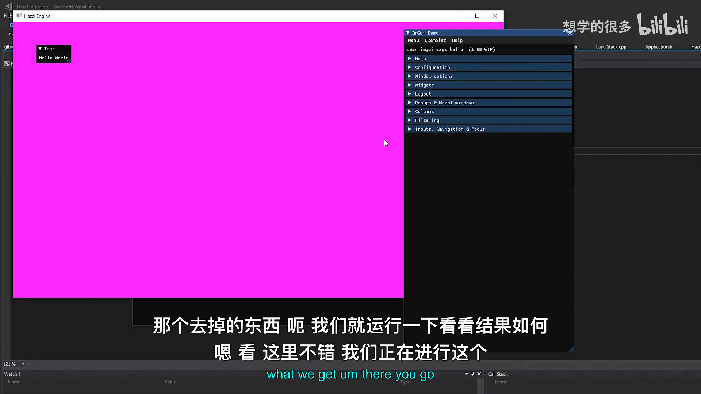

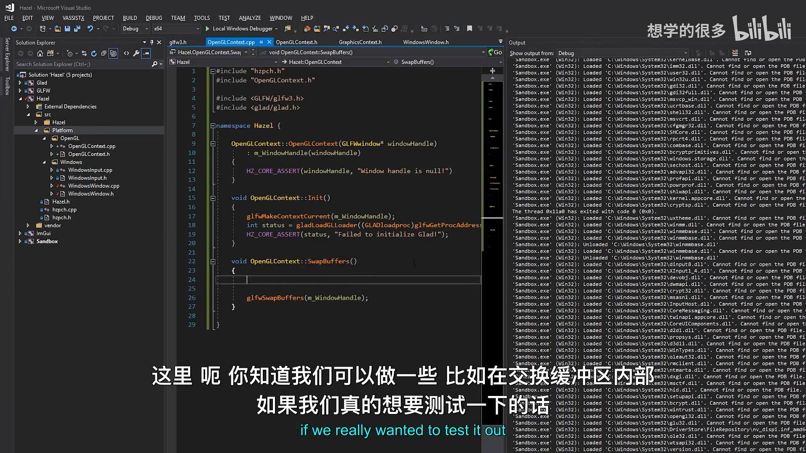

## 10. 清屏命令未来归属 Renderer

*(参考时间: 00:24:22)*

当前 `Application::Run()` 中仍然调用：

```cpp
glClearColor(1, 0, 1, 1);
glClear(GL_COLOR_BUFFER_BIT);
```

视频指出，清屏颜色和清屏命令最终不应长期放在 Application：

- 它属于 Renderer；
- 未来会经过 Framebuffer / Render Target；
- Renderer 负责发出清屏与绘制命令；
- Context 只负责管理图形上下文和提交缓冲。

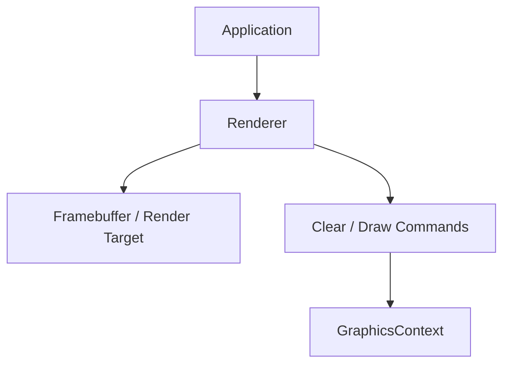

## 11. 未来运行时选择 API

*(参考时间: 00:25:00)*

Context 抽象完成后，可以在 WindowProps 中加入 API 选择：

```cpp
enum class RendererAPI
{
    None,
    OpenGL,
    Vulkan,
    DirectX,
    Metal
};
```

概念创建逻辑：

```cpp
switch (m_Data.API)
{
    case RendererAPI::OpenGL:
        m_Context = new OpenGLContext(m_Window);
        break;
    // ...
}
```

当前阶段仍然固定使用 OpenGL，但 Context 接口已经为未来选择后端腾出了位置。

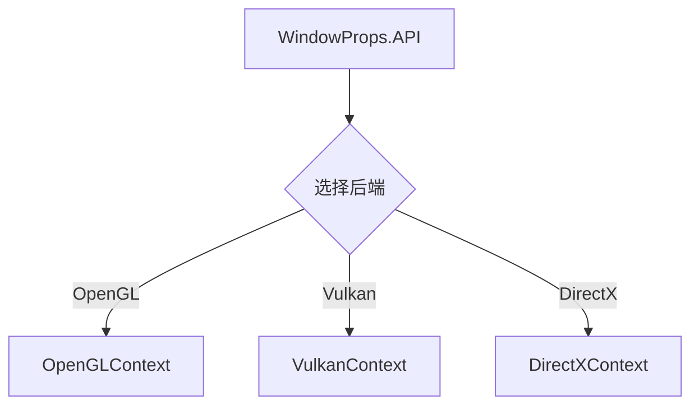

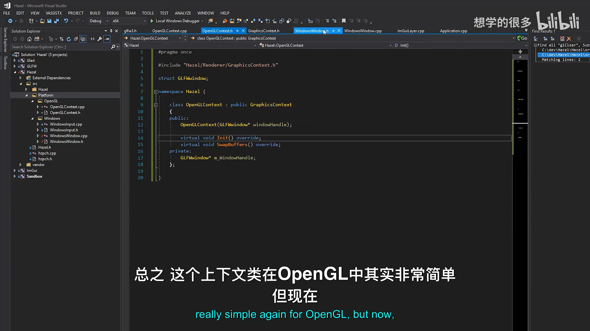

## 12. 本节结论

本讲完成了 Renderer 的第一个独立组件：

- 识别 WindowsWindow 直接包含 OpenGL 初始化代码的问题；
- 新增 `GraphicsContext` 抽象接口；
- 新增 `OpenGLContext`；
- Context 构造函数接收窗口句柄；
- `Init()` 设置当前 Context 并初始化 Glad；
- `SwapBuffers()` 封装 GLFW 缓冲交换；
- WindowsWindow 改为持有 `GraphicsContext*`；
- 移除了 Window 对 Glad 和上下文初始化函数的直接依赖；
- Context 使用多态指针，为 Vulkan / DirectX / Metal 预留空间；
- 运行验证 Context 正常；
- 明确清屏命令和 Framebuffer 未来归 Renderer 管理。

下一阶段将开始实现 Renderer 类，负责清屏颜色、渲染命令与状态管理。

## 附：参考

- [Bilibili 精译视频：027 - 渲染上下文](https://www.bilibili.com/video/BV1wtLazEEmC/?p=27)
- [The Cherno 游戏引擎系列播放列表](https://www.youtube.com/playlist?list=PLlrATfBNZ98dC-V-N3m0Go4deliWHPFwT5)
- [本期对应代码提交 `55fc4392`](https://github.com/TheCherno/Hazel/tree/55fc4392)

