# Hazel 游戏引擎笔记 029：OpenGL 着色器

> 本节来源：[The Cherno 游戏引擎系列第 29 讲“OpenGL 着色器”](https://www.bilibili.com/video/BV1wtLazEEmC/?p=29)，时长约 42 分 46 秒。  
> 原课程与 Hazel 代码作者：The Cherno。代码参考提交：[`76ae3b81`](https://github.com/TheCherno/Hazel/tree/76ae3b81)。  
> 本文由视频字幕重构、翻译并整理，不是官方教材；术语和代码以原视频及同期 Hazel 仓库为准。

## 本节目标

上一讲已经能在 Hazel 中画出第一个三角形，但三角形没有使用 Shader。本讲补上 GPU 渲染的核心：

- 解释什么 Shader；
- 理解顶点 Shader 与片元 Shader；
- 理解 GPU 图形管线中的数据流；
- 编译并链接 OpenGL Shader 程序；
- 创建 Hazel 的第一版 `Shader` 类；
- 处理编译和链接错误日志；
- 用 Shader 绘制红色三角形；
- 从顶点 Shader 向片元 Shader 传递位置数据；
- 观察颜色插值效果。


## 1. 开发分支的 PBR 预览

*(参考时间: 00:02:35)*

视频开场先展示 Hazel 开发分支中的 PBR Demo，用来说明当前公开课程正在走向什么程度。

演示包括：

- 不同粗糙度的金属与电介质球；
- 环境立方体贴图；
- HDR 曝光；
- 模型、Albedo、Normal、Metalness、Roughness 纹理加载；
- 基于环境贴图的反射。

这不是本讲实现内容，而是说明前面的窗口、事件、ImGui、数学库和构建系统为渲染开发提供了基础。

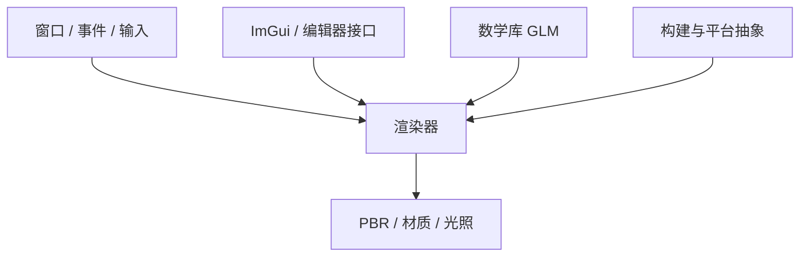

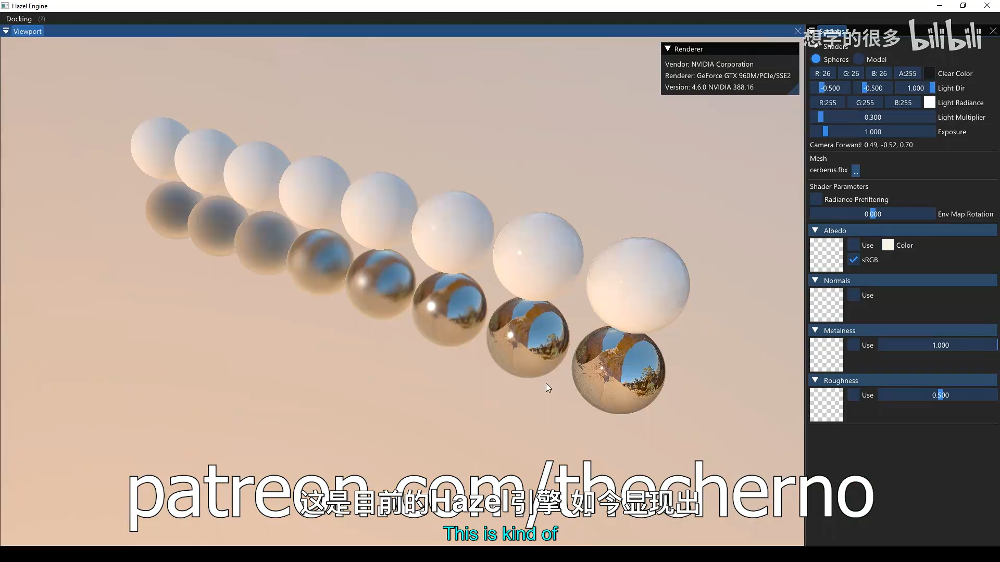

## 2. 什么是 Shader

*(参考时间: 00:06:49)*

Shader 是运行在 GPU 上的程序，用来决定 GPU 如何处理传入的数据。

两种最常见的 Shader：

| Shader | 执行次数 | 主要职责 |
|---|---:|---|
| Vertex Shader | 每个顶点一次 | 计算顶点在裁剪空间中的位置 |
| Fragment / Pixel Shader | 每个片元或像素一次 | 计算该像素最终颜色 |

OpenGL 把它称为 Fragment Shader；DirectX 等 API 常称为 Pixel Shader。

对于上一讲的三角形：

```text
3 个顶点
  -> Vertex Shader 执行 3 次
  -> 光栅化产生大量片段
  -> Fragment Shader 为每个片段决定颜色
```


## 3. 图形管线中的数据流

*(参考时间: 00:09:35)*

顶点 Shader 的主要输出是裁剪空间位置：

```glsl
gl_Position = ...;
```

裁剪空间坐标通常在：

```text
x: -1 到 +1
y: -1 到 +1
z: -1 到 +1
```

顶点位置经过图元装配和光栅化后，被转换为覆盖三角形区域的片段。

片元 Shader 再决定每个片段的颜色：

```glsl
out vec4 color;
color = vec4(1.0, 0.0, 0.0, 1.0);
```

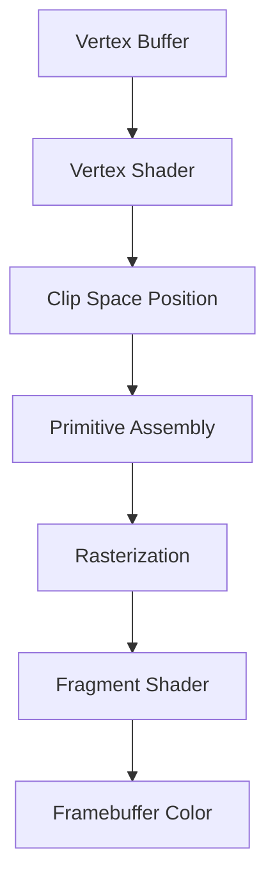


## 4. Shader 编译与链接

*(参考时间: 00:12:39)*

GLSL 是 OpenGL Shading Language。Shader 虽然运行在 GPU，但创建过程与 CPU 程序类似：

1. 创建 Shader 对象；
2. 提交源码；
3. 编译 Shader；
4. 检查编译状态；
5. 读取错误日志；
6. 创建 Program；
7. 附加顶点与片元 Shader；
8. 链接 Program；
9. 检查链接状态；
10. 分离并删除临时 Shader。

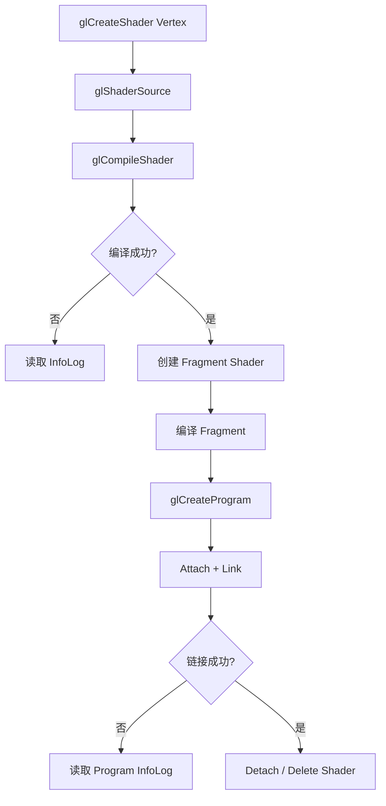

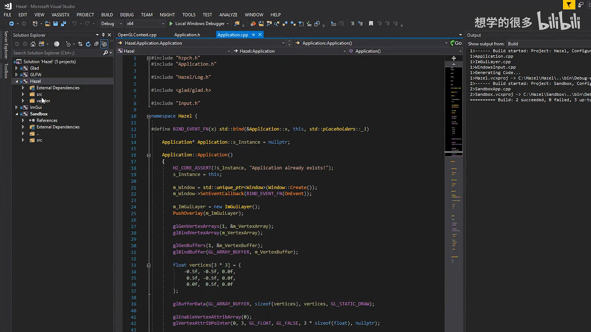

## 5. 编译顶点 Shader

*(参考时间: 00:15:20)*

创建顶点 Shader：

```cpp
GLuint vertexShader =
    glCreateShader(GL_VERTEX_SHADER);

const GLchar* source = vertexSrc.c_str();

glShaderSource(
    vertexShader,
    1,
    &source,
    0);

glCompileShader(vertexShader);
```

检查编译结果：

```cpp
GLint isCompiled = 0;
glGetShaderiv(
    vertexShader,
    GL_COMPILE_STATUS,
    &isCompiled);
```

如果失败：

```cpp
GLint maxLength = 0;
glGetShaderiv(
    vertexShader,
    GL_INFO_LOG_LENGTH,
    &maxLength);

std::vector<GLchar> infoLog(maxLength);
glGetShaderInfoLog(
    vertexShader,
    maxLength,
    &maxLength,
    infoLog.data());

glDeleteShader(vertexShader);

HZ_CORE_ERROR("{0}", infoLog.data());
HZ_CORE_ASSERT(
    false,
    "Vertex shader compilation failure!");
```

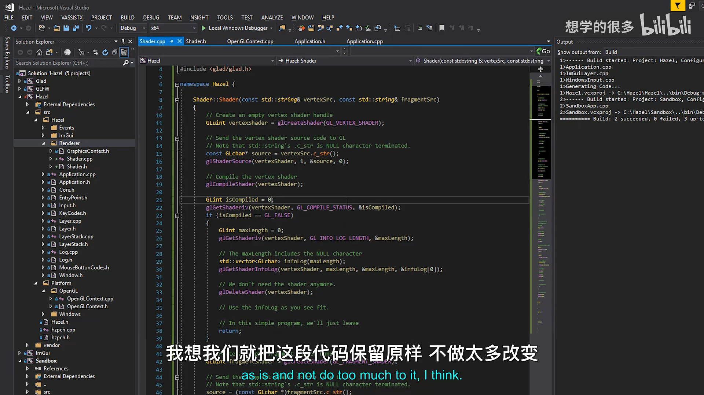

## 6. 编译片元 Shader

片元 Shader 使用相同的编译流程，只是类型改为：

```cpp
GLuint fragmentShader =
    glCreateShader(GL_FRAGMENT_SHADER);
```

如果片元 Shader 编译失败，需要同时删除：

```cpp
glDeleteShader(fragmentShader);
glDeleteShader(vertexShader);
```

因为顶点 Shader 已经成功创建，但整个 Shader Program 无法继续构建，必须避免资源泄漏。

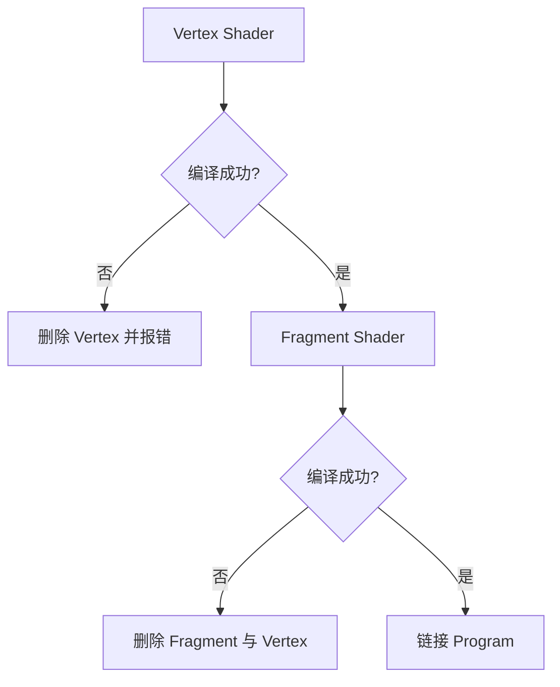

## 7. 链接 Shader Program

*(参考时间: 00:22:20)*

创建程序对象：

```cpp
m_RendererID = glCreateProgram();
GLuint program = m_RendererID;
```

附加并链接：

```cpp
glAttachShader(program, vertexShader);
glAttachShader(program, fragmentShader);
glLinkProgram(program);
```

检查链接状态：

```cpp
GLint isLinked = 0;
glGetProgramiv(
    program,
    GL_LINK_STATUS,
    &isLinked);
```

失败时：

```cpp
glDeleteProgram(program);
glDeleteShader(vertexShader);
glDeleteShader(fragmentShader);

HZ_CORE_ERROR("{0}", infoLog.data());
HZ_CORE_ASSERT(
    false,
    "Shader link failure!");
```

成功时：

```cpp
glDetachShader(program, vertexShader);
glDetachShader(program, fragmentShader);
```

链接完成后，Shader Program 已经持有编译结果，可以分离并删除独立的 Shader 对象。

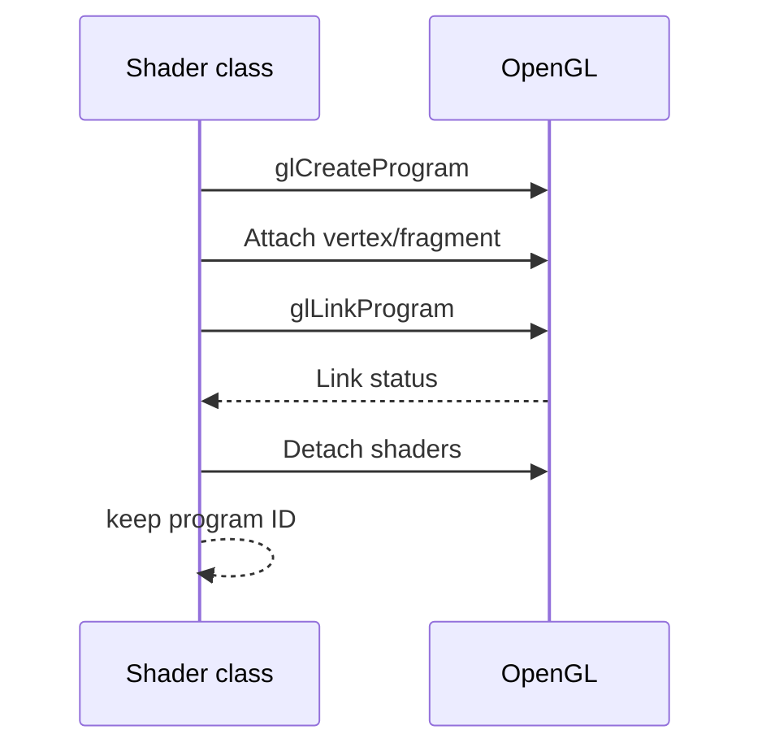

## 8. Shader 类接口

*(参考时间: 00:24:00)*

新增：

```text
Hazel/src/Hazel/Renderer/Shader.h
Hazel/src/Hazel/Renderer/Shader.cpp
```

```cpp
#pragma once

#include <string>

namespace Hazel {

class Shader
{
public:
    Shader(
        const std::string& vertexSrc,
        const std::string& fragmentSrc);
    ~Shader();

    void Bind() const;
    void Unbind() const;

private:
    uint32_t m_RendererID;
};

}
```

`m_RendererID` 保存 OpenGL Shader Program 的句柄。

绑定和解除绑定：

```cpp
void Shader::Bind() const
{
    glUseProgram(m_RendererID);
}

void Shader::Unbind() const
{
    glUseProgram(0);
}
```

析构时删除 Program：

```cpp
Shader::~Shader()
{
    glDeleteProgram(m_RendererID);
}
```

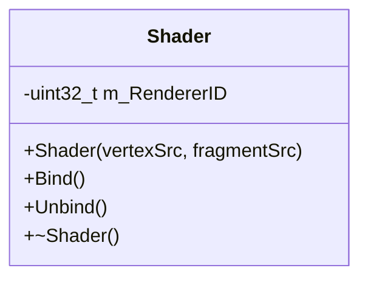

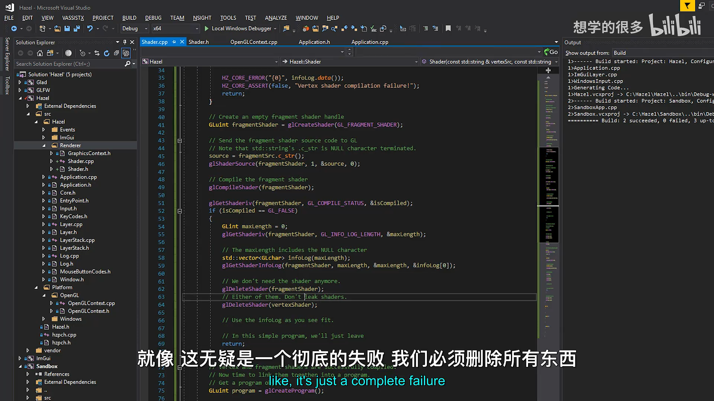

## 9. 在 Application 中创建 Shader

*(参考时间: 00:27:19)*

当前还没有完整 Renderer 架构，因此先临时把 Shader 放在 Application：

```cpp
#include "Hazel/Renderer/Shader.h"

std::unique_ptr<Shader> m_Shader;
```

创建：

```cpp
m_Shader.reset(
    new Shader(vertexSrc, fragmentSrc));
```

绘制前绑定：

```cpp
m_Shader->Bind();

glBindVertexArray(m_VertexArray);
glDrawElements(
    GL_TRIANGLES,
    3,
    GL_UNSIGNED_INT,
    nullptr);
```

虽然 OpenGL 只要求 Shader 在 draw call 前绑定，但这里把 `Bind()` 放在绘制流程开头，更接近 DirectX 等 API 的显式状态要求。

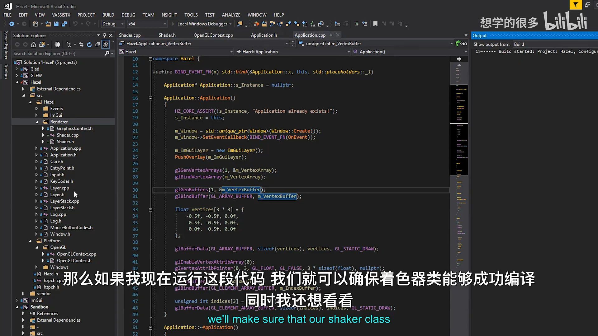

## 10. 使用 Raw String 编写 GLSL

*(参考时间: 00:29:35)*

普通 C++ 字符串需要逐行拼接和转义：

```cpp
std::string src =
    "#version 330 core\n"
    "layout(location = 0) in vec3 a_Position;\n";
```

不方便直接粘贴多行 Shader。

C++11 Raw String 可以保留原始换行：

```cpp
std::string vertexSrc = R"(
    #version 330 core

    layout(location = 0) in vec3 a_Position;

    void main()
    {
        gl_Position = vec4(a_Position, 1.0);
    }
)";
```

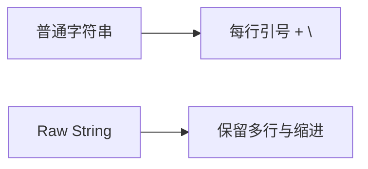

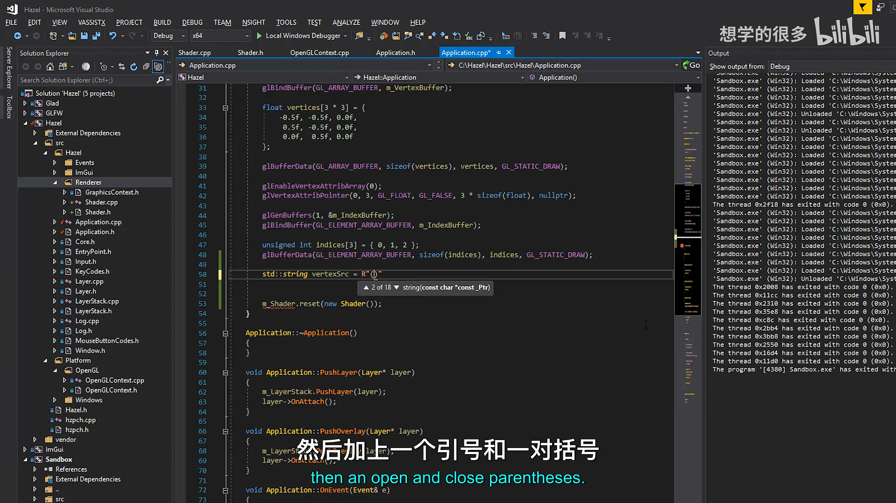

## 11. 编写顶点与片元 Shader

顶点 Shader：

```glsl
#version 330 core

layout(location = 0) in vec3 a_Position;

void main()
{
    gl_Position = vec4(a_Position, 1.0);
}
```

片元 Shader：

```glsl
#version 330 core

layout(location = 0) out vec4 color;

void main()
{
    color = vec4(1.0, 0.0, 0.0, 1.0);
}
```

命名约定：

- `a_` 表示输入 Attribute；
- `v_` 表示在 Shader 之间传递的 Varying 变量；
- `gl_Position` 是顶点 Shader 的内建裁剪空间输出；
- 颜色使用 RGBA 四分量向量。

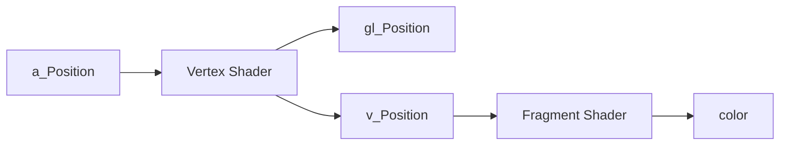

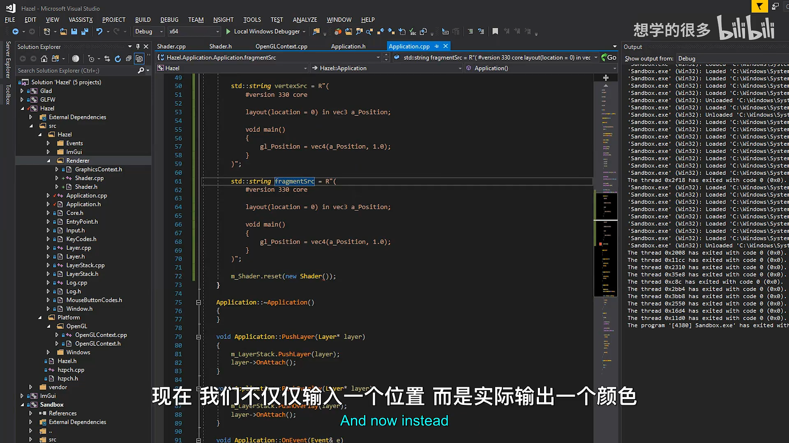

## 12. 绘制红色三角形

*(参考时间: 00:33:52)*

程序运行后，之前没有 Shader 的白色三角形变为纯红色。

这说明：

- 两个 Shader 编译成功；
- Program 链接成功；
- `Bind()` 正确设置了当前 GPU Program；
- Draw Call 使用了新的 Shader 输出。

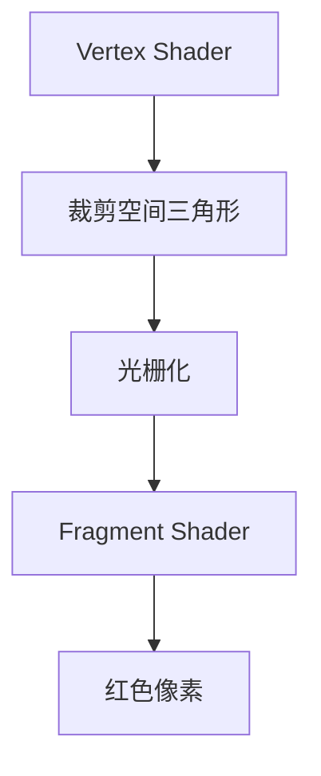

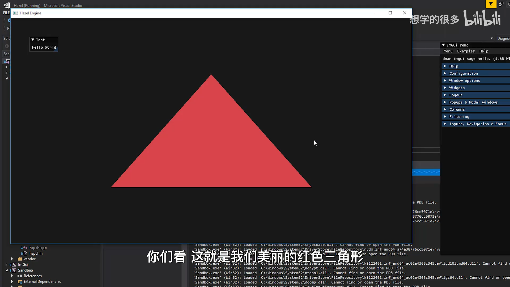

## 13. 在顶点 Shader 中平移三角形

*(参考时间: 00:34:50)*

修改：

```glsl
gl_Position =
    vec4(a_Position + 0.5, 1.0);
```

会把三个顶点整体向正 X、正 Y 平移，因此三角形移动到右上角。

这验证了顶点 Shader 的核心职责：把输入顶点转换成希望显示的裁剪空间位置。

```glsl
// 原始位置
gl_Position = vec4(a_Position, 1.0);

// 平移
gl_Position = vec4(a_Position + 0.5, 1.0);
```

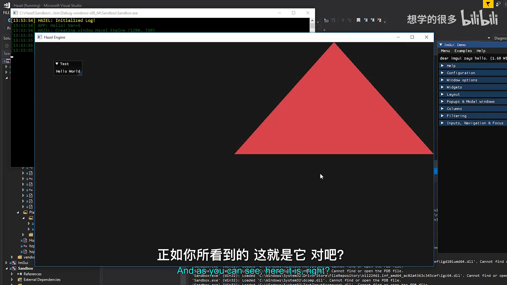

## 14. Shader 之间的数据传递

*(参考时间: 00:36:00)*

顶点 Shader 可以输出可变变量：

```glsl
out vec3 v_Position;

void main()
{
    v_Position = a_Position;
    gl_Position = vec4(a_Position, 1.0);
}
```

片元 Shader 使用相同名称接收：

```glsl
in vec3 v_Position;

void main()
{
    color = vec4(v_Position, 1.0);
}
```

变量名和类型必须对应。

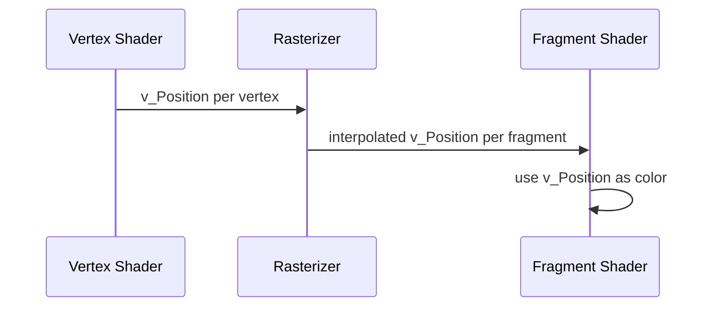

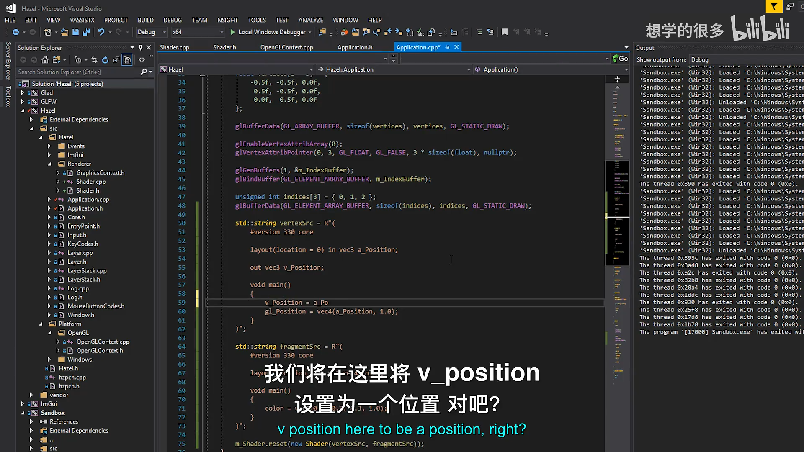

## 15. 为什么会出现黑色区域

*(参考时间: 00:37:27)*

顶点位置范围是：

```text
-1 到 +1
```

颜色通道通常被限制在：

```text
0 到 1
```

如果把负坐标直接作为颜色：

```glsl
color = vec4(v_Position, 1.0);
```

负值会被截断为 `0`，表现为黑色。

转换到 `0..1`：

```glsl
color = vec4(
    v_Position * 0.5 + 0.5,
    1.0);
```

映射关系：

```text
-1.0 -> 0.0
 0.0 -> 0.5
+1.0 -> 1.0
```

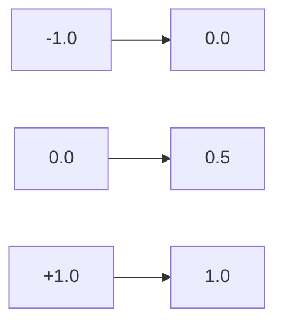

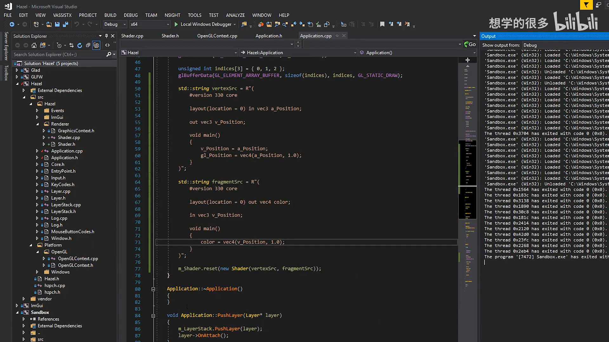

## 16. 颜色插值与坐标轴

*(参考时间: 00:38:11)*

顶点之间会进行线性插值：

```text
左顶点: 负值
中 间: 接近 0
右顶点: 正值
```

所以最终颜色会在三角形内部平滑变化。

坐标轴与 RGB 对应：

| 坐标 | 颜色通道 |
|---|---|
| x | red |
| y | green |
| z | blue |

移动三角形或增加偏移后，可以看到红色与绿色分布变化。

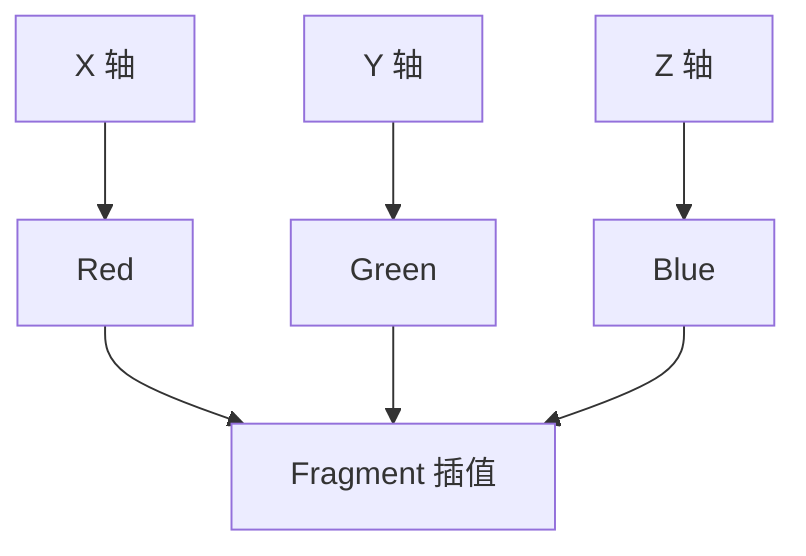

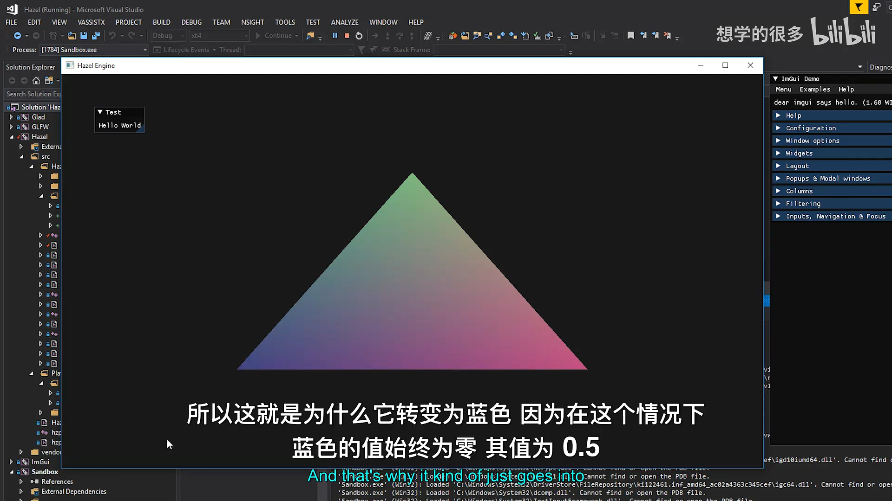

## 17. Shader 生命周期与资源管理

当前 Shader 类已经处理：

- 顶点编译失败时删除顶点 Shader；
- 片元编译失败时删除两个 Shader；
- 链接失败时删除 Program 和两个 Shader；
- 链接成功后分离 Shader；
- 析构时删除 Program。

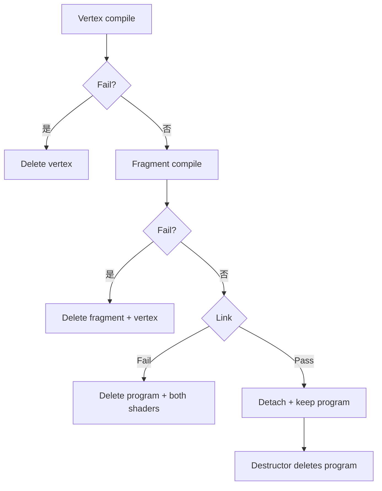

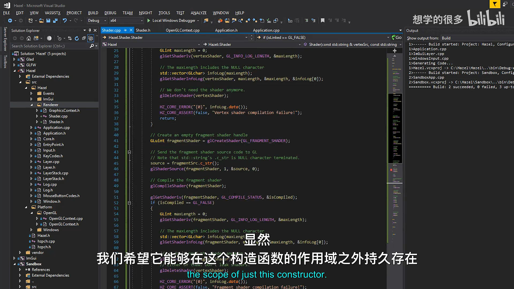

## 18. 当前技术债

*(参考时间: 00:41:37)*

虽然 Shader 类已经建立，但 Application 中仍然直接包含 OpenGL 代码：

- `glGenVertexArrays`；
- `glGenBuffers`；
- `glBufferData`；
- `glVertexAttribPointer`；
- `glDrawElements`。

这意味着跨平台 Application 仍直接依赖 OpenGL。

下一阶段应把这些内容提取为：

```text
Hazel/Renderer/VertexBuffer
Hazel/Renderer/IndexBuffer
Hazel/Renderer/VertexArray
Hazel/Renderer/Shader

Platform/OpenGL/OpenGLVertexBuffer
Platform/OpenGL/OpenGLIndexBuffer
Platform/OpenGL/OpenGLVertexArray
```

Renderer API 抽象的第一批实际类将从这里开始。

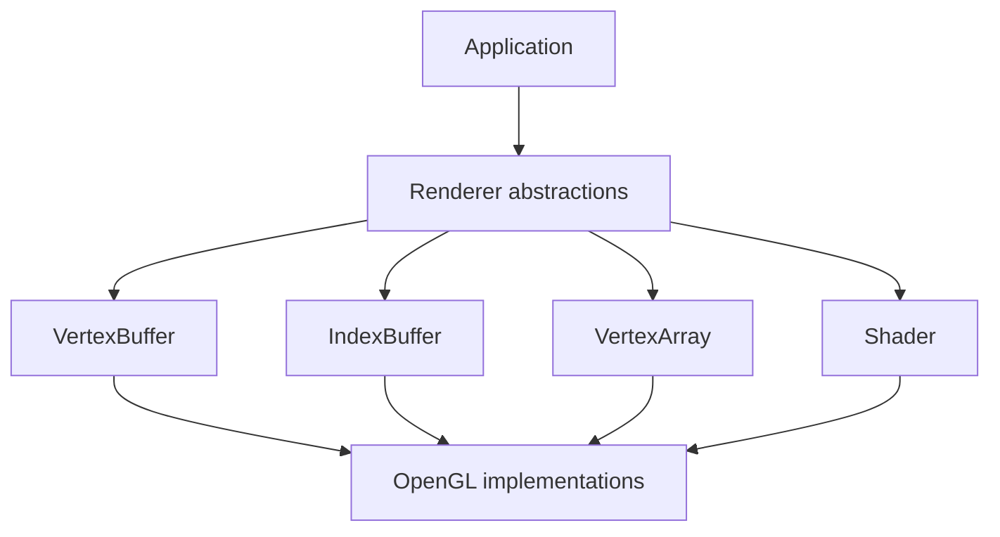


## 19. 本节结论

本讲完成了 Hazel 的第一个 Shader 系统：

- 解释 Vertex Shader 与 Fragment Shader 的职责；
- 理解每个顶点与每个像素的执行模型；
- 建立 Shader 编译、链接与错误检查流程；
- 新增 `Shader` 类；
- 使用 Raw String 编写 GLSL；
- 在 Application 中临时创建和绑定 Shader；
- 成功绘制红色三角形；
- 验证顶点位置变换；
- 通过 Varying 数据实现颜色插值；
- 处理 Shader 资源的创建与释放；
- 明确下一步需要抽象 VertexBuffer、IndexBuffer、VertexArray 等 OpenGL 类。

Shader 让 Hazel 第一次真正使用 GPU 程序控制顶点与像素输出，也为后续材质、光照和 PBR 渲染奠定基础。

## 附：参考

- [Bilibili 精译视频：029 - OpenGL 着色器](https://www.bilibili.com/video/BV1wtLazEEmC/?p=29)
- [The Cherno 游戏引擎系列播放列表](https://www.youtube.com/playlist?list=PLlrATfBNZ98dC-V-N3m0Go4deliWHPFwT5)
- [本期对应代码提交 `76ae3b81`](https://github.com/TheCherno/Hazel/tree/76ae3b81)
- [Khronos OpenGL Wiki：Shader Compilation](https://www.khronos.org/opengl/wiki/Shader_Compilation)
