# Hazel 游戏引擎笔记 030：渲染器 API 抽象

> 本节来源：[The Cherno 游戏引擎系列第 30 讲“渲染器 API 抽象”](https://www.bilibili.com/video/BV1wtLazEEmC/?p=30)，时长约 47 分 16 秒。  
> 原课程与 Hazel 代码作者：The Cherno。代码参考提交：[`7677da4`](https://github.com/TheCherno/Hazel/tree/7677da4)。  
> 本文由视频字幕重构、翻译并整理，不是官方教材；术语和代码以原视频及同期 Hazel 仓库为准。

## 本节目标

上一讲已经用两个手写 Shader 画出了彩色三角形，但所有渲染代码仍然直接塞在 `Application` 中：

- 直接包含 Glad；
- 直接调用 `glGenBuffers`、`glBufferData`；
- 直接处理 `GL_ARRAY_BUFFER`、`GL_ELEMENT_ARRAY_BUFFER`；
- 直接执行 `glDrawElements`。

本讲第一次认真处理 Hazel 的渲染 API 设计问题：如何让上层代码面对一个统一的 `VertexBuffer` 或 `IndexBuffer`，而把 OpenGL、DirectX、Vulkan、Metal 的差异藏在平台实现里。

本讲完成的内容：

- 比较编译期选择 API 与运行期选择 API；
- 建立 `RendererAPI` 枚举和全局当前 API 状态；
- 创建通用 `VertexBuffer`、`IndexBuffer` 接口；
- 使用静态 `Create()` 工厂函数返回具体后端实现；
- 实现 `OpenGLVertexBuffer`、`OpenGLIndexBuffer`；
- 把 Application 中的缓冲区创建和绘图数量改为通用接口；
- 保留仍属于 OpenGL 的 Vertex Array 操作，明确下一阶段技术债。

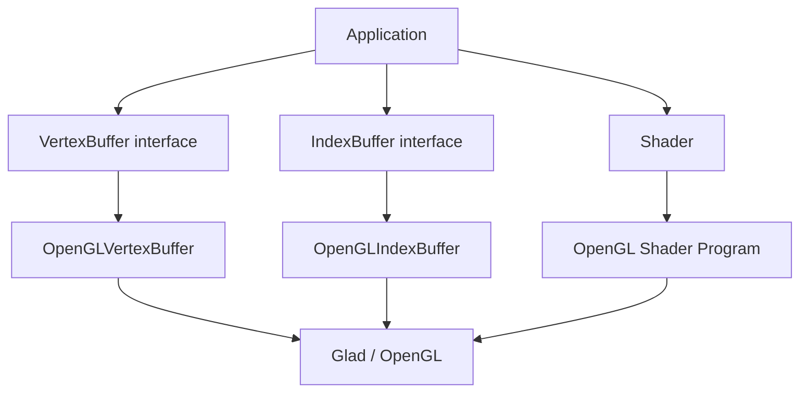


## 1. 为什么渲染 API 抽象困难

*(参考时间: 00:00:30)*

游戏引擎通常要面对两个互相关联、但不能混为一谈的维度。

### 1.1 平台差异

常见目标平台包括：

- Windows；
- macOS；
- Linux；
- Android；
- iOS；
- PlayStation；
- Xbox；
- Nintendo Switch。

每个平台的窗口系统、图形能力、编译器和原生 API 都不相同。

### 1.2 图形 API 差异

同一平台可能支持多个图形 API，例如：

- OpenGL；
- DirectX；
- Vulkan；
- Metal。

平台抽象解决“窗口和系统服务怎样创建”；渲染 API 抽象解决“顶点缓冲、纹理、Shader、Draw Call 怎样表达”。

本讲只处理第二类问题，也就是渲染后端。

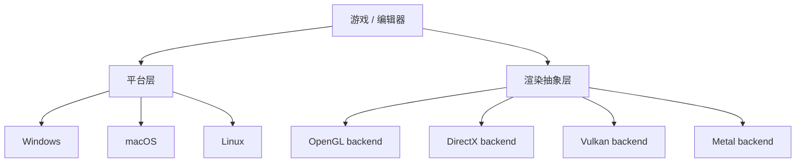


## 2. 编译期选择还是运行期选择

*(参考时间: 00:03:40)*

讲师把最重要的设计决策概括为一句话：

> 图形 API 是在编译时选择，还是在运行时选择？

### 2.1 编译期选择

编译期方案可以通过预处理宏或构建配置决定后端：

```cpp
#ifdef HZ_RENDERER_OPENGL
    // OpenGL 实现
#elif defined(HZ_RENDERER_DIRECTX)
    // DirectX 实现
#endif
```

也可以把不同后端放进不同项目、不同 DLL 或不同可执行文件。

优点：

- 最终二进制只包含当前后端；
- 不需要在运行时查询“现在用的是哪个 API”；
- 热路径没有额外分派成本；
- 发布包更小。

缺点：

- 更换 API 通常需要重新构建；
- 开发时需要维护多个构建配置；
- 想在 OpenGL 与 DirectX 之间快速比较画面时，流程比较笨重。

### 2.2 运行期选择

运行期方案让所有支持的后端都参与构建，然后通过统一的抽象对象选择实现。

优点：

- 可以在运行时切换后端；
- 更容易比较不同 API 的渲染结果；
- 编辑器或测试工具可以按配置选择后端；
- 上层游戏代码不需要包含 API 专用头文件。

缺点：

- 需要同时编译多个后端；
- 二进制和工程复杂度增加；
- 平台不支持的后端仍要用文件级或宏级隔离；
- 抽象层自身需要额外设计。

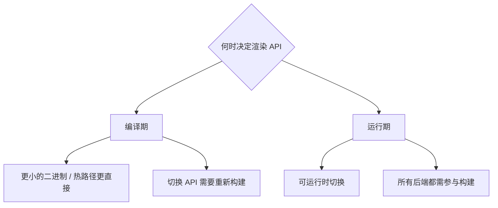


## 3. Hazel 为什么选择运行期抽象

*(参考时间: 00:07:45)*

讲师明确说明：渲染 API 设计没有唯一正确答案，它取决于引擎目标、团队习惯和性能要求。

Hazel 选择运行期抽象，主要原因是开发体验：

- 不需要为了比较 OpenGL 与 DirectX 而切换整套构建配置；
- 游戏或编辑器代码只接触通用类型；
- 可以在更高层决定后端；
- 后续加入 Renderer、RenderCommand 时，接口能继续演进。

讲师也强调自己的性能取向与 EA 游戏工程背景：运行期分派必须被认真评估。Hazel 的判断是，在资源创建和部分渲染命令中，一层虚函数或分支的成本远小于实际绘制和 GPU 提交，尤其当 API 查询不会在最小内层循环里反复发生时，可以接受。

这不是“运行期分派永远免费”，而是“在当前引擎规模和抽象收益下值得”。

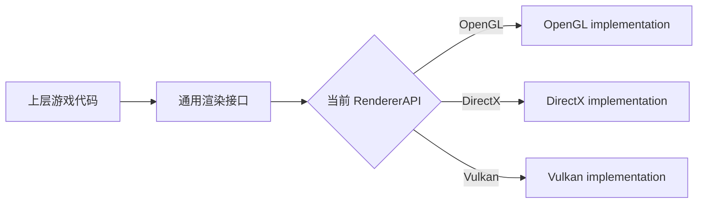


## 4. 目标 API 形态

*(参考时间: 00:16:06)*

当前 `Application` 的运行结果已经正确：位置数据经过顶点 Shader，再由片元 Shader 输出颜色。

但实现方式只是“尽快把图形放到屏幕上”的教学版本。理想情况下，上层代码不需要：

- `#include <glad/glad.h>`；
- 直接调用 `glGenBuffers`；
- 直接调用 `glBufferData`；
- 直接知道 OpenGL 的 Buffer Target。

讲师希望最终写成类似：

```cpp
auto vertexBuffer =
    VertexBuffer::Create(vertices, sizeof(vertices));

vertexBuffer->Bind();
```

资源创建参数将来可以继续扩展，例如：

- 顶点数据；
- 字节数；
- 静态、动态或流式更新策略；
- 是否需要 CPU 侧副本；
- 数据布局。

本讲先做最小版本，不一次设计完整资源系统。

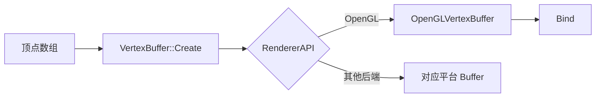

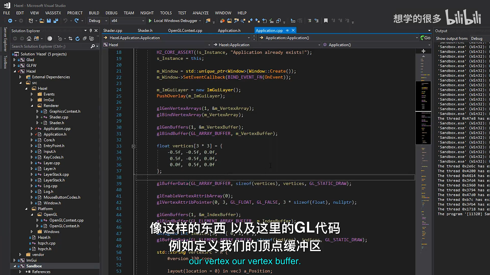

## 5. `Create()` 返回什么

*(参考时间: 00:17:33)*

`Create()` 是静态工厂函数，而不是普通构造函数。

原因很直接：抽象基类 `VertexBuffer` 不能凭空知道应该构造哪个派生类。静态函数可以检查当前渲染 API，再返回对应实现。

本讲选择返回裸指针：

```cpp
static VertexBuffer* Create(
    float* vertices,
    uint32_t size);
```

调用方负责所有权。当前 Application 使用 `std::unique_ptr` 接管：

```cpp
std::unique_ptr<VertexBuffer> m_VertexBuffer;

m_VertexBuffer.reset(
    VertexBuffer::Create(vertices, sizeof(vertices)));
```

讲师说明，如果引擎将来有引用计数或专门的资源句柄系统，`Create()` 也可以返回引用计数指针。当前还没有这类基础设施，所以先使用裸指针加明确的上层所有权。

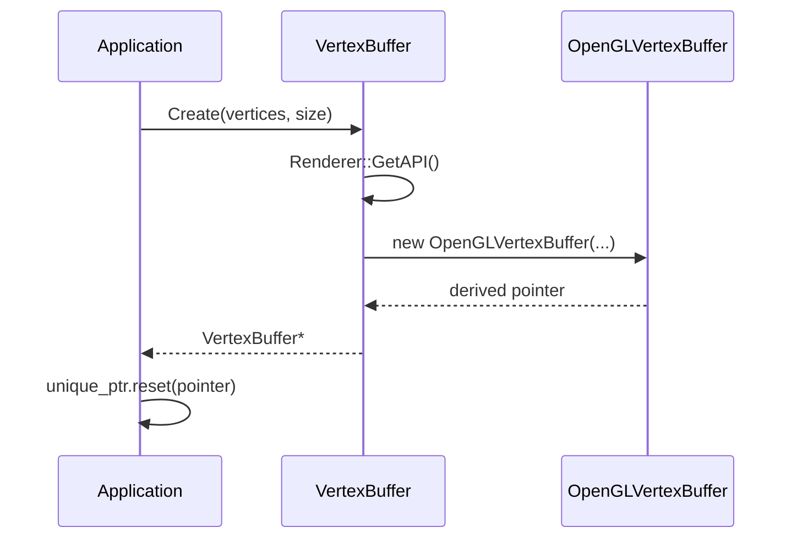

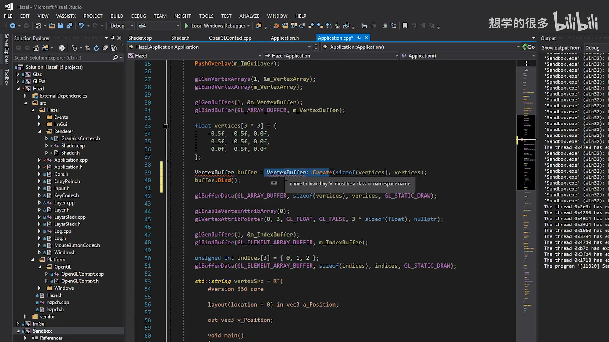

## 6. 文件组织与职责边界

*(参考时间: 00:18:10)*

通用渲染资源文件放在：

```text
Hazel/src/Hazel/Renderer/
    Buffer.h
    Buffer.cpp
```

OpenGL 专用实现放在：

```text
Hazel/src/Platform/OpenGL/
    OpenGLBuffer.h
    OpenGLBuffer.cpp
```

`Buffer.h` 中包含 `VertexBuffer` 与 `IndexBuffer` 两个抽象类。讲师倾向于把同一种资源的多个变体放在一个文件里，例如未来 `Texture.h` 可以同时容纳 2D、3D、Cube Map 等纹理接口。

这是讲师的文件组织偏好，不是渲染系统的硬性规则：

- 一个资源类型一个文件；
- 一种 API 一个平台实现文件；
- 避免为了几十行小类制造大量文件。

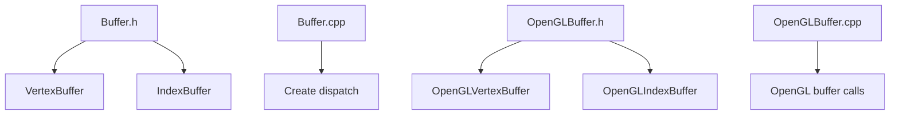

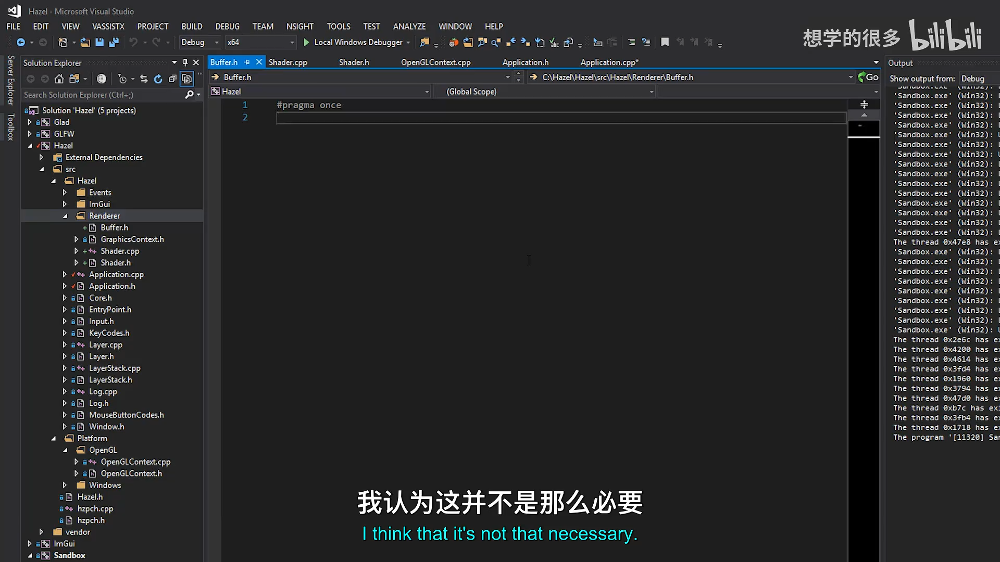

## 7. 通用缓冲区接口

*(参考时间: 00:19:30)*

`Buffer.h` 中的通用接口没有数据成员，只描述行为：

```cpp
#pragma once

namespace Hazel {

class VertexBuffer
{
public:
    virtual ~VertexBuffer() {}

    virtual void Bind() const = 0;
    virtual void Unbind() const = 0;

    static VertexBuffer* Create(
        float* vertices,
        uint32_t size);
};

class IndexBuffer
{
public:
    virtual ~IndexBuffer() {}

    virtual void Bind() const = 0;
    virtual void Unbind() const = 0;

    virtual uint32_t GetCount() const = 0;

    static IndexBuffer* Create(
        uint32_t* indices,
        uint32_t count);
};

}
```

几个关键设计点：

- 析构函数必须是 `virtual`，否则通过基类指针删除派生对象会破坏资源释放；
- `Bind()` 与 `Unbind()` 是纯虚函数，让每个后端自己定义状态切换；
- `IndexBuffer` 额外提供 `GetCount()`，因为 Draw Call 需要知道索引数量；
- 抽象类本身不持有 OpenGL ID，平台状态留在具体实现中。

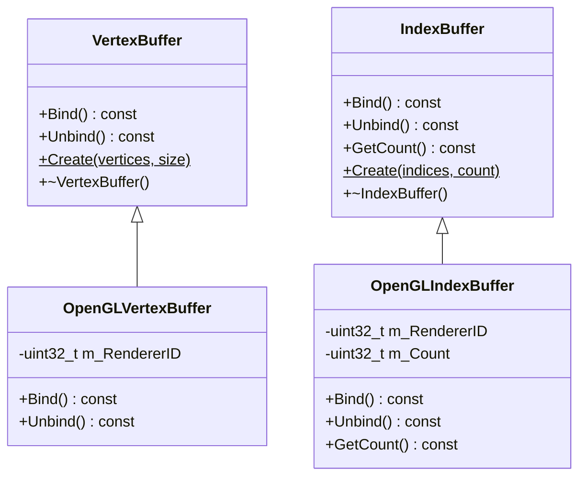

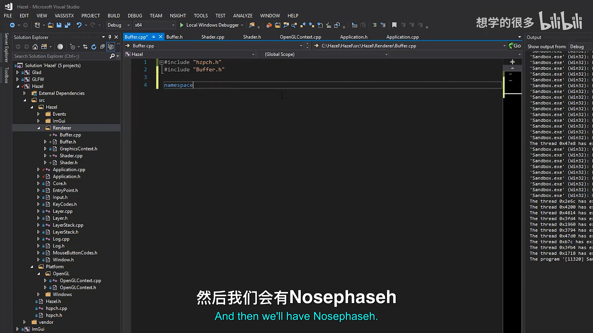

## 8. 当前渲染 API 状态

*(参考时间: 00:32:00)*

为了让工厂函数知道创建哪个后端，新增 `Renderer.h`：

```cpp
#pragma once

namespace Hazel {

enum class RendererAPI
{
    None = 0,
    OpenGL = 1
};

class Renderer
{
public:
    inline static RendererAPI GetAPI()
    {
        return s_RendererAPI;
    }

private:
    static RendererAPI s_RendererAPI;
};

}
```

当前值在 `Renderer.cpp` 中固定为 OpenGL：

```cpp
#include "hzpch.h"
#include "Renderer.h"

namespace Hazel {

RendererAPI Renderer::s_RendererAPI =
    RendererAPI::OpenGL;

}
```

`None` 的意义是：某些测试或工具可能只需要 Headless 环境，不必初始化真实图形后端。

讲师还讨论了 `SetAPI()`：如果要在运行时选择后端，应当尽早设置，最好在创建窗口、Context 和 Application 之前完成，使后续资源都按同一 API 创建。

```mermaid
stateDiagram-v2
    [*] --> SelectAPI
    SelectAPI --> CreateWindow
    CreateWindow --> CreateContext
    CreateContext --> CreateResources
    CreateResources --> Render
    SelectAPI: Renderer::SetAPI()
    CreateResources: Buffer / Shader / Texture
```

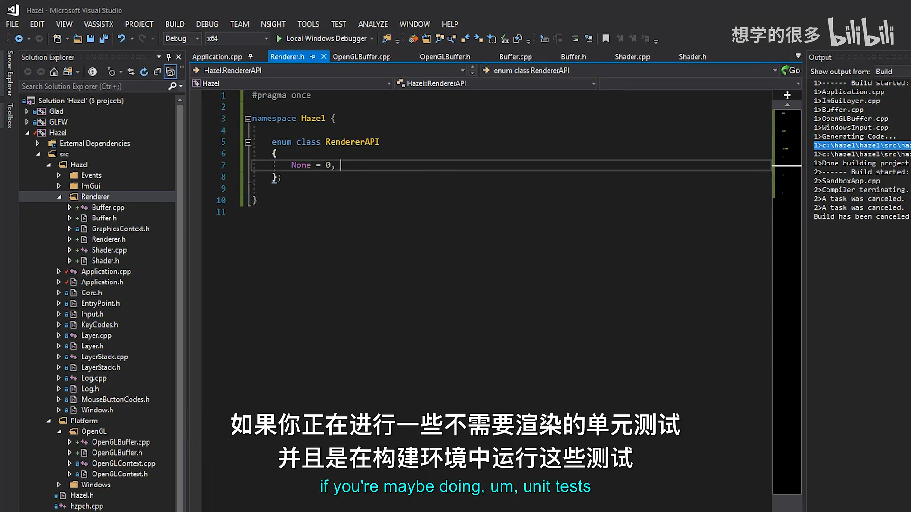

## 9. 工厂分派实现

*(参考时间: 00:34:30)*

`Buffer.cpp` 负责把静态 `Create()` 转发到具体实现：

```cpp
#include "hzpch.h"
#include "Buffer.h"

#include "Renderer.h"

#include "Platform/OpenGL/OpenGLBuffer.h"

namespace Hazel {

VertexBuffer* VertexBuffer::Create(
    float* vertices,
    uint32_t size)
{
    switch (Renderer::GetAPI())
    {
        case RendererAPI::None:
            HZ_CORE_ASSERT(
                false,
                "RendererAPI::None is currently not supported!");
            return nullptr;

        case RendererAPI::OpenGL:
            return new OpenGLVertexBuffer(
                vertices,
                size);
    }

    HZ_CORE_ASSERT(false, "Unknown RendererAPI!");
    return nullptr;
}

}
```

`IndexBuffer::Create()` 的结构完全相同，只是返回 `OpenGLIndexBuffer`。

这里体现了运行期抽象的核心模式：

1. 上层调用与具体 API 无关的静态 `Create()`；
2. `Create()` 查询 `Renderer::GetAPI()`；
3. `switch` 进入对应后端；
4. 基类指针返回给上层；
5. 实际实现只在平台目录中出现。

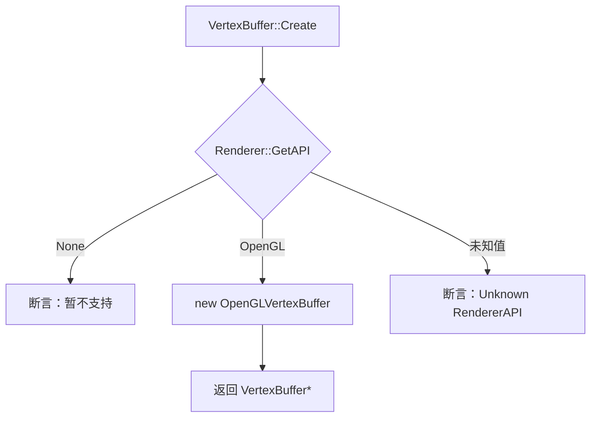

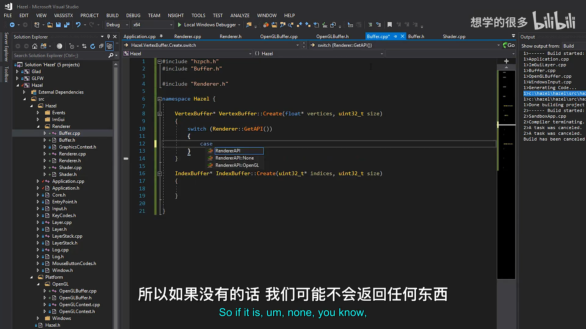

## 10. 平台隔离仍然需要条件编译

*(参考时间: 00:36:20)*

运行期抽象并不代表完全消除预处理宏。

DirectX 只在 Windows 与 Xbox 等 Microsoft 平台可用；Metal 通常只在 Apple 平台可用。因此 `Buffer.cpp` 在真正加入这些后端时，仍可能需要：

```cpp
#ifdef HZ_PLATFORM_WINDOWS
    case RendererAPI::DirectX:
        return new DirectXVertexBuffer(...);
#endif
```

关键区别是：

- 宏只隔离“平台无法编译的后端”；
- 上层游戏代码仍然只依赖 `VertexBuffer`；
- 渲染 API 选择本身仍可在支持范围内由运行期状态决定。

也就是说，运行期抽象与编译期平台隔离会共存，而不是互相排斥。

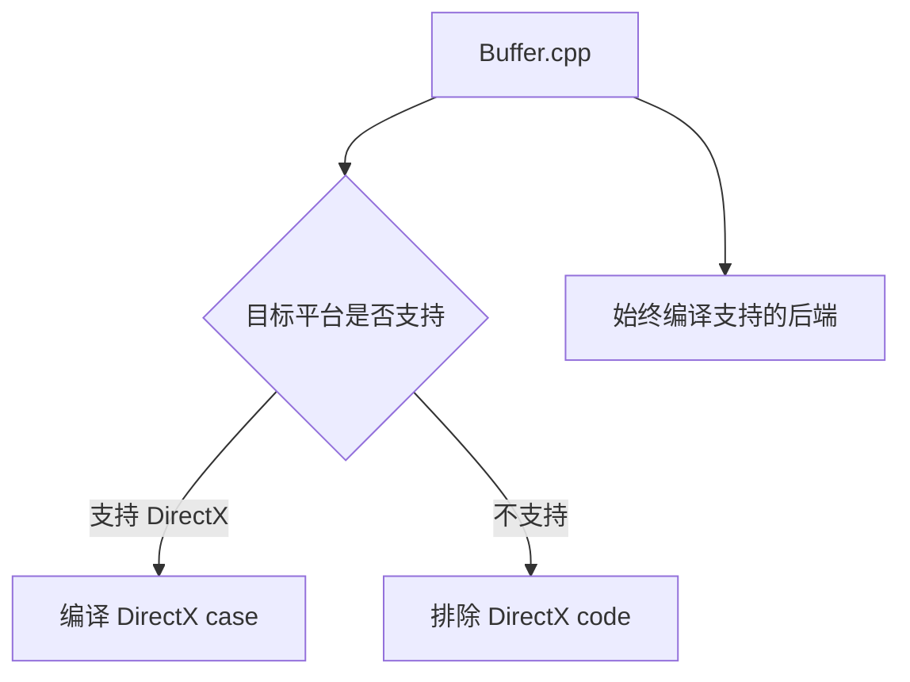

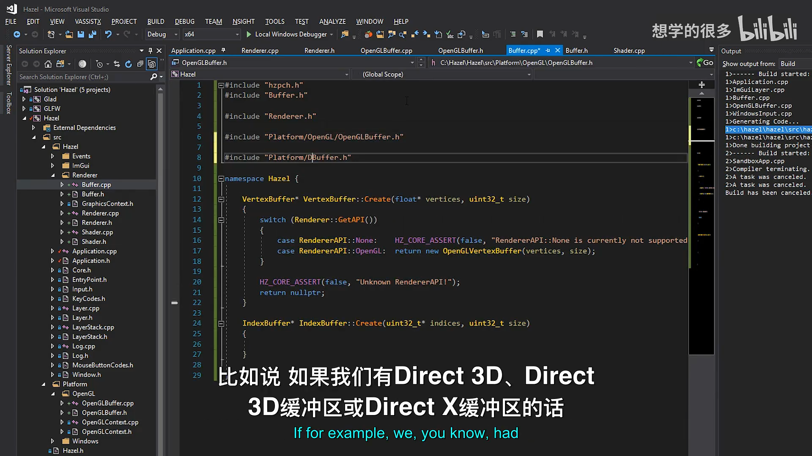

## 11. OpenGL 顶点缓冲实现

*(参考时间: 00:24:15)*

`OpenGLBuffer.h` 中的顶点缓冲继承通用接口：

```cpp
class OpenGLVertexBuffer :
    public VertexBuffer
{
public:
    OpenGLVertexBuffer(
        float* vertices,
        uint32_t size);

    virtual ~OpenGLVertexBuffer();

    virtual void Bind() const;
    virtual void Unbind() const;

private:
    uint32_t m_RendererID;
};
```

实现中使用 `glCreateBuffers`：

```cpp
OpenGLVertexBuffer::OpenGLVertexBuffer(
    float* vertices,
    uint32_t size)
{
    glCreateBuffers(1, &m_RendererID);
    glBindBuffer(GL_ARRAY_BUFFER, m_RendererID);
    glBufferData(
        GL_ARRAY_BUFFER,
        size,
        vertices,
        GL_STATIC_DRAW);
}
```

绘制时：

```cpp
void OpenGLVertexBuffer::Bind() const
{
    glBindBuffer(GL_ARRAY_BUFFER, m_RendererID);
}

void OpenGLVertexBuffer::Unbind() const
{
    glBindBuffer(GL_ARRAY_BUFFER, 0);
}
```

析构：

```cpp
OpenGLVertexBuffer::~OpenGLVertexBuffer()
{
    glDeleteBuffers(1, &m_RendererID);
}
```

`glCreateBuffers` 只负责创建 Buffer 对象；随后仍然需要 `glBindBuffer` 选择目标，才能让 `glBufferData` 明确作用于当前 Buffer。它减少了 `glGenBuffers` 一类旧接口的步骤，但不能把“创建”和“绑定”混为一谈。

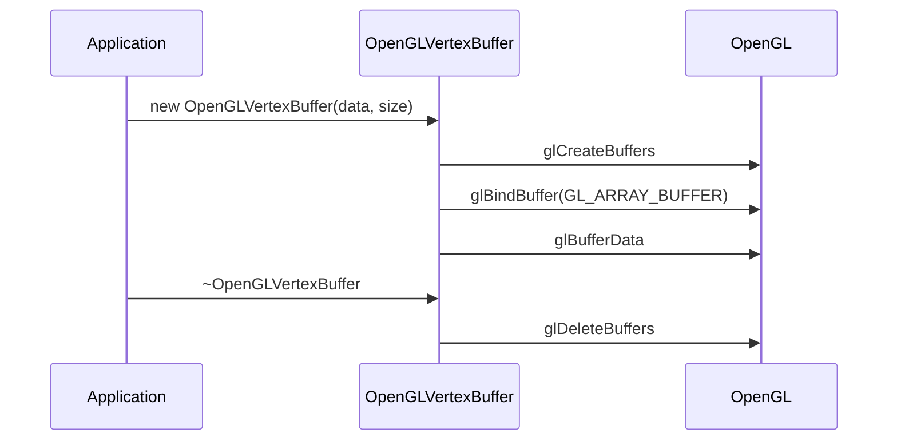

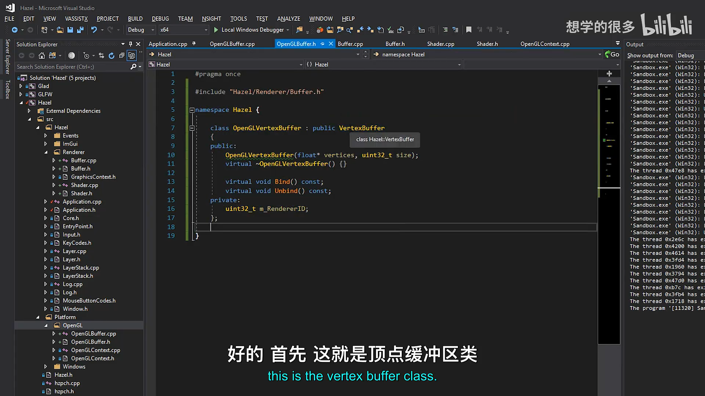

## 12. OpenGL 索引缓冲实现

*(参考时间: 00:38:00)*

索引缓冲的目标对象是 `GL_ELEMENT_ARRAY_BUFFER`，并且额外保存元素数量：

```cpp
class OpenGLIndexBuffer :
    public IndexBuffer
{
public:
    OpenGLIndexBuffer(
        uint32_t* indices,
        uint32_t count);

    virtual ~OpenGLIndexBuffer();

    virtual void Bind() const;
    virtual void Unbind() const;

    virtual uint32_t GetCount() const
    {
        return m_Count;
    }

private:
    uint32_t m_RendererID;
    uint32_t m_Count;
};
```

构造函数：

```cpp
OpenGLIndexBuffer::OpenGLIndexBuffer(
    uint32_t* indices,
    uint32_t count)
    : m_Count(count)
{
    glCreateBuffers(1, &m_RendererID);
    glBindBuffer(
        GL_ELEMENT_ARRAY_BUFFER,
        m_RendererID);

    glBufferData(
        GL_ELEMENT_ARRAY_BUFFER,
        count * sizeof(uint32_t),
        indices,
        GL_STATIC_DRAW);
}
```

这里明确区分了两个概念：

- `count` 是索引元素个数；
- `count * sizeof(uint32_t)` 才是字节数。

Draw Call 需要的是元素数量，而 `glBufferData` 需要的是字节数，因此接口保存 `count`，底层在上传时转换。

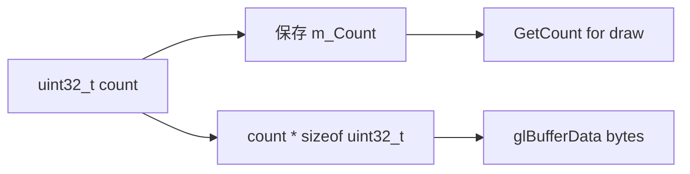

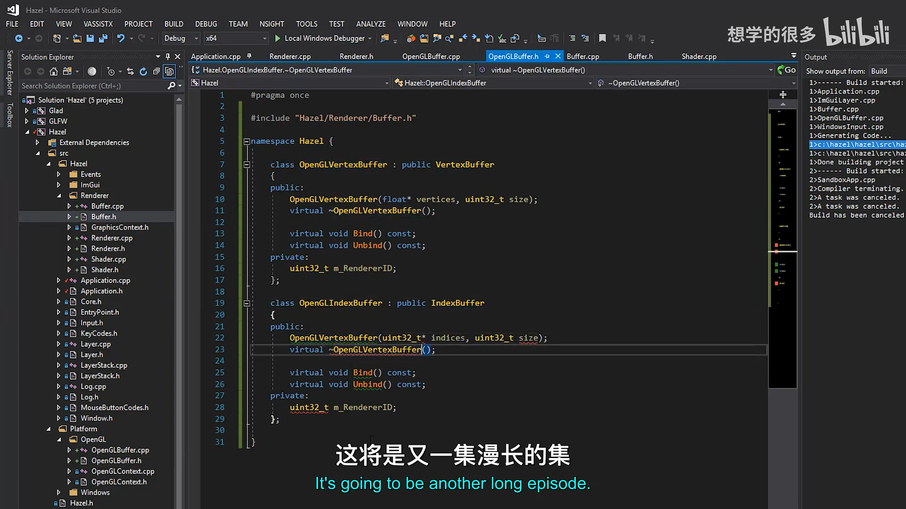

## 13. `size` 与 `count` 的语义

*(参考时间: 00:40:45)*

这是本讲一个容易被忽略、但对 API 设计很重要的细节。

如果参数名是 `size`：

- 它表示字节数；
- 调用者通常传 `sizeof(array)`；
- 底层可以直接用于 `glBufferData`。

如果参数名是 `count`：

- 它表示元素个数；
- 底层需要乘以元素大小；
- 但绘图命令可以直接使用它。

OpenGL 的 `glDrawElements` 需要索引数量，因此索引缓冲必须能返回 `GetCount()`。如果接口只保存字节数，绘制时还得反算。

视频最后为了提高可读性，把 Application 中的 `sizeof(indices) / sizeof(uint32_t)` 直接写成 `3`，但注释和代码仍然要清楚这是三个索引，而不是三个字节。

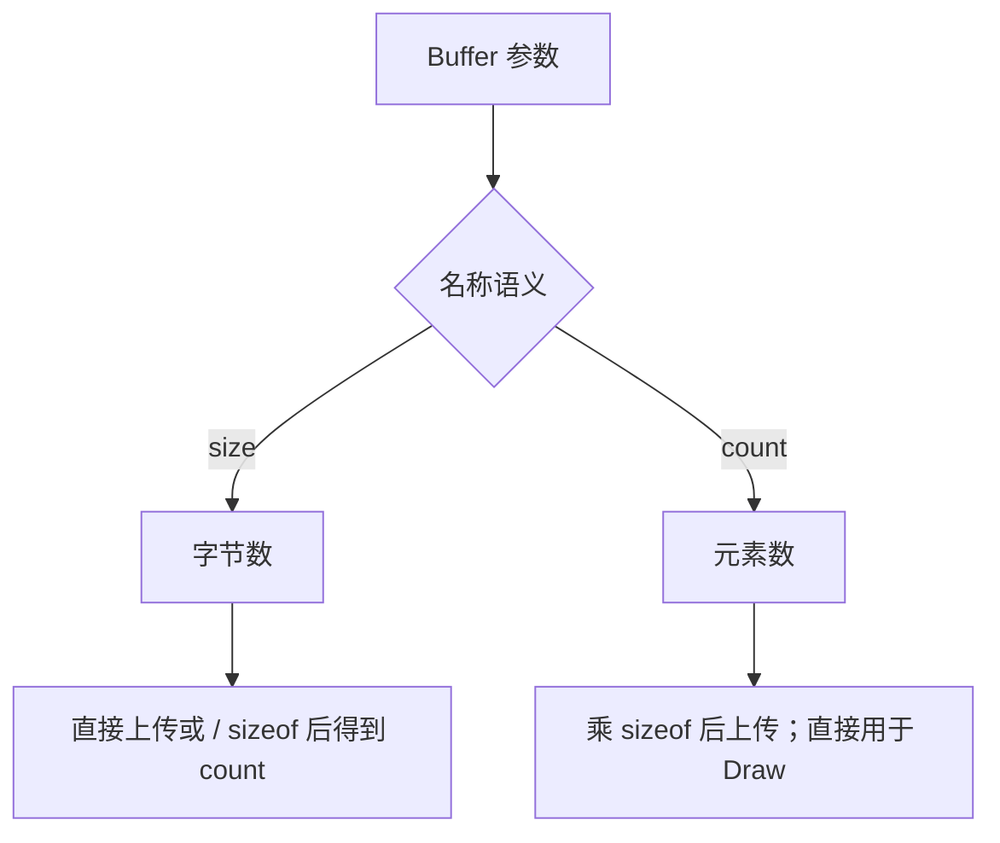

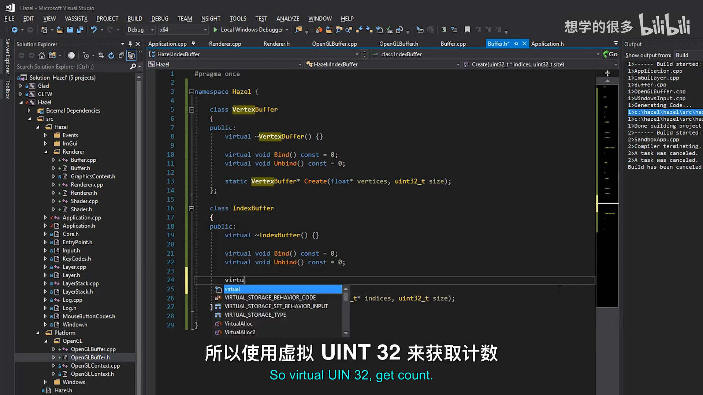

## 14. Application 改用通用缓冲接口

*(参考时间: 00:29:55)*

`Application.h` 引入 `Buffer.h`：

```cpp
#include "Hazel/Renderer/Buffer.h"
```

原有的裸 OpenGL ID：

```cpp
unsigned int m_VertexArray;
unsigned int m_VertexBuffer;
unsigned int m_IndexBuffer;
```

变成：

```cpp
unsigned int m_VertexArray;
std::unique_ptr<Shader> m_Shader;
std::unique_ptr<VertexBuffer> m_VertexBuffer;
std::unique_ptr<IndexBuffer> m_IndexBuffer;
```

构造三角形时：

```cpp
float vertices[3 * 3] = {
    -0.5f, -0.5f, 0.0f,
     0.5f, -0.5f, 0.0f,
     0.0f,  0.5f, 0.0f
};

m_VertexBuffer.reset(
    VertexBuffer::Create(
        vertices,
        sizeof(vertices)));

uint32_t indices[3] = { 0, 1, 2 };
m_IndexBuffer.reset(
    IndexBuffer::Create(
        indices,
        sizeof(indices) / sizeof(uint32_t)));
```

绘制时不再硬编码 3：

```cpp
glDrawElements(
    GL_TRIANGLES,
    m_IndexBuffer->GetCount(),
    GL_UNSIGNED_INT,
    nullptr);
```

这样，索引数量由资源自己提供，Application 不必和缓冲区内部数据长度脱节。

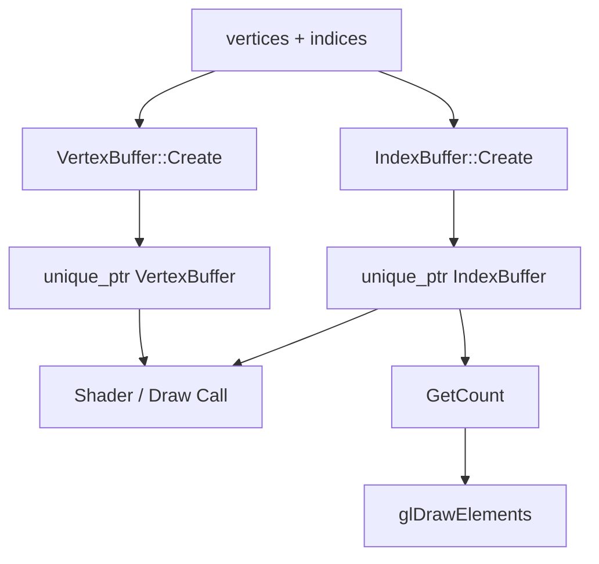

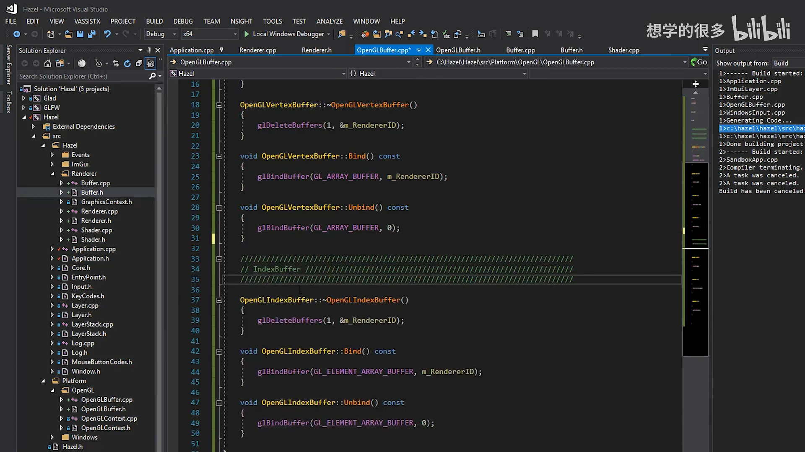

## 15. 第一轮运行暴露的问题

*(参考时间: 00:42:30)*

第一次运行没有直接得到预期的三角形。讲师借这个调试过程强调：资源对象被创建，并不等于底层状态已经正确绑定。

调整时重点检查了：

- 顶点缓冲是否绑定到 `GL_ARRAY_BUFFER`；
- 索引缓冲是否绑定到 `GL_ELEMENT_ARRAY_BUFFER`；
- Draw Call 是否使用 `IndexBuffer::GetCount()`；
- 顶点属性指针是否仍然面对当前绑定状态。

最终的 OpenGL 实现把绑定动作放入构造函数与 `Bind()`，并在 Application 中通过通用接口创建资源。重新运行后，原来的彩色三角形正常出现。

这说明抽象层不是“把代码挪个位置”就结束。底层的上下文状态、VAO 绑定关系和 Buffer Target 仍然必须准确。

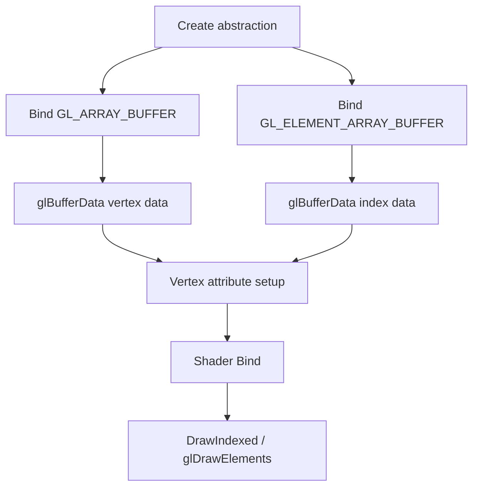

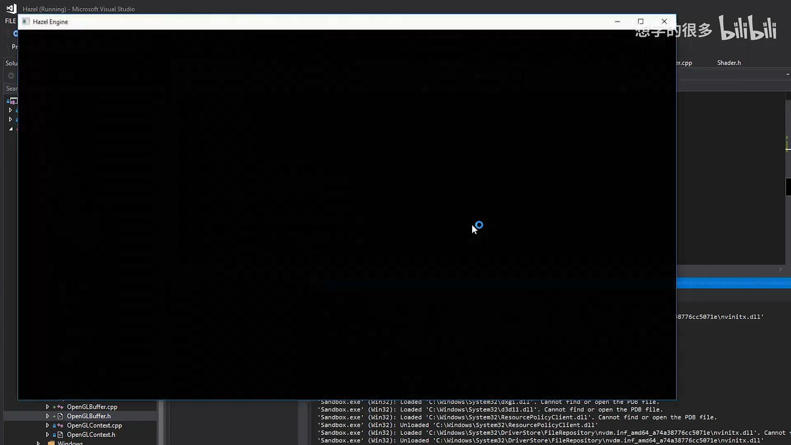

## 16. 抽象完成后的边界

*(参考时间: 00:44:05)*

重构后的 Application 已经不再直接创建 Vertex Buffer 与 Index Buffer：

```cpp
m_VertexBuffer.reset(
    VertexBuffer::Create(vertices, sizeof(vertices)));

m_IndexBuffer.reset(
    IndexBuffer::Create(indices, 3));
```

但仍有 OpenGL 遗留：

```cpp
glGenVertexArrays(1, &m_VertexArray);
glBindVertexArray(m_VertexArray);
glEnableVertexAttribArray(0);
glVertexAttribPointer(...);
glDrawElements(...);
```

`Buffer.h` 与 `Buffer.cpp` 不包含 Glad，也不需要了解 `GL_ARRAY_BUFFER`、`GL_ELEMENT_ARRAY_BUFFER`。这些细节只留在：

```text
Platform/OpenGL/OpenGLBuffer.h
Platform/OpenGL/OpenGLBuffer.cpp
```

这就是本讲的阶段性成果：缓冲区资源已经通过通用接口创建，平台实现被隔离；但 Vertex Array 与直接 Draw Call 还没有抽象。

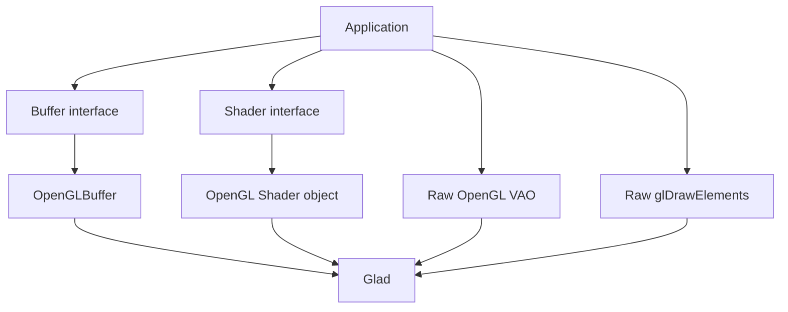

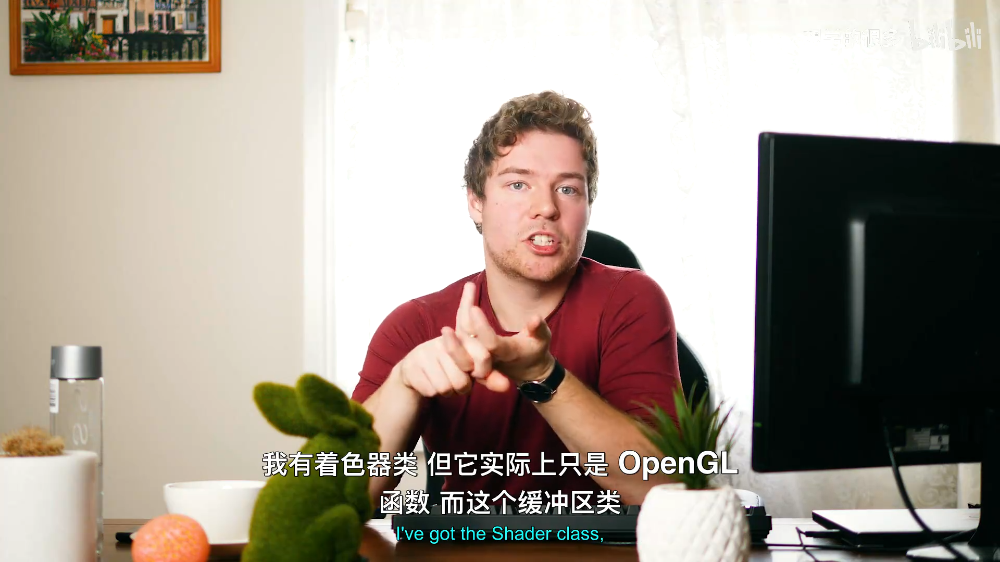

## 17. 下一步

*(参考时间: 00:46:40)*

讲师在结尾列出两条紧接着的方向：

- 继续完善 Renderer，把清屏、绘制命令等状态集中到渲染层；
- 抽象 Vertex Array 及其配置，避免 Application 直接设置属性指针。

从本讲暴露的边界看，`Buffer` 只解决了数据存储，仍然需要回答：

- 多个 Vertex Buffer 如何组织到同一个 VAO；
- Buffer Layout 如何描述位置、颜色、法线等属性；
- Index Buffer 如何与 VAO 绑定；
- Draw Call 如何由 Renderer 统一发出；
- 清屏颜色和清屏命令如何从 Application 移入渲染层。

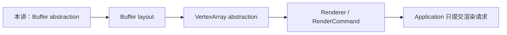


## 18. 本节结论

本讲完成了 Hazel 渲染 API 抽象的第一块基础设施：

- 讨论编译期与运行期选择图形 API 的权衡；
- 选择运行期 `RendererAPI` 状态；
- 新增 `Renderer` 与 `RendererAPI` 枚举；
- 新增通用 `VertexBuffer`、`IndexBuffer` 接口；
- 用静态 `Create()` 工厂选择平台实现；
- 返回裸指针，由 Application 的 `unique_ptr` 接管所有权；
- 新增 `OpenGLVertexBuffer`、`OpenGLIndexBuffer`；
- 把 Buffer ID、创建、上传、绑定与删除限制在 OpenGL 平台文件中；
- 用 `GetCount()` 提供索引元素数量；
- Application 不再直接创建 OpenGL Buffer；
- 保留 VAO 和 Draw Call 的 OpenGL 代码，作为下一步技术债；
- 明确图形 API 抽象是资源接口、后端选择与平台隔离共同组成的系统。

这还不是完整的 Renderer，但它建立了后续所有渲染资源都会沿用的模式：**上层表达“要创建什么”，平台实现决定“底层怎样完成”。**

## 附：参考

- [Bilibili 精译视频：030 - 渲染器API抽象](https://www.bilibili.com/video/BV1wtLazEEmC/?p=30)
- [The Cherno 游戏引擎系列播放列表](https://www.youtube.com/playlist?list=PLlrATfBNZ98dC-V-N3m0Go4deliWHPFwT5)
- [本期对应代码提交 `7677da4`](https://github.com/TheCherno/Hazel/tree/7677da4)
- [OpenGL Wiki：Vertex Specification](https://www.khronos.org/opengl/wiki/Vertex_Specification)
- [OpenGL Wiki：Buffer Object](https://www.khronos.org/opengl/wiki/Buffer_Object)
