# Hazel 游戏引擎笔记 031：顶点缓冲区布局

> 本节来源：[The Cherno 游戏引擎系列第 31 讲“顶点缓冲区布局”](https://www.bilibili.com/video/BV1wtLazEEmC/?p=31)，时长约 49 分 16 秒。  
> 原课程与 Hazel 代码作者：The Cherno。代码参考提交：[`e8eef16`](https://github.com/TheCherno/Hazel/tree/e8eef16)。  
> 本文由视频字幕重构、翻译并整理，不是官方教材；术语和代码以原视频及同期 Hazel 仓库为准。

## 本节目标

上一讲已经把 Vertex Buffer 和 Index Buffer 从 `Application` 中抽到通用接口与 OpenGL 实现后面。但顶点属性仍然由一组写死的数字描述：

```cpp
glVertexAttribPointer(
    0, 3, GL_FLOAT, GL_FALSE,
    3 * sizeof(float),
    nullptr);
```

这段代码同时隐藏了四项信息：

- Shader 中的属性位置；
- 每个属性包含几个基础分量；
- 一条完整顶点记录占多少字节；
- 属性在一条顶点记录中的起始偏移。

本讲的目标，是把这些数字改写成可读、可复用、可跨渲染 API 表达的布局描述。最终希望上层代码写成：

```cpp
BufferLayout layout = {
    { ShaderDataType::Float3, "a_Position" },
    { ShaderDataType::Float4, "a_Color" }
};
```

本讲完成的内容：

- 解释顶点属性、顶点缓冲区和顶点数组之间的关系；
- 建立跨 API 的 `ShaderDataType`；
- 建立 `BufferElement`，描述单个顶点属性；
- 建立 `BufferLayout`，自动计算偏移和步长；
- 为 `VertexBuffer` 增加 `SetLayout()` 与 `GetLayout()`；
- 使用初始化列表写出接近 Shader 声明形态的布局；
- 按布局自动调用 `glVertexAttribPointer()`；
- 为三角形加入颜色数据并验证颜色插值；
- 定位一次由 Shader 未输出颜色导致的“黑三角形”问题；
- 保留 Vertex Array 与 Draw Call 的 OpenGL 代码，作为下一讲的技术债。

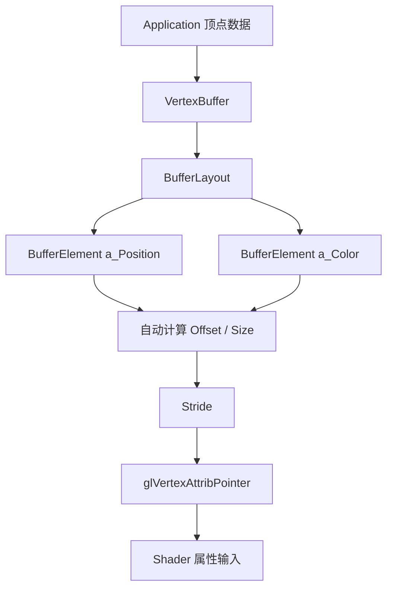

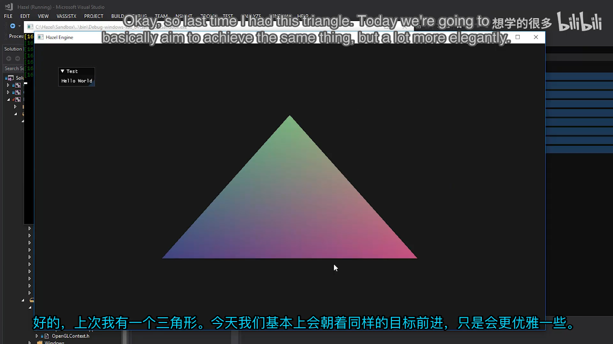

## 1. 顶点缓冲区本身只是字节块

*(参考时间: 00:05:32)*

CPU 上传给 GPU 的 Vertex Buffer 本质上是一段连续内存。OpenGL 知道这段内存的起始地址和字节数，却不知道其中的业务含义。

同样一段 `float` 数组，可以被解释成：

- 一个三浮点位置；
- 一个位置加一个四浮点颜色；
- 位置、法线、纹理坐标和切线；
- 多顶点交错存放的完整记录；
- 多个独立缓冲区分别提供不同属性。

要让 GPU 正确读取，必须告诉它：

- 从哪个字节开始；
- 每隔多少字节跳到下一个顶点；
- 一个属性由几个基础类型组成；
- 基础类型是 `float`、`int` 还是其他格式；
- 是否需要把整数归一化成浮点数。

这就是顶点缓冲区布局需要表达的内容。

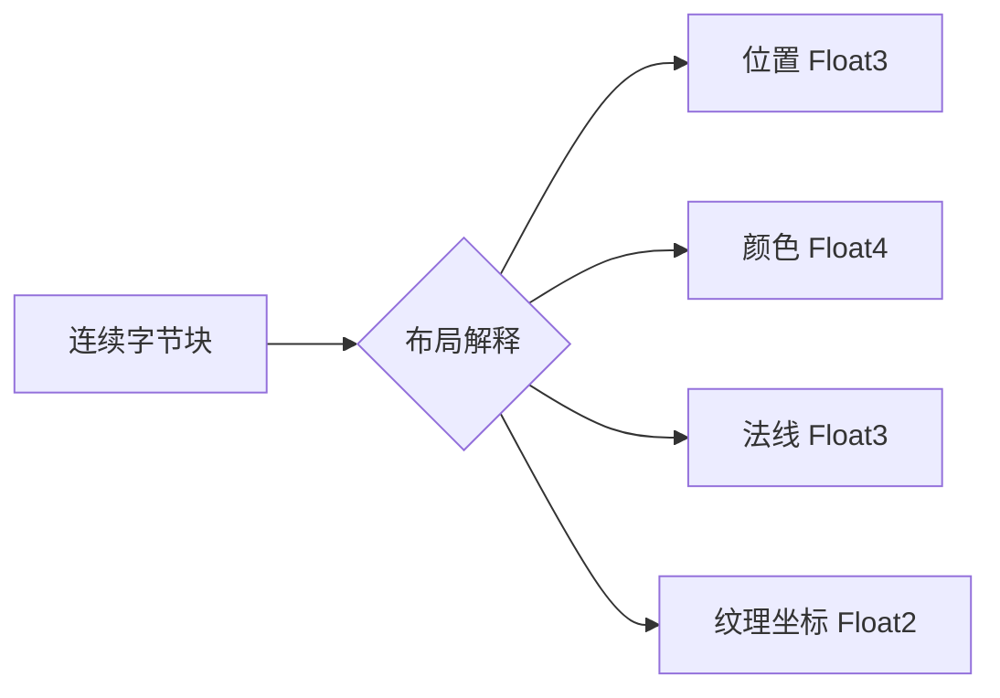

## 2. 属性状态实际存放在哪里

*(参考时间: 00:07:53)*

`glVertexAttribPointer()` 描述的是 Vertex Buffer 中的数据，但 OpenGL 会把这份属性配置保存在当前绑定的 Vertex Array Object 中。

因此必须区分两层关系：

- **Vertex Buffer** 保存顶点原始数据；
- **Vertex Array** 保存如何读取这些数据的属性状态。

一个 Vertex Array 可以关联多个 Vertex Buffer，也可以让多个属性共享同一个交错缓冲区。

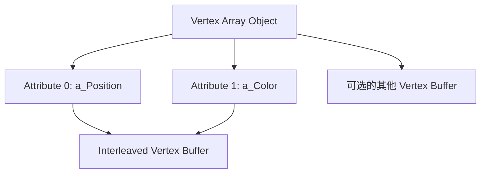

当前相机三角形采用交错布局：每个顶点记录先放 3 个位置浮点，再放 4 个颜色浮点。全部记录连续排列，读取属性时依靠 `stride` 跳过一整条顶点记录。

另一种方案是为位置、颜色、法线分别创建 Vertex Buffer。OpenGL 不强制选择某一种方案，但绝大多数场景会把常用属性交错在同一个缓冲区中，以提高顶点数据的局部性。

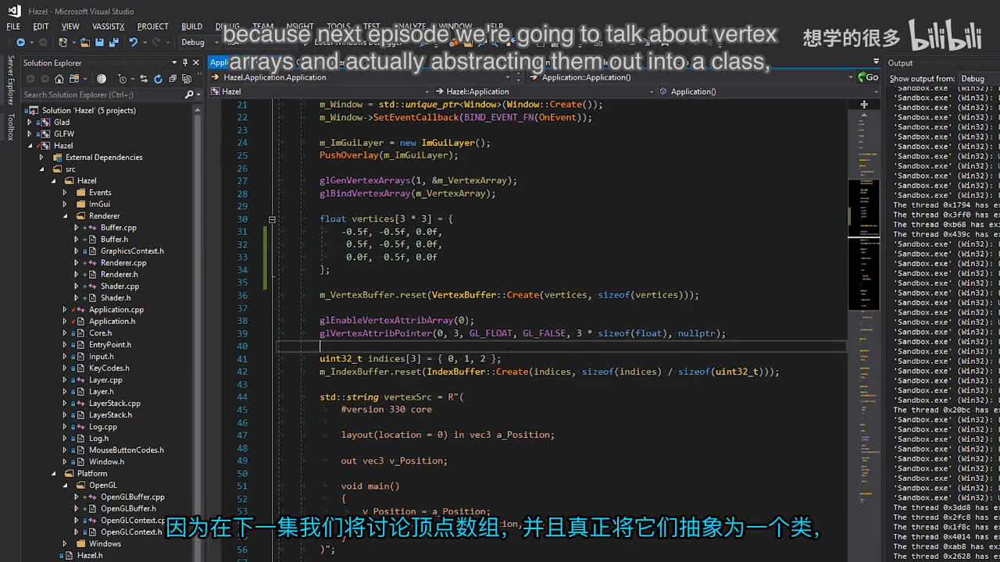

## 3. 现有属性配置与 Shader 的对应关系

*(参考时间: 00:10:07)*

Shader 中的属性声明已经给出了布局的高层语义：

```glsl
layout(location = 0) in vec3 a_Position;
layout(location = 1) in vec4 a_Color;
```

对应到 OpenGL：

| Shader 声明 | 位置 | 基础类型 | 分量数 | 字节偏移 |
|---|---:|---|---:|---:|
| `vec3 a_Position` | 0 | `GL_FLOAT` | 3 | 0 |
| `vec4 a_Color` | 1 | `GL_FLOAT` | 4 | 12 |

每个顶点共有 7 个浮点，所以步长为：

```text
7 * sizeof(float) = 28 bytes
```

如果把位置与颜色拆成两个缓冲区，每个缓冲区的 stride 和 offset 会不同。布局对象应该描述“内存怎样排列”，而不应该假定数据放在同一个 VBO 中。

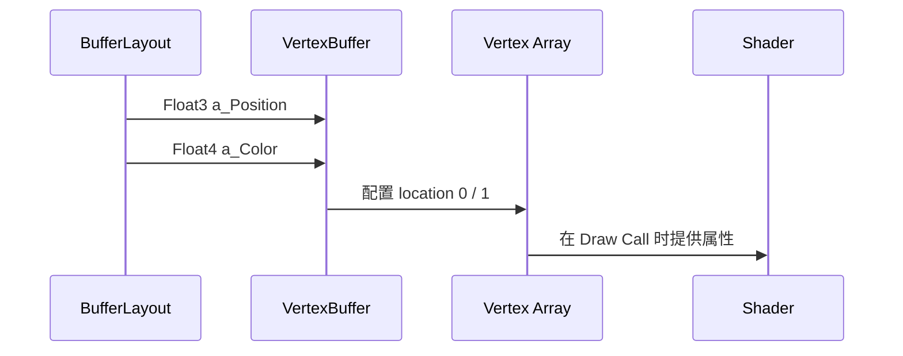

OpenGL 不会在设置 `glVertexAttribPointer()` 时自动验证布局是否与 Shader 一致。DirectX 等 API 的验证更严格，但抽象层仍然需要显式描述数据。OpenGL 的宽松只意味着错误可能在画面上才暴露，并不意味着布局信息可以被省略。

## 4. 目标：让布局看起来就像 Shader

*(参考时间: 00:13:23)*

讲师追求的不只是“能运行”，而是客户端代码一眼就能看懂。理想的布局应当直接对应 Shader 声明中的数据：

```cpp
BufferLayout layout = {
    { ShaderDataType::Float3, "a_Position" },
    { ShaderDataType::Float4, "a_Color" }
};
```

这个设计同时满足三个目标：

1. **可读**：类型和名字与 Shader 接近；
2. **可扩展**：可以继续加入纹理坐标、法线、颜色和切线；
3. **跨 API**：OpenGL、DirectX、Vulkan、Metal 都消费同一份描述。

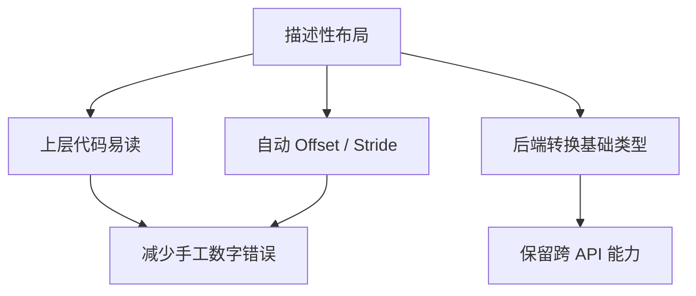

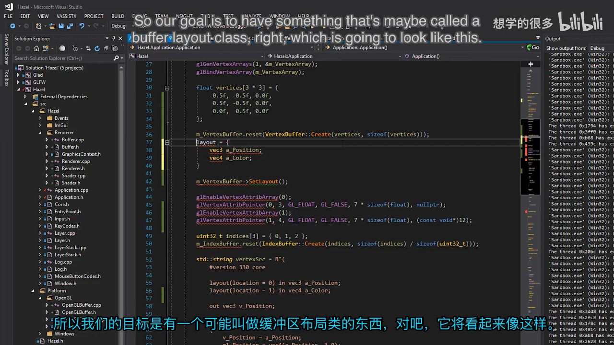

## 5. ShaderDataType：跨 API 的数据类型

*(参考时间: 00:14:37)*

不能直接把 GLSL 的 `vec3` 或 GLM 的数学类型当作通用布局类型。`vec3` 与具体 Shader 语言绑定，数学库类型又会把渲染接口和数学库耦合在一起。

因此引入独立的 `ShaderDataType`：

```cpp
enum class ShaderDataType
{
    None = 0,
    Float, Float2, Float3, Float4,
    Mat3, Mat4,
    Int, Int2, Int3, Int4,
    Bool
};
```

命名采用类似 HLSL 的 `Float3`，而不是 GLSL 的 `vec3`。这不是说当前 Shader 已经使用 HLSL，而是让布局层保持 API 中立，并为未来 HLSL 路径留出空间。

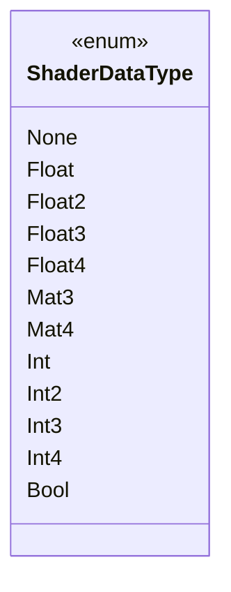

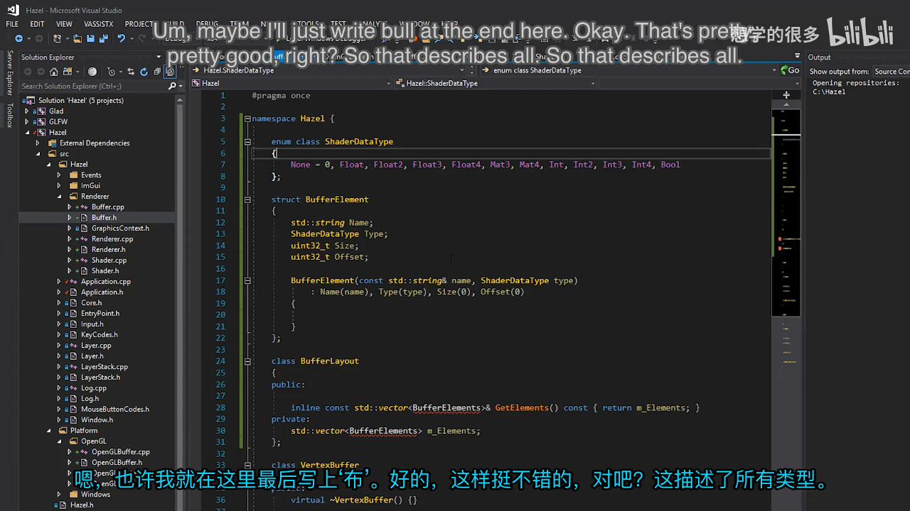

## 6. 从 ShaderDataType 计算字节数

*(参考时间: 00:21:02)*

每种类型都需要能回答“占用多少字节”。当前统一假设 `float` 和 `int` 为 4 字节：

```cpp
static uint32_t ShaderDataTypeSize(
    ShaderDataType type)
{
    switch (type)
    {
        case ShaderDataType::Float:  return 4;
        case ShaderDataType::Float2: return 4 * 2;
        case ShaderDataType::Float3: return 4 * 3;
        case ShaderDataType::Float4: return 4 * 4;
        case ShaderDataType::Mat3:   return 4 * 3 * 3;
        case ShaderDataType::Mat4:   return 4 * 4 * 4;
        case ShaderDataType::Int:    return 4;
        case ShaderDataType::Int2:   return 4 * 2;
        case ShaderDataType::Int3:   return 4 * 3;
        case ShaderDataType::Int4:   return 4 * 4;
        case ShaderDataType::Bool:   return 1;
    }

    HZ_CORE_ASSERT(false, "Unknown ShaderDataType!");
    return 0;
}
```

`Float3` 的大小是 12 字节，`Float4` 是 16 字节。当前只计算紧凑排列大小，还没有处理不同后端的矩阵对齐规则。这个抽象层先把最常见的顶点属性描述统一起来。

`None` 没有单独分支。它不是合法的属性类型；如果误传到函数末尾，断言会暴露错误。

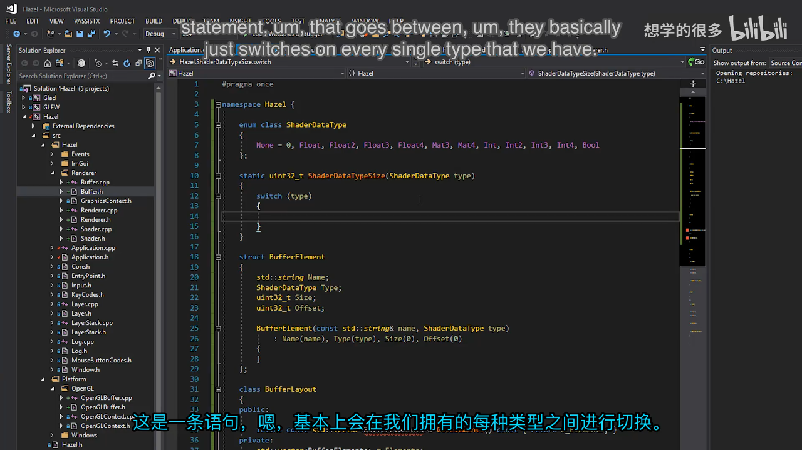

## 7. BufferElement：描述一个顶点属性

*(参考时间: 00:17:15)*

单个属性由 `BufferElement` 表示：

```cpp
struct BufferElement
{
    std::string Name;
    ShaderDataType Type;
    uint32_t Size;
    uint32_t Offset;
    bool Normalized;

    BufferElement() {}

    BufferElement(
        ShaderDataType type,
        const std::string& name,
        bool normalized = false)
        : Name(name),
          Type(type),
          Size(ShaderDataTypeSize(type)),
          Offset(0),
          Normalized(normalized)
    {
    }
};
```

各字段的职责如下：

- `Name`：与 Shader 属性名对应，便于阅读，也方便未来对接需要名称的 API；
- `Type`：跨 API 的类型语义；
- `Size`：该属性的字节数；
- `Offset`：从一条顶点记录的起点到该属性的字节偏移；
- `Normalized`：整数属性是否需要归一化。

`Size` 可以在构造时立即计算；`Offset` 不能，因为它取决于同一布局中排在前面的属性。

默认构造函数不是装饰。`BufferElement` 和 `BufferLayout` 需要放进容器，缺少默认构造会在编译阶段报错。

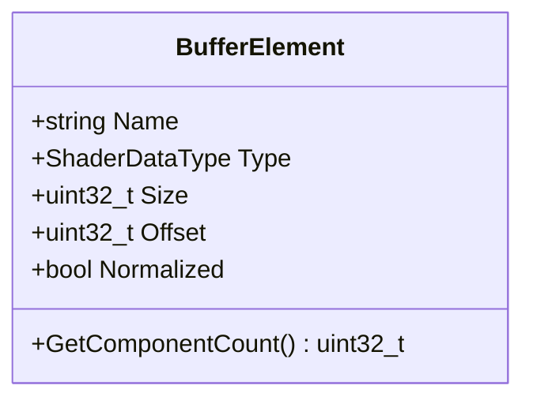

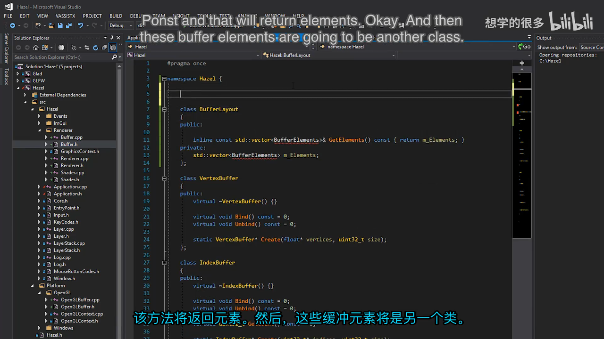

## 8. Component Count 不是矩阵元素数

*(参考时间: 00:32:24)*

OpenGL 的 `glVertexAttribPointer()` 不接受 `Float3` 这样的复合类型。它需要两项信息：

- 基础类型，例如 `GL_FLOAT`；
- 该属性包含几个基础分量，例如 3。

因此 `BufferElement` 还需要返回 component count：

```cpp
uint32_t GetComponentCount() const
{
    switch (Type)
    {
        case ShaderDataType::Float:  return 1;
        case ShaderDataType::Float2: return 2;
        case ShaderDataType::Float3: return 3;
        case ShaderDataType::Float4: return 4;
        case ShaderDataType::Mat3:   return 3 * 3;
        case ShaderDataType::Mat4:   return 4 * 4;
        case ShaderDataType::Int:    return 1;
        case ShaderDataType::Int2:   return 2;
        case ShaderDataType::Int3:   return 3;
        case ShaderDataType::Int4:   return 4;
        case ShaderDataType::Bool:   return 1;
    }

    HZ_CORE_ASSERT(false, "Unknown ShaderDataType!");
    return 0;
}
```

这里不把 component count 缓存成成员，因为调用频率不高，额外保存只会增加布局对象的数据量。直接由类型转换更简单。

矩阵类型返回 `3 * 3` 或 `4 * 4`，为未来上传 uniform 或扩展属性描述保留完整分量信息。当前顶点属性仍主要使用 `Float3` 和 `Float4`。

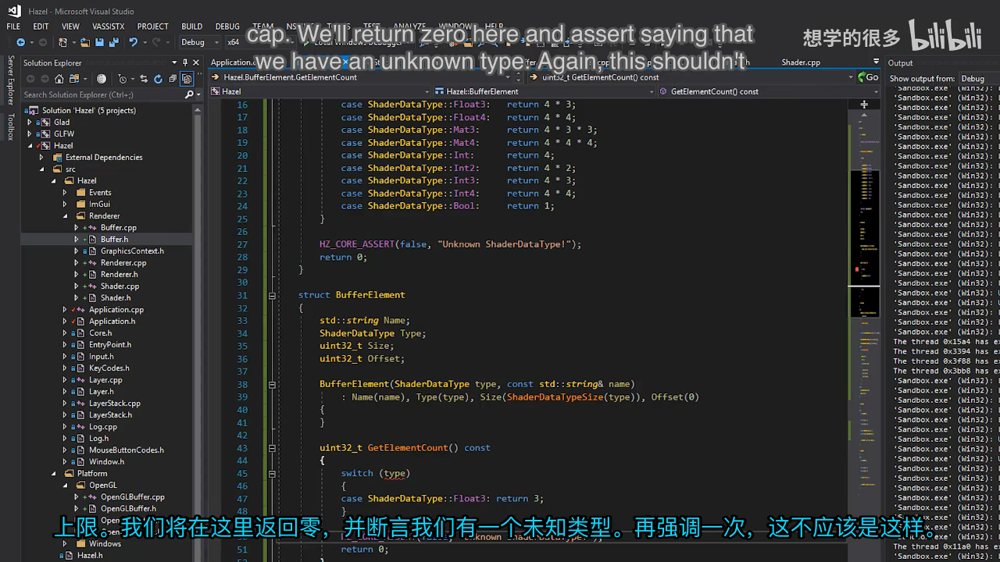

## 9. BufferLayout：从初始化列表得到元素数组

*(参考时间: 00:23:48)*

`BufferLayout` 内部保存 `BufferElement` 数组：

```cpp
class BufferLayout
{
public:
    BufferLayout() {}

    BufferLayout(
        const std::initializer_list<BufferElement>& elements)
        : m_Elements(elements)
    {
        CalculateOffsetsAndStride();
    }

    inline uint32_t GetStride() const
    {
        return m_Stride;
    }

    inline const std::vector<BufferElement>&
    GetElements() const
    {
        return m_Elements;
    }

private:
    std::vector<BufferElement> m_Elements;
    uint32_t m_Stride = 0;
};
```

为什么构造函数不直接接收 `const std::vector<BufferElement>&`？

如果写成 `BufferLayout layout = { ... };`，从大括号列表到 `vector` 需要一次隐式转换，从 `vector` 到 `BufferLayout` 又需要一次隐式转换。C++ 不允许同一条初始化链里连续发生两次用户定义转换。

直接接收 `std::initializer_list<BufferElement>` 后，大括号列表可以一步构造布局，再在成员初始化列表中复制成 `vector`。

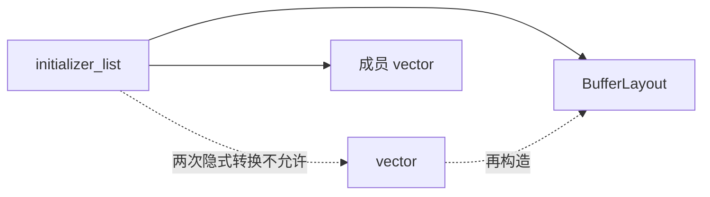

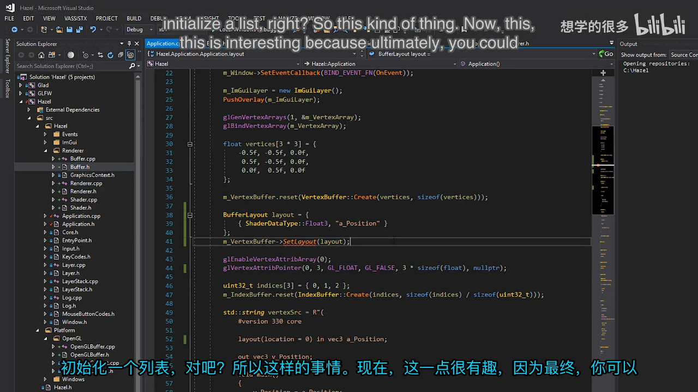

## 10. 自动计算 Offset 与 Stride

*(参考时间: 00:26:07)*

有了完整元素列表后，就可以计算每条属性在顶点记录中的位置：

```cpp
void CalculateOffsetsAndStride()
{
    uint32_t offset = 0;
    m_Stride = 0;

    for (auto& element : m_Elements)
    {
        element.Offset = offset;
        offset += element.Size;
        m_Stride += element.Size;
    }
}
```

算法是顺序累加：

1. 第一个元素从偏移 0 开始；
2. 当前元素大小加入累计偏移；
3. 该累计值成为下一个元素的起点；
4. 所有元素大小之和就是 stride。

例如布局为 `Float3, Float4, Float3`：

| 元素 | Size | Offset |
|---|---:|---:|
| `Float3` | 12 | 0 |
| `Float4` | 16 | 12 |
| `Float3` | 12 | 28 |

总 stride 为 `12 + 16 + 12 = 40` 字节。讲师在调试器中分别验证了前两项和三项布局，确认 offset 与 stride 都随元素变化自动更新。

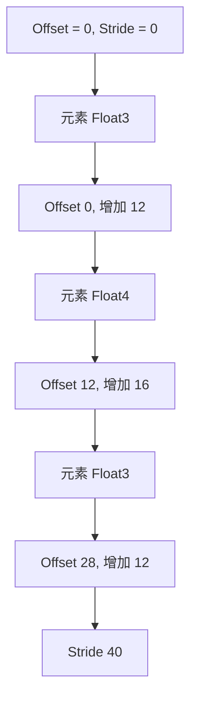

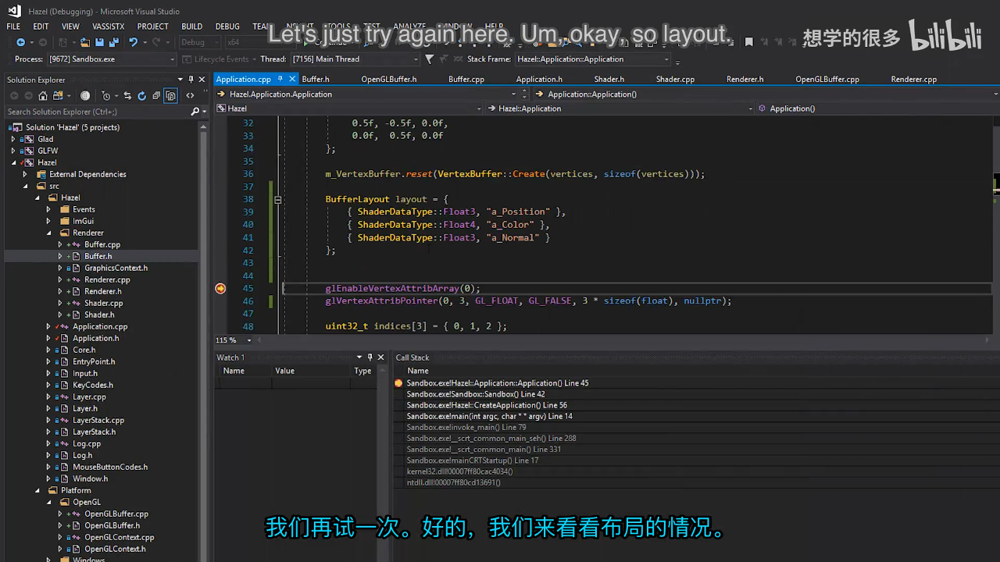

## 11. 把布局挂到 VertexBuffer 上

*(参考时间: 00:29:25)*

布局描述的是 Vertex Buffer 的内存内容，因此通用接口增加：

```cpp
virtual const BufferLayout& GetLayout() const = 0;
virtual void SetLayout(const BufferLayout& layout) = 0;
```

OpenGL 实现保存一份布局副本：

```cpp
class OpenGLVertexBuffer : public VertexBuffer
{
public:
    virtual const BufferLayout& GetLayout() const override
    {
        return m_Layout;
    }

    virtual void SetLayout(const BufferLayout& layout) override
    {
        m_Layout = layout;
    }

private:
    uint32_t m_RendererID;
    BufferLayout m_Layout;
};
```

这里保存副本，而不是依赖调用方临时对象继续存活。应用可以创建局部布局、调用 `SetLayout()`，随后离开作用域；Vertex Buffer 仍然拥有完整描述。

OpenGL 实际上把属性状态存进 Vertex Array，但讲师把表面 API 放在 Vertex Buffer 上，因为布局从语义上描述的是缓冲区数据，而且 DirectX 也没有独立的 Vertex Array 对象。底层的 VAO 差异留到下一讲抽象。

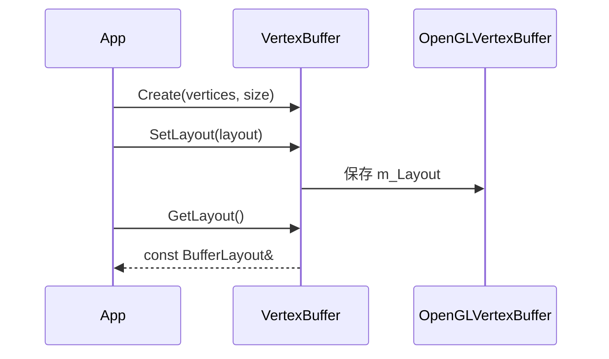

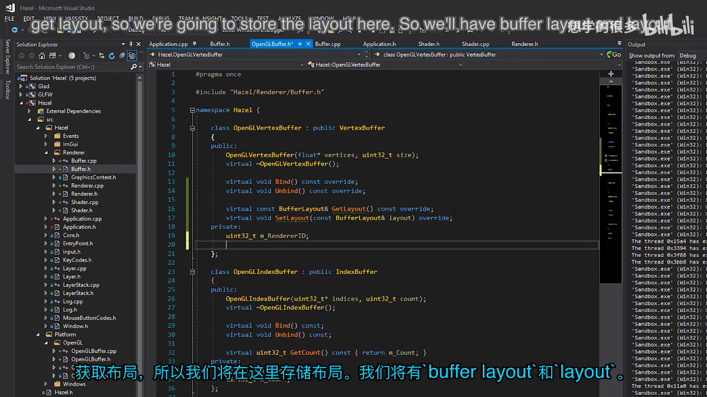

## 12. 为布局提供迭代能力

*(参考时间: 00:31:14)*

如果只暴露 `GetElements()`，调用端只能写：

```cpp
for (const auto& element : layout.GetElements())
```

虽然可以运行，但讲师希望布局本身就能直接迭代：

```cpp
for (const auto& element : layout)
```

因此 `BufferLayout` 提供 `begin()` 与 `end()`：

```cpp
std::vector<BufferElement>::iterator begin()
{
    return m_Elements.begin();
}

std::vector<BufferElement>::iterator end()
{
    return m_Elements.end();
}

std::vector<BufferElement>::const_iterator begin() const
{
    return m_Elements.begin();
}

std::vector<BufferElement>::const_iterator end() const
{
    return m_Elements.end();
}
```

非 const 版本支持需要时修改元素；const 版本让 `GetLayout()` 返回的只读引用也能参与范围 for。

最初只实现非 const 迭代器时，`const BufferLayout&` 无法进入范围 for。补上 const iterator 后，布局可以被安全地读取，同时不能让调用者绕过封装修改内部容器。

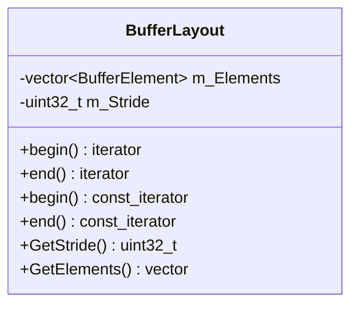

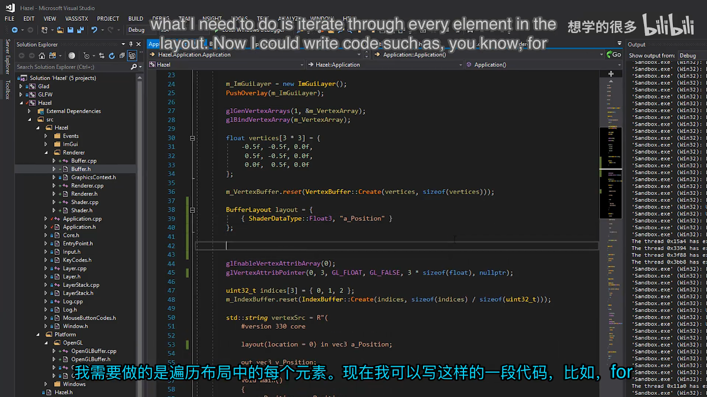

## 13. 按布局自动配置 Shader 属性

*(参考时间: 00:35:18)*

OpenGL 需要把 `ShaderDataType` 映射成基础 OpenGL 类型：

```cpp
static GLenum ShaderDataTypeToOpenGLBaseType(
    ShaderDataType type)
{
    switch (type)
    {
        case ShaderDataType::Float:
        case ShaderDataType::Float2:
        case ShaderDataType::Float3:
        case ShaderDataType::Float4:
        case ShaderDataType::Mat3:
        case ShaderDataType::Mat4:
            return GL_FLOAT;

        case ShaderDataType::Int:
        case ShaderDataType::Int2:
        case ShaderDataType::Int3:
        case ShaderDataType::Int4:
            return GL_INT;

        case ShaderDataType::Bool:
            return GL_BOOL;
    }

    HZ_CORE_ASSERT(false, "Unknown ShaderDataType!");
    return 0;
}
```

这个函数暂时放在 `Application.cpp`，因为它只是让当前演示跑起来的 OpenGL 转换层。下一阶段应把它移进 OpenGL 平台实现，避免上层代码接触 `GLenum`、`GL_FLOAT` 等平台专用名称。

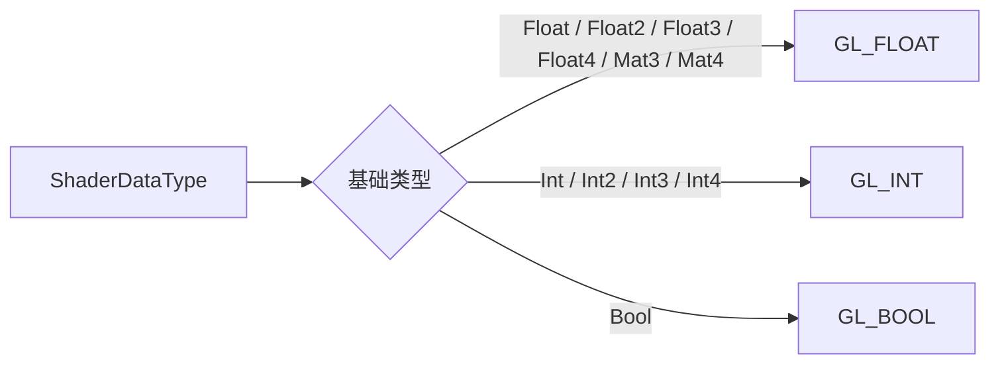

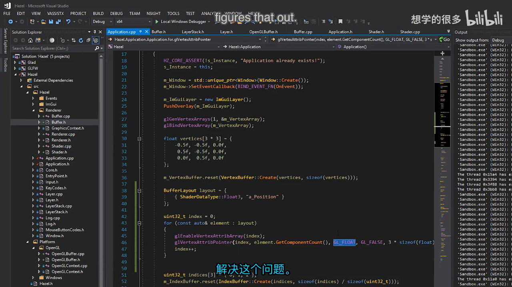

## 14. 用循环设置每个顶点属性

*(参考时间: 00:37:42)*

有了布局后，原先手写的两次 `glVertexAttribPointer()` 可以改为统一循环：

```cpp
uint32_t index = 0;
const auto& layout = m_VertexBuffer->GetLayout();

for (const auto& element : layout)
{
    glEnableVertexAttribArray(index);
    glVertexAttribPointer(
        index,
        element.GetComponentCount(),
        ShaderDataTypeToOpenGLBaseType(element.Type),
        element.Normalized ? GL_TRUE : GL_FALSE,
        layout.GetStride(),
        (const void*)element.Offset);

    index++;
}
```

每个参数现在都有明确来源：

| 参数 | 来源 |
|---|---|
| location | 当前循环索引 |
| component count | `element.GetComponentCount()` |
| base type | `ShaderDataTypeToOpenGLBaseType(element.Type)` |
| normalized | `element.Normalized` |
| stride | `layout.GetStride()` |
| byte offset | `element.Offset` |

`glVertexAttribPointer()` 的最后一个参数类型是 `const void*`，这里却需要传字节偏移。因此先把整数 `Offset` 转成指针形式。OpenGL 不会解引用这个地址，只把它当作相对于缓冲区起点的偏移。

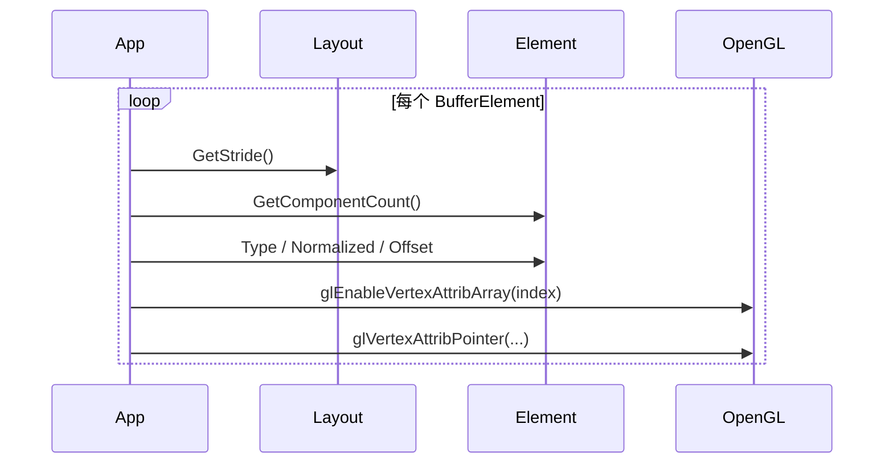

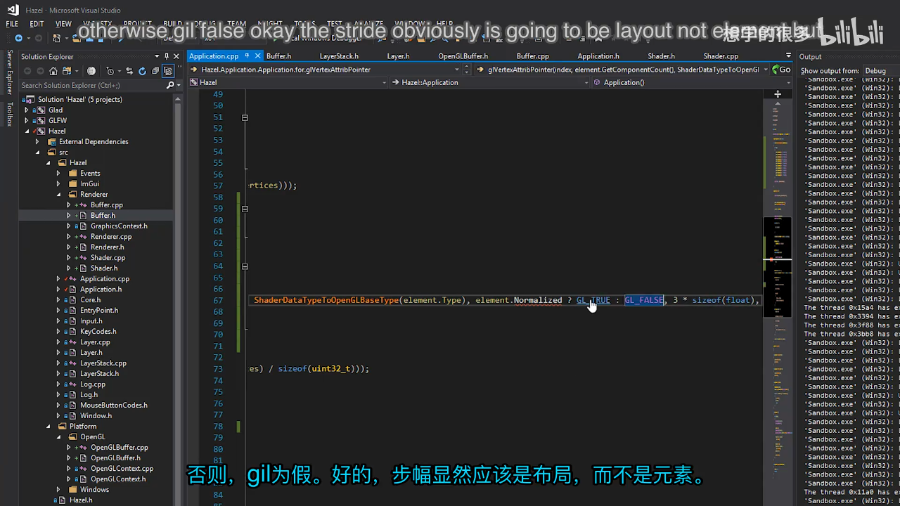

## 15. 用位置数据验证原有三角形

*(参考时间: 00:40:25)*

第一步只使用位置属性：

```cpp
BufferLayout layout = {
    { ShaderDataType::Float3, "a_Position" }
};

m_VertexBuffer->SetLayout(layout);
```

在这个阶段，布局会自动得到：

- `Float3.Size = 12`；
- `a_Position.Offset = 0`；
- `Stride = 12`。

运行结果与原三角形一致，说明读取一个三浮点位置仍然正确。这个验证很重要，因为后续一旦 stride 或 offset 计算错误，三角形会消失、变形，或者把颜色数据误读为顶点坐标。

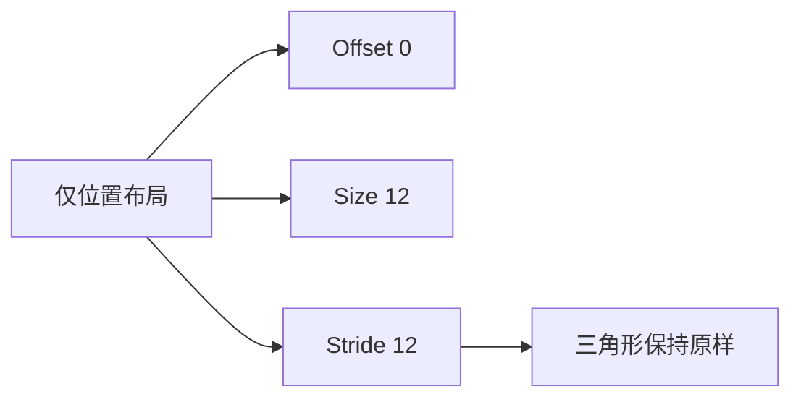

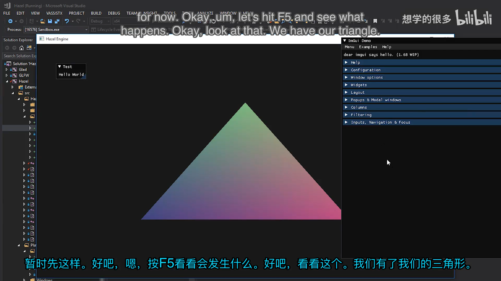

## 16. 加入颜色后，布局自动变化

*(参考时间: 00:41:04)*

顶点数组从每个顶点 3 个浮点扩展为 7 个浮点：

```cpp
float vertices[3 * 7] = {
    -0.5f, -0.5f, 0.0f,  0.8f, 0.2f, 0.8f, 1.0f,
     0.5f, -0.5f, 0.0f,  0.2f, 0.3f, 0.8f, 1.0f,
     0.0f,  0.5f, 0.0f,  0.8f, 0.8f, 0.2f, 1.0f
};
```

布局增加第二个元素：

```cpp
BufferLayout layout = {
    { ShaderDataType::Float3, "a_Position" },
    { ShaderDataType::Float4, "a_Color" }
};
```

自动计算结果变为：

- `a_Position.Size = 12`，`Offset = 0`；
- `a_Color.Size = 16`，`Offset = 12`；
- `Stride = 28`。

最先只把颜色放进顶点缓冲，不修改 Shader 对颜色的使用方式。结果仍是原来的三角形，说明新的 stride 与第一个属性的 offset 没有破坏位置读取。

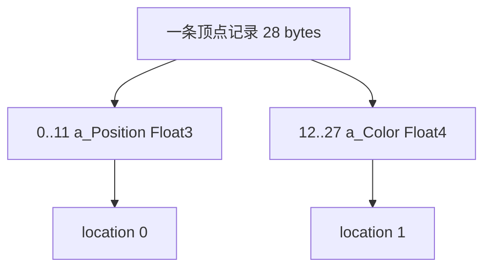

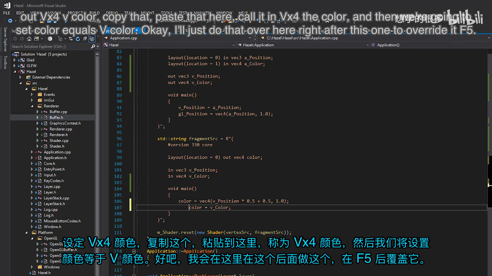

## 17. Shader 传递颜色与黑三角形调试

*(参考时间: 00:42:28)*

Vertex Shader 接收颜色并交给 Fragment Shader：

```glsl
layout(location = 0) in vec3 a_Position;
layout(location = 1) in vec4 a_Color;

out vec3 v_Position;
out vec4 v_Color;

void main()
{
    v_Position = a_Position;
    v_Color = a_Color;
    gl_Position = vec4(a_Position, 1.0);
}
```

Fragment Shader 增加同名的输入：

```glsl
in vec3 v_Position;
in vec4 v_Color;
layout(location = 0) out vec4 color;

void main()
{
    color = vec4(v_Position * 0.5 + 0.5, 1.0);
    color = v_Color;
}
```

第一次运行出现黑三角形。问题不是布局、stride 或 offset，而是 Vertex Shader 中还没有把输入颜色赋给输出 `v_Color`。补上赋值后，颜色重新出现在三角形上。

这个插曲说明：抽象层计算正确，不代表 Shader 数据链路完整。调试时要分别检查：

- CPU 顶点数据是否包含颜色；
- Vertex Buffer 是否上传了完整记录；
- 布局的 offset 与 stride 是否正确；
- Shader 是否声明并连接了对应属性；
- Vertex Shader 是否把值传给 Fragment Shader。

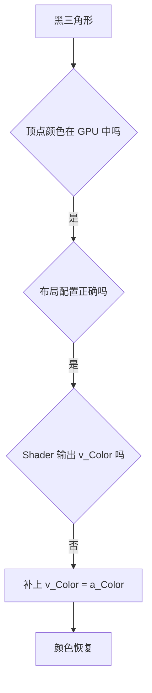

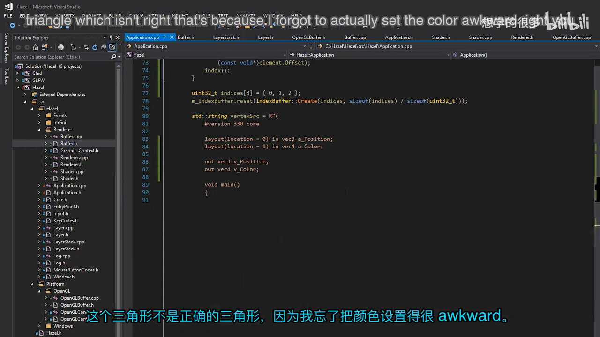

## 18. 颜色插值与最终视觉结果

*(参考时间: 00:43:16)*

每个顶点在数组中拥有独立颜色。Vertex Shader 输出颜色后，光栅化阶段会在三角形内部对颜色进行插值：

- 顶点 0 偏粉；
- 顶点 1 偏蓝；
- 顶点 2 偏黄；
- 三角形中心由三者平滑混合。

第一轮使用接近纯色的 `1.0`、`0.0` 组合，颜色过于刺眼。讲师随后把分量调整为 `0.8`、`0.2` 等值，保留不同顶点的颜色差异，同时降低饱和度和视觉冲击。

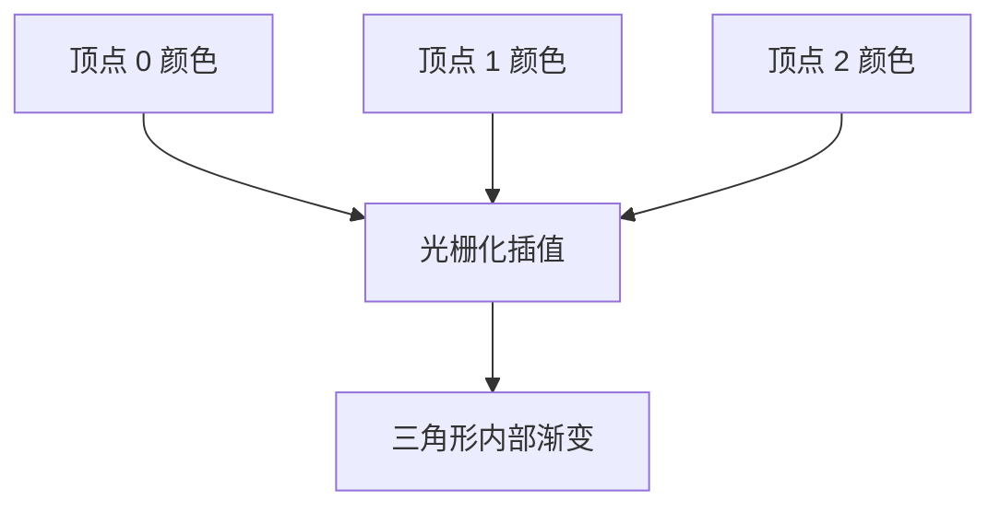

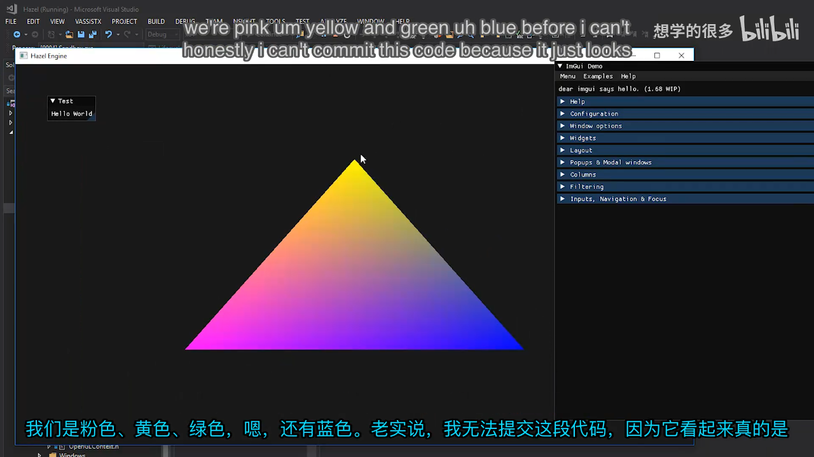

## 19. 收尾：局部布局、const 迭代器与最终代码

*(参考时间: 00:44:23)*

布局对象可以作为临时局部值传入 `SetLayout()`：

```cpp
{
    BufferLayout layout = {
        { ShaderDataType::Float3, "a_Position" },
        { ShaderDataType::Float4, "a_Color" }
    };

    m_VertexBuffer->SetLayout(layout);
}
```

离开作用域后，局部 `layout` 被销毁，但 `OpenGLVertexBuffer` 保存的是副本，所以渲染不受影响。

最终读取布局时使用 const 引用，并把循环整理为：

```cpp
const auto& layout = m_VertexBuffer->GetLayout();

for (const auto& element : layout)
{
    // 根据 element 配置顶点属性
}
```

这一版代码同时具备可读性和数据驱动能力：

- 代码中能直接看出 `Float3 a_Position` 与 `Float4 a_Color`；
- 新增属性只需要修改顶点数据和布局；
- stride 与 offset 不再靠手工维护；
- OpenGL 专用类型转换仍被限制在应用层的局部 helper 中；
- 未来抽象 Vertex Array 时，可以把属性配置整体移入平台实现。

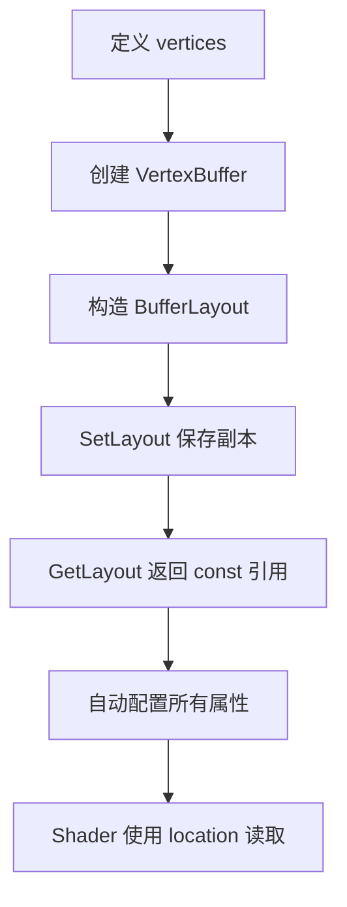

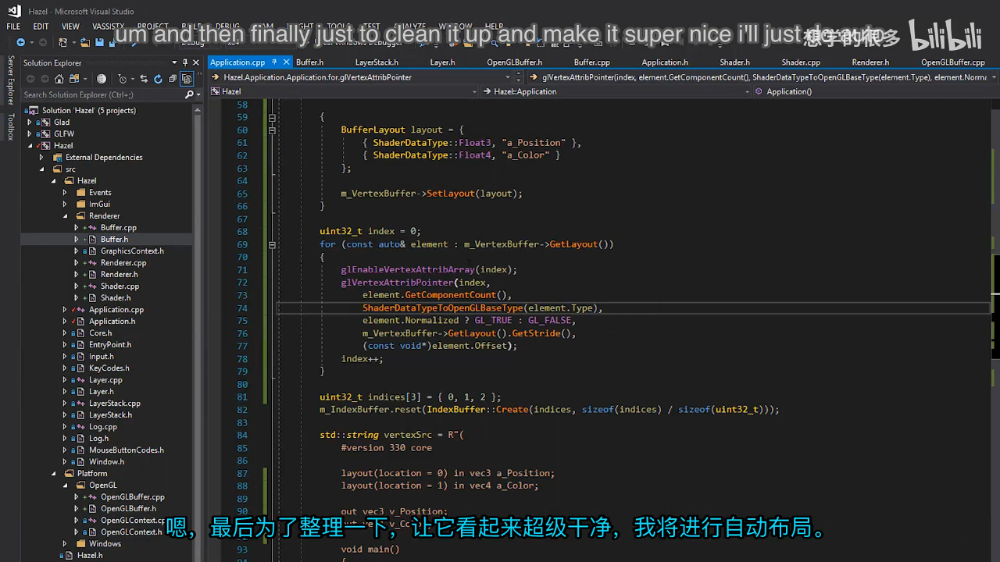

## 20. 当前边界与下一步

*(参考时间: 00:46:40)*

本讲已经让 Vertex Buffer 拥有布局描述，但属性配置代码仍直接写在 `Application.cpp`：

- 仍然直接包含 Glad；
- 仍然直接调用 `glEnableVertexAttribArray()`；
- 仍然直接调用 `glVertexAttribPointer()`；
- 仍然由应用层维护 VAO；
- `ShaderDataTypeToOpenGLBaseType()` 仍是一个临时 helper。

下一讲应把属性配置移入 OpenGL Vertex Array 实现，让应用只负责：

1. 创建 Vertex Buffer；
2. 创建 Vertex Array；
3. 把带布局的 Vertex Buffer 交给 Vertex Array；
4. 绑定 Vertex Array 并发出 Draw Call。


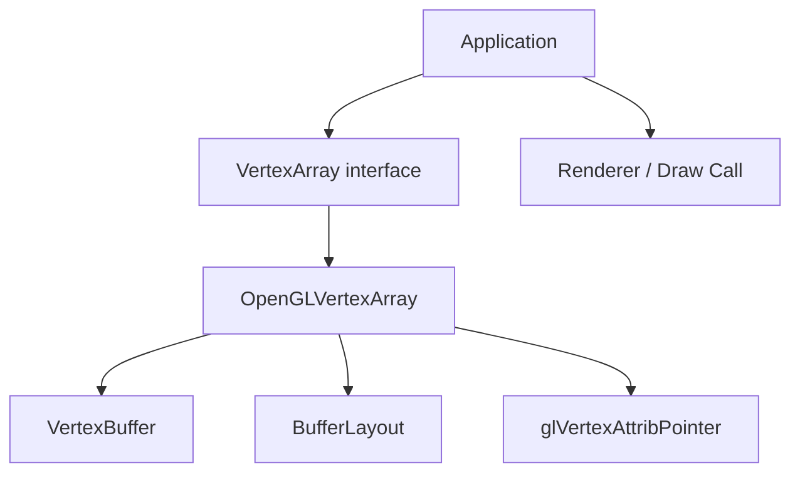

## 21. 本节结论

本讲完成了 Hazel 顶点缓冲区布局系统的第一版：

- 明确 Vertex Buffer 只是数据，Vertex Array 保存读取状态；
- 建立跨 API 的 `ShaderDataType`；
- 建立 `BufferElement`，保存名称、类型、大小、偏移和归一化标志；
- 建立 `BufferLayout`，从初始化列表构造并自动计算 offset 与 stride；
- 为布局提供 getter、迭代器和 const 迭代器；
- 为 `VertexBuffer` 增加 `GetLayout()` 与 `SetLayout()`；
- 在 OpenGL 实现中保存布局副本；
- 按布局自动配置 component count、基础类型、normalized、stride 和 offset；
- 用位置与颜色两个属性验证 stride 和 offset；
- 通过黑三角形问题确认 Shader 数据链路也必须完整；
- 把 Vertex Array 抽象列为下一阶段任务。

这套设计的价值不在隐藏少量 OpenGL 调用，而在把“内存中一条顶点记录长什么样”变成所有渲染后端都能理解、客户端开发者也能一眼看懂的描述。

## 附：参考

- [Bilibili 精译视频：031 - 顶点缓冲区布局](https://www.bilibili.com/video/BV1wtLazEEmC/?p=31)
- [The Cherno 游戏引擎系列播放列表](https://www.youtube.com/playlist?list=PLlrATfBNZ98dC-V-N3m0Go4deliWHPFwT5)
- [本期对应代码提交 `e8eef16`](https://github.com/TheCherno/Hazel/tree/e8eef16)
- [OpenGL Wiki：Vertex Specification](https://www.khronos.org/opengl/wiki/Vertex_Specification)
- [OpenGL Wiki：Buffer Object](https://www.khronos.org/opengl/wiki/Buffer_Object)
