# Hazel 游戏引擎笔记 032：顶点数组

> 本节来源：[The Cherno 游戏引擎系列第 32 讲“顶点数组”](https://www.bilibili.com/video/BV1wtLazEEmC/?p=32)，时长约 42 分 41 秒。  
> 原课程与 Hazel 代码作者：The Cherno。代码参考提交：[`0d292a3`](https://github.com/TheCherno/Hazel/tree/0d292a3)。  
> 本文由视频字幕重构、翻译并整理，不是官方教材；术语和代码以原视频及同期 Hazel 仓库为准。

## 本节目标

上一讲已经建立了 `BufferLayout`，但顶点属性配置仍写在 `Application.cpp`：

```cpp
glGenVertexArrays(1, &m_VertexArray);
glBindVertexArray(m_VertexArray);

uint32_t index = 0;
for (const auto& element : layout)
{
    glEnableVertexAttribArray(index);
    glVertexAttribPointer(
        index,
        element.GetComponentCount(),
        ShaderDataTypeToOpenGLBaseType(element.Type),
        element.Normalized ? GL_TRUE : GL_FALSE,
        layout.GetStride(),
        (const void*)element.Offset);
    index++;
}
```

本讲把这些 OpenGL 调用封装进通用 `VertexArray`，并让应用层只负责：

1. 创建 Vertex Array；
2. 创建带布局的 Vertex Buffer；
3. 把 Vertex Buffer 加入 Vertex Array；
4. 设置 Index Buffer；
5. 渲染时绑定 Vertex Array 并发出 Draw Call。

本讲完成的内容：

- 解释 Vertex Array、Vertex Buffer 与 Index Buffer 的关系；
- 设计通用 `VertexArray` 接口；
- 使用 `RendererAPI` 工厂创建 OpenGL 实现；
- 把属性配置移入 `OpenGLVertexArray::AddVertexBuffer()`；
- 用共享指针管理渲染资源生命周期；
- 加入“顶点缓冲必须已有布局”的断言；
- 把 `Application` 改为只使用通用接口；
- 创建第二个 Vertex Array 绘制方块；
- 为方块准备单独 Shader、顶点和索引；
- 定位方块只画出三个顶点的问题；
- 清理多余的 Vertex Buffer / Index Buffer 成员；
- 为下一讲的 Draw Call 抽象留下边界。

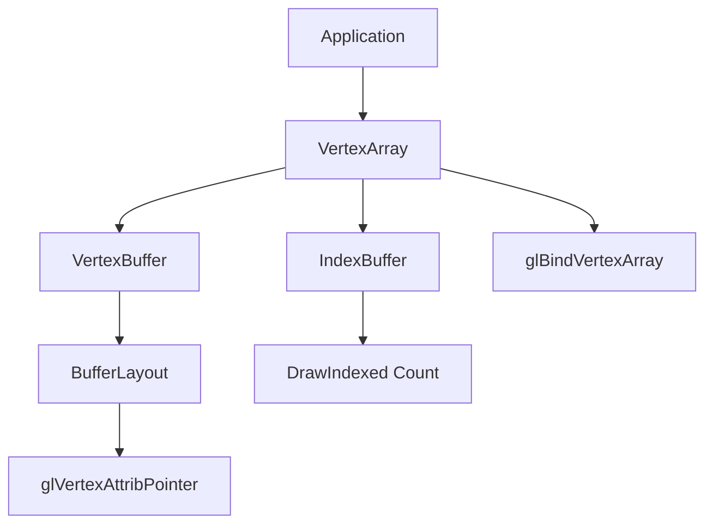

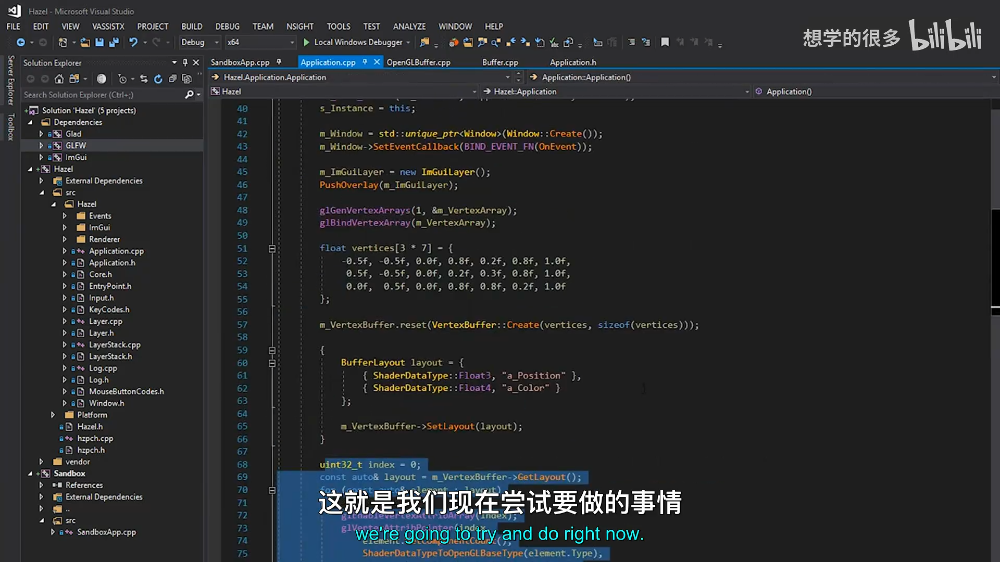

## 1. Vertex Array 只保存状态

*(参考时间: 00:00:34)*

顶点数据保存在 Vertex Buffer，索引数据保存在 Index Buffer。Vertex Array 本身不保存顶点数组，它保存的是“如何读取这些缓冲”的状态。

它主要关联：

- 一个或多个 Vertex Buffer；
- 每个 Buffer 的布局、stride 和 offset；
- 每个属性的 location、类型、分量数和归一化状态；
- 一个 Index Buffer；
- OpenGL 在 Draw Call 时需要的绑定状态。

讲师把 Vertex Array 描述为一种“状态容器”。它是 OpenGL 特有的设计，初看并不直观，但抽象后正好可以表示“一组资源如何组成可绘制对象”。

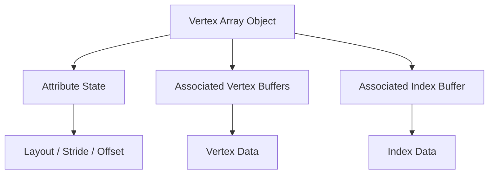


## 2. 引用不等于拥有数据

*(参考时间: 00:01:41)*

从 OpenGL 的底层语义看，Vertex Array 关联 Buffer ID，并不复制 Vertex Buffer 或 Index Buffer 的 GPU 内存。

如果把同一个 Vertex Buffer 绑定到另一个 Vertex Array，底层使用的仍是同一块数据。修改 Vertex Buffer 内容时，所有引用它的 Vertex Array 都会看到变化。

这带来一个 C++ 层的责任：通用包装对象必须保证被引用的资源继续存活。本讲使用 `std::shared_ptr` 保存引用，让 Vertex Array 在 C++ 生命周期上持有对应资源。

这里有两个层次：

- **OpenGL 对象关系**：VAO 记录 Buffer 的关联状态；
- **C++ 资源管理**：Hazel 的 `VertexArray` 持有 `shared_ptr`，防止资源提前销毁。

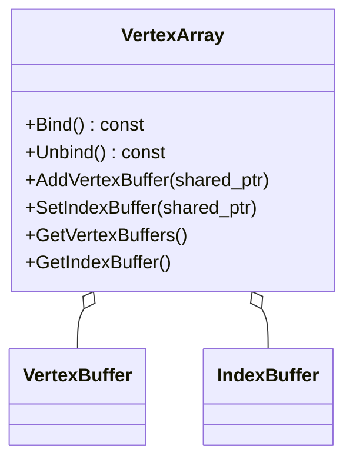


## 3. 多个 Vertex Buffer 与一个 Index Buffer

*(参考时间: 00:02:52)*

一个 Vertex Array 可以关联多个 Vertex Buffer。例如：

- 一个 Buffer 保存位置；
- 一个 Buffer 保存法线；
- 一个 Buffer 保存骨骼权重；
- 一个 Buffer 保存纹理坐标。

添加多个 Buffer 时，每个 Buffer 都必须在 Vertex Array 绑定期间配置自己的布局。属性 location 仍要按 Shader 期望的顺序递增。

Index Buffer 则通常只有一个。讲师表示自己几乎没有见过在同一个绘制对象中使用多个 Index Buffer 的情况，因此接口采用 `SetIndexBuffer()`，而不是 `AddIndexBuffer()`。

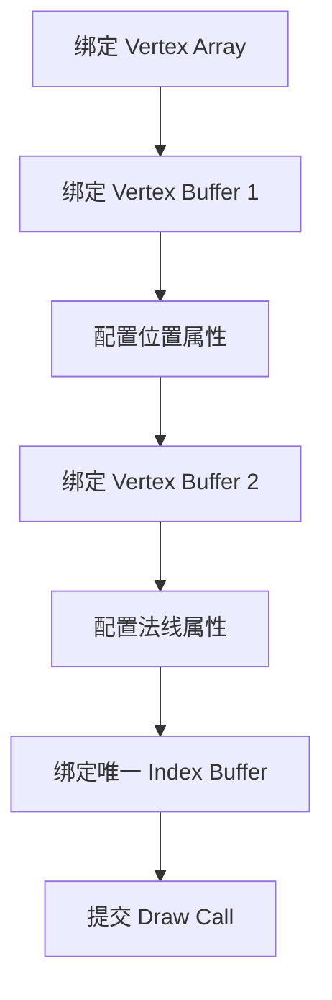


## 4. DirectX 没有等价的 VAO

*(参考时间: 00:05:02)*

DirectX 没有与 OpenGL Vertex Array 完全对应的对象。OpenGL 将“资源关联与属性状态”集中放在 VAO 中，而 DirectX 的输入布局与资源绑定流程不同。

讲师明确当前阶段优先把 OpenGL 引擎完整做起来。若过早为 DirectX 重新设计整套渲染架构，会拖慢已有产品的形成。

一个常见的临时兼容方式是：在通用 API 中保留 `VertexArray::Create()`，但 DirectX 实现可以暂时什么都不做。这样上层代码结构保持稳定，后续再根据 DirectX 的真实需求重构。

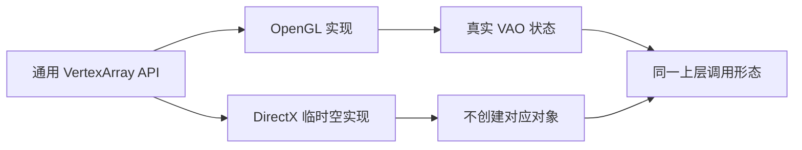


## 5. VertexArray 通用接口

*(参考时间: 00:07:05)*

新建 `VertexArray.h`，接口只依赖通用的 Vertex Buffer 与 Index Buffer：

```cpp
#pragma once

#include <memory>
#include "Hazel/Renderer/Buffer.h"

namespace Hazel {

class VertexArray
{
public:
    virtual ~VertexArray() {}

    virtual void Bind() const = 0;
    virtual void Unbind() const = 0;

    virtual void AddVertexBuffer(
        const std::shared_ptr<VertexBuffer>& vertexBuffer) = 0;

    virtual void SetIndexBuffer(
        const std::shared_ptr<IndexBuffer>& indexBuffer) = 0;

    virtual const std::vector<
        std::shared_ptr<VertexBuffer>>&
    GetVertexBuffers() const = 0;

    virtual const std::shared_ptr<IndexBuffer>&
    GetIndexBuffer() const = 0;

    static VertexArray* Create();
};

}
```

接口没有 `SetLayout()`。布局属于 Vertex Buffer，加入 Vertex Array 时由实现读取布局并配置属性。

`Create()` 不需要参数，因为 VAO 本身只是状态容器；真正的数据在后续通过 `AddVertexBuffer()` 和 `SetIndexBuffer()` 接入。

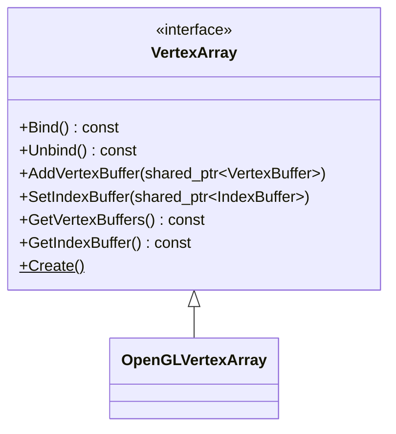

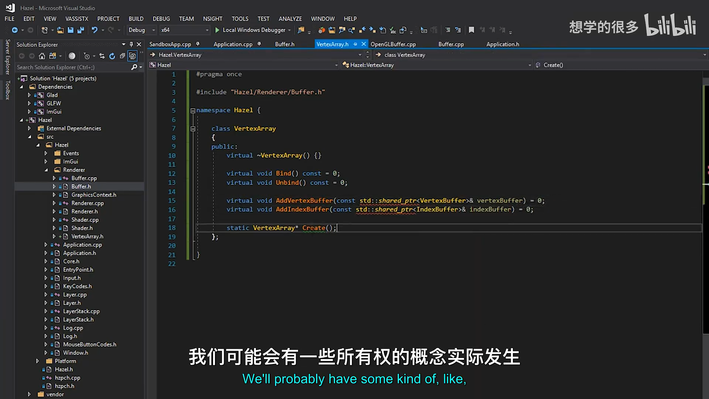

## 6. 为什么使用 shared_ptr

*(参考时间: 00:08:45)*

Hazel 的资源系统方向是让 Vertex Buffer、Index Buffer、Texture、Shader 等资源被引用计数管理。

`shared_ptr` 允许一个 Buffer 同时被：

- Vertex Array；
- 网格对象；
- 资源缓存；
- 临时加载代码；

共同引用。最后一个持有者销毁时，底层资源才会释放。

讲师也提到，如果未来极致关注性能，可以实现侵入式引用计数。但当前阶段，`shared_ptr` 已经能提供清晰的所有权语义，控制块本身的成本不是首要瓶颈。

当前工厂仍返回裸指针，因为 `make_shared<VertexBuffer>` 会尝试直接构造抽象基类，而工厂内部实际构造的是派生类。应用先创建共享指针，再使用 `reset()` 接管工厂结果：

```cpp
std::shared_ptr<VertexBuffer> vertexBuffer;
vertexBuffer.reset(
    VertexBuffer::Create(vertices, sizeof(vertices)));
```

未来可能统一返回 Hazel 的 `Ref<T>` 或 `Scope<T>`，但这一讲先沿用现有工厂形态。

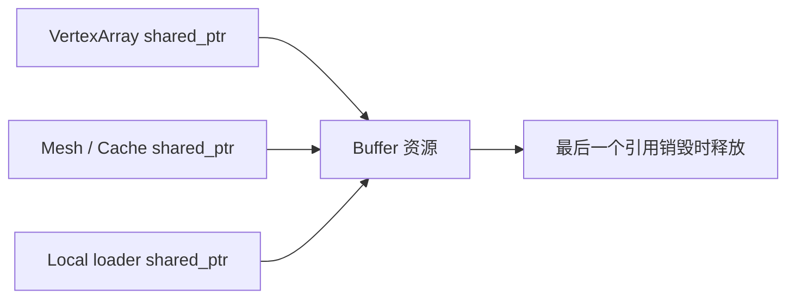

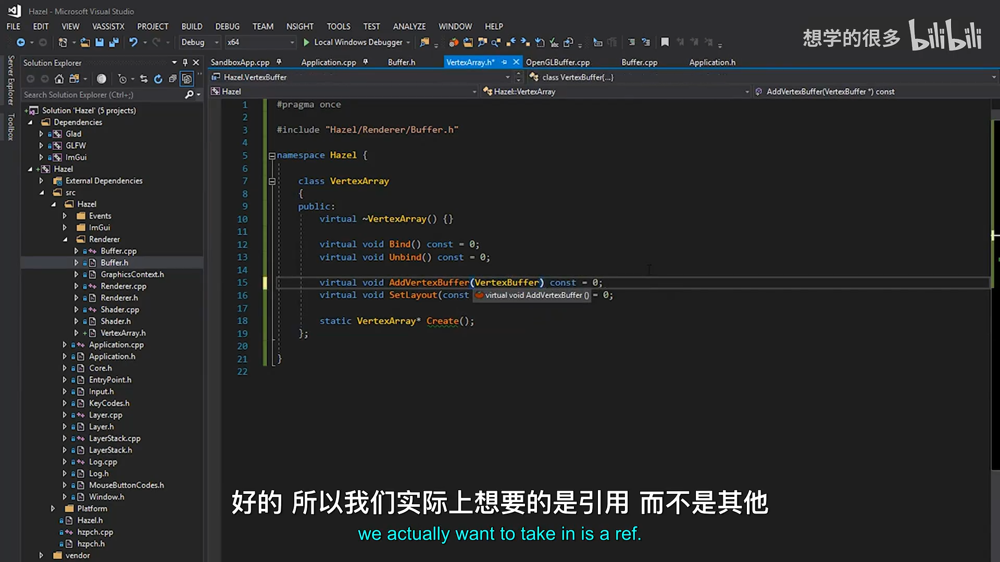

## 7. 工厂创建 OpenGLVertexArray

*(参考时间: 00:10:52)*

`VertexArray.cpp` 沿用第 30 讲的后端分派模式：

```cpp
#include "hzpch.h"
#include "VertexArray.h"

#include "Renderer.h"
#include "Platform/OpenGL/OpenGLVertexArray.h"

namespace Hazel {

VertexArray* VertexArray::Create()
{
    switch (Renderer::GetAPI())
    {
        case RendererAPI::None:
            HZ_CORE_ASSERT(
                false,
                "RendererAPI::None is currently not supported!");
            return nullptr;

        case RendererAPI::OpenGL:
            return new OpenGLVertexArray();
    }

    HZ_CORE_ASSERT(false, "Unknown RendererAPI!");
    return nullptr;
}

}
```

上层只看到 `VertexArray::Create()`，OpenGL VAO 的创建细节留在平台目录。

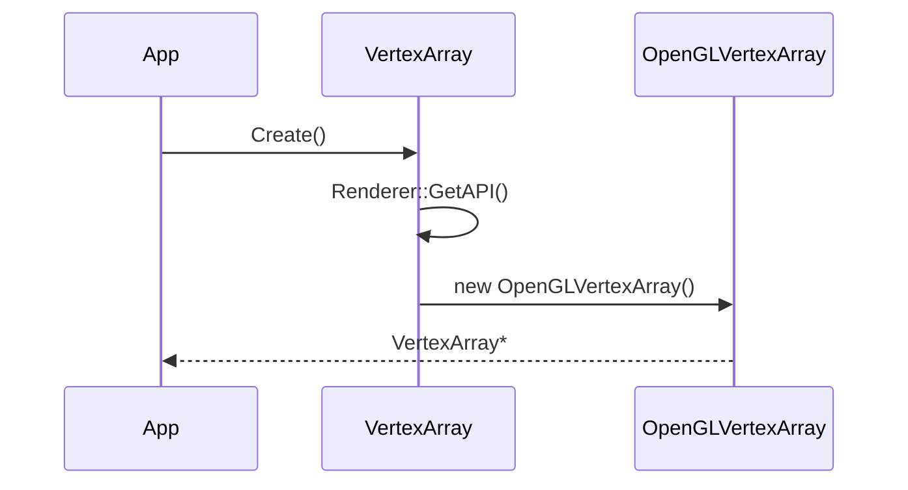

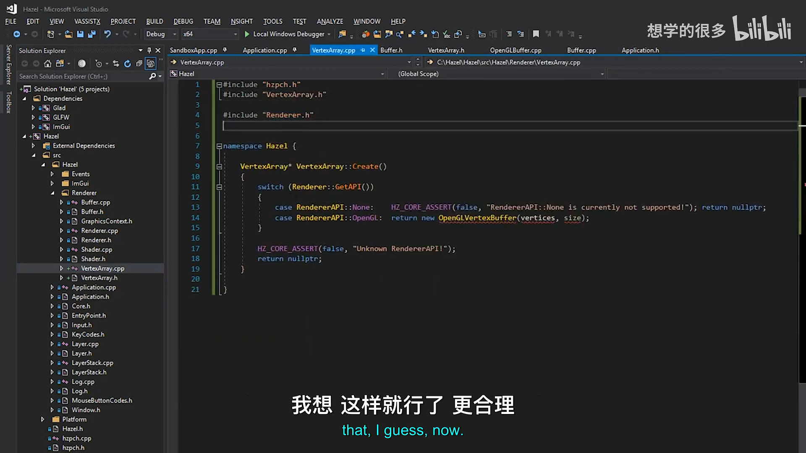

## 8. OpenGLVertexArray 的 CPU 侧镜像

*(参考时间: 00:13:41)*

OpenGL 实现在 CPU 侧保存一份资源列表：

```cpp
class OpenGLVertexArray : public VertexArray
{
public:
    OpenGLVertexArray();
    virtual ~OpenGLVertexArray();

    virtual void Bind() const override;
    virtual void Unbind() const override;

    virtual void AddVertexBuffer(
        const std::shared_ptr<VertexBuffer>& vertexBuffer) override;

    virtual void SetIndexBuffer(
        const std::shared_ptr<IndexBuffer>& indexBuffer) override;

    virtual const std::vector<
        std::shared_ptr<VertexBuffer>>&
    GetVertexBuffers() const override
    {
        return m_VertexBuffers;
    }

    virtual const std::shared_ptr<IndexBuffer>&
    GetIndexBuffer() const override
    {
        return m_IndexBuffer;
    }

private:
    uint32_t m_RendererID;
    std::vector<std::shared_ptr<VertexBuffer>> m_VertexBuffers;
    std::shared_ptr<IndexBuffer> m_IndexBuffer;
};
```

`m_VertexBuffers` 镜像一个 VAO 可以关联多个 Vertex Buffer 的事实；`m_IndexBuffer` 只保存一个索引缓冲。

这层镜像不是为了复制 GPU 数据，而是为了在 C++ 侧保持资源存活，并能通过通用 getter 查询 Draw Call 所需的索引数量。

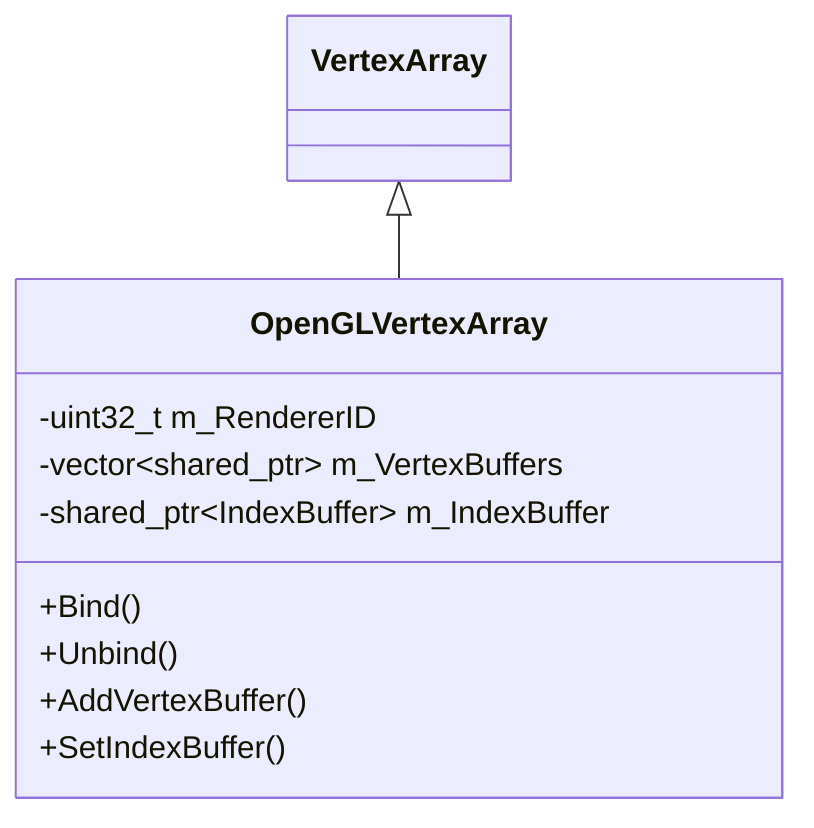

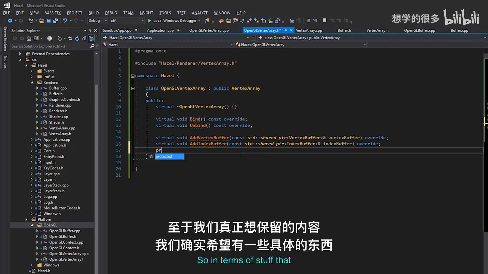

## 9. 创建、绑定与销毁 VAO

*(参考时间: 00:15:16)*

构造函数使用 OpenGL 4.5 的直接创建接口：

```cpp
OpenGLVertexArray::OpenGLVertexArray()
{
    glCreateVertexArrays(1, &m_RendererID);
}

OpenGLVertexArray::~OpenGLVertexArray()
{
    glDeleteVertexArrays(1, &m_RendererID);
}

void OpenGLVertexArray::Bind() const
{
    glBindVertexArray(m_RendererID);
}

void OpenGLVertexArray::Unbind() const
{
    glBindVertexArray(0);
}
```

最初忘记 `OpenGLVertexArray.cpp` 包含 Glad，导致 VAO 创建函数无法识别。加入 `<glad/glad.h>` 后才正常。

`m_RendererID` 仍是 `uint32_t`。讲师提到未来可以定义专门的渲染资源 ID 类型，避免到处出现裸整数，但当前不需要扩大改动范围。

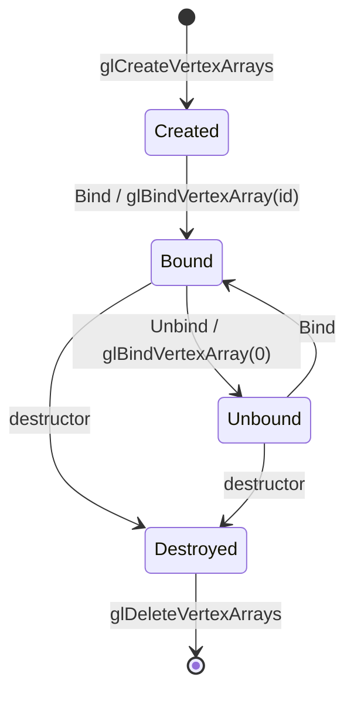

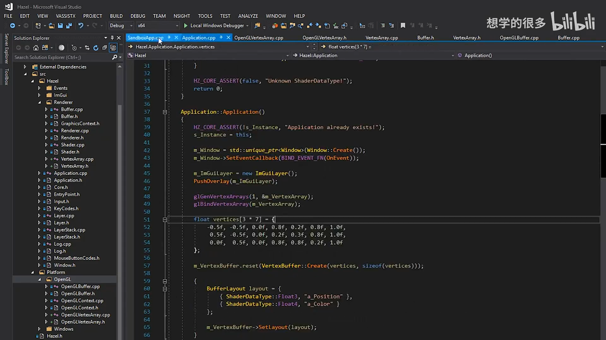

## 10. AddVertexBuffer 绑定属性状态

*(参考时间: 00:17:32)*

添加 Vertex Buffer 时，必须先让对应的 VAO 成为当前绑定状态：

```cpp
void OpenGLVertexArray::AddVertexBuffer(
    const std::shared_ptr<VertexBuffer>& vertexBuffer)
{
    HZ_CORE_ASSERT(
        vertexBuffer->GetLayout().GetElements().size(),
        "Vertex Buffer has no layout!");

    glBindVertexArray(m_RendererID);
    vertexBuffer->Bind();

    uint32_t index = 0;
    const auto& layout = vertexBuffer->GetLayout();
    for (const auto& element : layout)
    {
        glEnableVertexAttribArray(index);
        glVertexAttribPointer(
            index,
            element.GetComponentCount(),
            ShaderDataTypeToOpenGLBaseType(element.Type),
            element.Normalized ? GL_TRUE : GL_FALSE,
            layout.GetStride(),
            (const void*)element.Offset);
        index++;
    }

    m_VertexBuffers.push_back(vertexBuffer);
}
```

执行顺序很重要：

1. 检查布局非空；
2. 绑定目标 VAO；
3. 绑定 Vertex Buffer；
4. 按布局设置每个属性；
5. 保存共享指针。

属性配置属于当前 VAO，因此如果在添加 Buffer 前没有绑定目标 VAO，状态会写入错误的 VAO。

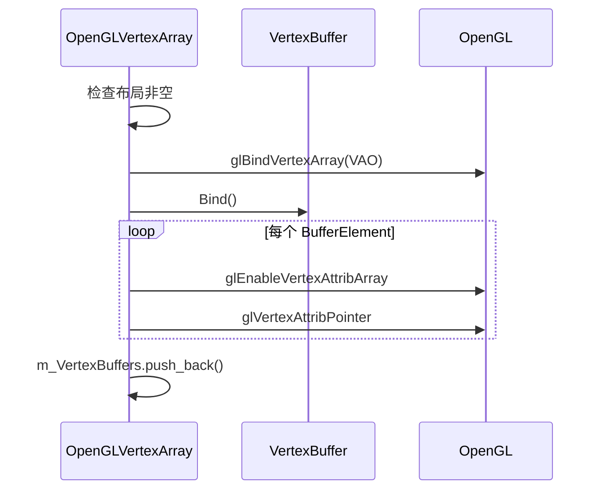

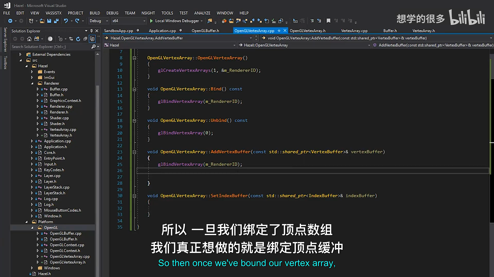

## 11. 内部调用 Direct GL 还是包装方法

*(参考时间: 00:16:14)*

在 `AddVertexBuffer()` 内部，讲师直接调用：

```cpp
glBindVertexArray(m_RendererID);
```

而不是调用自己的 `Bind()`。

原因是 `Bind()` 是开放给上层渲染代码的公共操作。未来加入状态跟踪、调试、统计或回调时，上层绑定应该被记录，而实现内部为了配置属性而执行的临时绑定不应该伪装成一次用户绑定。

但对于其他资源，代码会调用 `vertexBuffer->Bind()`，因为这里操作的是另一个 API 对象，不应该绕过它去读取私有 Renderer ID。

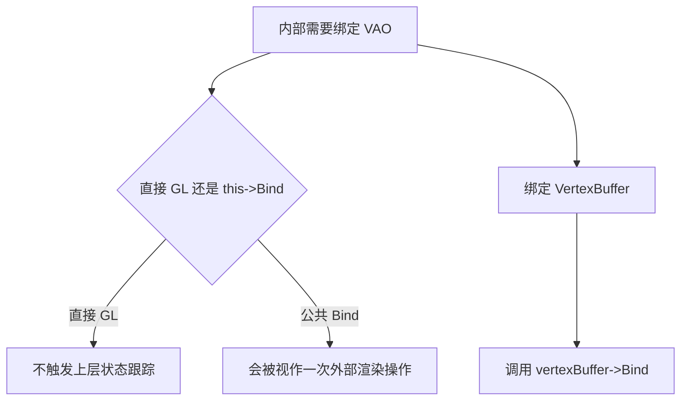

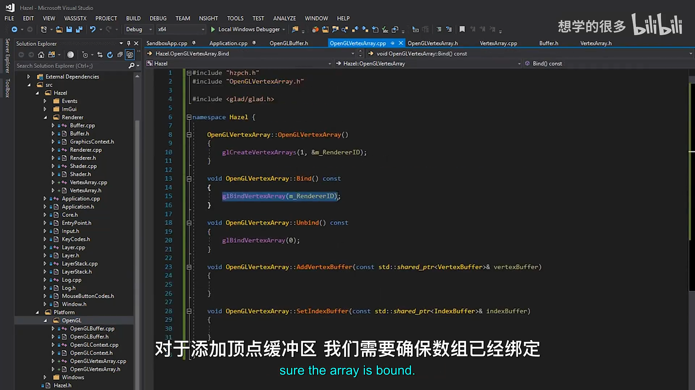

## 12. 缺少布局时立即断言

*(参考时间: 00:24:47)*

如果先把 Vertex Buffer 加入 Vertex Array，再设置布局，属性数量、stride 和 offset 都还是空的。

为了避免这种顺序错误悄悄产生不可预期的 GL 状态，`AddVertexBuffer()` 使用断言：

```cpp
HZ_CORE_ASSERT(
    vertexBuffer->GetLayout().GetElements().size(),
    "Vertex Buffer has no layout!");
```

正确顺序是：

```cpp
vertexBuffer->SetLayout(layout);
vertexArray->AddVertexBuffer(vertexBuffer);
```

错误顺序会在调试阶段直接触发断言，而不是等到画面缺失后才猜原因。

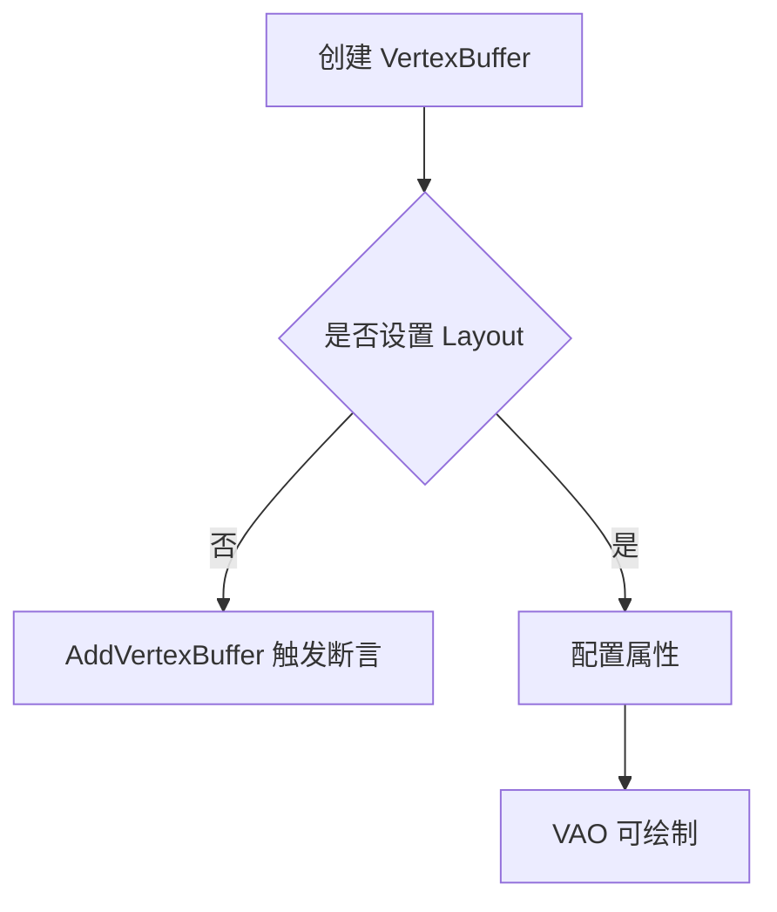

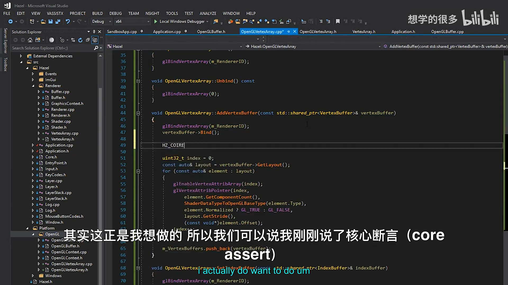

## 13. SetIndexBuffer 同样依赖绑定状态

*(参考时间: 00:19:23)*

索引缓冲通过 `SetIndexBuffer()` 关联：

```cpp
void OpenGLVertexArray::SetIndexBuffer(
    const std::shared_ptr<IndexBuffer>& indexBuffer)
{
    glBindVertexArray(m_RendererID);
    indexBuffer->Bind();
    m_IndexBuffer = indexBuffer;
}
```

只有当前绑定的 VAO 会记录当前绑定的 Element Array Buffer。因此这里也必须先绑定目标 VAO。

保存 `m_IndexBuffer` 后，上层可以通过：

```cpp
vertexArray->GetIndexBuffer()->GetCount()
```

得到 `glDrawElements()` 所需的索引数量，不必在 Application 中再保存一份索引数量的副本。

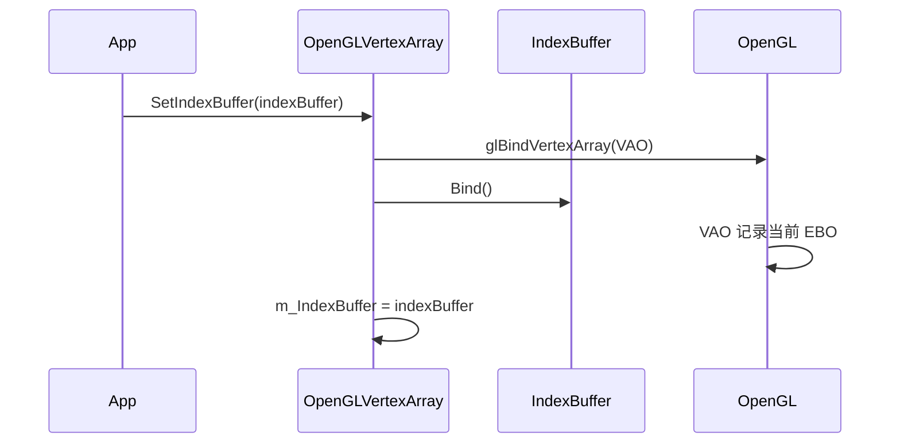

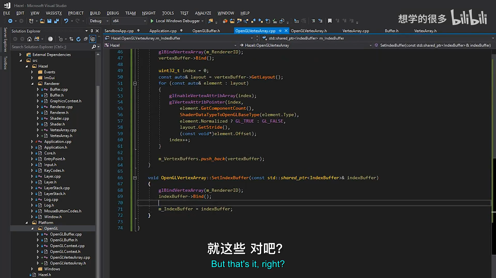

## 14. Application 改用通用 VertexArray

*(参考时间: 00:21:44)*

Application 头部新增：

```cpp
#include "Hazel/Renderer/VertexArray.h"
```

成员从裸 VAO ID 改为：

```cpp
std::shared_ptr<VertexArray> m_VertexArray;
```

三角形的 VAO 初始化变成：

```cpp
m_VertexArray.reset(VertexArray::Create());

float vertices[3 * 7] = {
    -0.5f, -0.5f, 0.0f, 0.8f, 0.2f, 0.8f, 1.0f,
     0.5f, -0.5f, 0.0f, 0.2f, 0.3f, 0.8f, 1.0f,
     0.0f,  0.5f, 0.0f, 0.8f, 0.8f, 0.2f, 1.0f
};

std::shared_ptr<VertexBuffer> vertexBuffer;
vertexBuffer.reset(
    VertexBuffer::Create(vertices, sizeof(vertices)));
vertexBuffer->SetLayout({
    { ShaderDataType::Float3, "a_Position" },
    { ShaderDataType::Float4, "a_Color" }
});
m_VertexArray->AddVertexBuffer(vertexBuffer);

uint32_t indices[3] = { 0, 1, 2 };
std::shared_ptr<IndexBuffer> indexBuffer;
indexBuffer.reset(
    IndexBuffer::Create(indices, 3));
m_VertexArray->SetIndexBuffer(indexBuffer);
```

第一次编译出现名称为 `m_VertexArray` 的重定义，因为旧裸 VAO 成员仍存在。删除旧成员、补上 `Platform/OpenGL/OpenGLVertexArray.h` 的包含路径后，三角形重新正常显示。

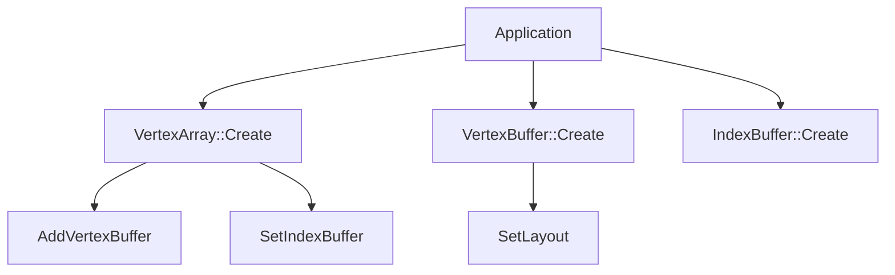

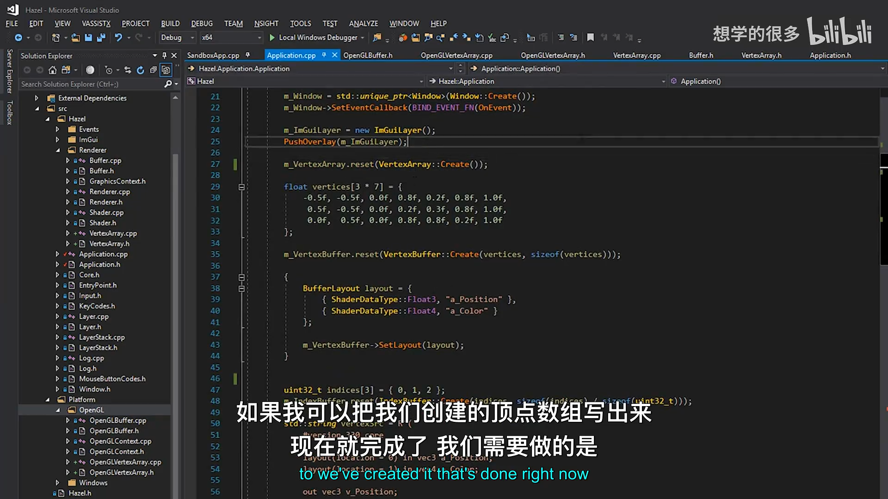

## 15. 增加第二个可绘制对象

*(参考时间: 00:29:01)*

为了验证 Vertex Array 可以复用，讲师增加第二个 VAO：

```cpp
std::shared_ptr<Shader> m_BlueShader;
std::shared_ptr<VertexArray> m_SquareVA;
```

单独创建方块所需的顶点：

```cpp
float squareVertices[3 * 4] = {
    -0.75f, -0.75f, 0.0f,
     0.75f, -0.75f, 0.0f,
     0.75f,  0.75f, 0.0f,
    -0.75f,  0.75f, 0.0f
};
```

方块只有位置属性：

```cpp
std::shared_ptr<VertexBuffer> squareVB;
squareVB.reset(VertexBuffer::Create(
    squareVertices, sizeof(squareVertices)));

squareVB->SetLayout({
    { ShaderDataType::Float3, "a_Position" }
});

m_SquareVA.reset(VertexArray::Create());
m_SquareVA->AddVertexBuffer(squareVB);
```

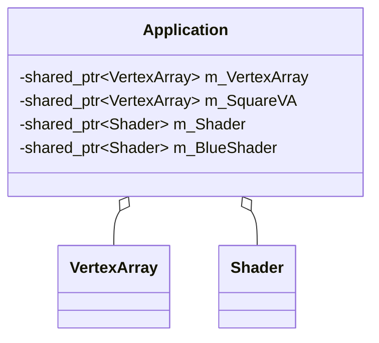

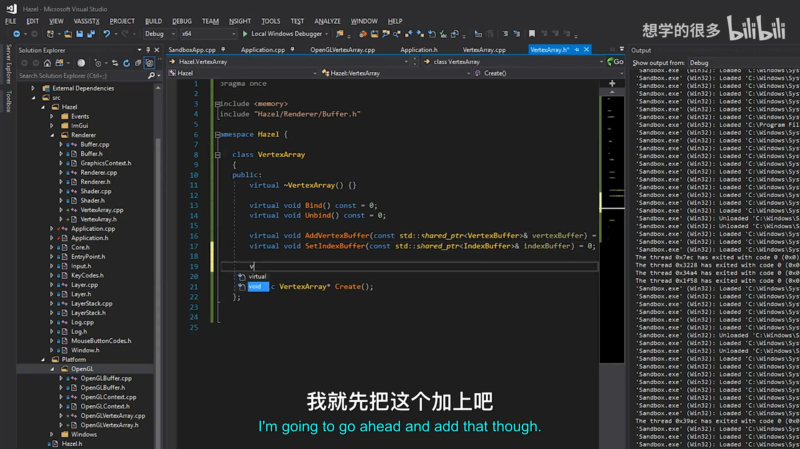

## 16. 一个方块需要六个索引

*(参考时间: 00:34:43)*

方块由两个三角形组成：

```cpp
uint32_t squareIndices[6] = {
    0, 1, 2,
    2, 3, 0
};
```

创建 Index Buffer 并设置到方块 VAO：

```cpp
std::shared_ptr<IndexBuffer> squareIB;
squareIB.reset(IndexBuffer::Create(
    squareIndices,
    sizeof(squareIndices) / sizeof(uint32_t)));

m_SquareVA->SetIndexBuffer(squareIB);
```

方块只接受位置，而三角形的原 Shader 还要求颜色属性。因此新增一个只读取 `a_Position` 的蓝色 Shader，Fragment Shader 直接返回固定蓝色：

```glsl
layout(location = 0) in vec3 a_Position;

void main()
{
    gl_Position = vec4(a_Position, 1.0);
}
```

```glsl
layout(location = 0) out vec4 color;

void main()
{
    color = vec4(0.2, 0.3, 0.8, 1.0);
}
```

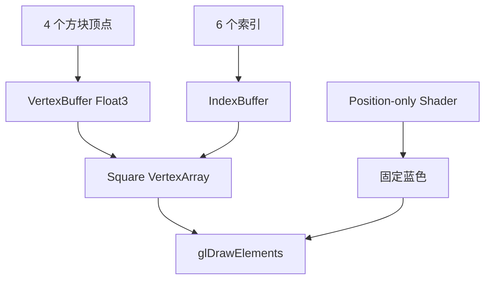

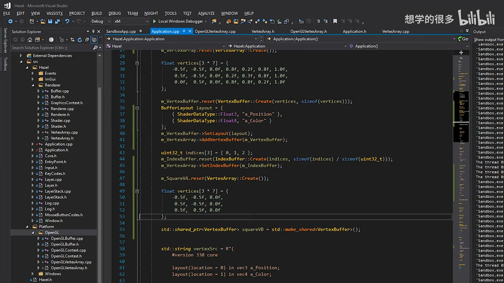

## 17. 绘制顺序与对象绑定

*(参考时间: 00:35:47)*

Run 循环中先绘制方块：

```cpp
m_BlueShader->Bind();
m_SquareVA->Bind();
glDrawElements(
    GL_TRIANGLES,
    m_SquareVA->GetIndexBuffer()->GetCount(),
    GL_UNSIGNED_INT,
    nullptr);
```

再绘制渐变三角形：

```cpp
m_Shader->Bind();
m_VertexArray->Bind();
glDrawElements(
    GL_TRIANGLES,
    m_VertexArray->GetIndexBuffer()->GetCount(),
    GL_UNSIGNED_INT,
    nullptr);
```

绘制一个对象时，Shader、Vertex Array 和 Draw Call 必须属于同一组状态。第一次运行看起来像画了两个对象，但方块只有三个顶点，明显少了一半。

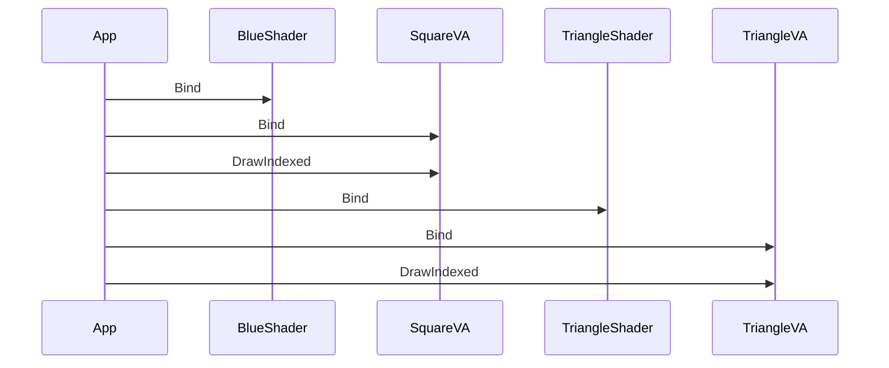

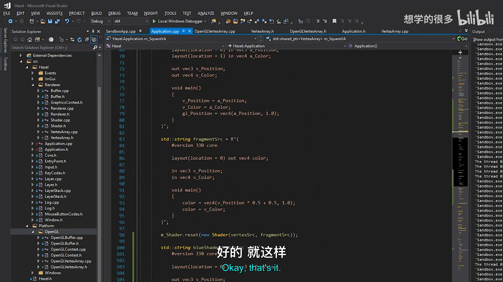

## 18. 方块只画三个顶点的排查

*(参考时间: 00:37:36)*

方块索引明明有 6 个，却只显示三角形。讲师先怀疑 Index Buffer 的 `GetCount()`：

```cpp
virtual uint32_t GetCount() const
{
    return m_Count;
}
```

检查后确认 `m_Count` 正常保存了构造函数收到的数量。继续检查 Application 时发现：

```cpp
// 错误：把三角形的 m_IndexBuffer 设置到了方块 VAO
m_SquareVA->SetIndexBuffer(m_IndexBuffer);
```

正确写法必须使用方块自己的索引缓冲：

```cpp
m_SquareVA->SetIndexBuffer(squareIB);
```

修复后，Draw Call 从方块 VAO 取到 6，终于画出完整的两个三角形。

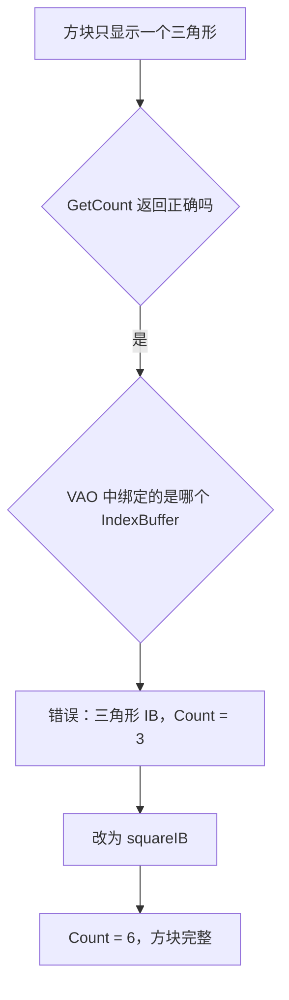

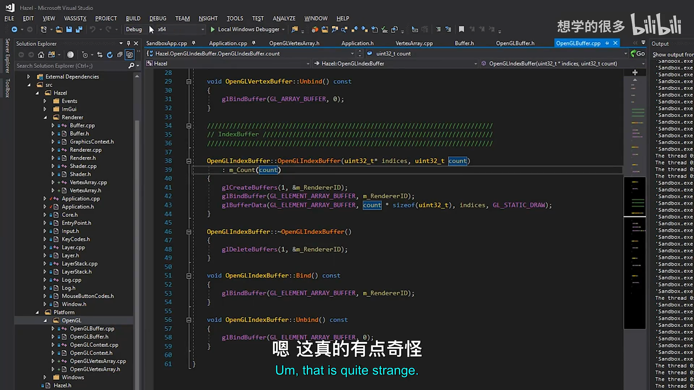

## 19. 最终画面与资源清理

*(参考时间: 00:39:16)*

修复后，蓝色方块位于背景，渐变三角形在前景。方块顶点从 `0.5` 扩大到 `0.75`，使两者形成清晰的前后层次。

最后清理 Application 中已不再需要的局部 Buffer 成员：

- 不再单独保存 `m_VertexBuffer`；
- 不再单独保存 `m_IndexBuffer`；
- 需要索引数量时，通过 `m_VertexArray->GetIndexBuffer()->GetCount()` 获取；
- Vertex Array 的 `shared_ptr` 持有全部资源。

本地加载变量仍可短暂存在，离开作用域后由 Vertex Array 保持资源存活。

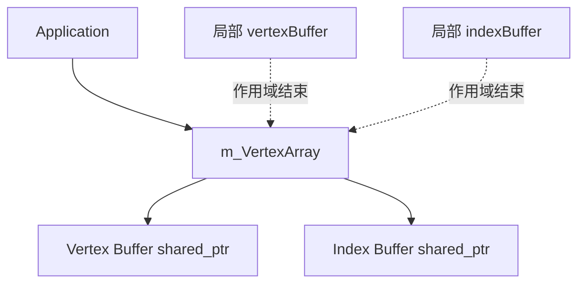

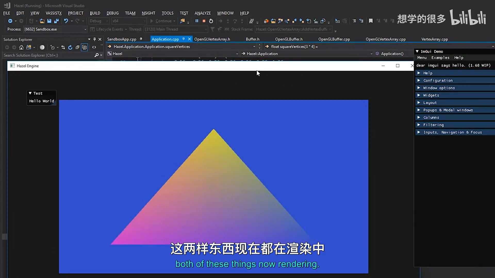

## 20. 析构与下一阶段

*(参考时间: 00:40:45)*

补上析构函数后，VAO 会正确释放：

```cpp
OpenGLVertexArray::~OpenGLVertexArray()
{
    glDeleteVertexArrays(1, &m_RendererID);
}
```

此时 Application 已经不再直接创建 VAO，也不再直接配置顶点属性。但仍保留一条 OpenGL Draw Call：

```cpp
glDrawElements(
    GL_TRIANGLES,
    vertexArray->GetIndexBuffer()->GetCount(),
    GL_UNSIGNED_INT,
    nullptr);
```

下一步需要抽象 Renderer 与 Draw Command，让应用层不再直接包含 Glad，也不直接调用 `glDrawElements()`。

```mermaid
graph LR
    A[本讲: VertexArray abstraction] --> B[下一讲: Renderer / Draw Command]
    B --> C[Application 不包含 Glad]
    C --> D[上层提交渲染请求]
    D --> E[平台后端执行 Draw Call]
```

```mermaid
graph TD
    A[Application] --> B[Renderer]
    B --> C[RenderCommand]
    C --> D[OpenGLVertexArray::Bind]
    C --> E[Index Buffer Count]
    C --> F[glDrawElements]
```

## 21. 本节结论

本讲完成了 Hazel 对 Vertex Array 的抽象：

- 明确 Vertex Array 是状态容器，不保存实际顶点数据；
- 建立通用 `VertexArray` 接口；
- 用 `VertexArray::Create()` 按渲染 API 选择实现；
- 用 `shared_ptr` 管理 Buffer 生命周期；
- 在 `OpenGLVertexArray` 中创建和销毁 VAO；
- 在 VAO 绑定期间配置 Vertex Buffer 属性；
- 在 VAO 绑定期间关联唯一 Index Buffer；
- 用断言阻止无布局 Vertex Buffer；
- 重构 Application，移除裸 VAO 与属性配置；
- 创建第二个 VAO 绘制蓝色方块；
- 通过错误 Index Buffer 的实际案例验证 VAO 与 EBO 的关联状态；
- 通过 getter 从 Vertex Array 获取索引数量；
- 清理多余 Buffer 成员，让 VAO 成为资源组合入口。

至此，Hazel 已经能通过通用对象完成大部分资源设置。剩余的关键边界是 Draw Call：只要它仍暴露在 Application 中，渲染后端就还没有真正隐藏完成。

## 附：参考

- [Bilibili 精译视频：032 - 顶点数组](https://www.bilibili.com/video/BV1wtLazEEmC/?p=32)
- [The Cherno 游戏引擎系列播放列表](https://www.youtube.com/playlist?list=PLlrATfBNZ98dC-V-N3m0Go4deliWHPFwT5)
- [本期对应代码提交 `0d292a3`](https://github.com/TheCherno/Hazel/tree/0d292a3)
- [OpenGL Wiki：Vertex Specification](https://www.khronos.org/opengl/wiki/Vertex_Specification)
- [OpenGL Wiki：Vertex Array Object](https://www.khronos.org/opengl/wiki/Vertex_Specification#Vertex_Array_Object)
