# Hazel 游戏引擎笔记 033：渲染流程与提交

> 本节来源：[The Cherno 游戏引擎系列第 33 讲“渲染流程与提交”](https://www.bilibili.com/video/BV1wtLazEEmC/?p=33)，时长约 36 分 29 秒。  
> 原课程与 Hazel 代码作者：The Cherno。代码参考提交：[`dc9e382`](https://github.com/TheCherno/Hazel/tree/dc9e382)。  
> 本文由视频字幕重构、翻译并整理，不是官方教材；术语和代码以原视频及同期 Hazel 仓库为准。

## 本节目标

第 32 讲已经把顶点数组、顶点缓冲和索引缓冲封装起来，但 `Application::Run()` 中仍留着最后一条 OpenGL 专用代码：

```cpp
glDrawElements(
    GL_TRIANGLES,
    vertexArray->GetIndexBuffer()->GetCount(),
    GL_UNSIGNED_INT,
    nullptr);
```

这正是实际提交给 GPU 的 Draw Call。只要它还直接写在应用层，渲染后端就没有真正隐藏。

本讲建立三层渲染架构：

- `Renderer`：高层场景与对象提交流程；
- `RenderCommand`：静态、原子化的底层命令入口；
- `RendererAPI`：每个图形 API 的具体后端接口。

本讲完成的内容：

- 解释 Draw Call 实际做什么；
- 区分场景级数据与对象级数据；
- 设计 `BeginScene`、`Submit`、`EndScene` 流程；
- 讨论未来命令队列、延迟提交和可见性优化；
- 建立 `RendererAPI` 接口与 API 枚举；
- 建立 `RenderCommand` 静态转发层；
- 实现 `OpenGLRendererAPI`；
- 用 `Renderer::Submit()` 绑定 VAO 并发出 Draw Call；
- 把 Application 的清屏和绘制改成 Hazel 通用接口；
- 修复首次重构时遗漏的 VAO 绑定；
- 从 Application 中彻底移除 Glad；
- 明确下一阶段的 Camera、Transform 和 Material。

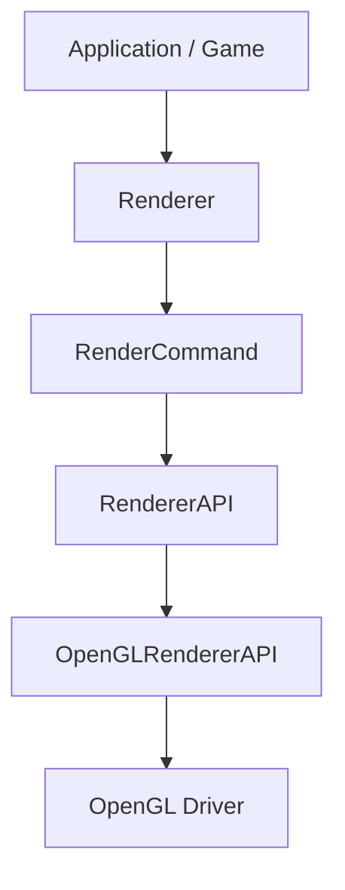


## 1. Draw Call 是真正的提交动作

*(参考时间: 00:00:26)*

渲染前需要准备大量状态：

- 绑定 Shader；
- 绑定纹理和材质参数；
- 绑定 Vertex Array；
- 配置顶点属性和索引缓冲；
- 上传 uniforms；
- 决定要绘制多少索引。

Draw Call 是最终把“已经准备好的状态”交给 GPU 执行的命令。GPU 按当前状态运行 Vertex Shader，完成图元装配、光栅化，再运行 Fragment Shader 得到像素颜色。

在 OpenGL 中，本讲对应的调用是 `glDrawElements()`。DirectX 等后端也会有自己的等价提交命令。抽象层的目标，是让上层只说“绘制这个 Vertex Array”，而不关心底层函数名。

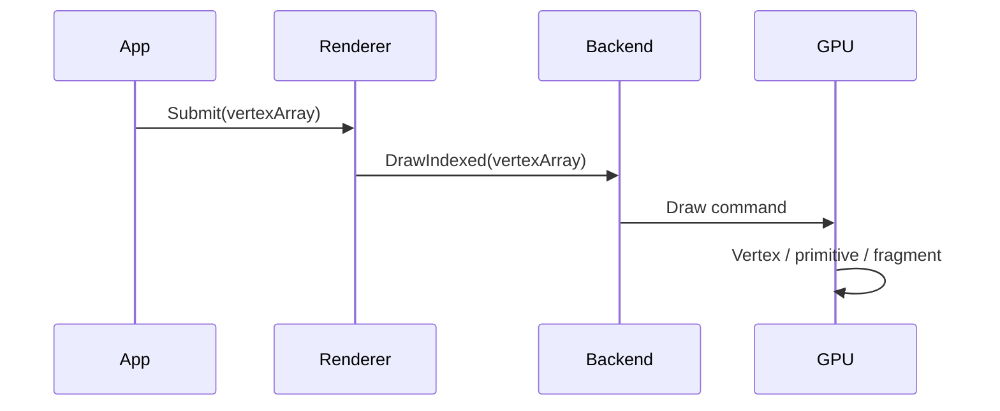

## 2. 渲染一个物体至少需要什么

*(参考时间: 00:03:25)*

把一个立方体画到 3D 世界中，需要两个层面的数据。

### 2.1 场景级数据

- 相机位置与朝向；
- View 矩阵；
- Projection 矩阵；
- 灯光；
- 环境贴图或环境光照；
- 天空盒和全局渲染设置。

这些信息在渲染一个场景中的所有对象时通常保持一致。

### 2.2 对象级数据

- 几何形状；
- Shader / Material；
- 世界变换矩阵；
- 法线、纹理坐标和骨骼数据；
- 物件特有的渲染参数。

当前 Hazel 只有 Vertex Array 和 Shader。相机、材质、灯光、环境贴图和变换系统都尚未实现，但本讲先把它们未来所在的位置确定下来。

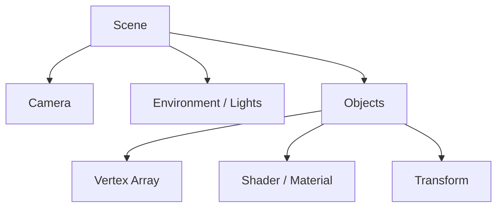

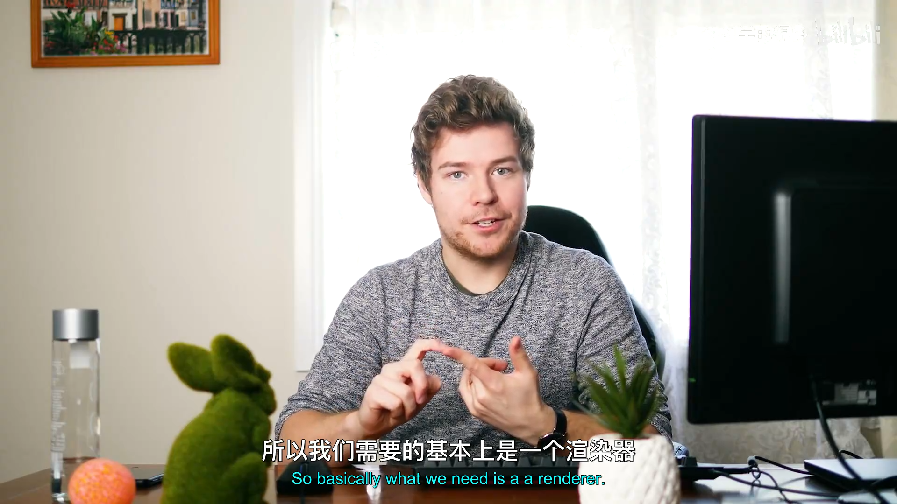

## 3. BeginScene / Submit / EndScene

*(参考时间: 00:06:04)*

讲师把一次渲染组织成三个高层阶段：

```cpp
Renderer::BeginScene(sceneData);

shader->Bind();
Renderer::Submit(vertexArray);

Renderer::EndScene();
```

`BeginScene()` 接收所有“整个场景共享”的参数。以后它会把相机矩阵、灯光和环境信息放入当前场景状态。

`Submit()` 接收每个待绘制对象。以后它还会接收变换矩阵和材质，并把这些对象级数据与当前场景组合起来。

`EndScene()` 表示场景提交结束。未来它可以触发命令队列刷新，让渲染线程执行已经收集的命令。

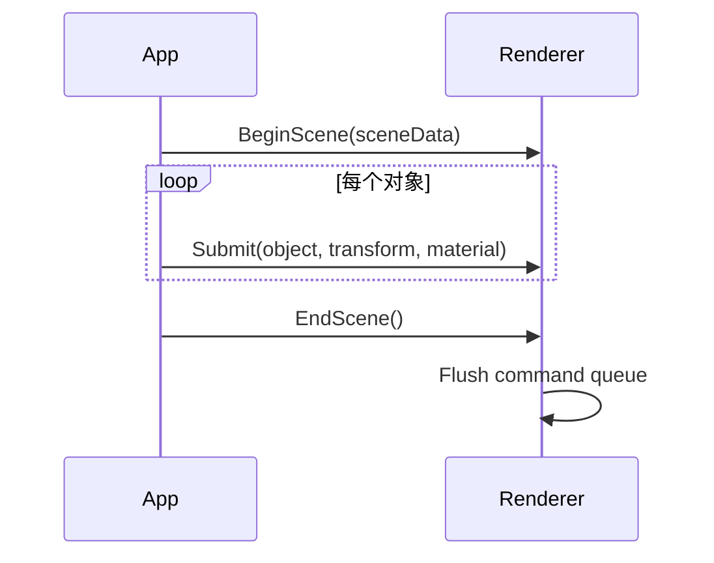


## 4. 当前采用立即提交

*(参考时间: 00:09:02)*

成熟渲染器通常不会在 `Submit()` 中立即调用 GPU，而是把绘制请求写入 Render Command Queue：

1. 收集完整场景；
2. 执行视锥裁剪；
3. 合并材质相同或状态相同的对象；
4. 对绘制顺序排序；
5. 在线程安全的命令队列中统一执行；
6. 可以在独立渲染线程中消费。

这些优化只有拿到整个场景后才有意义。如果每提交一个对象就立刻绘制，就无法提前知道后面的对象、灯光和材质分布。

不过当前阶段没有相机、裁剪器、材质系统或 Render Graph。讲师选择先做最直接的立即模式：

```text
Submit -> Bind Vertex Array -> DrawIndexed
```

未来再把中间实现替换为命令队列，同时保持上层 API 形态。

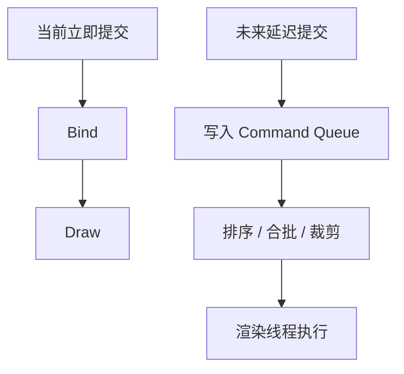


## 5. 重构前的 Run 循环

*(参考时间: 00:10:58)*

Application 原本直接完成：

```cpp
glClearColor(0.1f, 0.1f, 0.1f, 1);
glClear(GL_COLOR_BUFFER_BIT);

m_BlueShader->Bind();
m_SquareVA->Bind();
glDrawElements(...);

m_Shader->Bind();
m_VertexArray->Bind();
glDrawElements(...);
```

本讲希望把这段改写成：

```cpp
RenderCommand::SetClearColor({ 0.1f, 0.1f, 0.1f, 1 });
RenderCommand::Clear();

Renderer::BeginScene();

m_BlueShader->Bind();
Renderer::Submit(m_SquareVA);

m_Shader->Bind();
Renderer::Submit(m_VertexArray);

Renderer::EndScene();
```

这一改动把“应用要画什么”与“OpenGL 怎样画”分开。

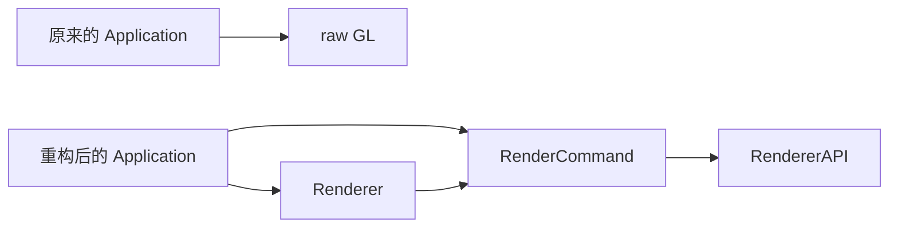

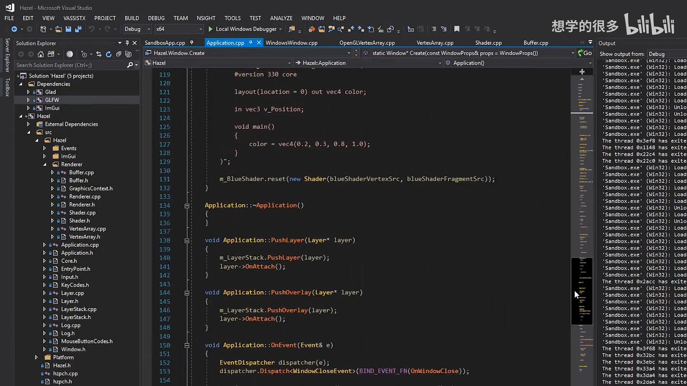

## 6. Renderer 与 RendererAPI 的职责差异

*(参考时间: 00:14:09)*

Renderer 是高层对象：

- 理解 Scene；
- 接收几何与材质；
- 绑定对象状态；
- 组合场景级与对象级参数；
- 未来负责队列、排序和批处理。

清屏、Draw Call 这类具体操作位于 Renderer 之下。讲师把这一层称为 Render Command，把真正的图形 API 后端称为 Renderer API。

命名也经过讨论。`RenderAPI` 虽然更短，但不够明确；`RendererAPI` 更清楚地表示“Renderer 所使用的图形 API”。

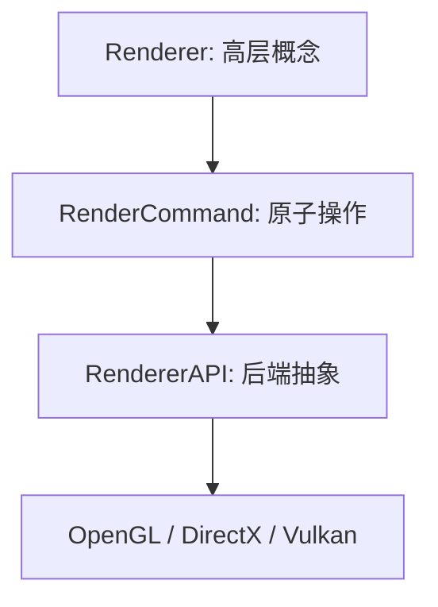

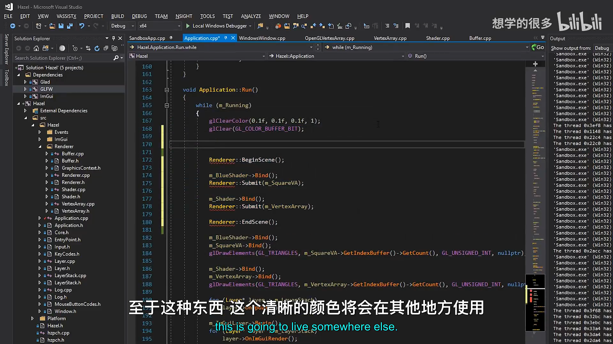

## 7. RendererAPI 接口

*(参考时间: 00:16:04)*

新增 `RendererAPI.h`：

```cpp
#pragma once

#include <glm/glm.hpp>
#include "VertexArray.h"

namespace Hazel {

class RendererAPI
{
public:
    enum class API
    {
        None = 0,
        OpenGL = 1
    };

    virtual void SetClearColor(const glm::vec4& color) = 0;
    virtual void Clear() = 0;

    virtual void DrawIndexed(
        const std::shared_ptr<VertexArray>& vertexArray) = 0;

    inline static API GetAPI()
    {
        return s_API;
    }

private:
    static API s_API;
};

}
```

接口直接使用 GLM 的 `vec4` 表示颜色。数学库不是渲染后端，颜色参数也不会迫使接口暴露 OpenGL 类型。

`DrawIndexed()` 取名参考 DirectX，而不是照搬 OpenGL 的 `DrawElements()`。上层使用 Hazel 的 Index Buffer 概念，因此“绘制索引数据”是更中立的名称。

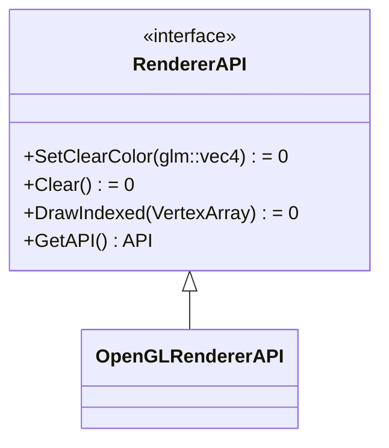

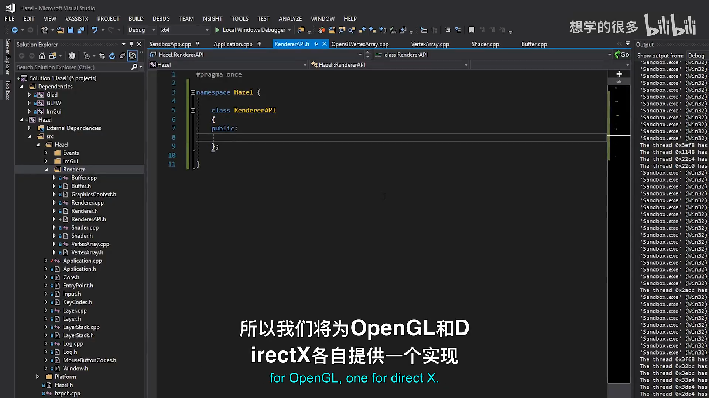

## 8. API 枚举与当前后端

*(参考时间: 00:18:21)*

`RendererAPI.cpp` 暂时把当前后端设为 OpenGL：

```cpp
#include "hzpch.h"
#include "RendererAPI.h"

namespace Hazel {

RendererAPI::API RendererAPI::s_API =
    RendererAPI::API::OpenGL;

}
```

这里保存的是“当前选择哪一种后端”的枚举，不是后端对象本身。后端对象由更底层的 `RenderCommand` 持有。

未来窗口和 Graphics Context 创建时可以决定实际 API，再实例化相应的 RendererAPI 实现。当前先固定 OpenGL。

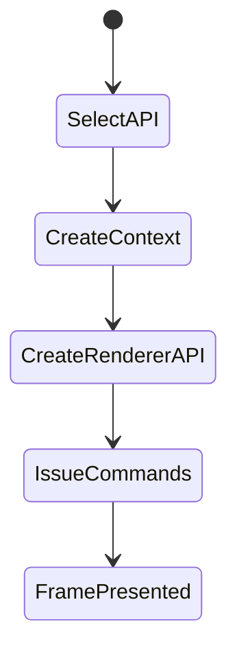

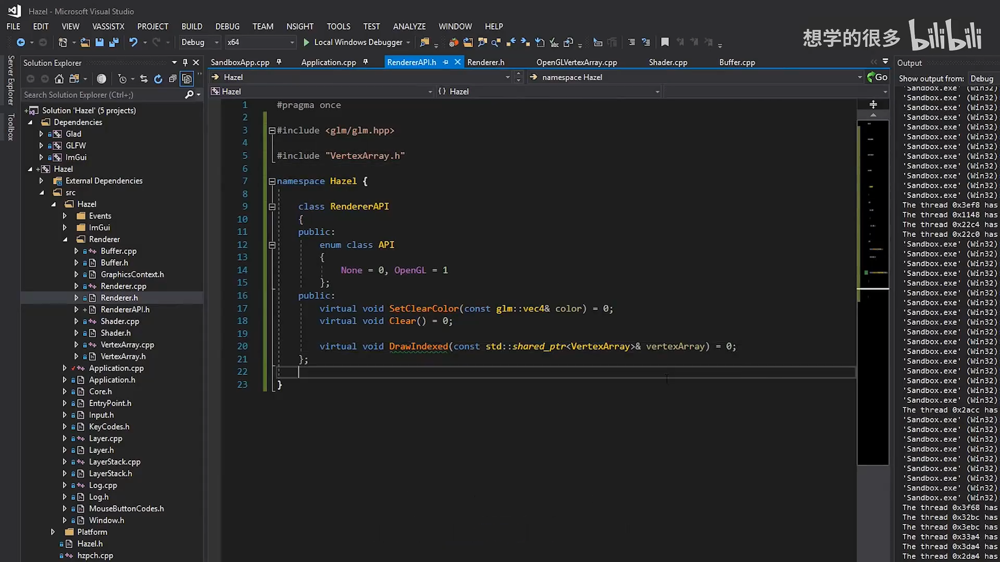

## 9. RenderCommand 是静态转发层

*(参考时间: 00:19:40)*

`RenderCommand.h` 不包含渲染策略，只把调用转发给当前后端：

```cpp
#pragma once

#include "RendererAPI.h"

namespace Hazel {

class RenderCommand
{
public:
    inline static void SetClearColor(const glm::vec4& color)
    {
        s_RendererAPI->SetClearColor(color);
    }

    inline static void Clear()
    {
        s_RendererAPI->Clear();
    }

    inline static void DrawIndexed(
        const std::shared_ptr<VertexArray>& vertexArray)
    {
        s_RendererAPI->DrawIndexed(vertexArray);
    }

private:
    static RendererAPI* s_RendererAPI;
};

}
```

每个函数只做一件事：

- `SetClearColor()` 设置颜色；
- `Clear()` 清屏；
- `DrawIndexed()` 提交一次索引绘制。

它们不绑定 Shader、不绑定 Vertex Array、不排序，也不处理材质。绑定等准备动作属于高层 Renderer。

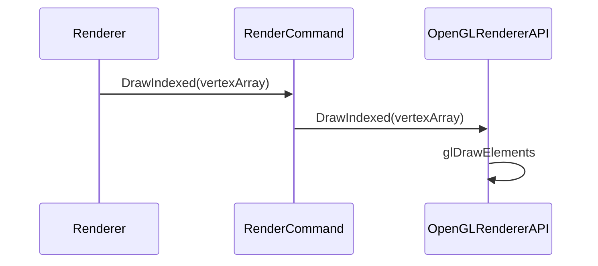

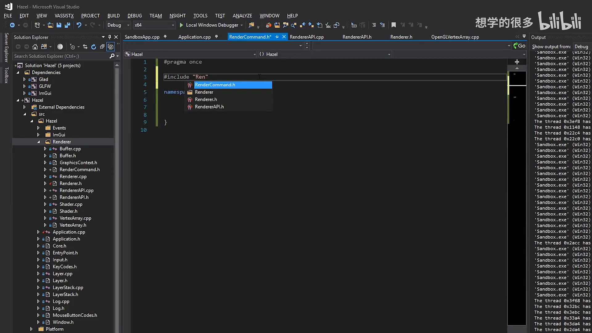

## 10. 创建当前 RendererAPI 实现

*(参考时间: 00:24:43)*

`RenderCommand.cpp` 创建 OpenGL 实现：

```cpp
#include "hzpch.h"
#include "RenderCommand.h"

#include "Platform/OpenGL/OpenGLRendererAPI.h"

namespace Hazel {

RendererAPI* RenderCommand::s_RendererAPI =
    new OpenGLRendererAPI;

}
```

这是一段临时实现：

- 后端对象从应用启动存活到退出；
- 当前没有动态工厂；
- 没有在析构中删除，但对象没有成员，生命周期与进程相同；
- 后续会由图形 Context 或渲染初始化逻辑选择实际实现。

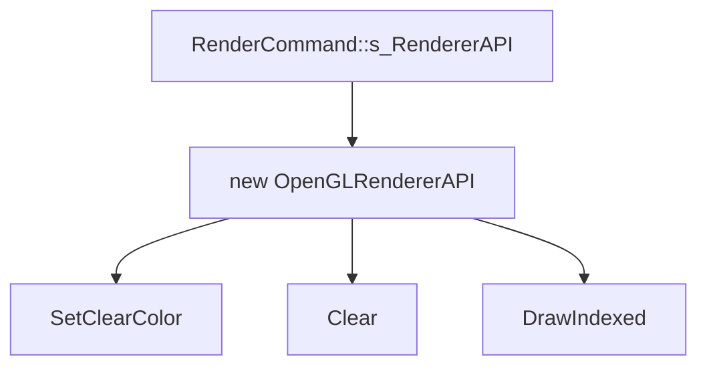

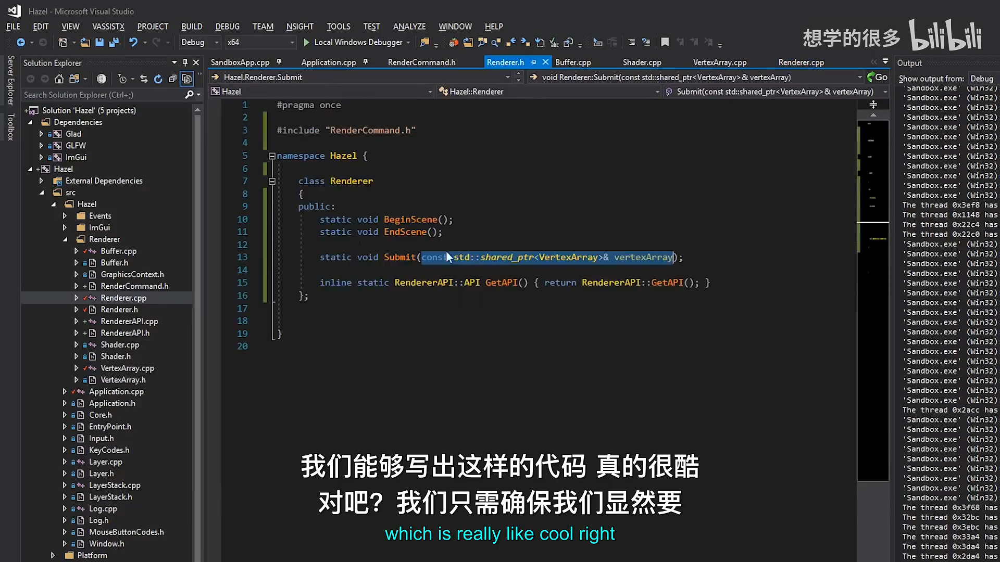

## 11. OpenGLRendererAPI 头文件

*(参考时间: 00:25:51)*

平台实现继承通用接口：

```cpp
#pragma once

#include "Hazel/Renderer/RendererAPI.h"

namespace Hazel {

class OpenGLRendererAPI : public RendererAPI
{
public:
    virtual void SetClearColor(
        const glm::vec4& color) override;

    virtual void Clear() override;

    virtual void DrawIndexed(
        const std::shared_ptr<VertexArray>& vertexArray) override;
};

}
```

该文件位于 `Platform/OpenGL`。除这里和 OpenGL Buffer、Vertex Array 等平台文件外，上层不再需要包含 Glad。

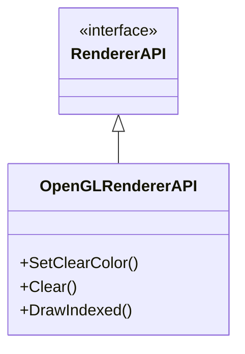

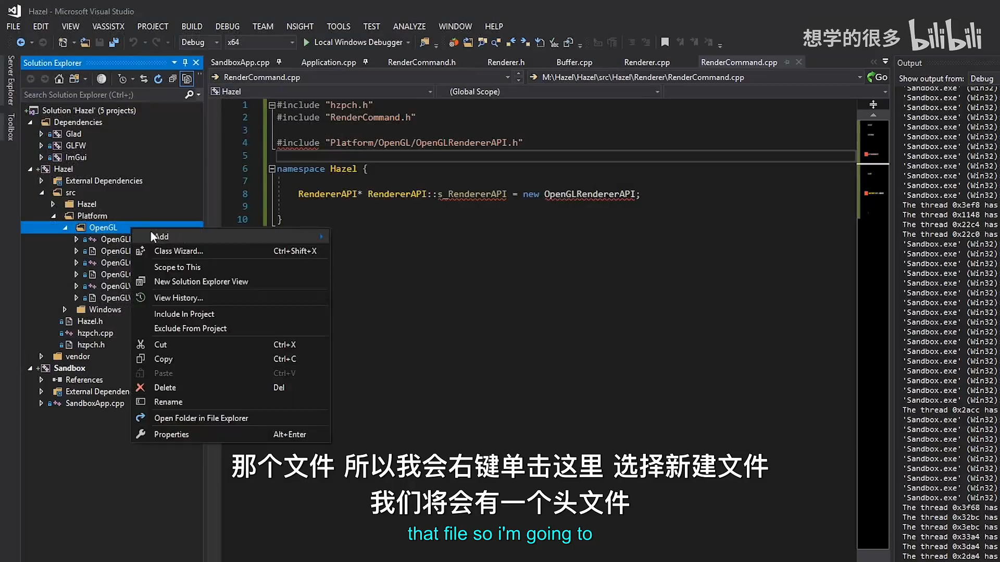

## 12. 清屏与 DrawIndexed 实现

*(参考时间: 00:27:13)*

`OpenGLRendererAPI.cpp` 包含 Glad，并实现原始调用：

```cpp
#include "hzpch.h"
#include "OpenGLRendererAPI.h"

#include <glad/glad.h>

namespace Hazel {

void OpenGLRendererAPI::SetClearColor(
    const glm::vec4& color)
{
    glClearColor(color.r, color.g, color.b, color.a);
}

void OpenGLRendererAPI::Clear()
{
    glClear(GL_COLOR_BUFFER_BIT | GL_DEPTH_BUFFER_BIT);
}

void OpenGLRendererAPI::DrawIndexed(
    const std::shared_ptr<VertexArray>& vertexArray)
{
    glDrawElements(
        GL_TRIANGLES,
        vertexArray->GetIndexBuffer()->GetCount(),
        GL_UNSIGNED_INT,
        nullptr);
}

}
```

Clear 当前同时清除颜色和深度缓冲。未来可能需要传入 flags，只清除指定附件；Frame Buffer 也可能直接调用类似命令。

DrawIndexed 当前固定绘制三角形、索引类型固定为 `uint32_t`。以后需要支持点、线、三角形条带和不同索引类型。

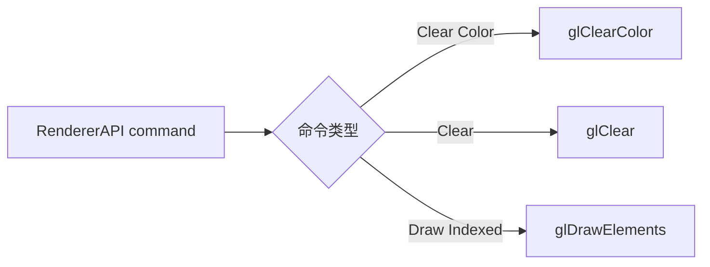

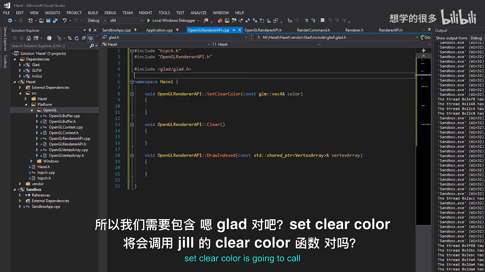

## 13. Renderer 高层接口

*(参考时间: 00:21:12)*

`Renderer.h` 只公开场景级操作：

```cpp
#pragma once

#include "RenderCommand.h"

namespace Hazel {

class Renderer
{
public:
    static void BeginScene();
    static void EndScene();

    static void Submit(
        const std::shared_ptr<VertexArray>& vertexArray);

    inline static RendererAPI::API GetAPI()
    {
        return RendererAPI::GetAPI();
    }
};

}
```

`GetAPI()` 仍然有用：引擎调试面板或平台特定代码可能需要知道当前使用的是 OpenGL 还是 DirectX。它只是查询枚举，不会暴露底层 API 对象。

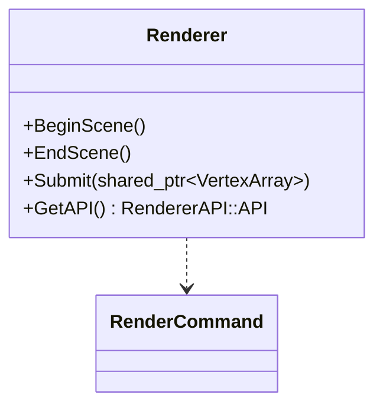

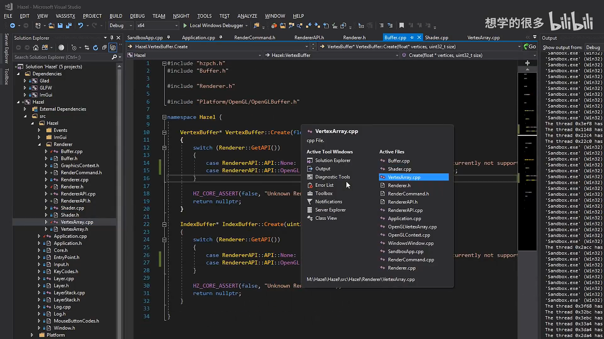

## 14. Submit 必须绑定 Vertex Array

*(参考时间: 00:32:17)*

最初 `Renderer::Submit()` 直接调用 DrawIndexed，忘记绑定 VAO，导致画面上没有预期对象。

正确实现是：

```cpp
void Renderer::Submit(
    const std::shared_ptr<VertexArray>& vertexArray)
{
    vertexArray->Bind();
    RenderCommand::DrawIndexed(vertexArray);
}
```

这里体现了职责边界：

- Renderer 负责准备绘制所需的绑定状态；
- RenderCommand 只发出单个原子操作；
- RenderCommand 不应该偷偷绑定 VAO，否则名字叫 DrawIndexed 的命令实际做了两件事。

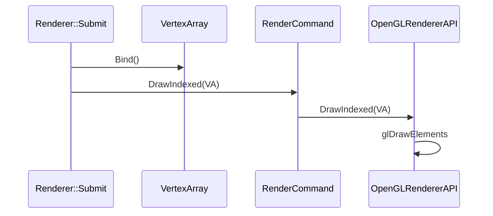

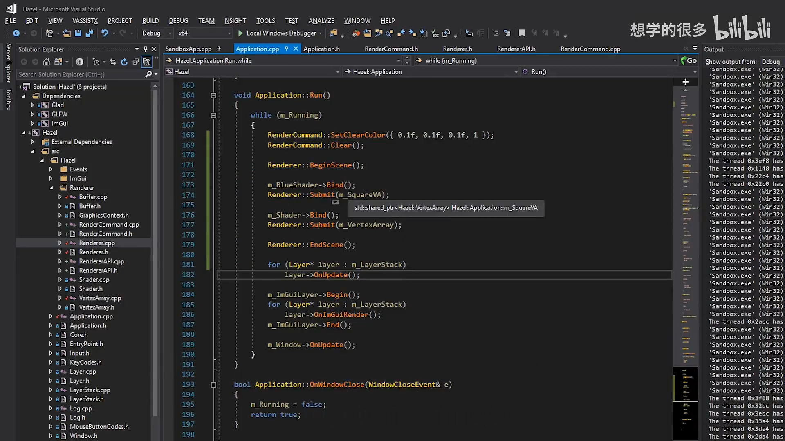

## 15. BeginScene 与 EndScene 暂时为空

*(参考时间: 00:22:26)*

`Renderer.cpp` 当前实现：

```cpp
void Renderer::BeginScene()
{
}

void Renderer::EndScene()
{
}

void Renderer::Submit(
    const std::shared_ptr<VertexArray>& vertexArray)
{
    vertexArray->Bind();
    RenderCommand::DrawIndexed(vertexArray);
}
```

BeginScene 未来会接收相机和环境参数，保存当前场景状态，并确保后续材质得到正确的 Shader uniforms。

EndScene 未来会结束命令收集，刷新命令队列，或者通知渲染线程执行本帧。

现在留空是明确的阶段性选择，而不是遗漏。它们为后续架构保留了稳定调用点。

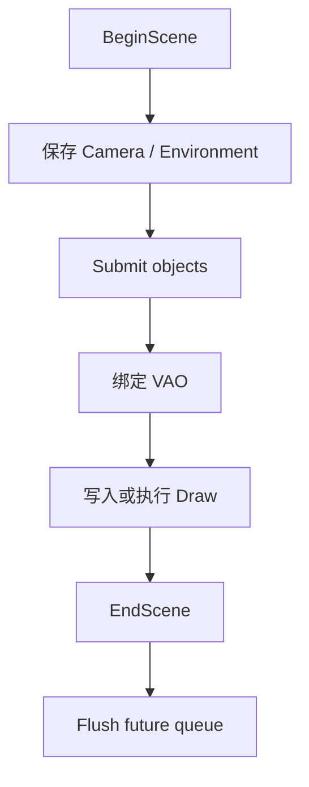

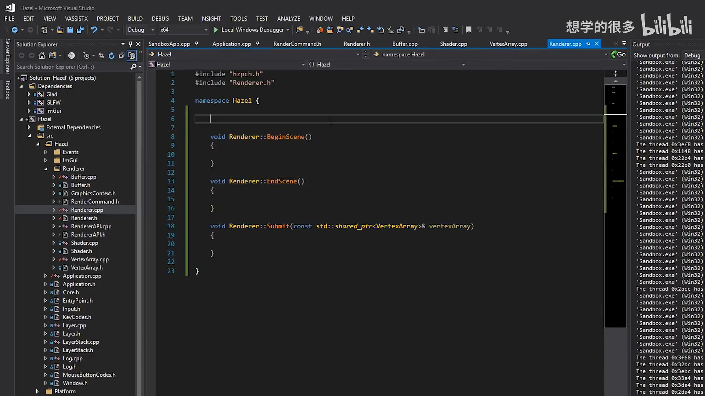

## 16. Application 改用 Renderer 流程

*(参考时间: 00:30:43)*

Application 删除 Glad 和裸绘制代码，引入：

```cpp
#include "Hazel/Renderer/Renderer.h"
```

Run 循环变成：

```cpp
RenderCommand::SetClearColor({ 0.1f, 0.1f, 0.1f, 1 });
RenderCommand::Clear();

Renderer::BeginScene();

m_BlueShader->Bind();
Renderer::Submit(m_SquareVA);

m_Shader->Bind();
Renderer::Submit(m_VertexArray);

Renderer::EndScene();
```

Shader 仍然由应用绑定，因为 Material 系统还没有建立。未来 Mesh 会持有 Material，Material 会选择 Shader 和 uniforms，Renderer 再统一处理这些对象级状态。

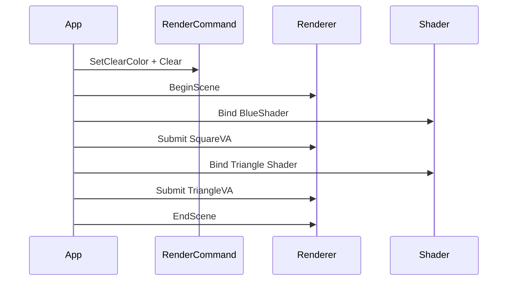

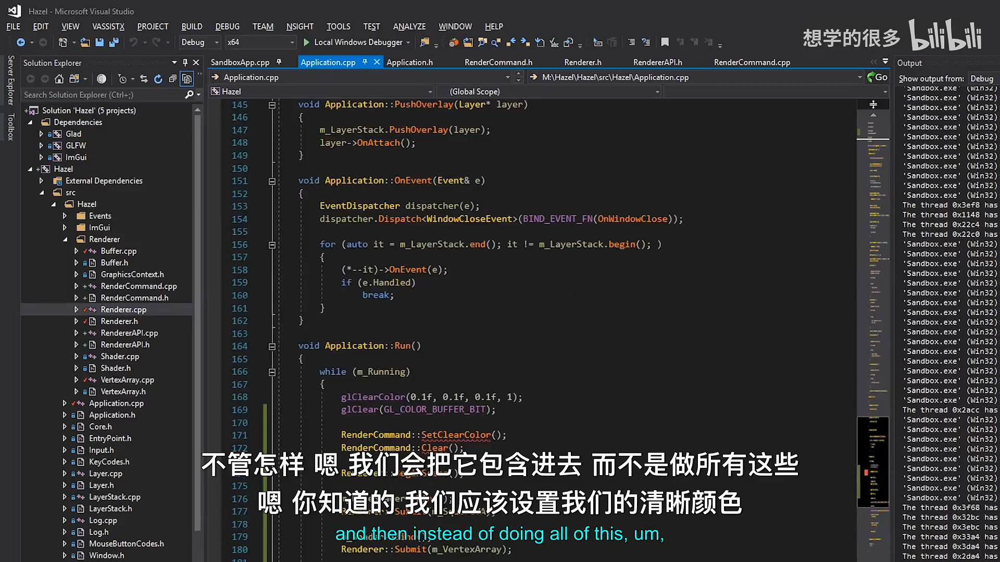

## 17. 结果保持一致且不再依赖 Glad

*(参考时间: 00:33:06)*

修复 VAO 绑定后，运行结果与上一讲完全相同：蓝色方块和渐变三角形正常显示。

随后讲师从 Application 中移除：

```cpp
#include <glad/glad.h>
```

只编译 Hazel 渲染库就能通过。Application 不再看到：

- `glClearColor`
- `glClear`
- `glBindVertexArray`
- `glDrawElements`
- `GL_TRIANGLES`
- `GL_UNSIGNED_INT`

所有 OpenGL 细节都被限制在平台实现中。

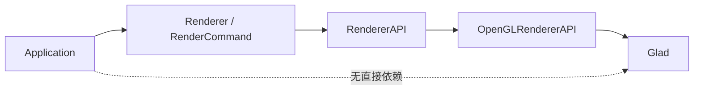

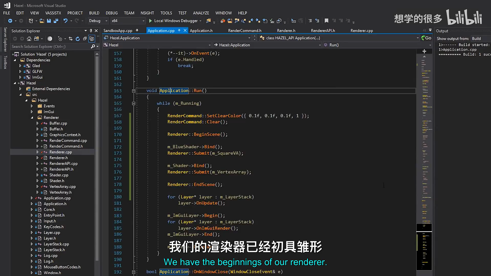

## 18. OpenGLRendererAPI 的边界

*(参考时间: 00:28:08)*

当前 OpenGL 后端刻意保持简单：

- 清屏固定同时清除颜色和深度；
- DrawIndexed 固定绘制 `GL_TRIANGLES`；
- 索引类型固定为 `GL_UNSIGNED_INT`；
- 不设置 primitive mode；
- 不处理 viewport；
- 不处理混合、深度测试和面剔除；
- 不管理 Frame Buffer。

这些限制不是长期接口，而是当前渲染器还没有处理对应状态。让命令保持最小化，可以让后续扩展点时更清楚每一次 API 增长是为了哪种能力。

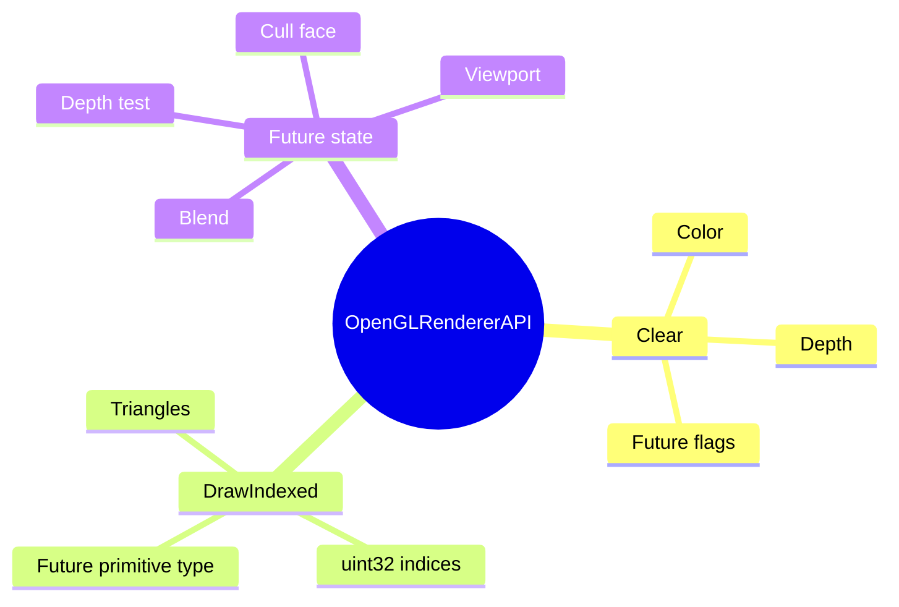

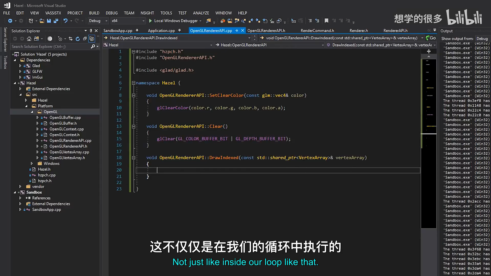

## 19. 命令队列与多线程渲染

*(参考时间: 00:35:50)*

真正的 Render Command Queue 会把命令保存下来，由渲染线程在合适的时间执行。好处包括：

- 将场景提交与 GPU 提交解耦；
- 在完整场景上执行视锥裁剪；
- 按材质和渲染状态合批；
- 调整透明物体与不透明物体的顺序；
- 构建跨线程安全的任务结构；
- 降低主线程阻塞。

当前还没有真实 3D 场景，多线程和队列不会成为瓶颈。过早引入只会让代码更复杂。现阶段先把高层 API 形态固定下来，未来替换内部执行机制。

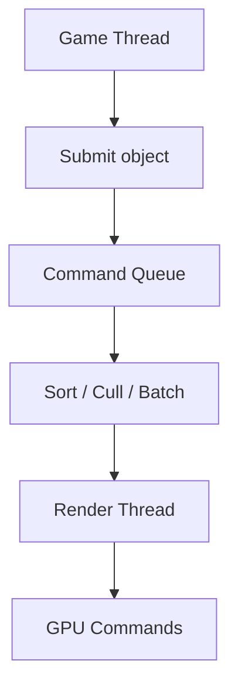


## 20. 下一阶段：Camera、Transform 与 Material

*(参考时间: 00:34:41)*

渲染器已经能发出 Draw Call，但还缺少 3D 场景的关键输入：

- Camera：提供 View 与 Projection；
- Transform：把对象放到世界中的位置、旋转和缩放到 Shader；
- Material：选择 Shader 并上传对象级参数；
- Mesh：把 Vertex Array、Material 与 Transform 组织在一起；
- Environment：灯光与环境贴图；
- Renderer scene state：保存 BeginScene 传入的共享参数。

讲师计划先引入相机，让场景可以在 3D 空间中观察；随后处理变换矩阵和材质，使对象能以不同位置、姿态和外观提交到 Renderer。

```mermaid
graph TD
    A[Camera] --> E[Scene State]
    B[Environment] --> E
    C[Mesh] --> D[Material]
    C --> F[VertexArray]
    C --> G[Transform]
    E --> H[Renderer]
    D --> H
    F --> H
    G --> H
    H --> I[RenderCommand]
```

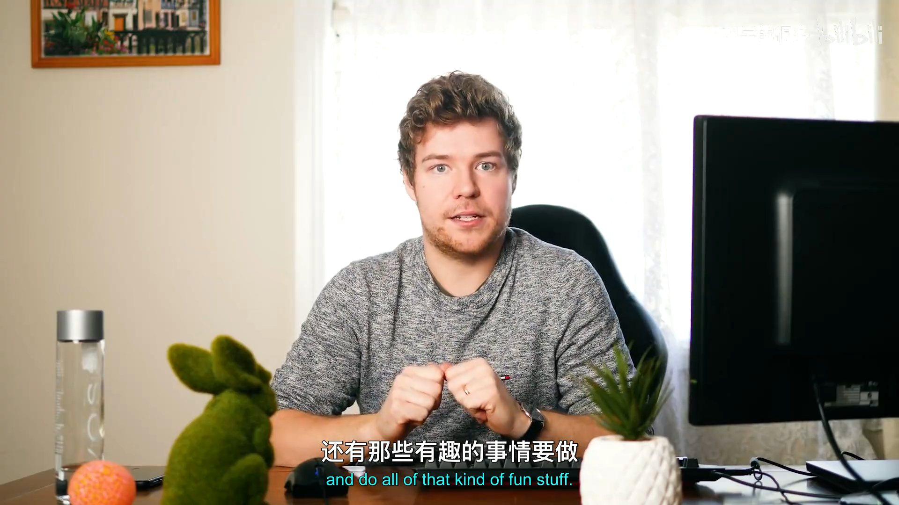

## 21. 本节结论

本讲完成了 Hazel 渲染架构的第一个稳定分层：

- Draw Call 从 Application 移入 OpenGL 后端；
- 明确场景级数据与对象级数据的区别；
- 建立 `Renderer::BeginScene()`、`Submit()`、`EndScene()`；
- 建立 `RendererAPI` 接口与 API 枚举；
- 建立 `RenderCommand` 静态命令转发层；
- 实现 `OpenGLRendererAPI`；
- 用 OpenGLRendererAPI 封装清屏和 `glDrawElements`；
- Submit 负责绑定 VAO，命令本身保持原子化；
- Application 改用通用 Renderer 流程；
- 修复遗漏 VAO 绑定导致的不显示问题；
- 从 Application 中移除 Glad；
- 保持画面与上一讲完全一致；
- 明确未来的命令队列、相机、材质与变换方向。

这版 Renderer 仍然简单，但职责边界已经清晰：Renderer 决定“怎样准备一次绘制”，RenderCommand 表达“要执行什么原子操作”，RendererAPI 决定“当前平台怎样实际完成”。

## 附：参考

- [Bilibili 精译视频：033 - 渲染流程与提交](https://www.bilibili.com/video/BV1wtLazEEmC/?p=33)
- [The Cherno 游戏引擎系列播放列表](https://www.youtube.com/playlist?list=PLlrATfBNZ98dC-V-N3m0Go4deliWHPFwT5)
- [本期对应代码提交 `dc9e382`](https://github.com/TheCherno/Hazel/tree/dc9e382)
- [OpenGL Wiki：Rendering Pipeline Overview](https://www.khronos.org/opengl/wiki/Rendering_Pipeline_Overview)
- [OpenGL Wiki：Vertex Specification](https://www.khronos.org/opengl/wiki/Vertex_Specification)
