# Hazel 游戏引擎笔记 034：摄像机及其工作原理

> 本节来源：[The Cherno 游戏引擎系列第 34 讲“摄像机及其工作原理”](https://www.bilibili.com/video/BV1wtLazEEmC/?p=34)，时长约 38 分 54 秒。  
> 原课程与 Hazel 代码作者：The Cherno。本讲代码基线为 [`dc9e382`](https://github.com/TheCherno/Hazel/tree/dc9e382)，下一讲正交相机实现提交为 [`c1d915e`](https://github.com/TheCherno/Hazel/tree/c1d915e)。  
> 本文由视频字幕重构、翻译并整理，不是官方教材；术语和代码以原视频及同期 Hazel 仓库为准。

## 本节目标

第 33 讲已经建立 `Renderer`、`RenderCommand` 与 `RendererAPI`，但 `Renderer::BeginScene()` 和 `EndScene()` 仍是空函数。摄像机正是 BeginScene 的第一项正式数据。

本讲刻意不写 C++ 代码，而是先解决设计问题：

- 摄像机究竟是什么；
- 它在渲染和游戏逻辑之间处于什么位置；
- 摄像机需要哪些数据；
- View 矩阵与 Projection 矩阵分别表示什么；
- 为什么移动摄像机会让整个场景反向移动；
- Perspective 与 Orthographic 投影有何区别；
- MVP 矩阵怎样生成屏幕位置；
- 相机数据应该在何时、上传到哪个 Shader；
- BeginScene 应该保存相机引用，还是复制矩阵数据；
- 为什么下一讲先实现正交相机。

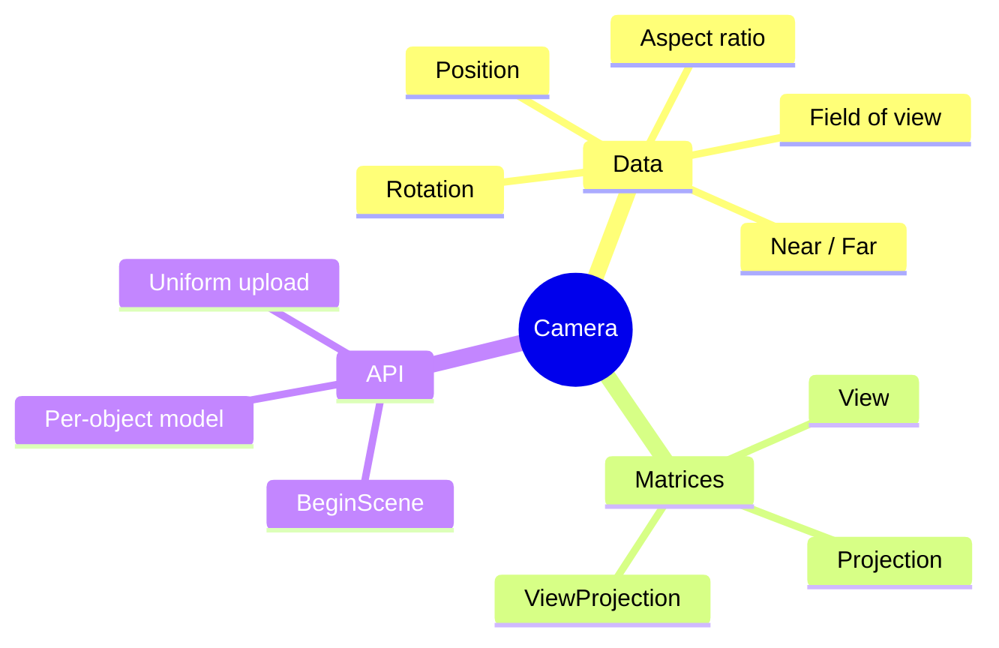


## 1. 摄像机同时属于游戏与渲染

*(参考时间: 00:00:22)*

摄像机不是单纯的渲染对象。它与两类系统都有关：

- **游戏逻辑**：角色移动、载具驾驶、鼠标输入和相机碰撞会改变摄像机；
- **渲染系统**：每帧需要把摄像机变换和投影提交给 GPU。

因此相机架构必须同时考虑：

- 逻辑更新是否高效；
- 相机状态如何传给渲染器；
- 多线程命令队列是否存在数据竞争；
- 不同摄像机类型如何共享公共能力；
- 未来编辑器相机、场景相机和阴影相机如何区分。

这正是讲师先画图、再编码的原因。相机 API 一旦被场景与渲染器广泛使用，后续修改成本很高。

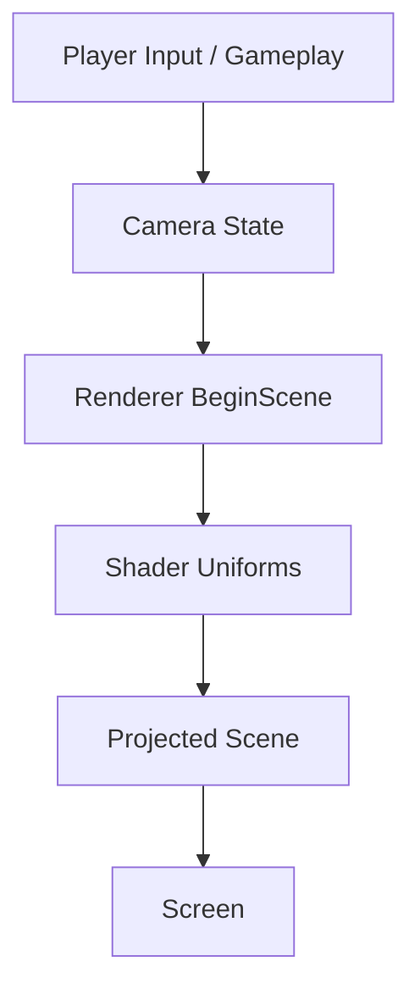


## 2. OpenGL 没有真正的 Camera 对象

*(参考时间: 00:04:24)*

OpenGL API 中不存在 `CreateCamera()`，摄像机是引擎建立的抽象。它的目标是回答两个问题：

1. 我们从哪里、朝哪个方向观察场景？
2. 我们看到的世界范围有多宽、多高、多远？

第一类由相机变换得到 View 矩阵；第二类由镜头参数得到 Projection 矩阵。

摄像机本质上是“把世界转成观察空间”的一组矩阵，而不是某种 GPU 原生实体。


## 3. Field of View 与 Aspect Ratio

*(参考时间: 00:05:47)*

现实相机可以更换不同焦距的镜头。游戏引擎通常用 Field of View 表示视野宽窄：

- 大 FOV：看到更多场景，边缘透视变形更明显；
- 小 FOV：视野更窄，长焦压缩感更强。

常见 3D 游戏 FOV 约在 45° 到 65°。继续增大时，画面边缘容易出现类似鱼眼镜头的畸变。

Aspect Ratio 是视口宽高比：

```text
aspect = viewportWidth / viewportHeight
```

如果没有正确的宽高比，圆形会被拉成椭圆，画面几何也会变形。

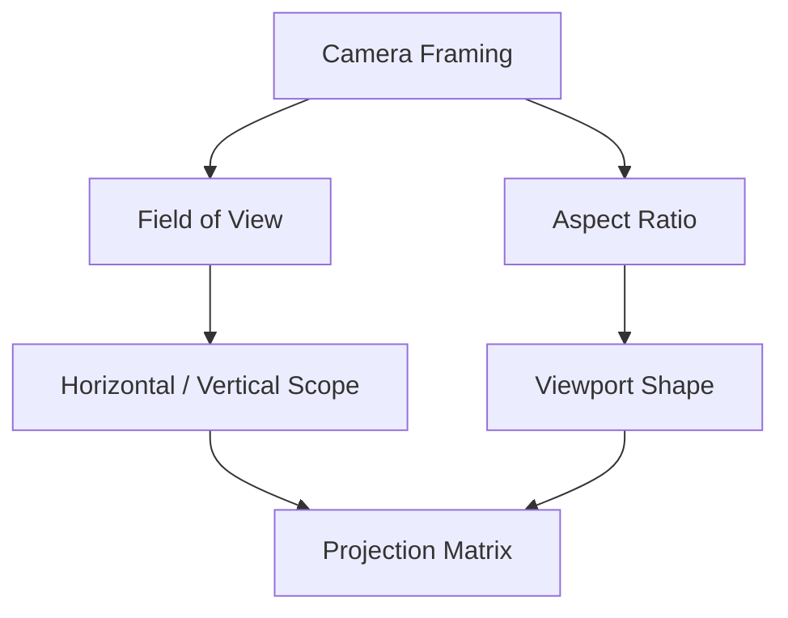

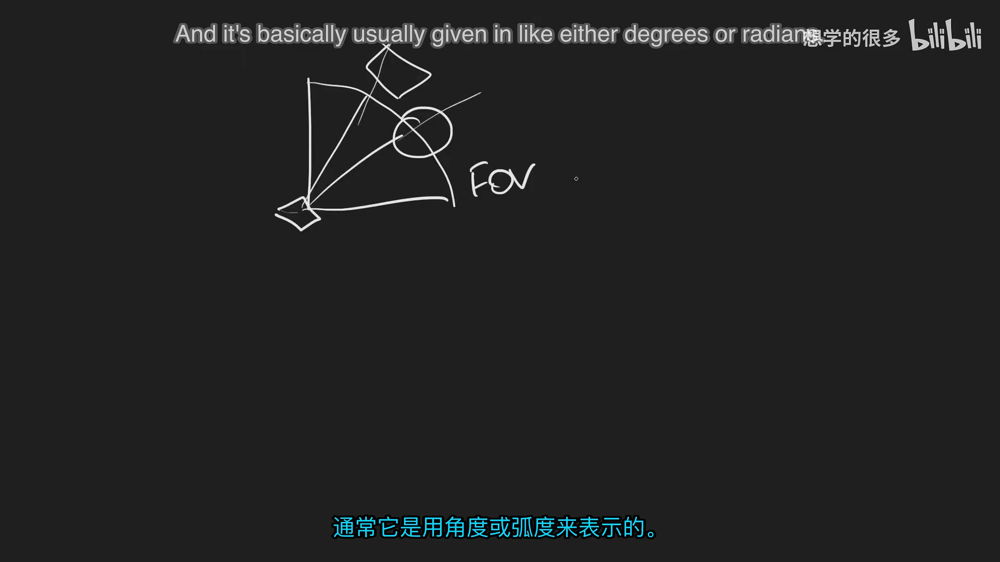

## 4. Near 与 Far Clipping Planes

*(参考时间: 00:34:55)*

投影矩阵还需要 Near 和 Far 裁剪面：

- 比 Near 更近的物体被裁掉；
- 比 Far 更远的物体被裁掉；
- 两者围出透视图中的视锥体。

Near 不能设为 0，否则深度精度和矩阵计算都会出现问题。Far 也不能无限大，否则深度缓冲精度会快速下降。

正交相机同样有 Near/Far，只是视锥体形状从“截头金字塔”变为长方体。

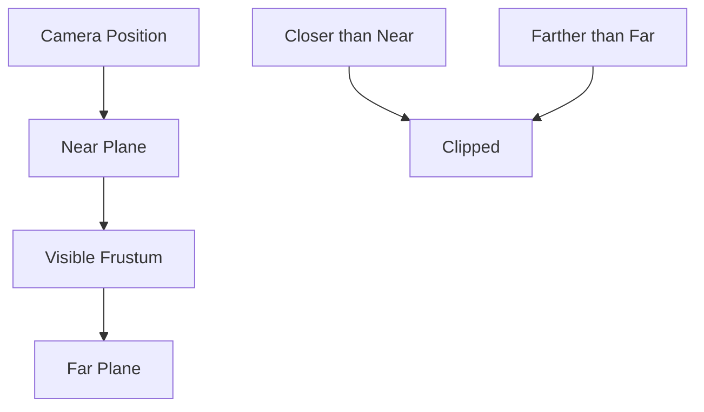

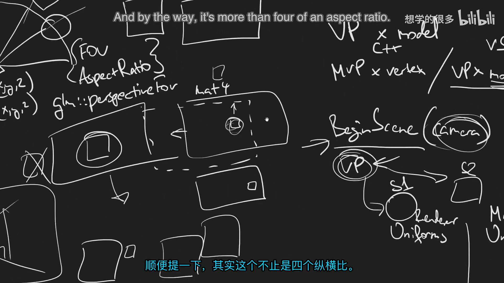

## 5. 相机需要的数据

*(参考时间: 00:09:02)*

拆解摄像机后，可以把它需要的核心数据分成两组。

### 5.1 相机变换

- 世界空间位置；
- 朝向/旋转；
- 通常不含缩放；
- 用于构造 View 矩阵。

### 5.2 镜头属性

- Field of View；
- Aspect Ratio；
- Near Plane；
- Far Plane；
- 用于构造 Projection 矩阵。

讲师把这种分析称为“回到数据”：不理解一个概念时，先问它最终要通过哪些数字进入渲染管线。

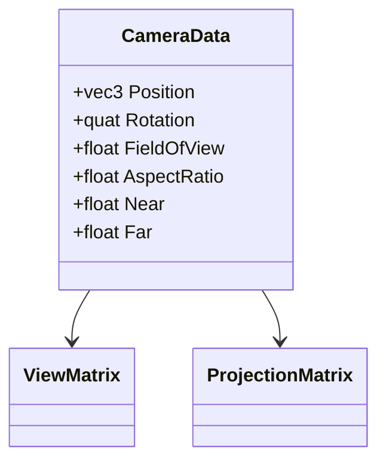


## 6. 移动摄像机等于反向移动场景

*(参考时间: 00:10:06)*

假设一个立方体固定在原点，摄像机向上移动。画面中立方体看起来会向下移动，并逐渐露出顶面。

摄像机向后移动，物体本身没有缩小，但透视投影让更远的物体看起来更小。

摄像机向左移动时，场景物体在屏幕上向右移动。

因此可以总结为：

```text
物体相对相机的运动 = 相机运动的逆
```

摄像机不是真的绕世界飞行；它改变的是所有场景对象进入相机坐标系时的变换。

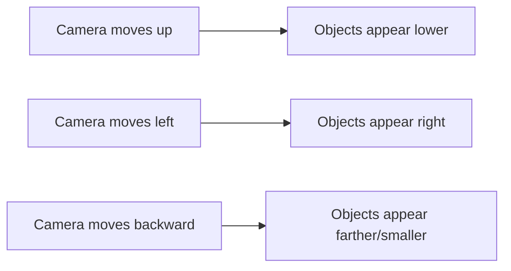

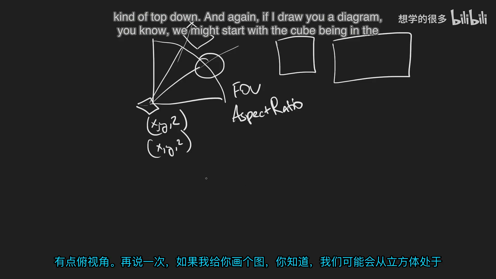

## 7. View Matrix 是相机变换的逆

*(参考时间: 00:15:30)*

相机自身的世界变换由 Translation 与 Rotation 构成：

```text
cameraTransform = Translate(position) * Rotate(rotation)
```

要让世界进入相机空间，需要对这个变换取逆：

```text
viewMatrix = inverse(cameraTransform)
```

如果相机在世界空间向前移动，View 矩阵会让场景向后移动，从而保持“相机向前观察”的视觉效果。

相机通常不含 Scale，但通用变换系统仍可写成 TRS：

```text
modelMatrix = Translate * Rotate * Scale
```

矩阵乘法顺序不可交换，改变顺序会得到不同结果。

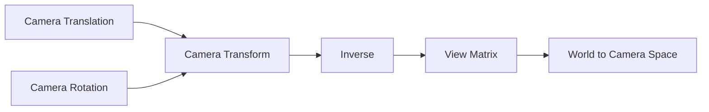


## 8. Perspective Projection

*(参考时间: 00:18:06)*

Perspective 投影模拟人眼和真实镜头：

- 远处物体看起来更小；
- 平行线向消失点汇聚；
- 深度感来自透视缩放。

GLM 可用类似下面的函数生成矩阵：

```cpp
glm::perspective(
    glm::radians(fieldOfView),
    aspectRatio,
    nearPlane,
    farPlane);
```

它返回一个 4×4 投影矩阵。参数变化会直接影响画面范围、透视强度和深度分辨率。

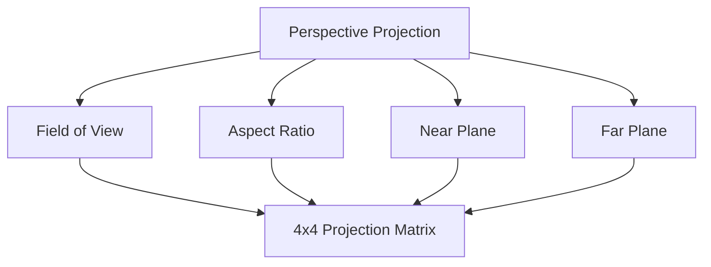

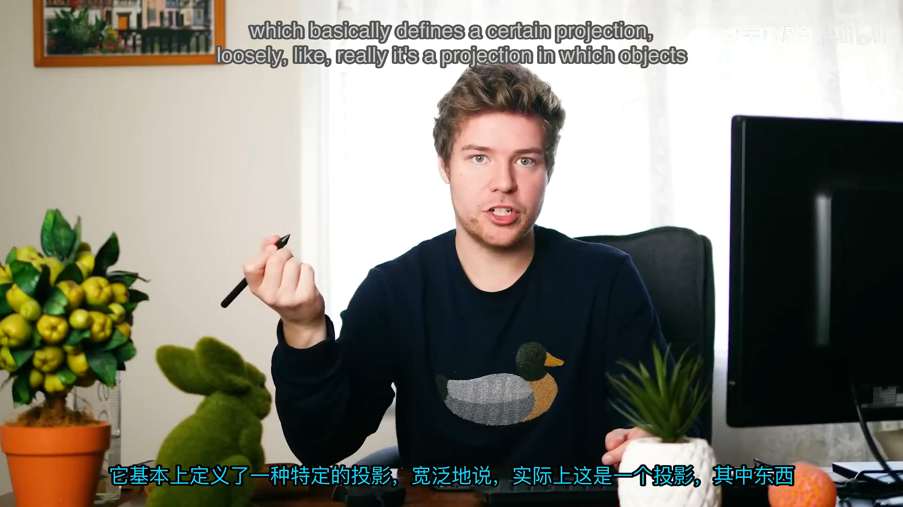

## 9. Orthographic Projection

*(参考时间: 00:19:01)*

Orthographic 投影不会因深度产生物体缩放：

- 近处和远处的同尺寸物体在画面上相同大；
- 常用于 2D 游戏、UI、工程制图和编辑器视图；
- 视锥体是长方体，而不是透视金字塔。

当前 Hazel 仍在绘制 2D 三角形和方块，因此下一讲先实现正交相机，之后进入 3D 时再增加 Perspective Camera。

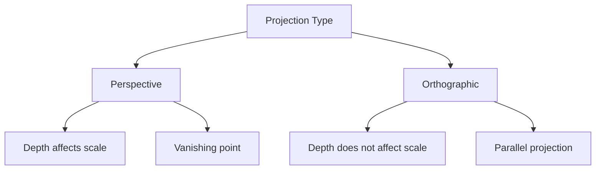

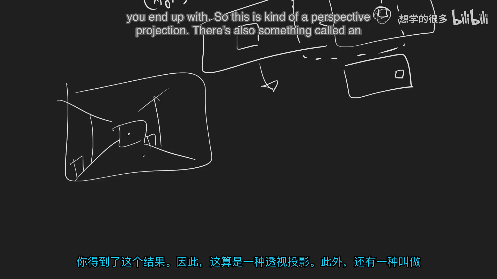

## 10. Projection、View、Model 与顶点

*(参考时间: 00:20:08)*

完整渲染位置来自四层数据：

- Projection：相机镜头和裁剪面；
- View：相机在世界中的位置与朝向；
- Model：对象自身的位置、旋转和缩放；
- Vertex：模型局部空间中的顶点。

OpenGL/GLSL 的列向量形式通常写成：

```text
clipPosition = Projection * View * Model * vec4(position, 1.0)
```

其中：

```text
ViewProjection = Projection * View
```

可以每帧只计算一次，供同一场景中的所有对象共享。


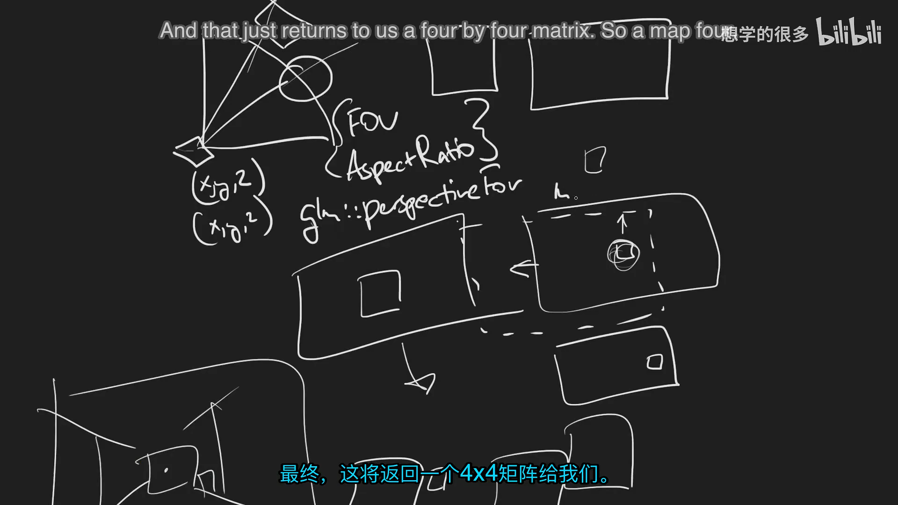

## 11. OpenGL 与 DirectX 的乘法顺序

*(参考时间: 00:21:34)*

GLM 与 GLSL 通常使用列主序，矩阵在左侧相乘：

```text
P * V * M * position
```

DirectX 传统上使用行主序的书写方式，概念上会把向量放在左侧，形成相反的外观顺序：

```text
position * M * V * P
```

两种形式表达的是同一件事，但不能把顺序和转置方式混用。矩阵乘法不满足交换律。

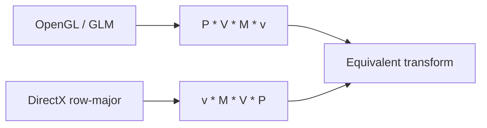

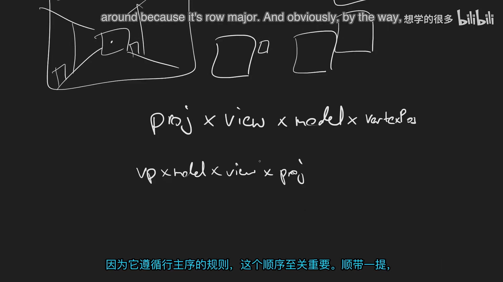

## 12. ViewProjection 每帧计算一次

*(参考时间: 00:23:48)*

同一帧、同一场景中，相机只有一个：

```cpp
glm::mat4 viewProjection =
    camera.GetProjection() * camera.GetView();
```

场景中的所有对象共享这个 VP 矩阵。每个对象只额外需要自己的 Model 矩阵。

相机在整个 Draw 提交期间不应改变。就像摄影师按下快门前，相机位置已经确定；一帧画面代表这一瞬间的视角。

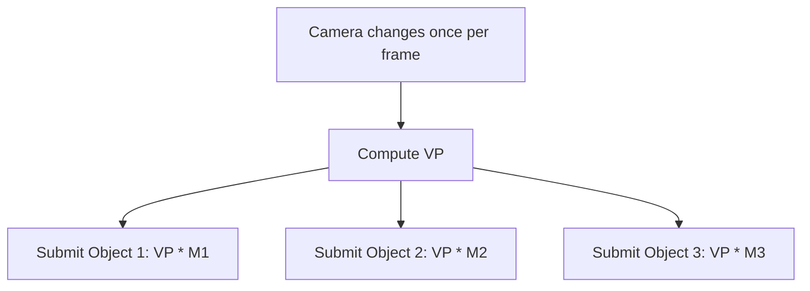

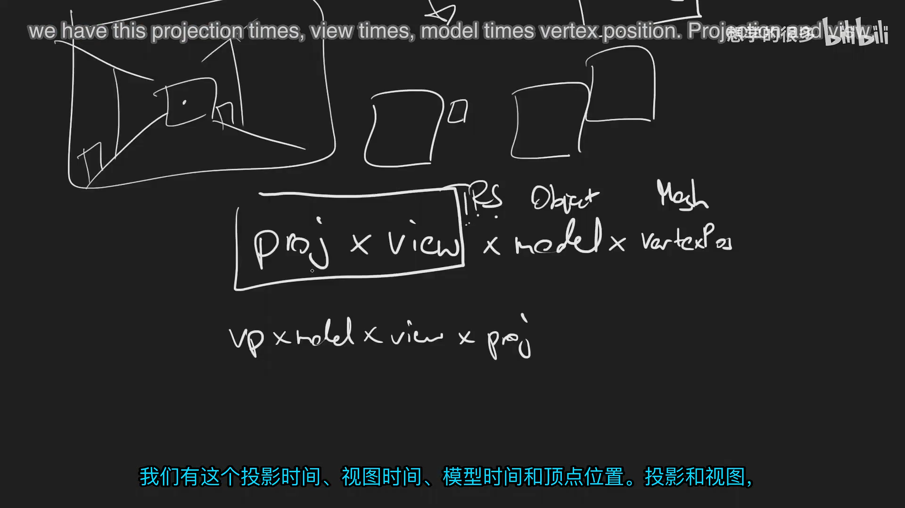

## 13. 矩阵乘法放在 CPU 还是 Shader

*(参考时间: 00:27:00)*

有两种常见方式。

### 13.1 CPU 计算 MVP

每个对象先计算：

```cpp
glm::mat4 mvp = viewProjection * model;
```

再把 MVP 作为 uniform 上传。Vertex Shader 只做：

```glsl
gl_Position = u_MVP * vec4(a_Position, 1.0);
```

矩阵组合按对象执行一次，而不是按顶点执行。

### 13.2 Shader 中计算

上传 VP 与 Model，Vertex Shader 做：

```glsl
gl_Position =
    u_ViewProjection * u_Model * vec4(a_Position, 1.0);
```

Model 矩阵通常还有其他用途，例如把法线旋转到世界空间。保留独立 Model 方便后续材质与光照。

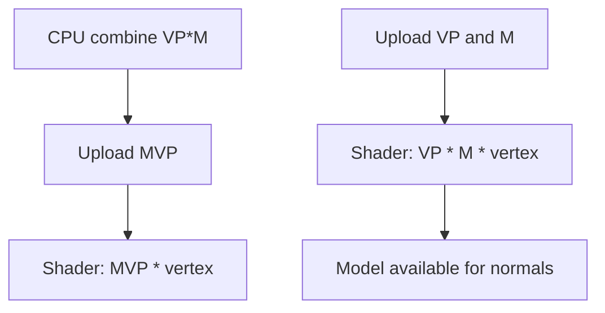

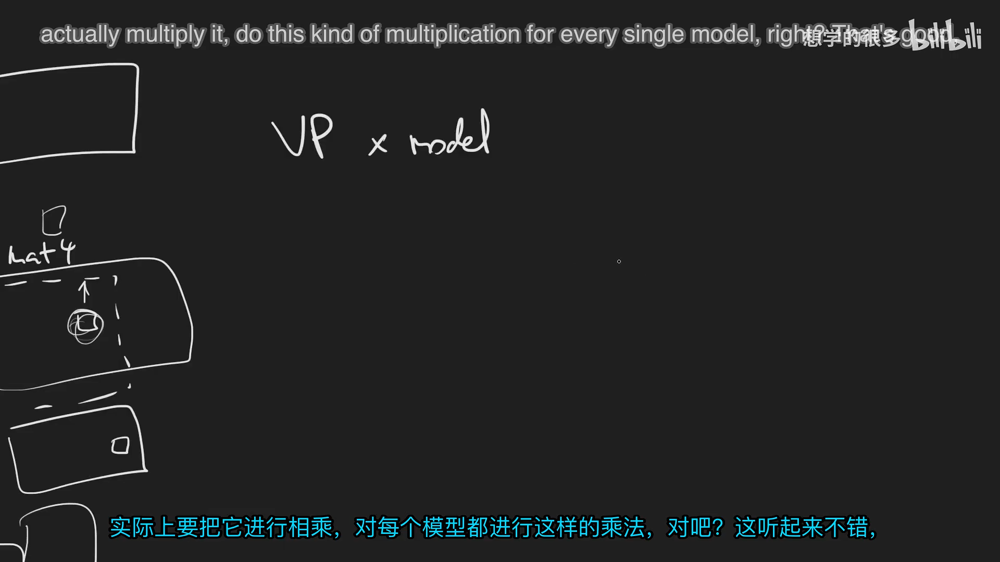

## 14. Renderer Uniform 与 Material Uniform

*(参考时间: 00:30:44)*

Shader uniforms 可以分成两类。

### 14.1 Renderer / Scene Uniforms

- ViewProjection；
- 相机位置；
- 灯光；
- 环境贴图；
- 全局时间等。

这些值在同一场景的多个物体之间通常不变。

### 14.2 Material / Object Uniforms

- Model 矩阵；
- 颜色；
- 金属度、粗糙度；
- 纹理；
- 发光强度等。

这些值由对象或材质决定，可能每个物体都不同。

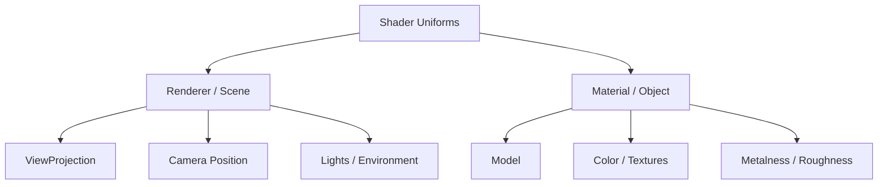

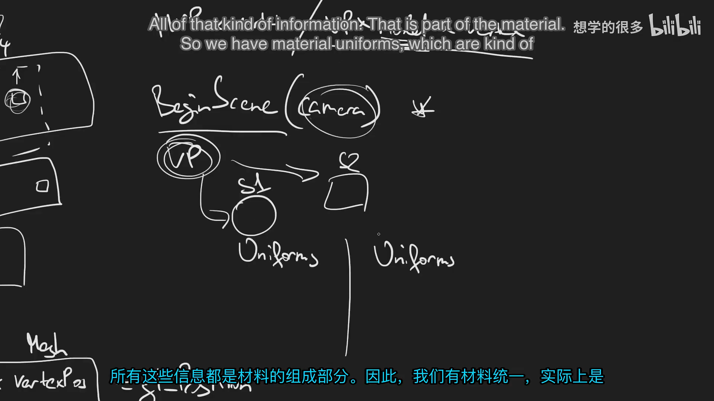

## 15. BeginScene 不能立即假定 Shader

*(参考时间: 00:30:54)*

场景中不同对象可能使用不同 Shader。BeginScene 时还不能把所有相机 uniform 上传到某一个 Shader，因为此时还不知道最终会绑定哪些 Shader。

因此 BeginScene 的职责是保存当前相机/场景数据：

- 保存 ViewProjection；
- 保存相机位置；
- 保存灯光与环境；
- 在之后绑定某个 Shader 时再上传这些场景 uniforms。

如果 Renderer 未来按材质合批，那么在第一次绑定某个 Shader 时上传一次场景 uniforms，再绘制所有共享该 Shader 的对象。

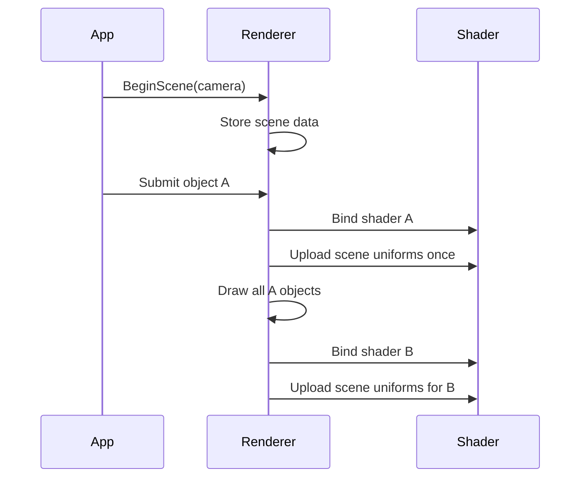

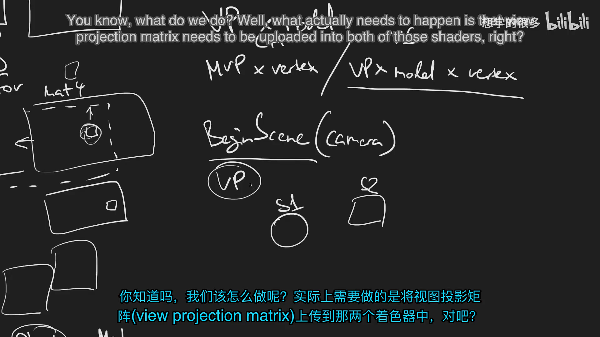

## 16. 保存相机引用还是复制矩阵

*(参考时间: 00:32:36)*

BeginScene 可以把相机引用留在 Renderer 中，也可以立即复制 ViewProjection 等必要数据。

在多线程或延迟渲染命令队列中，复制更安全：

- 主线程可能在 GPU 执行前继续更新相机；
- 如果命令持有相机引用，队列执行时读到的可能是下一帧状态；
- 延迟渲染通常比主线程晚一帧，引用会产生时间错位。

因此对于未来 Render Command Queue，应当复制命令所需的纯数据，而不是保存可变场景对象指针。

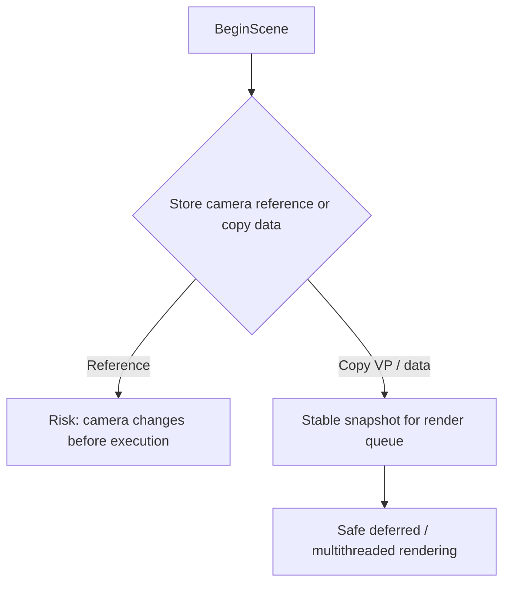

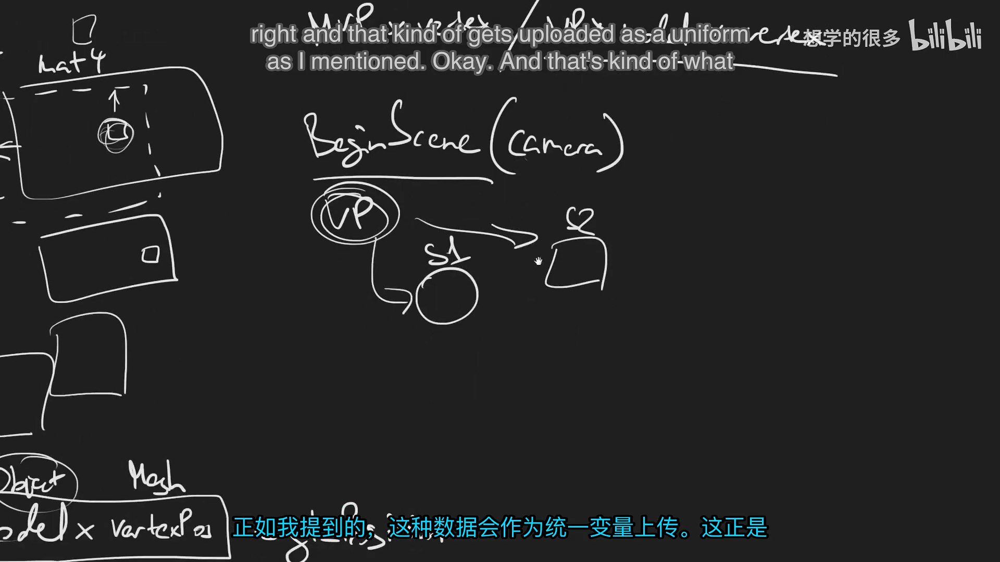

## 17. Submit 未来需要模型变换

*(参考时间: 00:35:51)*

未来 `Renderer::Submit()` 不只是接收 Vertex Array，还需要对象级信息：

```cpp
Renderer::Submit(
    vertexArray,
    modelMatrix,
    material);
```

提交一个 Mesh 时，Renderer 需要：

1. 选择或绑定 Material 对应 Shader；
2. 上传当前 Scene 的 ViewProjection；
3. 上传对象的 Model 矩阵；
4. 上传 Material uniforms；
5. 绑定 Vertex Array；
6. 发出 DrawIndexed。

当前没有 Material 和 Mesh 系统，所以本讲只规划接口，不提前实现。

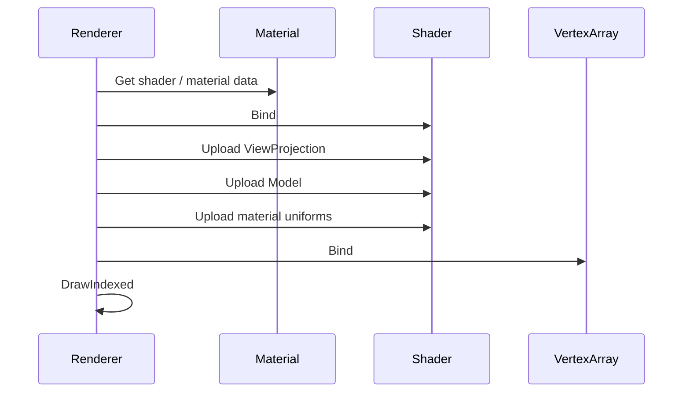

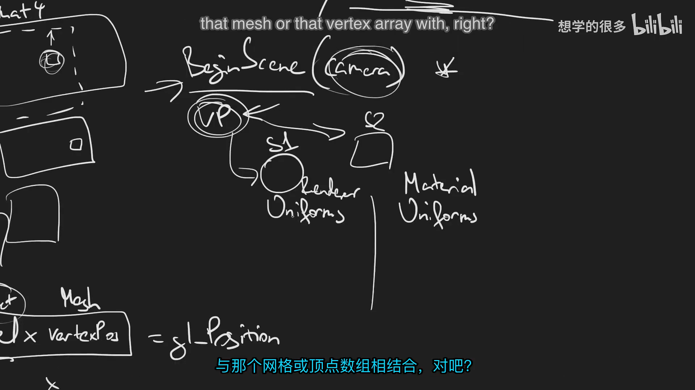

## 18. EndScene 与场景状态保护

*(参考时间: 00:36:11)*

EndScene 当前可以保持为空，因为数据只存在于局部阶段。未来可以：

- 清理当前场景状态；
- 刷新命令队列；
- 标记场景提交结束；
- 断言没有重复 BeginScene；
- 断言 Submit 没有发生在场景外。

一个简单实现是维护“当前是否处于场景中”的状态，提前捕获 BeginScene/EndScene 使用错误。

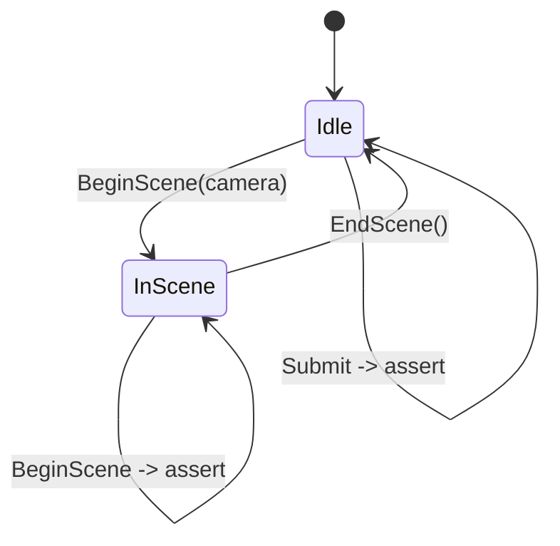

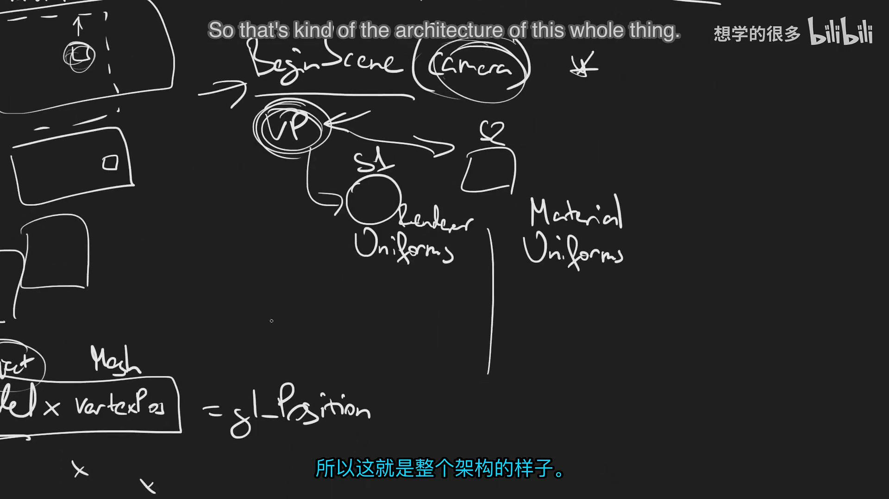

## 19. 下一讲为什么先做正交相机

*(参考时间: 00:37:28)*

当前 Hazel 只渲染 2D 三角形和方块。使用正交投影可以：

- 保持现有物体视觉尺寸；
- 验证相机 ViewProjection 数据流；
- 验证 Shader uniform 上传；
- 先完成 Renderer BeginScene/Submit 架构；
- 为未来 Perspective Camera 保留相同接口。

下一讲将实现 `OrthographicCamera`，并把相机传给 Renderer：

```cpp
Renderer::BeginScene(camera);
Renderer::Submit(vertexArray, model);
Renderer::EndScene();
```

Perspective Camera 会稍后加入 3D 场景。


## 20. 摄像机架构小结

*(参考时间: 00:37:37)*

一个完整场景相机需要：

- 世界位置；
- 朝向；
- View 矩阵；
- Projection 矩阵；
- Field of View；
- Aspect Ratio；
- Near/Far 平面；
- ViewProjection 组合。

Renderer 需要：

- BeginScene 接收并保存当前场景相机数据；
- 绑定 Shader 时上传场景 uniforms；
- Submit 对象时额外上传 Model 与 Material；
- 在多线程命令队列中复制数据快照。

```mermaid
graph TD
    A[Camera] --> B[View Matrix]
    A --> C[Projection Matrix]
    B --> D[ViewProjection]
    C --> D
    D --> E[Renderer Scene Uniforms]
    F[Object Transform] --> G[Model Matrix]
    G --> H[Object Uniforms]
    E --> I[Shader]
    H --> I
    I --> J[Vertex Shader]
    J --> K[Clip Space]
```

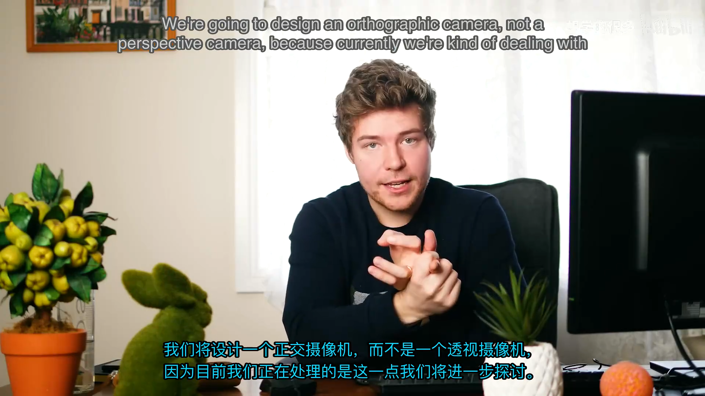

## 21. 本节结论

本讲完成了相机系统的概念和数据设计：

- 摄像机是引擎抽象，不是 OpenGL 原生对象；
- 区分相机变换与镜头投影属性；
- Field of View 决定视野宽窄；
- Aspect Ratio 决定画面形状；
- Near/Far 定义裁剪范围；
- View 矩阵是相机变换的逆；
- Perspective 有远小近大，Orthographic 保持平行尺寸；
- MVP 矩阵把局部顶点变换到屏幕；
- ViewProjection 每帧每场景计算一次；
- Model 矩阵每个对象独立；
- Renderer 负责场景 uniforms，Material 负责对象 uniforms；
- BeginScene 保存相机数据，收到 Shader 后再上传；
- 延迟渲染应复制相机数据快照；
- 下一讲先实现正交相机。

本讲没有新增 Hazel 代码，但确定了下一讲所有类和函数的输入、职责与数据流。相机架构的核心不是“把摄像机放在某个位置”，而是稳定地把世界转换到当前观察者的坐标系。

## 附：参考

- [Bilibili 精译视频：034 - 摄像机及其工作原理](https://www.bilibili.com/video/BV1wtLazEEmC/?p=34)
- [The Cherno 游戏引擎系列播放列表](https://www.youtube.com/playlist?list=PLlrATfBNZ98dC-V-N3m0Go4deliWHPFwT5)
- [本讲代码基线 `dc9e382`](https://github.com/TheCherno/Hazel/tree/dc9e382)
- [下一讲正交相机实现 `c1d915e`](https://github.com/TheCherno/Hazel/tree/c1d915e)
- [LearnOpenGL：Camera](https://learnopengl.com/Getting-started/Camera)
- [GLM Manual：Projection Matrices](https://glm.g-truc.net/0.9.9/api/a00243.html)
