# Hazel 游戏引擎笔记 035：创建正交相机

> 本节来源：[The Cherno 游戏引擎系列第 35 讲“创建正交相机”](https://www.bilibili.com/video/BV1wtLazEEmC/?p=35)，时长约 38 分 27 秒。  
> 原课程与 Hazel 代码作者：The Cherno。代码参考提交：[`c1d915e`](https://github.com/TheCherno/Hazel/tree/c1d915e)。  
> 本文由视频字幕重构、翻译并整理，不是官方教材；术语和代码以原视频及同期 Hazel 仓库为准。

## 本节目标

第 34 讲已经规划了 Camera、View、Projection 与 Renderer 的数据流。本讲把这些设计真正写进 Hazel：

- 创建 `OrthographicCamera`；
- 使用 `glm::ortho()` 构造投影矩阵；
- 用位置和 Z 轴旋转构造相机变换；
- 从相机变换的逆得到 View 矩阵；
- 缓存 ViewProjection 矩阵；
- 在 Shader 中接收 `u_ViewProjection` uniform；
- 为 Shader 增加 `UploadUniformMat4()`；
- 把 Camera 参数加入 `Renderer::BeginScene()`；
- 在 `Renderer::Submit()` 中绑定 Shader 并上传场景 uniform；
- 修正窗口宽高比导致的物体拉伸；
- 测试相机平移与旋转；
- 定位 GLM 位置向量未初始化造成的空白画面。

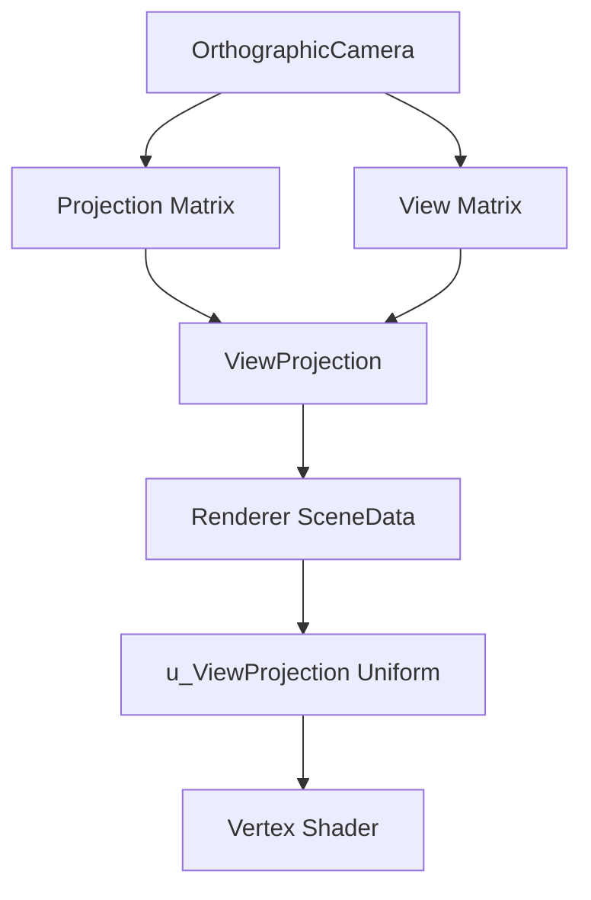


## 1. OrthographicCamera 的类形态

*(参考时间: 00:01:29)*

Hazel 明确区分不同相机类型，因此类名不是泛泛的 `Camera`，而是：

```cpp
class OrthographicCamera
{
public:
    OrthographicCamera(
        float left,
        float right,
        float bottom,
        float top);

    const glm::vec3& GetPosition() const;
    void SetPosition(const glm::vec3& position);

    float GetRotation() const;
    void SetRotation(float rotation);

    const glm::mat4& GetProjectionMatrix() const;
    const glm::mat4& GetViewMatrix() const;
    const glm::mat4& GetViewProjectionMatrix() const;

private:
    void RecalculateViewMatrix();

    glm::mat4 m_ProjectionMatrix;
    glm::mat4 m_ViewMatrix;
    glm::mat4 m_ViewProjectionMatrix;

    glm::vec3 m_Position = { 0.0f, 0.0f, 0.0f };
    float m_Rotation = 0.0f;
};
```

明确的类型名称也为未来的 `PerspectiveCamera` 留下空间。

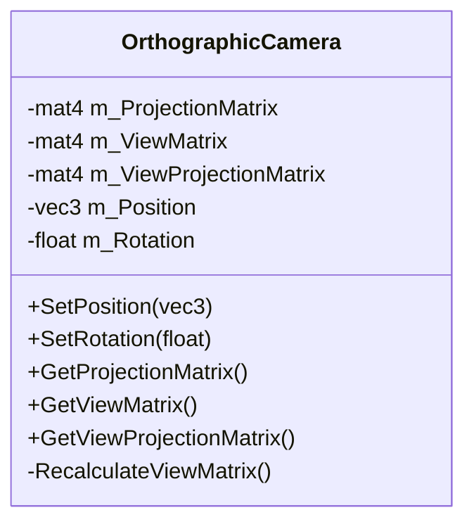

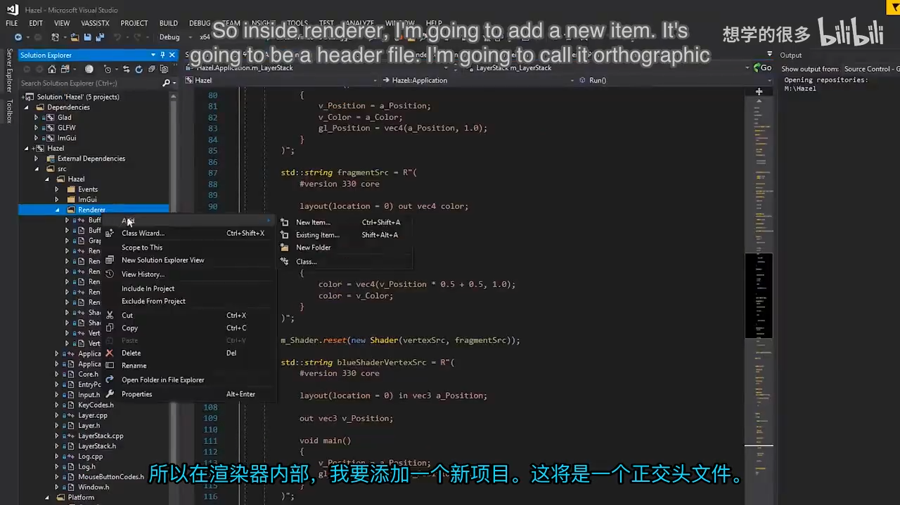

## 2. 构造参数：left、right、bottom、top

*(参考时间: 00:02:20)*

正交投影不是根据 FOV 生成视锥，而是定义视口中的世界空间矩形：

```text
left / right / bottom / top
```

这个矩形内的坐标会映射到屏幕。矩形越宽，同样大小的物体在屏幕上越小。

当前 `glm::ortho()` 还使用固定 Near/Far：

```text
near = -1.0
far  =  1.0
```

对于当前 2D 内容已经足够。未来可以扩展构造参数，把 Near/Far 暴露给上层。

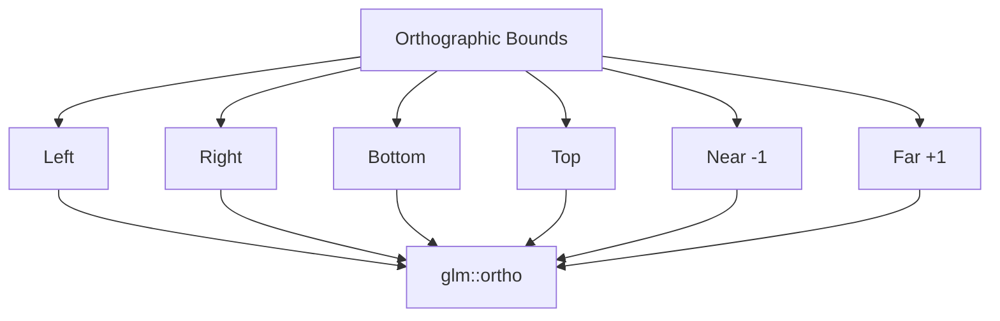

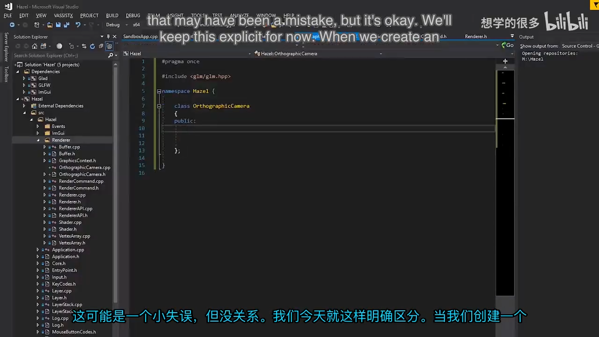

## 3. 为什么要缓存 ViewProjection

*(参考时间: 00:05:03)*

Projection 与 View 需要分别保留，因为未来光照、调试或投影反算可能需要单独矩阵。

但每帧、每个对象都会使用 ViewProjection：

```text
viewProjection = projection * view
```

如果每次调用都重新相乘，会产生重复工作。因此类中多缓存一个 4×4 矩阵，约多占 64 字节，却能让 Renderer 直接取得结果。

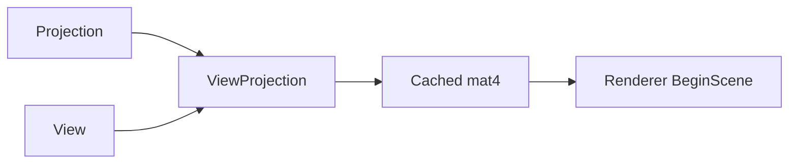

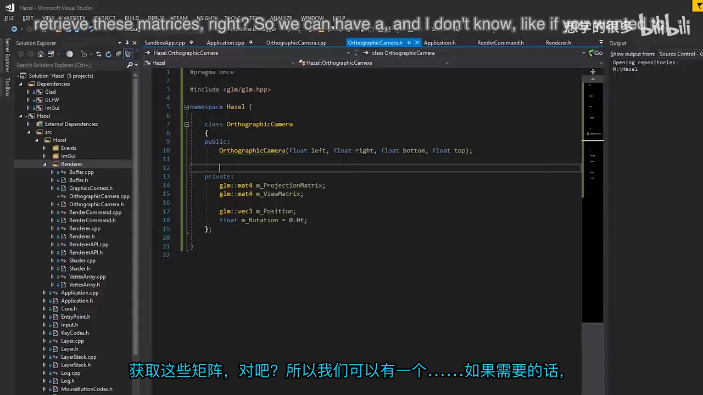

## 4. Position 与 Z 轴旋转

*(参考时间: 00:03:29)*

正交相机保存：

```cpp
glm::vec3 m_Position;
float m_Rotation;
```

这里的旋转是一个 `float`，表示绕 Z 轴的 2D 旋转，而不是欧拉角或四元数。

当前 Hazel 主要绘制 2D 场景，绕 X/Y 旋转会让平面物体离开正交相机可理解的范围。未来做 3D 时，Perspective Camera 会使用完整朝向表示。

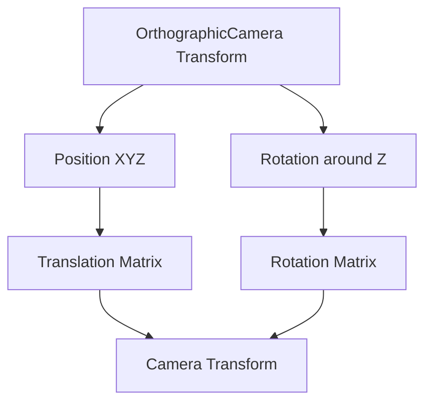

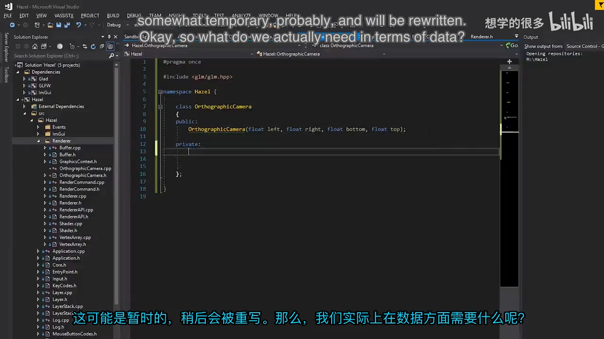

## 5. SetPosition / SetRotation 自动重算

*(参考时间: 00:07:18)*

改变位置或旋转后，View 与 ViewProjection 不能继续保持旧值：

```cpp
void SetPosition(const glm::vec3& position)
{
    m_Position = position;
    RecalculateViewMatrix();
}

void SetRotation(float rotation)
{
    m_Rotation = rotation;
    RecalculateViewMatrix();
}
```

这里选择“变更即重算”。另一种做法是使用显式 `OnUpdate()` 或在帧末统一更新矩阵，但当前相机变化频率较低，直接重算更简单，也能避免忘记刷新状态。

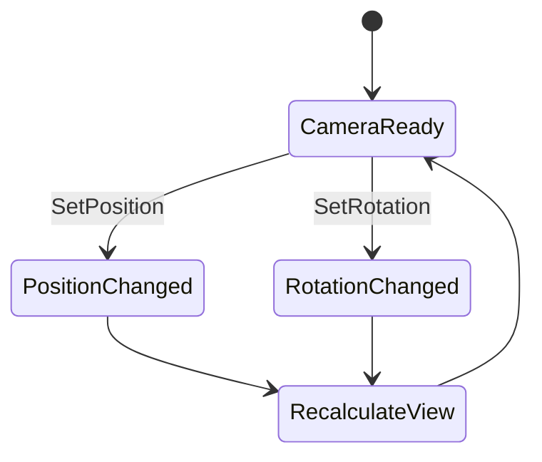

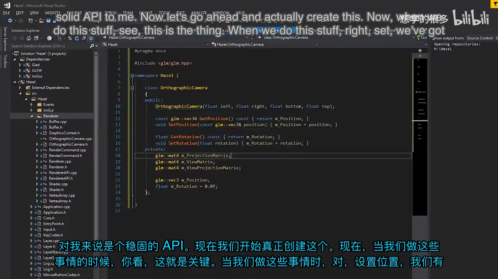

## 6. 构造 Projection 与初始 View

*(参考时间: 00:09:23)*

构造函数实现：

```cpp
OrthographicCamera::OrthographicCamera(
    float left,
    float right,
    float bottom,
    float top)
    : m_ProjectionMatrix(
        glm::ortho(left, right, bottom, top, -1.0f, 1.0f)),
      m_ViewMatrix(1.0f)
{
    m_ViewProjectionMatrix =
        m_ProjectionMatrix * m_ViewMatrix;
}
```

两个关键点：

- `m_ViewMatrix(1.0f)` 明确构造单位矩阵；
- 构造函数中也计算一次 VP，保证对象从创建起就处于可用状态。

不能依赖 ViewProjection 的默认值。未初始化的矩阵可能包含任意数字，第一次绘制就会出现不可预测画面。

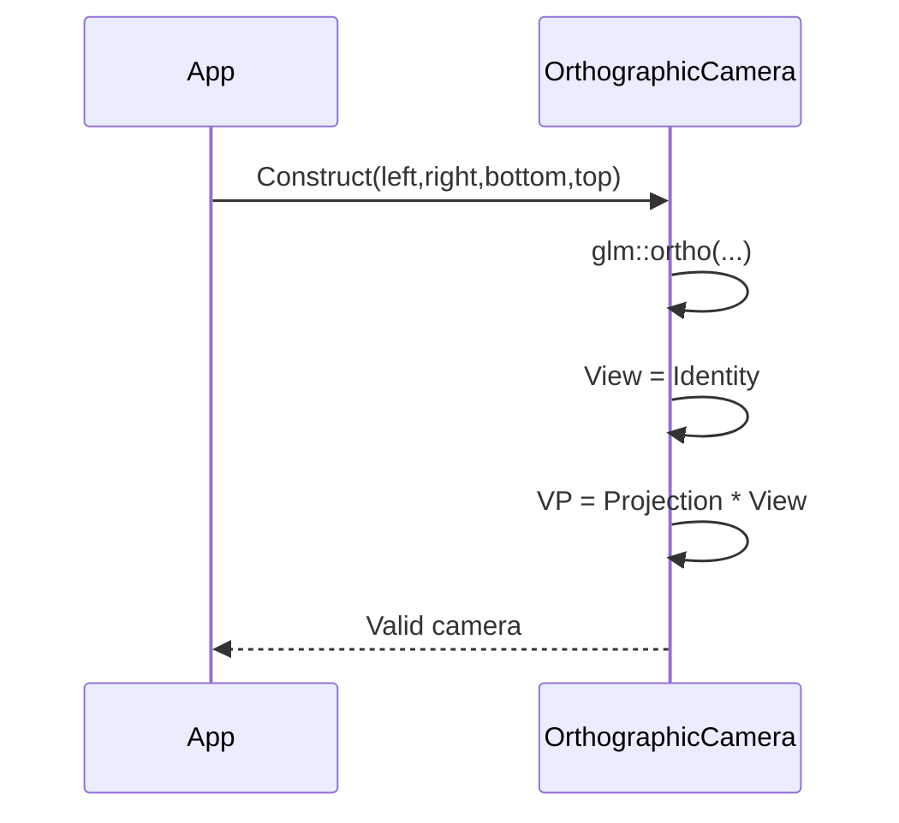

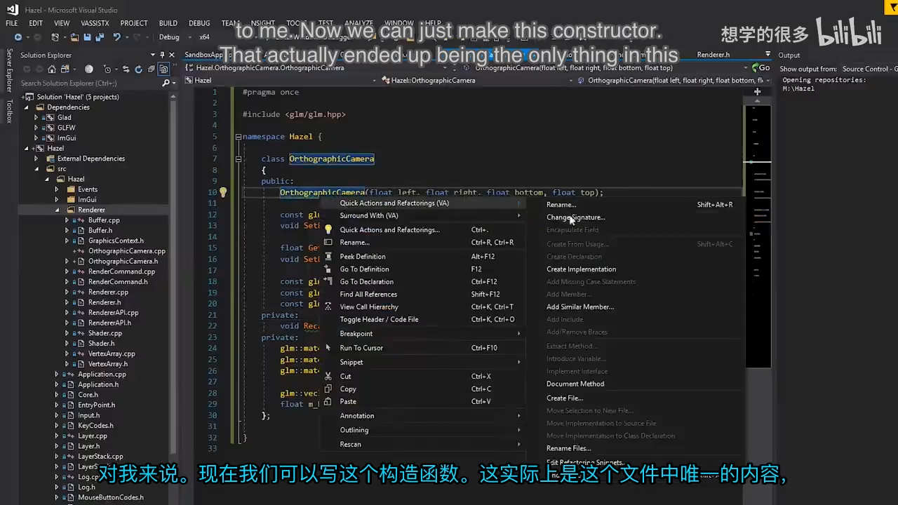

## 7. RecalculateViewMatrix 的推导

*(参考时间: 00:11:07)*

相机自身变换由平移和旋转组成：

```cpp
glm::mat4 transform =
    glm::translate(glm::mat4(1.0f), m_Position) *
    glm::rotate(
        glm::mat4(1.0f),
        glm::radians(m_Rotation),
        glm::vec3(0, 0, 1));
```

然后取逆：

```cpp
m_ViewMatrix = glm::inverse(transform);
m_ViewProjectionMatrix =
    m_ProjectionMatrix * m_ViewMatrix;
```

顺序必须先平移后旋转：

```text
T * R
```

如果改成 `R * T`，相机会围绕世界原点旋转后再平移，运动轨迹会完全不同。

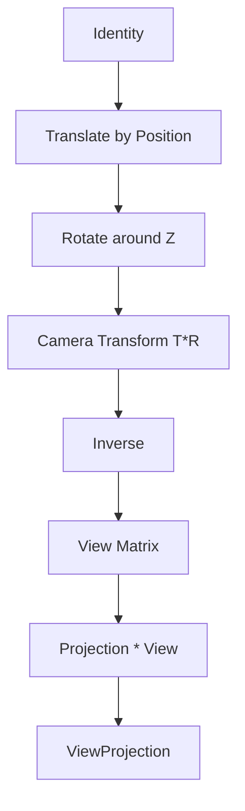

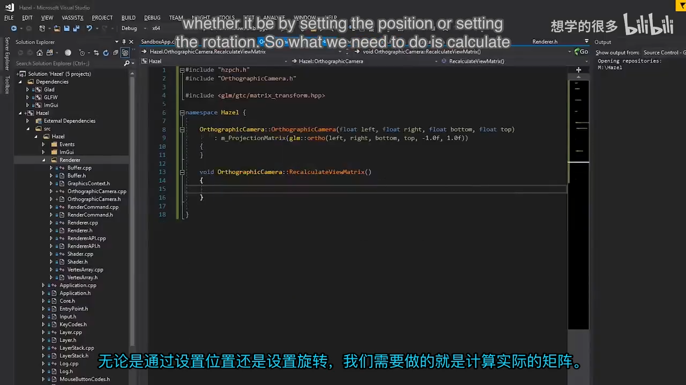

## 8. GLM 列主序下的 VP 乘法

*(参考时间: 00:13:34)*

代码写作：

```cpp
m_ViewProjectionMatrix =
    m_ProjectionMatrix * m_ViewMatrix;
```

虽然变量名是 ViewProjection，乘法顺序却必须让 Projection 在左、View 在右。

GLM 为 OpenGL 提供列主序矩阵，正确形式是：

```text
P * V * M * vertex
```

如果写成 `View * Projection`，平移和投影的顺序会颠倒，画面通常完全错误。

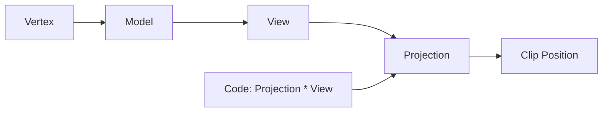

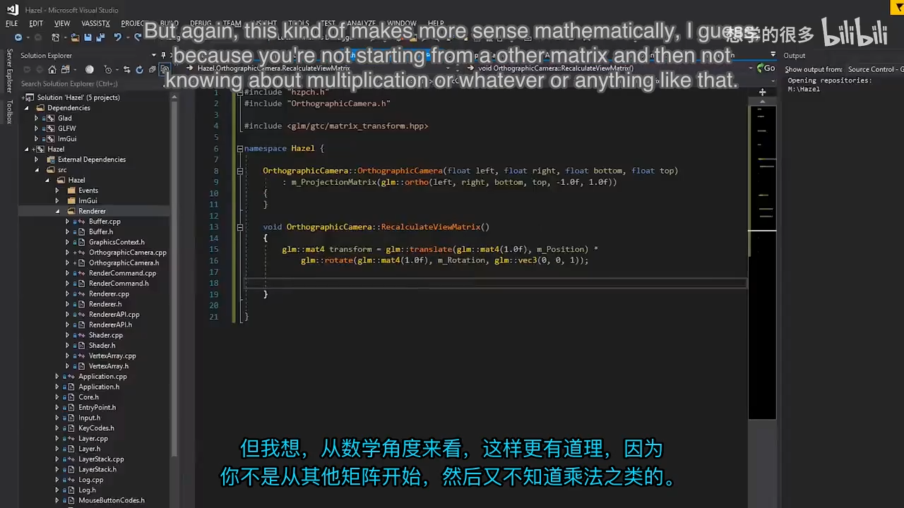

## 9. Application 持有正交相机

*(参考时间: 00:14:40)*

Application 增加成员：

```cpp
OrthographicCamera m_Camera;
```

构造函数初始化：

```cpp
Application::Application()
    : m_Camera(-1.6f, 1.6f, -0.9f, 0.9f)
{
}
```

这组边界形成 16:9 的宽高比：

```text
(1.6 - -1.6) / (0.9 - -0.9) = 3.2 / 1.8 = 16:9
```

相机作为值成员存在于 Application 中，不需要 `shared_ptr`。它跟随 Application 生命周期，Renderer 只在 BeginScene 时读取它。

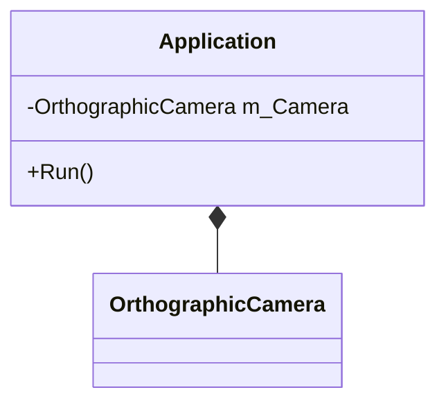

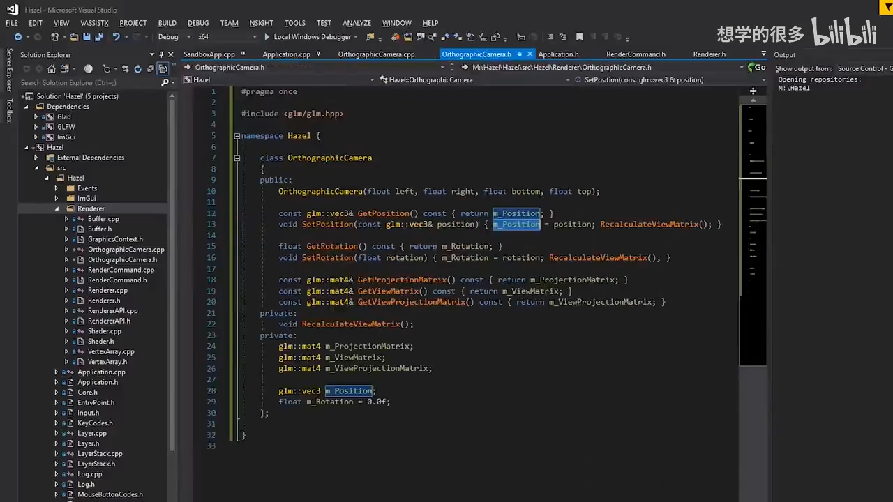

## 10. Shader 中的 ViewProjection uniform

*(参考时间: 00:16:28)*

两个 Vertex Shader 都增加：

```glsl
uniform mat4 u_ViewProjection;
```

顶点位置改为：

```glsl
void main()
{
    v_Position = a_Position;
    v_Color = a_Color;
    gl_Position =
        u_ViewProjection * vec4(a_Position, 1.0);
}
```

`u_` 前缀只是命名约定，用来让 CPU 侧代码一眼识别 uniform。

当前尚未加入 Model 矩阵，所以这里直接用 VP 变换对象顶点。

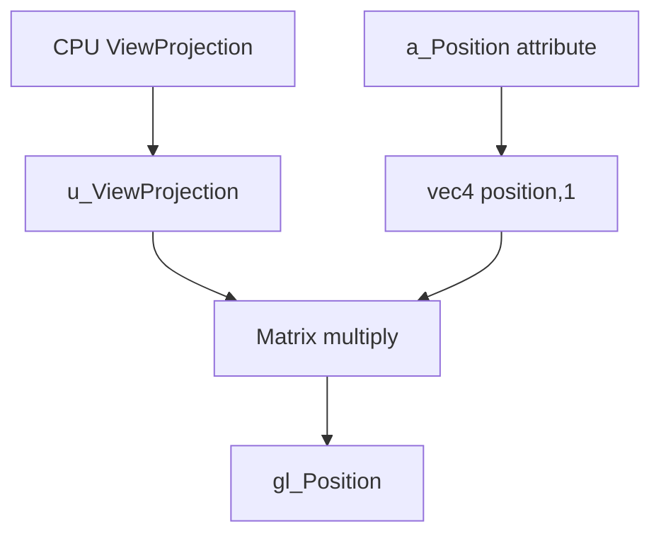

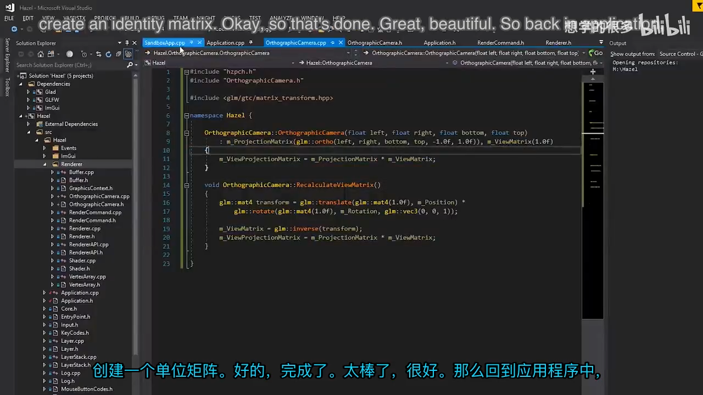

## 11. Shader 添加 UploadUniformMat4

*(参考时间: 00:18:36)*

`Shader` 接口增加：

```cpp
void UploadUniformMat4(
    const std::string& name,
    const glm::mat4& matrix);
```

调用前必须已经绑定 Shader：

```cpp
shader->Bind();
shader->UploadUniformMat4(
    "u_ViewProjection",
    viewProjection);
```

上传函数本身不再调用 `glUseProgram()`。一次绘制可能需要上传多个 uniforms，由调用方绑定一次 Shader 后集中上传更高效。

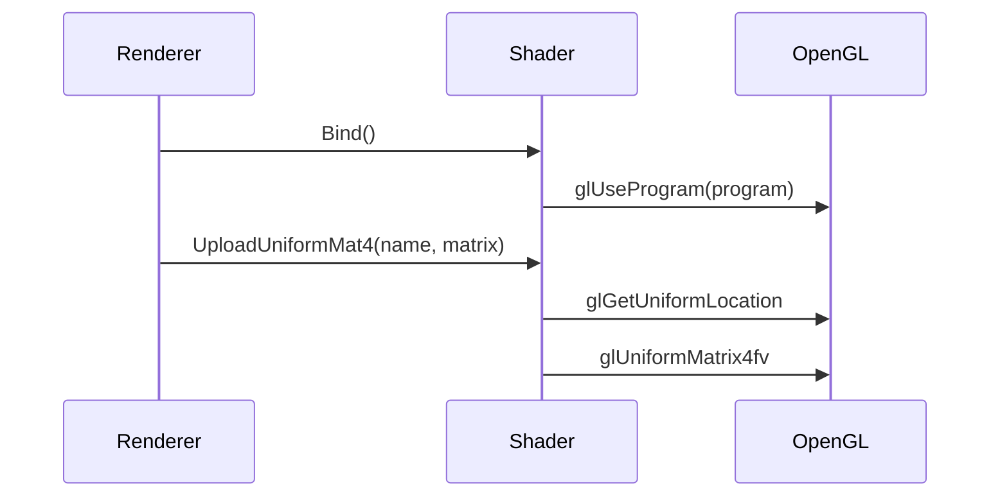

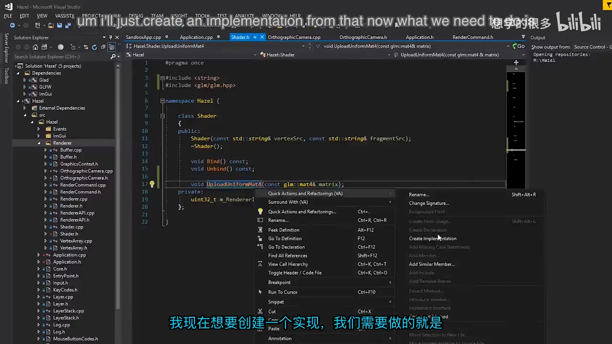

## 12. glUniformMatrix4fv 参数

*(参考时间: 00:20:05)*

OpenGL 实现：

```cpp
void Shader::UploadUniformMat4(
    const std::string& name,
    const glm::mat4& matrix)
{
    GLint location =
        glGetUniformLocation(m_RendererID, name.c_str());

    glUniformMatrix4fv(
        location,
        1,
        GL_FALSE,
        glm::value_ptr(matrix));
}
```

参数含义：

- `location`：uniform 在 Shader Program 中的位置；
- `1`：上传一个矩阵；
- `GL_FALSE`：GLM 已经是列主序，不需要转置；
- `glm::value_ptr()`：指向矩阵首元素的连续 float 内存。

如果 location 返回 `-1`，说明名称不存在或未被 Shader 使用。当前实现直接上传；后续可以加入错误检查。

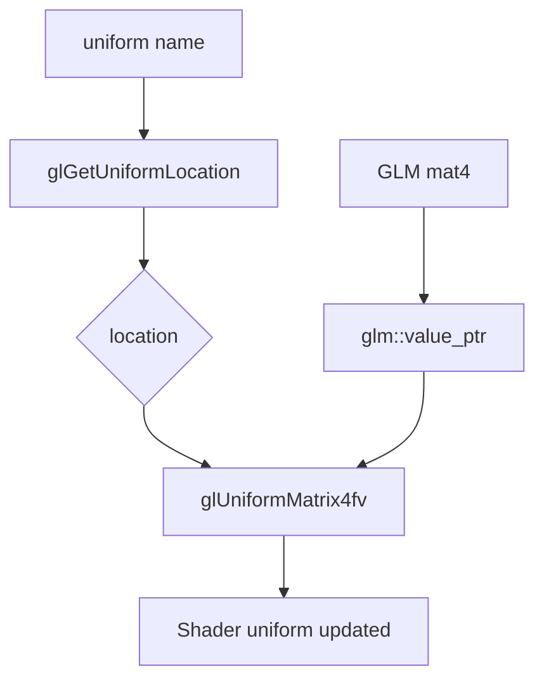

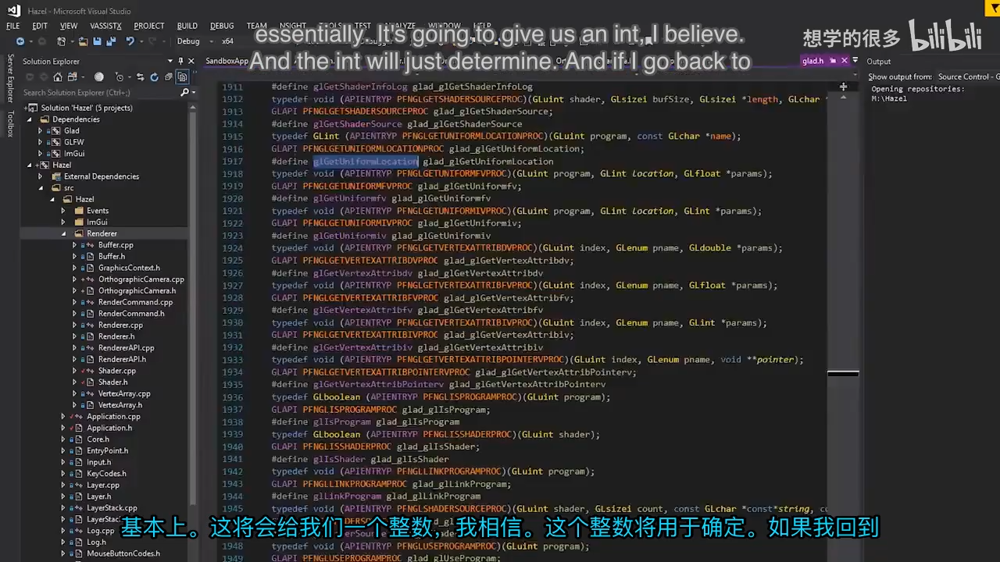

## 13. 第一次运行：画面保持不变

*(参考时间: 00:22:31)*

第一次接入 camera VP 后，画面仍与上一讲一致。

这说明：

- 正交矩阵覆盖范围与原 NDC 坐标一致；
- Shader uniform 已成功上传；
- VP 矩阵的基础乘法和绑定顺序正确；
- 之前只缺少相机数据的传递。

编译时曾出现 Camera 类型未知错误，因为相机头文件被包含在了错误的文件位置。补到 Application 头文件后构建成功。

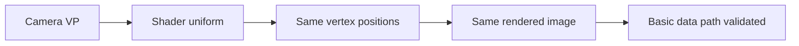

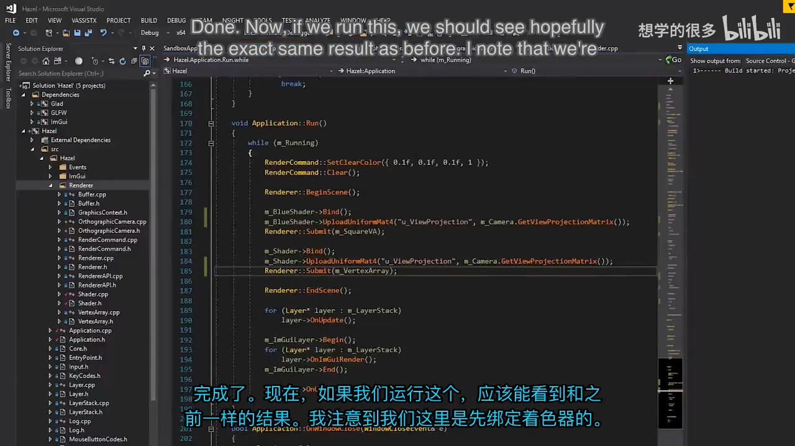

## 14. 修改正交边界就是改变“视野”

*(参考时间: 00:23:03)*

把投影边界从：

```text
-1 .. +1
```

扩大为：

```text
-2 .. +2
```

相机能看到更大的世界区域，相同物体在屏幕上就会变小。

这相当于正交相机没有透视的“缩放”。改变边界与移动相机是不同操作：

- 扩大 left/right/top/bottom：缩放视野；
- 修改 camera position：平移观察位置。

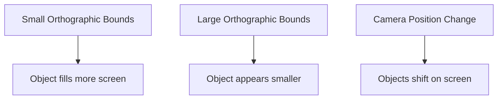

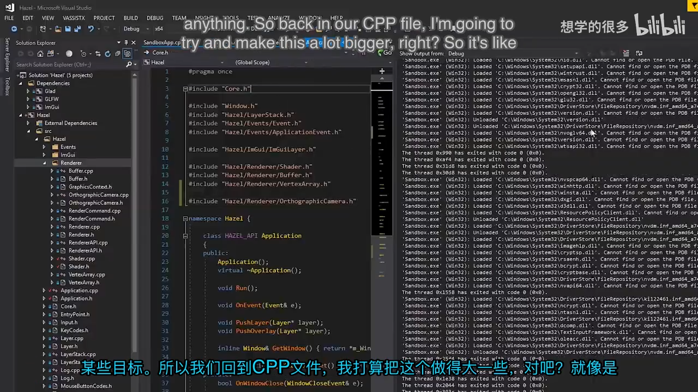

## 15. Aspect Ratio 修复与方形变形

*(参考时间: 00:25:08)*

方块顶点在 X/Y 上都是 `-0.75 .. 0.75`，但一开始显示为长方形。

原因是投影边界使用相同的 X/Y 范围，而窗口是 1280×720。Camera 认为可见区域是正方形，Framebuffer 却把它拉伸到 16:9。

修复边界：

```cpp
OrthographicCamera camera(
    -1.6f, 1.6f,
    -0.9f, 0.9f);
```

此时：

```text
3.2 / 1.8 = 16 / 9
```

方块恢复正方形，三角形也随之得到正确比例。

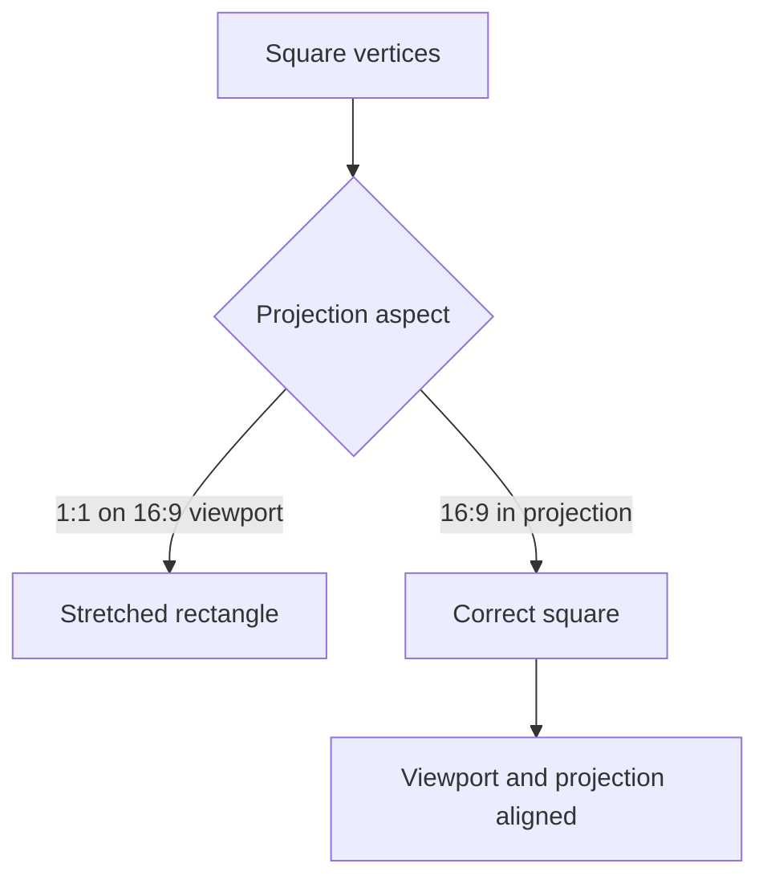

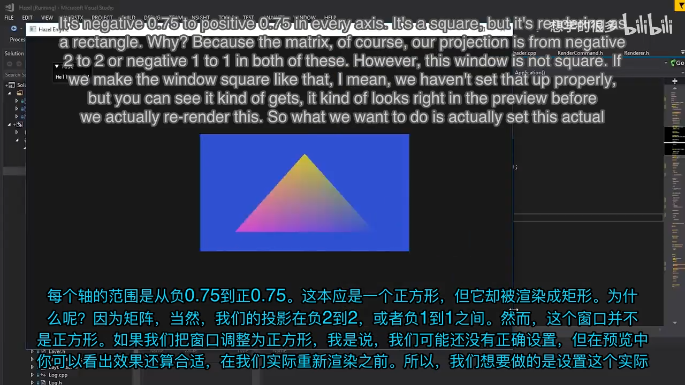

## 16. BeginScene 改为接收 Camera

*(参考时间: 00:27:27)*

Renderer 接口：

```cpp
static void BeginScene(OrthographicCamera& camera);
```

实现：

```cpp
void Renderer::BeginScene(OrthographicCamera& camera)
{
    m_SceneData->ViewProjectionMatrix =
        camera.GetViewProjectionMatrix();
}
```

这里没有复制整个 Camera。Camera 包含多个矩阵和成员，复制成本高；Renderer 真正需要的是 ViewProjection 快照。

传引用避免复制整个对象，但只把矩阵复制进场景状态。

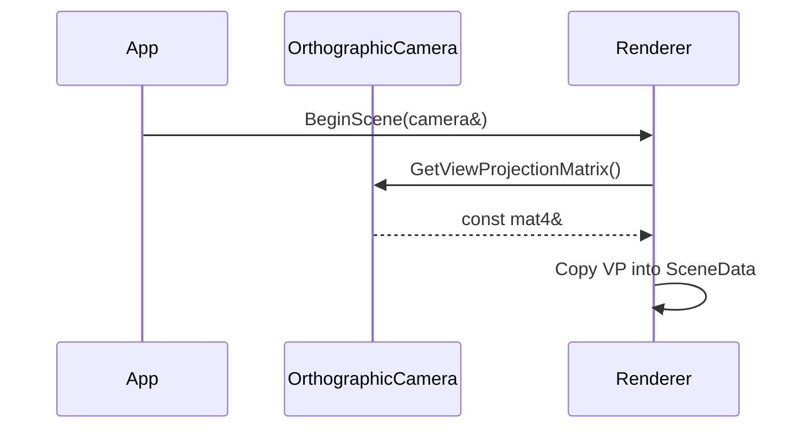

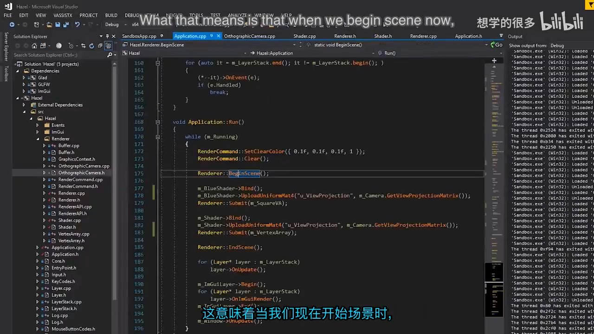

## 17. SceneData 保存当前场景 uniform

*(参考时间: 00:29:16)*

Renderer 内部增加：

```cpp
struct SceneData
{
    glm::mat4 ViewProjectionMatrix;
};

static SceneData* m_SceneData;
```

当前在 `Renderer.cpp` 中分配：

```cpp
Renderer::SceneData* Renderer::m_SceneData =
    new Renderer::SceneData;
```

这是临时实现：

- Renderer 是静态类；
- 需要一个地方保存当前场景状态；
- SceneData 随引擎整个生命周期存在；
- 未来会重构为更正式的 Renderer Context / Scene Renderer。

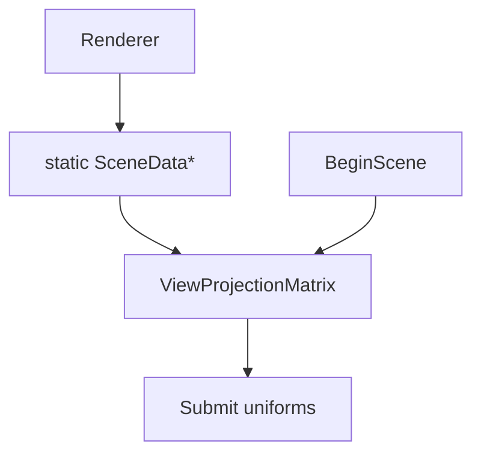

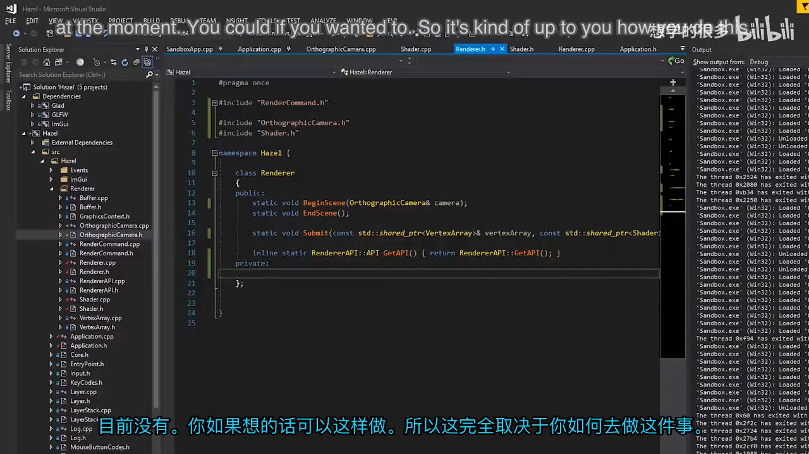

## 18. Submit 接收 Shader 并上传场景 uniform

*(参考时间: 00:31:17)*

Renderer 提交接口改为：

```cpp
static void Submit(
    const std::shared_ptr<Shader>& shader,
    const std::shared_ptr<VertexArray>& vertexArray);
```

实现：

```cpp
void Renderer::Submit(
    const std::shared_ptr<Shader>& shader,
    const std::shared_ptr<VertexArray>& vertexArray)
{
    shader->Bind();
    shader->UploadUniformMat4(
        "u_ViewProjection",
        m_SceneData->ViewProjectionMatrix);

    vertexArray->Bind();
    RenderCommand::DrawIndexed(vertexArray);
}
```

Shader 放在参数前面，因为 Shader 决定“怎样渲染”，几何决定“渲染什么”。未来 Mesh/Material 会进一步封装这两类信息。

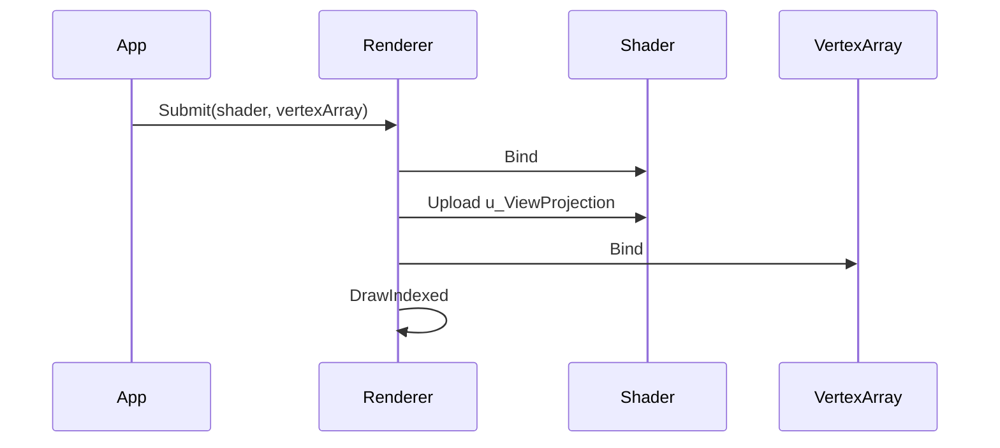

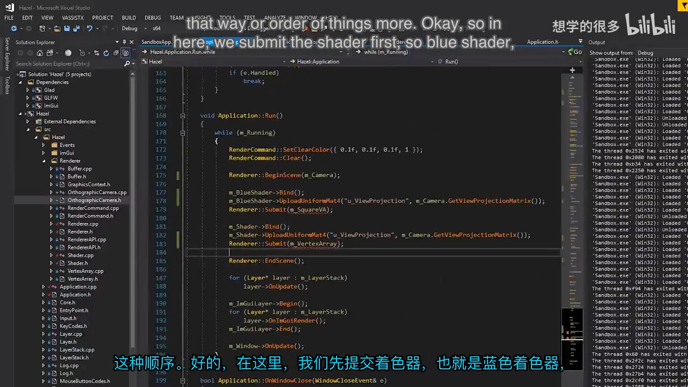

## 19. Application 的最终渲染流程

*(参考时间: 00:31:42)*

Run 循环现在非常简洁：

```cpp
RenderCommand::SetClearColor({ 0.1f, 0.1f, 0.1f, 1 });
RenderCommand::Clear();

Renderer::BeginScene(m_Camera);

Renderer::Submit(m_BlueShader, m_SquareVA);
Renderer::Submit(m_Shader, m_VertexArray);

Renderer::EndScene();
```

旧代码中的手动 Shader 绑定与 uniform 上传全部移除。对象绘制统一通过 Renderer 流程。

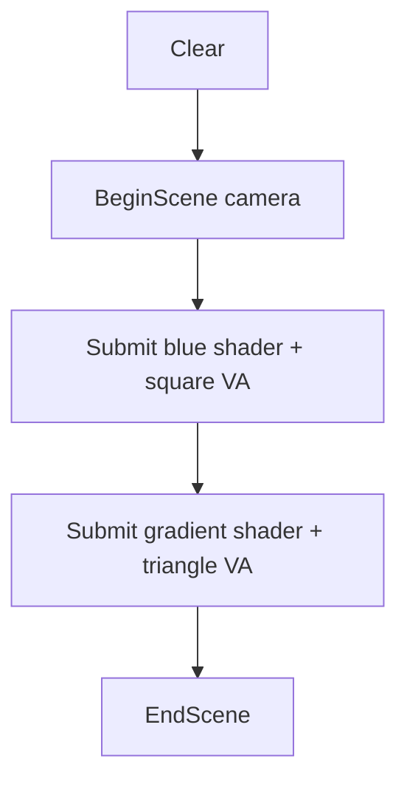

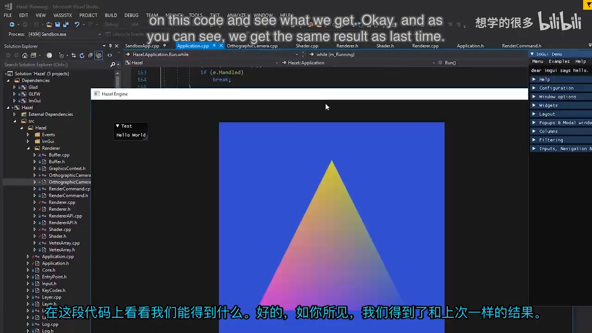

## 20. 平移测试验证 View 逆矩阵

*(参考时间: 00:32:31)*

把相机位置设为：

```cpp
m_Camera.SetPosition({ 0.5f, 0.5f, 0.0f });
```

相机向右上移动，场景在屏幕上向左下移动。

方向反转说明：

- Position 已写入相机变换；
- View 矩阵确实取了逆；
- ViewProjection 已重新计算；
- Shader 读取了新值。

```mermaid
graph LR
    A[Camera +0.5 X/Y] --> B[View inverse]
    B --> C[Scene -0.5 X/Y]
    C --> D[Objects move down-left]
```

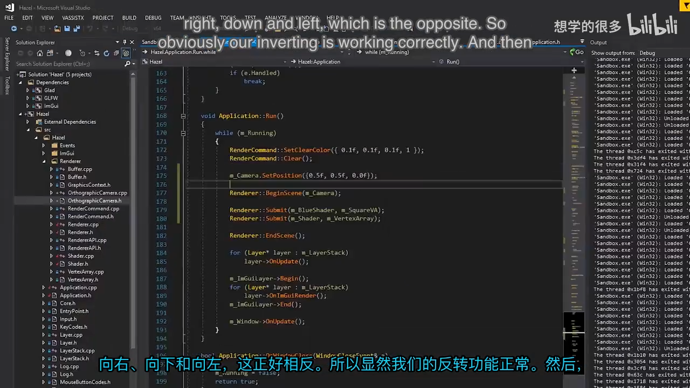

## 21. 旋转测试失败：GLM 向量未初始化

*(参考时间: 00:33:19)*

设置：

```cpp
m_Camera.SetRotation(45.0f);
```

画面却完全空白。第一反应是旋转单位错误，于是加入 `glm::radians()`，但问题仍然存在。

进一步在调试器检查 `RecalculateViewMatrix()`：

- rotation 是 0.5；
- position 不是 `(0, 0, 0)`；
- GLM 向量在当前构造方式下没有被置零；
- 未初始化的 position 产生无效相机变换，场景被移出可视范围。

修复：

```cpp
glm::vec3 m_Position = { 0.0f, 0.0f, 0.0f };
```

重新运行后，旋转 45° 正常工作。

```mermaid
flowchart TD
    A[Rotation makes screen blank] --> B{Radians correct?}
    B -- Yes, still blank --> C{Inspect matrix inputs}
    C --> D[Position contains garbage]
    D --> E[Initialize vec3 to zero]
    E --> F[Rotation works]
```

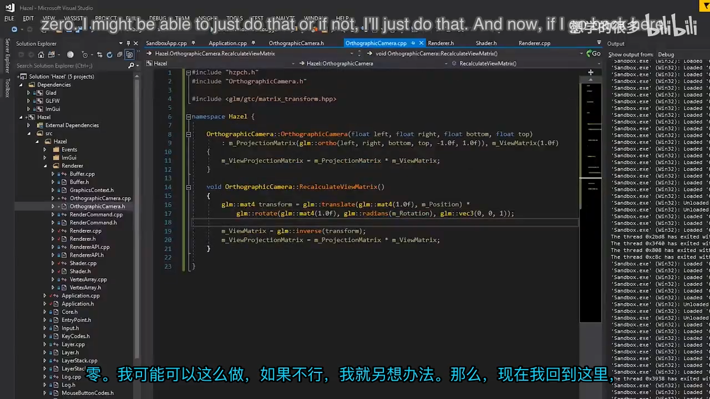

## 22. 旋转与平移组合

*(参考时间: 00:35:43)*

修复后同时设置：

```cpp
m_Camera.SetPosition({ 0.5f, 0.5f, 0.0f });
m_Camera.SetRotation(45.0f);
```

两个对象同时旋转并偏移，方向与预期一致。

这验证了：

- `T * R` 的转换顺序；
- `glm::radians()` 的旋转单位；
- View 逆矩阵；
- 位置和旋转变化后的 VP 重算；
- Shader 每帧接收新 VP。

```mermaid
flowchart LR
    A[Camera Position] --> C[T * R]
    B[Camera Rotation] --> C
    C --> D[Inverse = View]
    D --> E[Projection * View]
    E --> F[Objects rotate and shift]
```

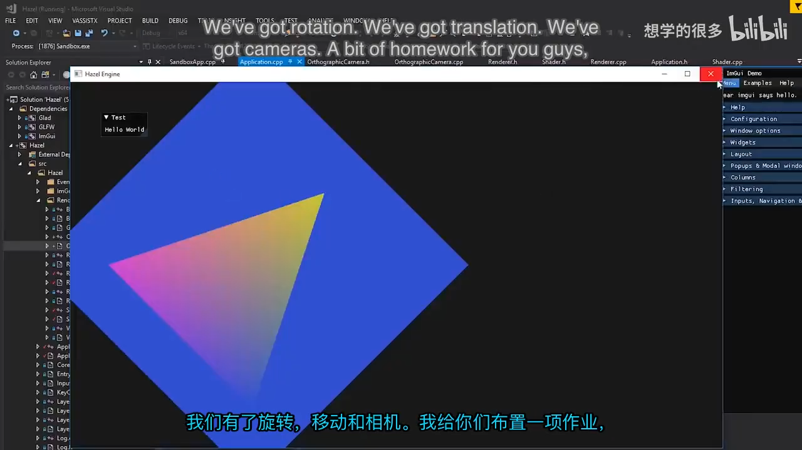

## 23. 当前限制与下一步

*(参考时间: 00:36:08)*

当前 Renderer Submit 每次都：

1. 绑定 Shader；
2. 上传 ViewProjection；
3. 绑定 VAO；
4. 发出 Draw Call。

如果连续绘制很多使用同一 Shader 的对象，会重复上传相同的 VP。未来应：

- 收集所有提交项；
- 按 Shader / Material 分组；
- 每个 Shader 只上传一次场景 uniforms；
- 对相同材质对象合批；
- 再为每个对象上传 Model 矩阵。

下一步还可能处理：

- Shader uniform 系统；
- Model / Transform 矩阵；
- 相机控制器；
- 更正式的 Scene Renderer；
- 把演示代码从 Application 移到 Sandbox。

```mermaid
flowchart TD
    A[Current immediate Submit] --> B[Shader bind]
    B --> C[VP upload]
    C --> D[Draw]
    E[Future batching] --> F[Group by shader]
    F --> G[Upload VP once]
    G --> H[Upload model/material per object]
    H --> I[Draw batch]
```

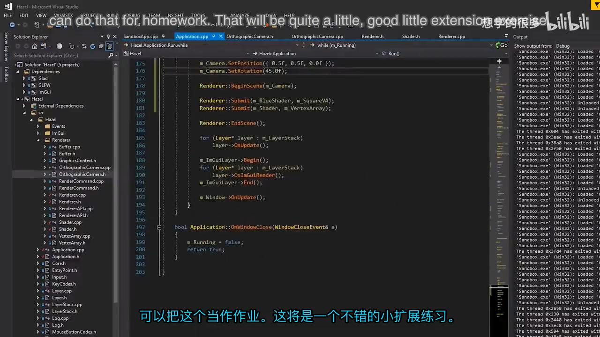

## 24. 本节结论

本讲完成 Hazel 的第一个正交相机实现：

- 建立 `OrthographicCamera` 类；
- 用 `glm::ortho()` 创建 Projection；
- 缓存 View 与 ViewProjection；
- 用 Position 与 Z 轴 Rotation 生成相机变换；
- 对相机变换取逆得到 View；
- 将 Camera 加入 `Renderer::BeginScene()`；
- 用 Renderer SceneData 保存 VP；
- 为 Shader 增加 `UploadUniformMat4()`；
- 通过 `glGetUniformLocation()` 与 `glUniformMatrix4fv()` 上传矩阵；
- 在 Vertex Shader 中用 `u_ViewProjection` 变换顶点；
- 修正 16:9 窗口下的投影宽高比；
- 验证相机平移使场景反向移动；
- 定位并修复未初始化的 GLM Position；
- 验证平移与旋转组合；
- 让 Application 渲染流程保持简洁。

这一讲不仅接上了上一讲规划的数据流，也展示了矩阵代码最常见的两类调试问题：比例不一致与成员未初始化。最终画面正常，并不代表矩阵一直正确；通过平移、旋转和极端参数逐项验证，才能确认相机变换链完整可靠。

## 附：参考

- [Bilibili 精译视频：035 - 创建正交相机](https://www.bilibili.com/video/BV1wtLazEEmC/?p=35)
- [The Cherno 游戏引擎系列播放列表](https://www.youtube.com/playlist?list=PLlrATfBNZ98dC-V-N3m0Go4deliWHPFwT5)
- [本期对应代码提交 `c1d915e`](https://github.com/TheCherno/Hazel/tree/c1d915e)
- [GLM Manual：Matrix Transform](https://glm.g-truc.net/0.9.9/api/a00243.html)
- [OpenGL Wiki：Uniform](https://www.khronos.org/opengl/wiki/Uniform)
