# Hazel 游戏引擎笔记 039：材质系统

> 本节来源：[The Cherno 游戏引擎系列第 39 集“039 - 材质系统”](https://www.bilibili.com/video/BV1wtLazEEmC/?p=39)，时长约 32 分 04 秒。
>
> 原课程与 Hazel 代码作者：The Cherno。公开代码参考快照：[`3c14780`](https://github.com/TheCherno/Hazel/tree/3c14780)，其中包括 `OpenGLShader::UploadUniformFloat4()` 等同阶段 uniform 上传接口。
>
> **编者说明：** 本讲是一次概念导览和临时代码实验，不是 Material 系统的最终实现。视频中的 `Material`、`MaterialInstance` 和渲染器提交接口属于讲师展示的目标 API 草案；当时公开仓库尚无独立的 `Material.h` 提交。本文把“视频实际写过的试验代码”和“讲师规划的未来接口”分开说明。
>
> 本文由视频 ASR 转写稿重构、翻译并整理，不是官方教材；术语、代码和设计判断以原视频及同阶段 Hazel 仓库为准。

## 本节目标

第 35 集把相机、变换和 `Renderer::Submit()` 串进了同一条渲染路径。本讲暂时不继续堆叠功能，而是先回答一个更基础的问题：**当两个物体使用同一个 Shader，却要呈现不同表面外观时，数据应该放在哪里？**

本讲要建立以下认识：

- Shader 是运行在 GPU 上的程序，负责顶点位置和最终像素颜色；
- 在 Shader 中硬编码颜色能工作，但会失去复用价值；
- Uniform 是在绘制前传给 Shader 的数据；
- Material 的简化定义是 **Shader + 一组属于表面外观的 Uniform 数据**；
- 不是所有 Uniform 都属于 Material，ViewProjection、光源方向等通常由 Renderer 负责；
- 单个“万能 Shader”会引入大量分支和变体，真实引擎通常从模块生成多个特化 Shader；
- Mesh 通常与 Material 一起被创作和保存，但在代码中也可以分开控制；
- Material Instance 共享一个基础 Material 的 Shader 和参数布局，只覆盖每个实例不同的数据；
- 按 Material 排序能减少 Shader、Uniform 和 Material 状态切换；
- 纹理、粗糙度、金属度、法线等表面数据都可以沿同一套 Material 接口接入；
- 要实现可靠的 Material 系统，Shader 类还必须先支持反射、参数校验、文件加载和批量 uniform 存储；
- 本讲最后留下了一个课程方向问题：先完成快速、可玩的 2D 渲染器，还是立即投入完整 3D 渲染器。

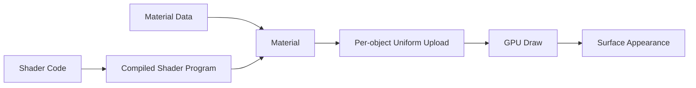

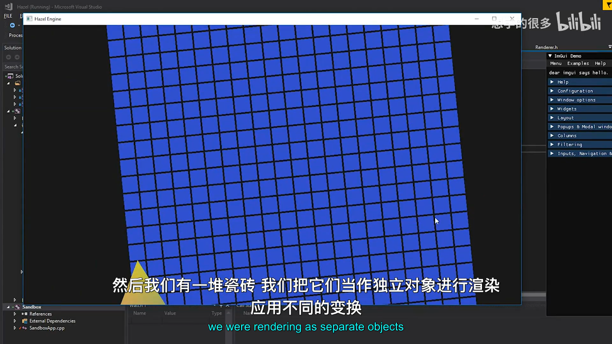

## 1. 当前引擎已经能做什么

*(参考时间：00:01:18)*

上一集结束时，Sandbox 已经能够：

- 绘制一个带顶点颜色的三角形；
- 用相机移动、旋转视角；
- 用相对位置构建一片方块网格；
- 为每个方块提交独立的 Transform；
- 由 `Renderer::Submit()` 绑定 Shader、上传场景与对象 uniform，再发出 Draw Call。

这些方块目前共用同一个平色 Shader。它们的位置不同，但表面颜色和着色逻辑相同。

现在提出一个新需求：

> 同一块方块几何，能否在绘制时选择红色或蓝色？

最直接的办法是修改片段 Shader，把输出颜色固定成红色：

```glsl
#version 330 core

layout(location = 0) out vec4 color;

void main()
{
    color = vec4(1.0, 0.0, 0.0, 1.0);
}
```

这当然能让画面变红。但接下来想要蓝色时，又得再写一个 Shader；想要紫色、绿色，或让颜色由编辑器实时调整时，还要继续复制代码。

问题不在于“能不能写死颜色”，而在于这种方式不能充分复用 Shader。

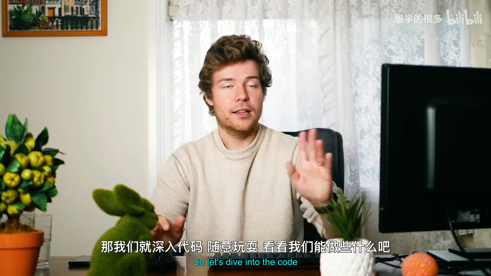

## 2. 从“固定程序”到“带输入的程序”

*(参考时间：00:02:49)*

讲师用普通程序作类比：如果程序只能计算 `10 + 5`，它当然能给出一次正确答案，但工具价值很低。更有用的写法是接收两个输入：

```text
add(a, b)
```

这样无论输入是 `10 + 5`、`2 + 3`，还是运行时由用户提供的数据，程序都能复用。

Shader 也一样。不要让“红色”成为程序本身，而要让颜色成为 Shader 的输入：

```text
flat_color(inputColor)
```

于是同一个 Shader 可以：

- 接收红色，输出红色；
- 接收蓝色，输出蓝色；
- 接收材质编辑器中的任意颜色；
- 以后进一步接收纹理、粗糙度和金属度等表面参数。

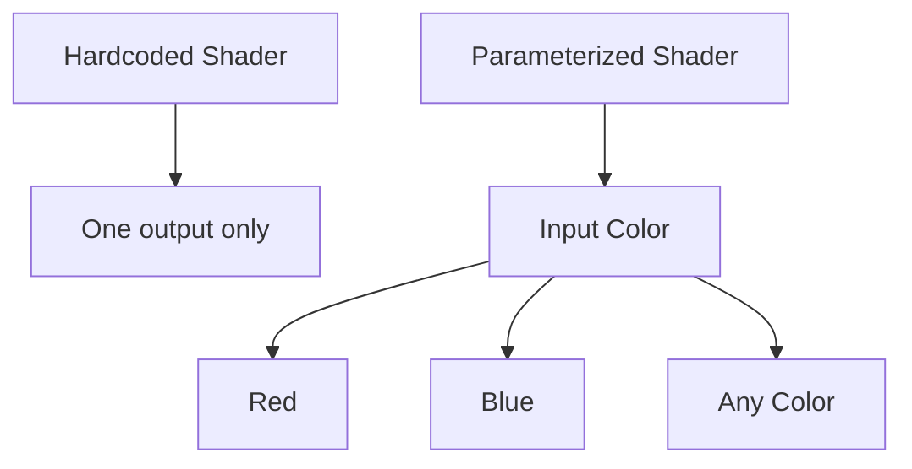

讲师强调，这类 Shader 通常由引擎工程师或技术美术编写。使用 Shader 的美术人员不必理解 GPU 指令和光照公式，只需要给暴露出来的端口填入颜色、纹理和表面参数。

## 3. Material 的简化定义

*(参考时间：00:05:49)*

Regular draw 之前，CPU 可以把一组数据传给当前 Shader，这类数据称为 **Uniform**。同一个 Uniform 在整次 Draw Call 中保持不变，因此非常适合表达“这次绘制使用什么表面参数”。

由此得到本讲反复强调的核心定义：

```text
Material = Shader + Uniform Data
```

更准确地说，是一组**决定表面外观的** Uniform 数据，而不是 Shader 中出现的所有 Uniform。

材质可以描述：

- 基础颜色；
- 反照率纹理；
- 粗糙或光滑程度；
- 金属、塑料等表面类型；
- 法线贴图；
- 高光贴图或破损贴图；
- 未来 PBR 系统中的其他表面参数。

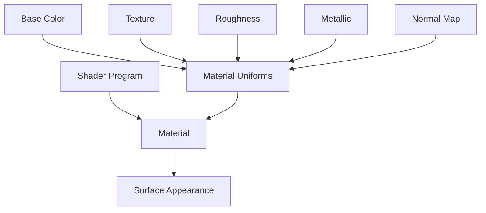

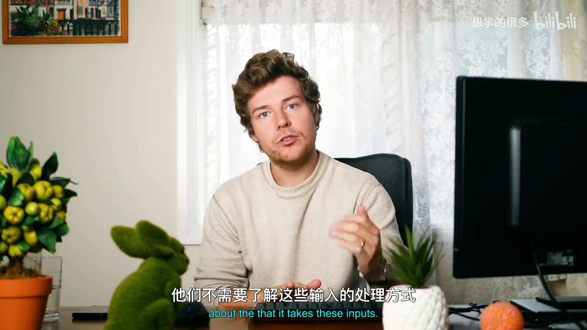

这不是 Hazel 独有的定义，而是很多游戏引擎都采用的抽象：Shader 提供算法和参数接口，Material 提供这一表面在算法中的具体输入。

## 4. 并非所有 Uniform 都属于材质

*(参考时间：00:06:00)*

视频当前的 Vertex Shader 中已经有：

```glsl
uniform mat4 u_ViewProjection;
uniform mat4 u_Transform;
```

这两个 Uniform 是渲染过程必需的数据，但不应塞进材质：

- `u_ViewProjection` 由相机和场景决定；
- `u_Transform` 由对象在世界中的位置、旋转和缩放决定。

如果未来加入光照，`u_LightDirection` 也不会因为某个表面材质变化而改变。讲师在很后面再次用一个兔子模型作类比：改变灯光方向，不会改变兔子的材质本身；兔子只是对不同光照作出材质表面应有的响应。

因此不能采用“把 Shader 中所有 Uniform 全部拿来当 Material 字段”的简单方案。

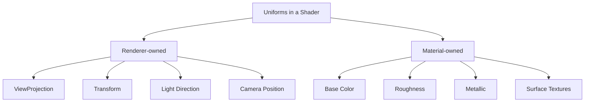

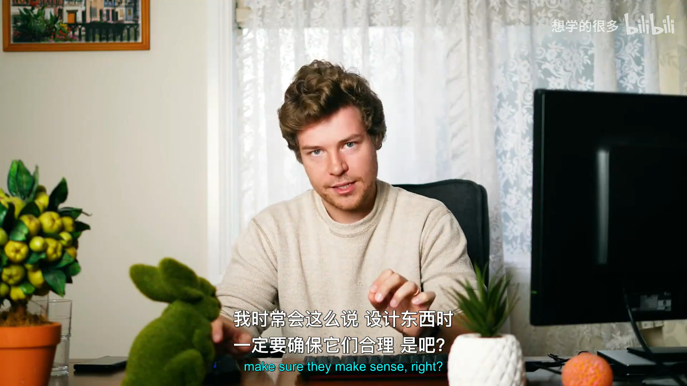

这也是材质系统真正困难的地方之一：引擎必须知道哪些参数由谁提供、何时上传，以及同名参数在当前 Shader 中是否存在。

## 5. “万能 Shader”与 Shader 变体

*(参考时间：00:06:58)*

一种看似省事的做法是写一个 Über Shader，把游戏可能需要的所有功能都放进去，再用大量 `if` 或编译期开关选择行为。

这种方式通常会带来两个问题：

- GPU 可能为根本不会执行的分支付出代价；
- 一个巨大的 Shader 越来越难维护、调试和优化。

更常见的做法是建立 Shader 编译系统：源码中写可组合的代码块，根据材质所需功能生成对应的 Shader 变体。

例如，源码可以定义是否使用纹理、是否使用法线贴图、是否接收某种光照。编译系统据此生成多个特化版本。

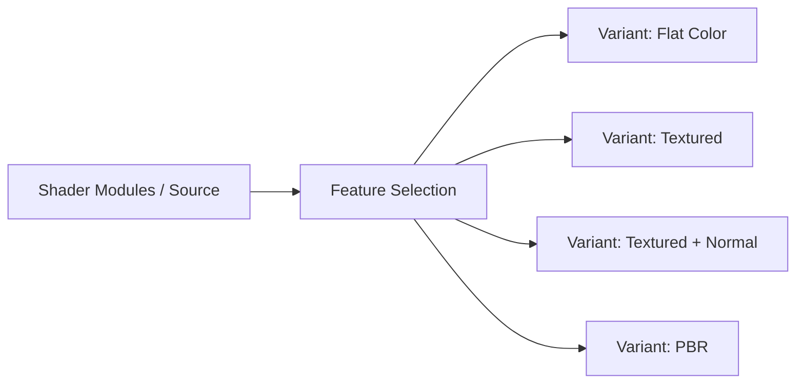

讲师说：“你只写了一个 Shader，却可能得到 300 个 Shader。”这并不意味着源代码要复制 300 次，而是同一套模块可以生成 300 个针对不同功能组合的 GPU 程序。

这个编译系统本讲不会实现，只先建立概念。

## 6. Geometry 与 Material 的关系

*(参考时间：00:08:02)*

本讲的实践目标很小：

1. 让方块的片段 Shader 接收一个颜色 uniform；
2. 在沙盒代码中给不同方块上传红色或蓝色；
3. 证明“同一 Shader + 不同数据”能得到不同表面外观；
4. 再讨论应该如何把这种直接上传封装成 Material API。

从更大的资产流程看，讲师特别提醒：几何体和材质通常不是完全分离的两件事。

艺术家制作一个木桌模型时，通常也会给它指定木质表面。模型文件往往保存了几何、子网格以及各自的材质引用。若引擎只保存裸几何，而让每个使用者手动配材质，会很别扭。

合理的资产关系通常接近：

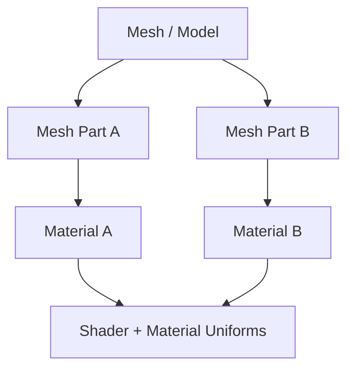

当然，把材质单独替换或覆盖仍然有合法用途，例如调试、换装、编辑器预览或运行时动态变化。但默认创作流程是“模型带着表面一起被制作”。

## 7. 材质系统的复杂度从哪里来

*(参考时间：00:09:55)*

愿望可以写成一句话：

> 让 Material 保存 Shader，并允许设置任意数据。

真正开始设计时，问题会迅速变多：

- 怎样知道某个 Shader 需要哪些 uniform？
- 参数不存在时，是静默忽略、记录日志还是断言？
- 怎样把整数、浮点、向量、矩阵、纹理统一成类型安全的数据？
- 每个参数逐次调用 `glGetUniformLocation()`，还是编译时缓存位置？
- 怎样把多个参数打包成 uniform buffer / constant buffer？
- Renderer 和 Material 是否应各自拥有一个常量缓冲区？
- 参数修改后，什么时候同步到 GPU？
- 一个 Material 被多个对象共享时，哪些数据能共享，哪些必须按实例覆盖？

这些正是 Material 系统比“一个 Shader 类加一个 `SetColor()`”复杂得多的原因。

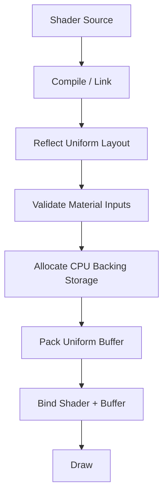

本讲只做最小实验，但后面实现时逐项都绕不开。

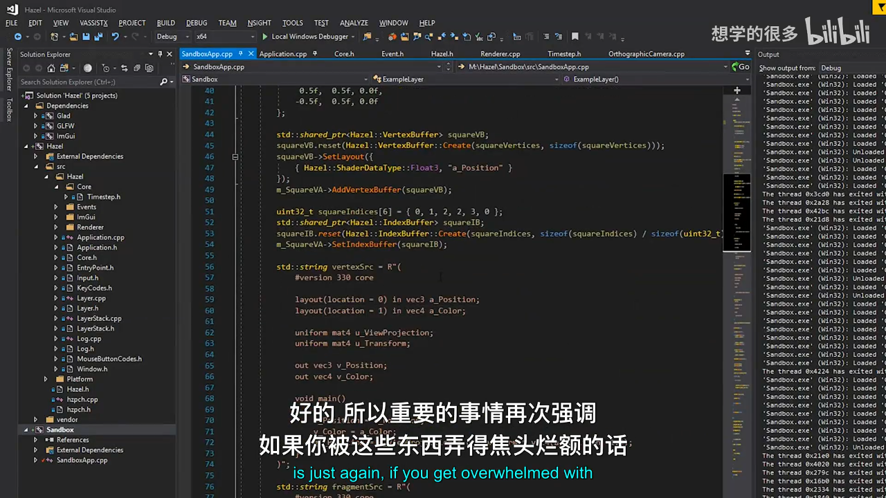

## 8. 先做一个能工作的“半成品”

*(参考时间：00:11:03)*

讲师先确认当前 Sandbox 的状态：

- Vertex Shader 已经接收 ViewProjection 和 Transform；
- Fragment Shader 还没有接收任何运行时 uniform；
- 方块网格通过两层循环生成 400 个独立提交；
- 方块当前使用统一下的平色 Shader。

实验目标是生成一种红蓝交替的图案。

在 Sandbox 中先准备两个颜色：

```cpp
glm::vec4 redColor  = { 0.8f, 0.2f, 0.3f, 1.0f };
glm::vec4 blueColor = { 0.2f, 0.3f, 0.8f, 1.0f };
```

视频的 `blueColor` 数值沿用了原来的蓝色方阵风格，`redColor` 则刻意调到相近亮度。颜色使用 `vec4`，前三个分量是 RGB，最后一个分量是 Alpha。

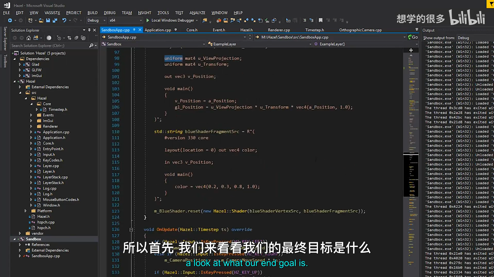

目前的绘制循环类似：

```cpp
for (int y = 0; y < 20; y++)
{
    for (int x = 0; x < 20; x++)
    {
        glm::vec3 pos(x * 0.11f, y * 0.11f, 0.0f);
        glm::mat4 transform =
            glm::translate(glm::mat4(1.0f), pos) *
            glm::scale(glm::mat4(1.0f), glm::vec3(0.1f));

        Hazel::Renderer::Submit(m_FlatColorShader, m_SquareVA, transform);
    }
}
```

为了得到竖条交替效果，可以按列号 `x` 判断：

```cpp
glm::vec4 color = (x % 2 == 0) ? redColor : blueColor;
```

`x = 0, 2, 4, ...` 使用红色，`x = 1, 3, 5, ...` 使用蓝色。


## 9. 直接向 Shader 上传颜色

*(参考时间：00:13:02)*

现有 Shader 接口还没有方便上传 `vec4` 的函数。讲师转到 OpenGL Shader 实现，添加 `UploadUniformFloat4()`。

该函数的职责只有三步：

1. 用名字找到 uniform location；
2. 确认或处理找不到 location 的情况；
3. 调用 OpenGL 的 `glUniform4f()`，把四个浮点分量上传到当前 Shader。

```cpp
void OpenGLShader::UploadUniformFloat4(
    const std::string& name,
    const glm::vec4& value)
{
    GLint location = glGetUniformLocation(m_RendererID, name.c_str());
    glUniform4f(location, value.x, value.y, value.z, value.w);
}
```

对应声明可以放在平台实现类的公开接口中：

```cpp
void UploadUniformFloat4(
    const std::string& name,
    const glm::vec4& value);
```

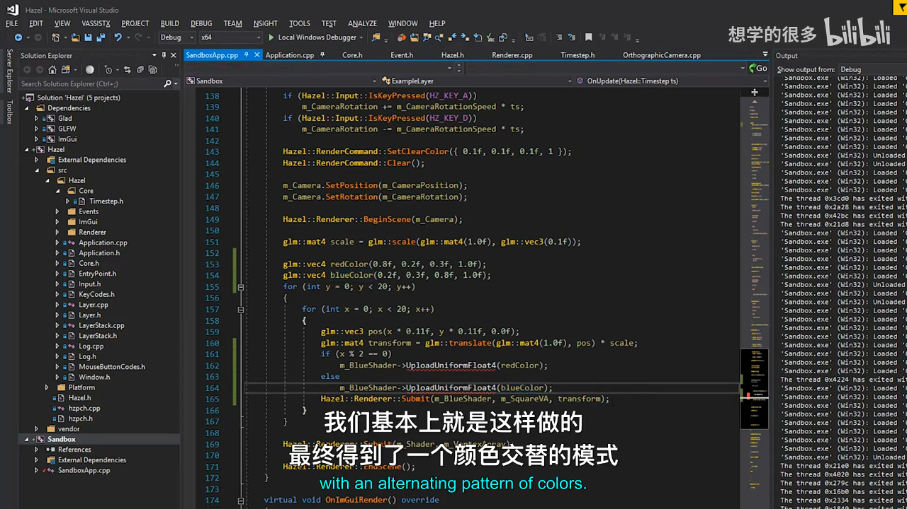

OpenGL 的命名在这里容易让人犹豫：

- `glUniform4f` 一次接收四个标量；
- `glUniform4fv` 接收一个包含四个标量的指针或数组；
- 这一段使用的是 `glUniform4f`。

函数绑定的是当前正在使用的 Shader Program，所以调用它之前必须先绑定对应 Shader。

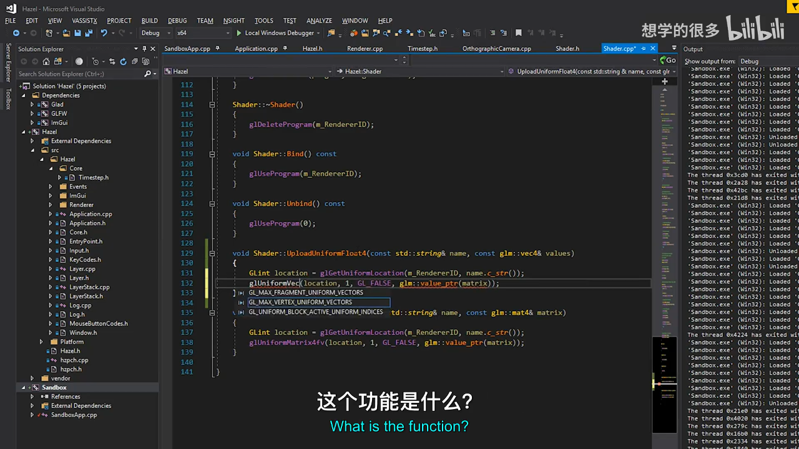

## 10. Location 查询与未来缓存

*(参考时间：00:14:19)*

当前实现每次上传 uniform 都执行：

```cpp
glGetUniformLocation(m_RendererID, name.c_str());
```

讲师提到，有观众建议缓存 location。这个方向是对的，但他不准备在临时实验里展开。

更完整的做法是在 Shader 编译、链接完成后：

- 解析或反射 Shader 中的 uniform；
- 记录名称、类型、数组长度和 location；
- 验证材料需要的参数是否真的存在；
- 根据类型和布局计算 CPU 缓冲区大小；
- 后续上传时直接复用已知 location；
- 参数名拼错时尽早报告，而不是静默传入 `-1`。

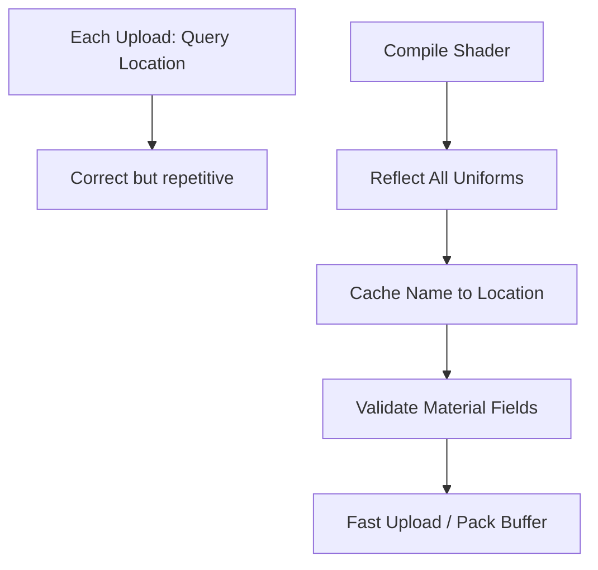

这解释了为什么一个真正可靠的 Material 系统要从 Shader 层开始改造，而不是只在 Sandbox 里多写几个 `SetColor()`。

## 11. 在 Fragment Shader 中声明 `u_Color`

*(参考时间：00:16:20)*

原来承担蓝色彩色输出的 Shader 被改造成更通用的平色 Shader，并在片段阶段添加：

```glsl
uniform vec4 u_Color;
```

`main()` 不再写死颜色，而是直接输出该 uniform：

```glsl
#version 330 core

layout(location = 0) out vec4 color;

uniform vec4 u_Color;

void main()
{
    color = u_Color;
}
```

也可以把颜色声明成 `vec3`，把 Alpha 固定为 `1.0`。这两种写法都能表达纯色表面，本讲为了和前面准备的 `glm::vec4` 数据保持一致，使用四分量形式。

在 Sandbox 的每次提交前，根据列号选颜色并上传：

```cpp
auto flatColorShader =
    std::dynamic_pointer_cast<Hazel::OpenGLShader>(m_FlatColorShader);

flatColorShader->Bind();

glm::vec4 color = (x % 2 == 0) ? redColor : blueColor;
flatColorShader->UploadUniformFloat4("u_Color", color);

Hazel::Renderer::Submit(m_FlatColorShader, m_SquareVA, transform);
```


这里体现了 Uniform 的生命周期：它不随顶点变化，而是在一次绘制前统一传入，并在这一批片元执行中保持一致。


## 12. 红蓝交替结果与明显的性能问题

*(参考时间：00:16:42)*

运行后，方阵变成红蓝相间的竖条。这个结果验证了两件事：

- 同一个 Shader 可以生成不同外观；
- 决定外观的数据确实可以由 CPU 在 Draw Call 前传入。

从最简单意义上说，这已经做出了一个“材质”：Shader 提供通用平色逻辑，颜色 uniform 表示这次绘制使用什么表面颜色。

但讲师马上强调：**这只适合演示，不是理想渲染方式。**

当前循环为了表现交替，每画一个方块就：

1. 切换或确认 Shader 状态；
2. 查询并上传一次颜色；
3. 上传对象 Transform；
4. 发出一次 Draw Call。

当画面有 400 个方块时，就有大量重复状态切换。更合理的办法是把相同 Material 的物体放在一起绘制。

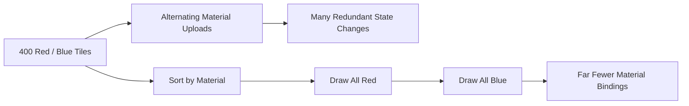

视频故意让这个缺点暴露出来，因为它正好说明 Material 不只是 UI 概念，也会直接决定渲染排序和批处理结构。

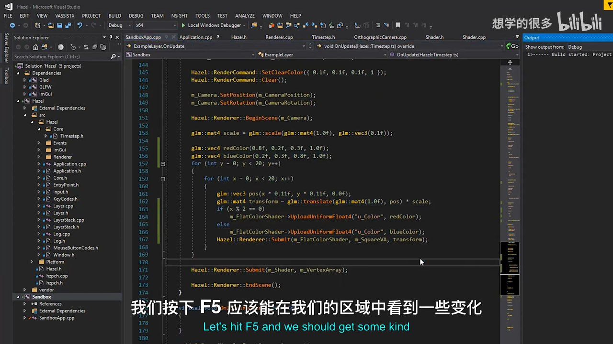

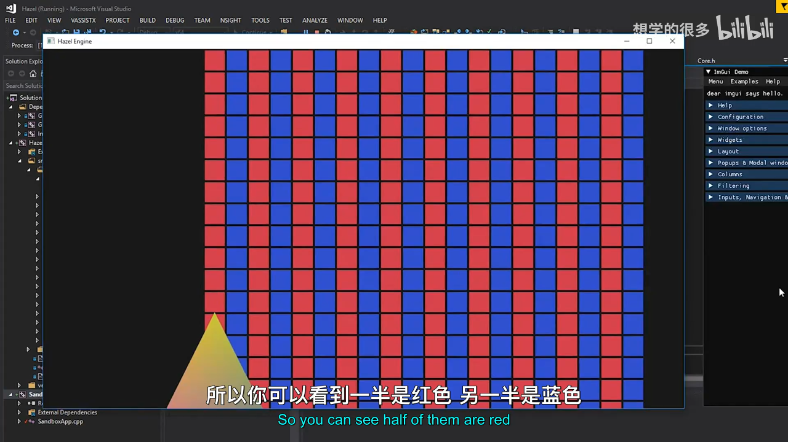

## 13. 为什么不继续在 Sandbox 里手动上传

*(参考时间：00:17:31)*

当前代码能工作，但 API 很别扭：

```cpp
shader->Bind();
shader->UploadUniformFloat4("u_Color", redColor);
Renderer::Submit(shader, vertexArray, transform);
```

问题包括：

- 调用者要知道底层 `OpenGLShader` 类型；
- 调用者要记得先绑定 Shader；
- 调用者要手写 uniform 名称；
- 颜色与应用层、几何提交逻辑混在一起；
- 参数拼错时容易静默失败；
- 不同图形 API 的 uniform 上传方式不同；
- 无法自然表达“这是同一个基础材质的不同实例”。

所以讲师展示的是一个目标 API，而不是继续接受这种底层写法。

## 14. 目标 Material API

*(参考时间：00:18:14)*

从使用者的角度看，希望可以创建 Material，并把 Shader 交给它：

```cpp
Hazel::Ref<Hazel::Material> flatColorMaterial =
    Hazel::Material::Create(m_FlatColorShader);
```

然后设置属于材质的参数：

```cpp
flatColorMaterial->Set("u_Color", redColor);
```

> 以上及后文 Material API 是依据视频口述整理出的示意代码，并非本集公开的最终实现。

Material 构造时可以做很多隐藏工作：

- 保存 Shader 引用；
- 读取 Shader 的参数定义；
- 过滤出真正由材质控制的 uniform；
- 分配 CPU 侧后备存储；
- 设置各参数的默认值；
- 准备上传数据；
- 在绑定时绑定 Shader 并写入参数。

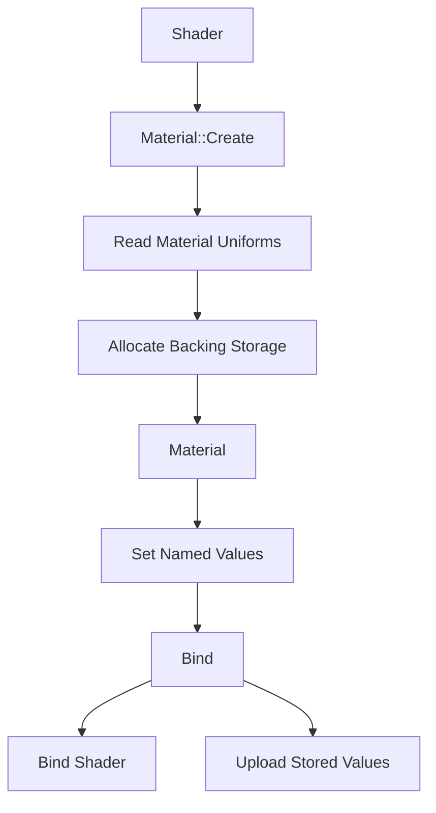

这样应用层不需要再关心 `glUniform4f`、location 查询或具体图形 API。

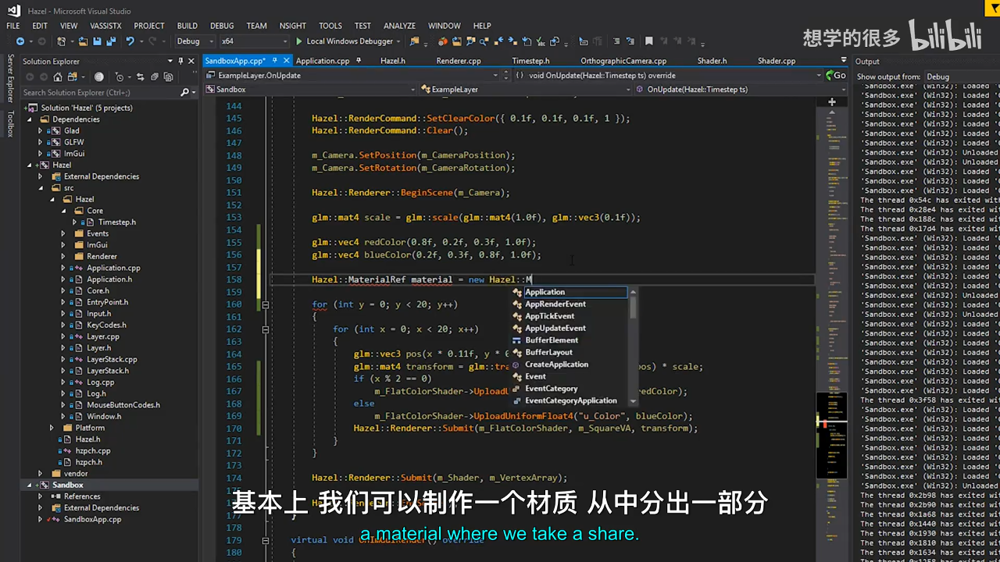

## 15. Material、Mesh 与 Override Material

*(参考时间：00:21:37)*

从渲染对象的角度，提交接口可以从“Shader + VertexArray”上升为“几何 + Material”：

```text
Renderer::Submit(mesh, material, transform)
```

正常资产流程中，Mesh 往往自带 Material：

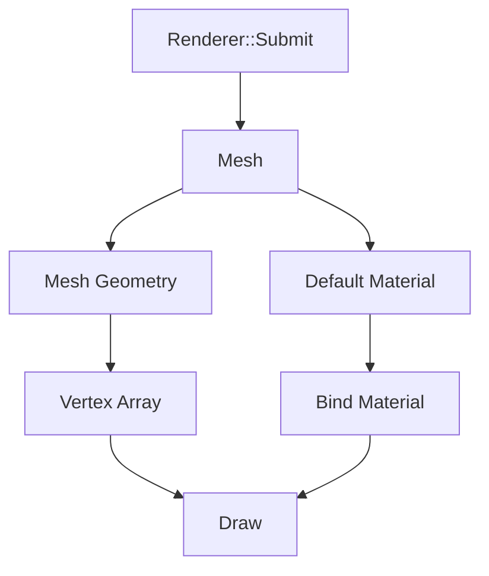

但 Renderer 还可以接受一个 Override Material：

```text
若 overrideMaterial 存在，就优先使用它；否则使用 Mesh 自带材质。
```

这适合：

- 用纯色材质检查模型轮廓和几何；
- 调试法线、UV 或光照；
- 编辑器中的临时预览；
- 特效、描边或特殊渲染通道。

Override Material 不否定 Mesh/Material 的默认绑定关系，而是给渲染流程提供一个明确的替换入口。

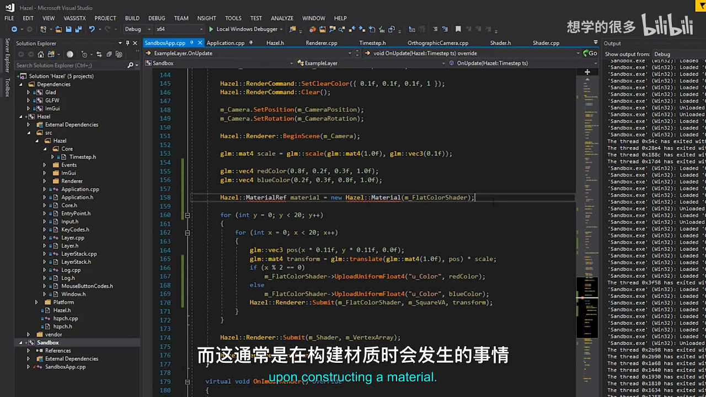

## 16. Material Instance 解决什么问题

*(参考时间：00:22:14)*

如果每换一种颜色就新建一个 Material，那么红材质、蓝材质、绿材质会各自成为完整材质。讲师更希望把“平色材质”作为基础定义，再从中派生出参数不同的实例。

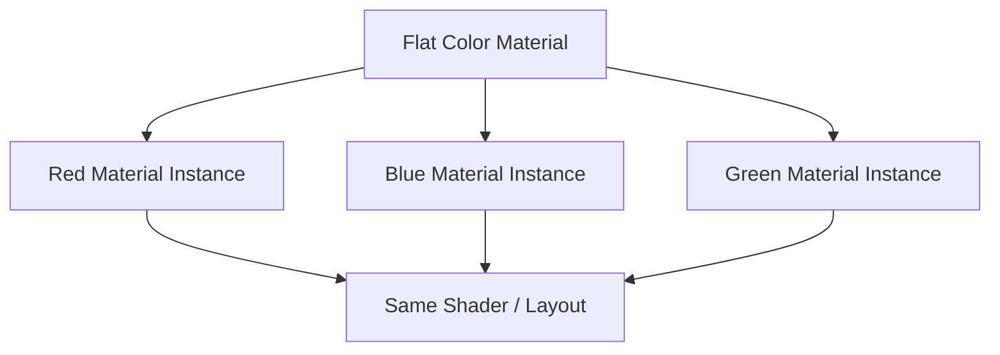

Material Instance 的基本含义是：

- 共享基础 Material 的 Shader；
- 共享参数布局和默认值；
- 只覆盖实例自己的参数数据；
- 可被多个对象引用；
- 绑定实例时，同时绑定 Shader 并上传它的数据。

示意 API：

```cpp
Hazel::Ref<Hazel::MaterialInstance> redMaterial =
    Hazel::MaterialInstance::Create(flatColorMaterial);

redMaterial->Set("u_Color", redColor);

Hazel::Ref<Hazel::MaterialInstance> blueMaterial =
    Hazel::MaterialInstance::Create(flatColorMaterial);

blueMaterial->Set("u_Color", blueColor);
```

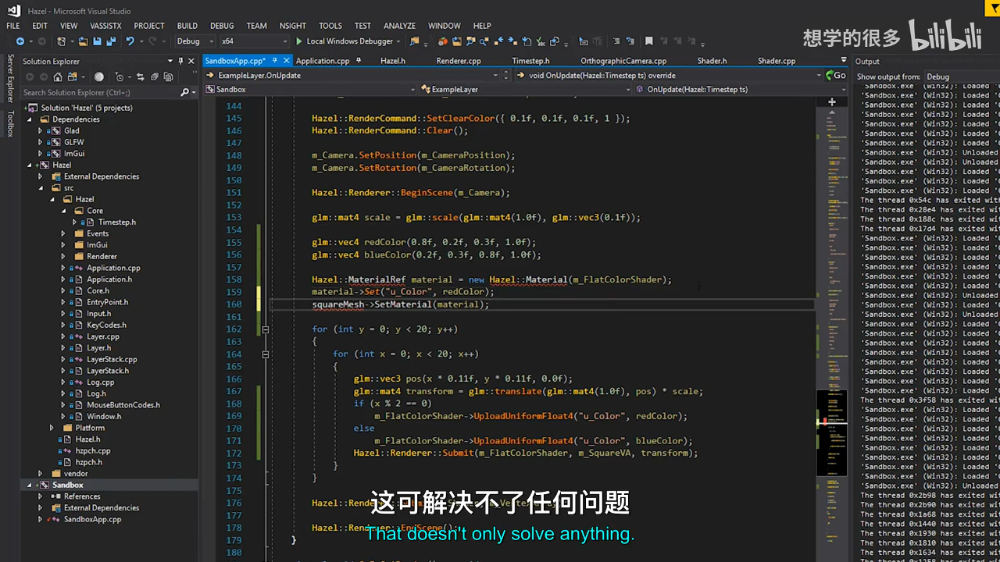

## 17. PBR 银材质与木材质实例

*(参考时间：00:22:34)*

讲师用 PBR 银材质说明 Instance 的价值。

基础 Material 可能是“银色金属”，定义：

- PBR 着色模型；
- 银色基础色；
- 金属工作流；
- 法线、粗糙度、高光等参数槽位。

场景中的不同球体可以派生不同 Material Instance：

- 一个球表面较粗糙；
- 一个球有局部磨损；
- 一个球使用不同的划痕贴图；
- 一个球的光泽程度不同。

它们仍然是同一种银色金属基础，但在具体表面上有所不同。

木材也是类似例子。一个场景可能有许多木桌、地板和家具，它们共享木质表面逻辑，却不是每块木头都有完全相同的纹理、颜色或老化程度。

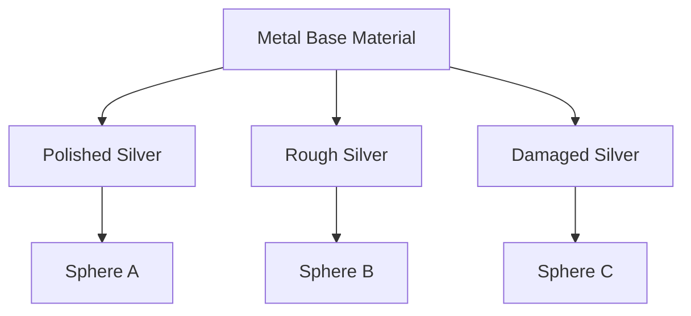

讲师在这里提到的另一层原因是批处理：物体会按相同 Material Instance 或基础 Material 分组，从而减少状态切换。

## 18. 绑定 Material Instance 时实际发生什么

*(参考时间：00:24:31)*

使用 Material 后，Sandbox 不再直接提交 Shader：

```cpp
Hazel::Renderer::Submit(m_SquareVA, redMaterial, transform);
```

Renderer 内部大致执行：

```text
1. 取出 Material Instance 引用的 Material；
2. 从 Material 取得 Shader；
3. 绑定 Shader；
4. 上传 Material Instance 保存的参数；
5. 上传当前对象的 Transform；
6. 绑定 VertexArray；
7. 发出 Draw Call。
```

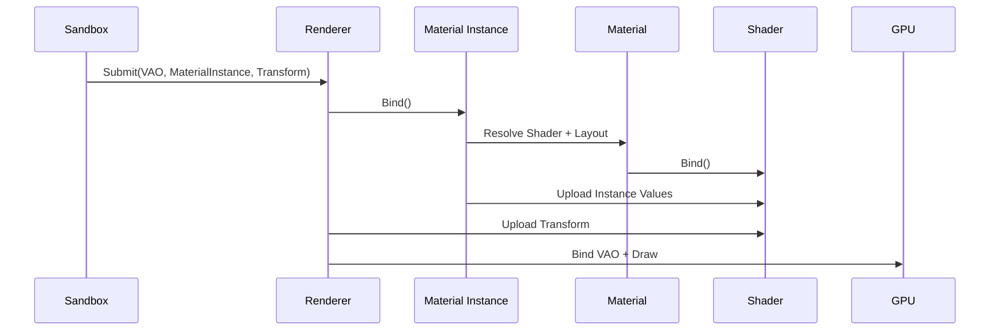

这样，应用层表达的是一次“用某材质绘制某几何”的意图，而不是一串图形 API 调用。

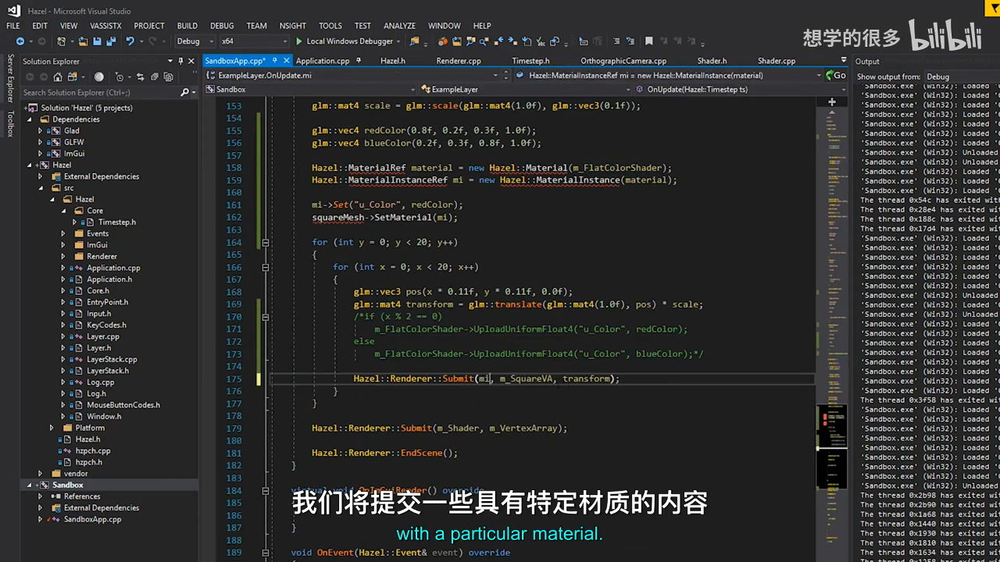

## 19. 渲染排序：400 次材质切换变成 2 次

*(参考时间：00:25:58)*

如果场景有 400 个方块，一半红色、一半蓝色，当前交替绘制会频繁切换。

引入 Material Instance 后，Renderer 可以先把提交项收集起来，再按材质排序：

```text
Red Material Instance   -> Draw all red tiles
Blue Material Instance  -> Draw all blue tiles
```

理想情况下只需要绑定两次材质。每个对象仍然有不同 Transform，所以 Transform 仍需逐个上传或按批次处理，但不需要每次重复设置颜色。

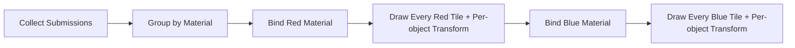

讲师称这种过程包含一种 render sorting。

注意这并不是说“材质相同就一定可以一次 Draw Call”。完整的批处理还取决于：

- 几何是否在同一缓冲区；
- 是否能合并顶点与索引；
- 是否使用同一 Shader 和材质；
- 纹理绑定是否一致；
- 实例化或其他批次机制是否可用；
- 透明物体的排序约束。

但至少按 Material 分组可以减少重复绑定和 uniform 设置，这是渲染排序最直接的一层收益。


## 20. 纹理也走同一套材质接口

*(参考时间：00:27:02)*

本讲还没有正式实现纹理，但纹理的归属方式与颜色相同：基色纹理、粗糙度贴图、法线贴图、破损贴图都属于某个材质的表面定义。

示意接口可以写成：

```cpp
material->SetTexture("u_AlbedoMap", albedoTexture);
material->SetTexture("u_RoughnessMap", roughnessTexture);
material->SetValue("u_Roughness", 0.35f);
```

也可以使用更显式的 API：

```text
SetValue(name, value)
SetTexture(name, texture)
```

讲师强调，API 形式可以自行设计，关键是 Material 保存纹理引用，并在绑定时把纹理连同 Shader 所需参数一起准备好。

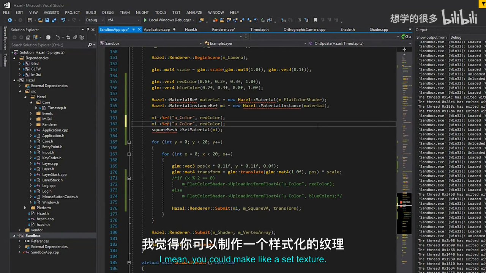

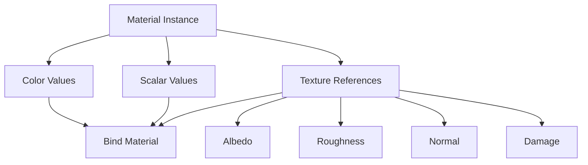

## 21. 材质系统的“安全性”

*(参考时间：00:28:00)*

讲师非常喜欢 Material 概念的一点是，它像智能指针一样减少了裸露底层操作的机会。

学习者第一次写 OpenGL 时，常见流程是：

1. 创建 Shader；
2. 写一个 `SetUniform*()`；
3. 调用 `glGetUniformLocation()`；
4. 如果 location 是 `-1`，记录错误或断言；
5. 手动保证参数名、类型和 Shader 一致。

这些检查本身没错，只是分散在调用处，容易遗漏。

更完整的 Material 系统可以在创建时询问 Shader：

- 你有哪些 uniform？
- 每个参数是什么类型？
- 它们需要多少空间？
- 哪些属于材质，哪些由 Renderer 提供？

然后为材质分配一块后备 buffer，校验用户设置的参数，并按统一方式上传。这样错误能更早被发现，上层代码也更安全。

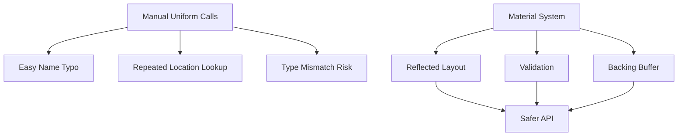

当然，“安全”来自正确的实现与校验，不是只要叫 `Material` 就自动可靠。

## 22. 实现正式材质系统之前，Shader 还缺什么

*(参考时间：00:29:02)*

本讲并没有把这些目标代码全部实施。讲师明确指出，要实现正式系统，至少还要继续扩展 Shader 类：

- 从文件加载 Shader，而不是把 GLSL 字符串写在 C++ 中；
- 解析或反射 uniform 参数；
- 保存参数类型和 location；
- 支持参数校验；
- 读取所有材质相关 uniform；
- 计算或创建 uniform buffer；
- 管理 Shader 编译变体；
- 统一不同图形 API 的 Shader 表示。

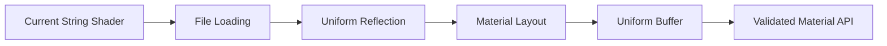

因此本节的价值更像是“先画出目标”，为后续 Shader 与 Texture 章节建立接口方向。

## 23. 2D 还是 3D：课程方向选择

*(参考时间：00:29:12)*

视频最后，讲师正式提出课程路线问题：

> Hazel 现在应该先成为一个完整可用的 2D 引擎，还是立即投入完整 3D 渲染器？

他给出的判断是：

- Material 系统对 3D 更重要；
- 2D 场景通常只需要少数 Shader，颜色和纹理已能覆盖大部分内容；
- 先把 2D 路径打磨完成，用户更快能做出真正的 2D 游戏；
- 3D 渲染器会显著拉长开发周期；
- 无论先选哪条路线，最后都希望 Hazel 同时支持 2D 和 3D；
- 不管投票结果如何，Shader 类和纹理系统都要继续做；
- 频道之外还有 OpenGL 系列可以继续承载 3D 教学。

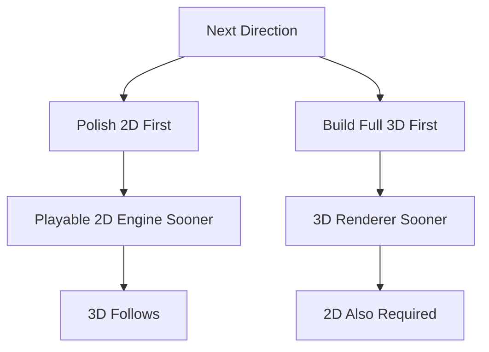

这段路线讨论也解释了为什么本讲没有直接完成整套材质代码：下一阶段是优先 2D 还是 3D，会影响 Shader 和 Material 系统的复杂程度。

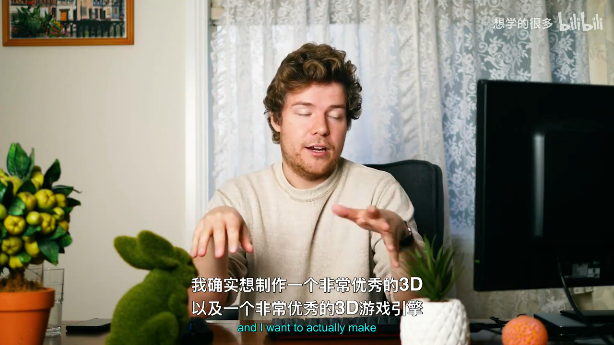

## 24. 本节结论

本讲从“给方块换颜色”这个小问题出发，给出了 Hazel 材质系统的基本方向：

- Shader 是可复用的 GPU 程序；
- 不应为每种颜色复制 Shader；
- Uniform 在 Draw Call 前向 Shader 提供数据；
- 简化地说，Material 是 Shader 与表面 uniform 数据的组合；
- Camera、Transform、Light 等数据通常由 Renderer 管理，不属于材质；
- 视频通过 `UploadUniformFloat4()` 和 `u_Color` 完成了红蓝方块的临时实验；
- 逐对象切换颜色会产生大量冗余状态，应按 Material 分组绘制；
- 目标 API 用 Material 封装 Shader 与参数存储；
- Material Instance 共享基础材质布局，只保存实例差异；
- Override Material 可用于调试和特殊渲染；
- 纹理及 PBR 表面参数可以沿同一接口扩展；
- 正式实现前，Shader 还需要文件加载、反射、校验、缓存和缓冲区支持；
- 第 39 集展示的是目标与试验，不是最终 Material 类；
- 后续课程要在 2D 优先与 3D 优先之间做路线选择。

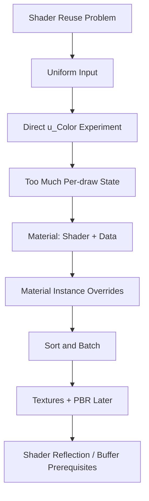

## 附录：参考与延伸阅读

- [Bilibili 精译视频：039 - 材质系统](https://www.bilibili.com/video/BV1wtLazEEmC/?p=39)
- [The Cherno 游戏引擎系列播放列表](https://www.youtube.com/playlist?list=PLlrATfBNZ98dC-V-N3m0Go4deliWHPFwT5)
- [Hazel 公开代码参考快照 `3c14780`](https://github.com/TheCherno/Hazel/tree/3c14780)
- [OpenGL Wiki：Shader Compilation](https://www.khronos.org/opengl/wiki/Shader_Compilation)
- [OpenGL Wiki：Uniform](https://www.khronos.org/opengl/wiki/Uniform)
- [OpenGL Wiki：Uniform Buffer Object](https://www.khronos.org/opengl/wiki/Uniform_Buffer_Object)

