# 虚拟机和容器：从全系统模拟到云原生编排

> **课程**：2026 春季学期《操作系统原理》  
> **讲师**：蒋炎岩（jyy）  
> **官方课程主页**：<https://jyywiki.cn/OS/2026/>  
> **官方讲义**：<https://jyywiki.cn/OS/2026/lect29.md>  
> **视频来源**：[Bilibili BV1uaEB66EAH](https://www.bilibili.com/video/BV1uaEB66EAH/)  
> **版权说明**：课程讲义与幻灯片归蒋炎岩所有，采用 [Creative Commons BY-NC 4.0](http://creativecommons.org/licenses/by-nc/4.0/) 许可；本电子书是对课堂讲授的书面化重构，保留出处与许可说明。

## 导语：一台机器如何变成许多台

*(参考时间: 00:00)*

虚拟化的目标可以概括为一句话：

> 让一个进程或操作系统以为自己独占了一台机器。

课程从最朴素的全系统模拟出发，逐步走到现代容器：

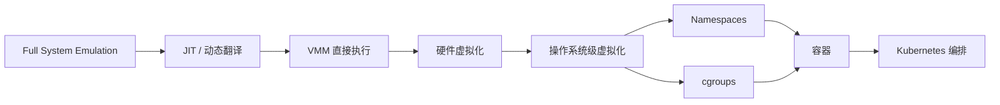

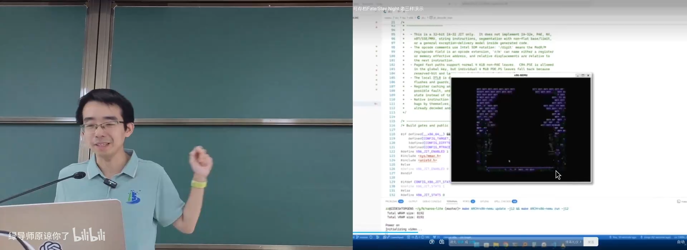

---

## 1. 全系统模拟：概念简单，性能困难

### 1.1 NEMU 式模拟器

*(参考时间: 00:00)*

全系统模拟器需要：

1. 取指令；
2. 译码；
3. 执行；
4. 更新 CPU 状态；
5. 处理特权指令和设备。

概念模型并不复杂，但逐条解释指令的性能通常不到原生执行的 `1/10`。

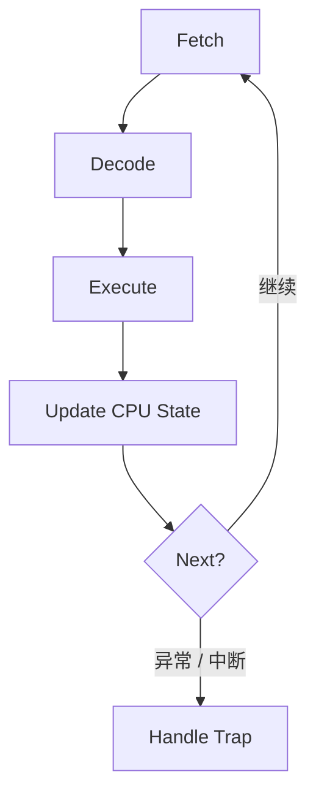


### 1.2 Basic Block

*(参考时间: 00:02)*

如果连续取出的指令不改变控制流，它们可以组成一个 **basic block**：

```asm
mov eax, 1
mov ebx, 2
add eax, ebx
```

直到遇到：

- 条件跳转；
- 间接跳转；
- `return`；
- 异常或系统调用。


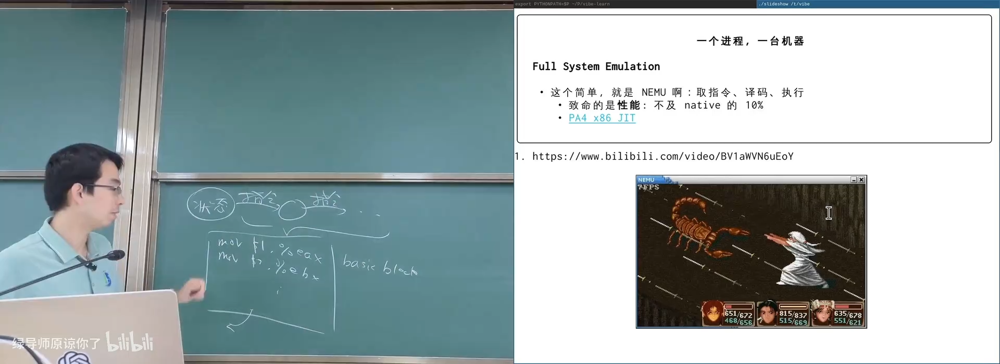

### 1.3 JIT：把基本块变成本机代码

*(参考时间: 00:03)*

最直接的方法：

1. 把基本块转写成 C 函数；
2. 调用本机 C 编译器；
3. 生成 `.so`；
4. `dlopen` 加载；
5. 解析 relocation；
6. 跳转执行。

概念代码：

```c
void basic_block(CPUState *cpu) {
    cpu->eax = 1;
    cpu->ebx = 2;
}
```

编译器可以把立即数直接编码进机器指令，避免运行时再次译码。

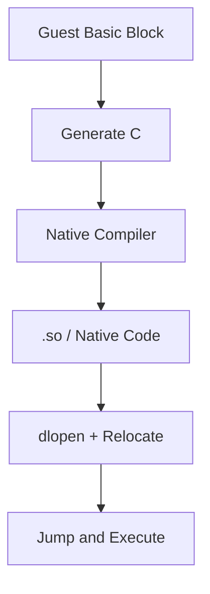

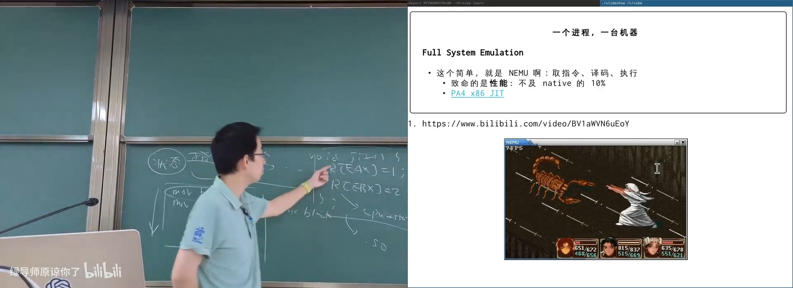

### 1.4 只编译热点

*(参考时间: 00:06)*

每个基本块都调用一次外部编译器不可接受：

- 编译器启动成本约几十到几百毫秒；
- 只执行一次的基本块编译收益为负。

实际 JIT 通常使用分层策略：

```text
解释执行
  ↓ 统计执行次数
热点超过阈值
  ↓ 后台编译
缓存本机代码
  ↓ 下次直接跳转
```

Java VM、Node.js VM 等也使用类似机制。

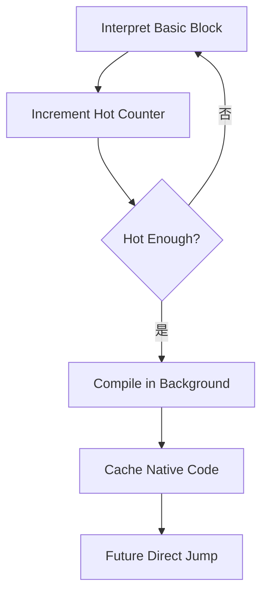

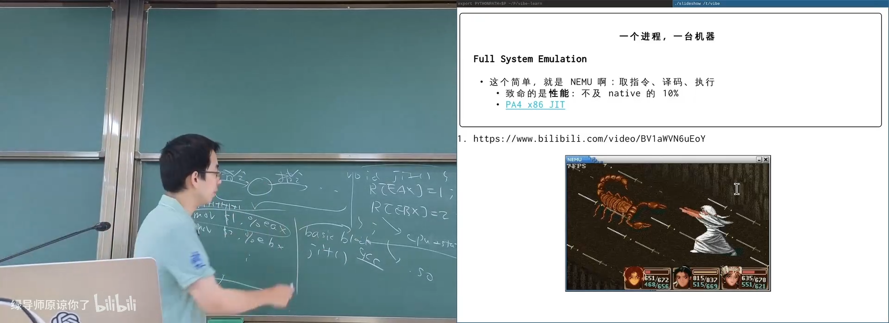

---

## 2. QEMU dyngen：模板拼接与重定位

### 2.1 不调用外部编译器

*(参考时间: 00:08)*

QEMU 早期方案希望同时满足：

- 跨主机架构；
- 无需每个 basic block 调外部编译器；
- 比纯解释执行快。

核心想法：

> 预先编译“单条 Guest 指令的代码模板”，运行时把模板拷贝并修补。


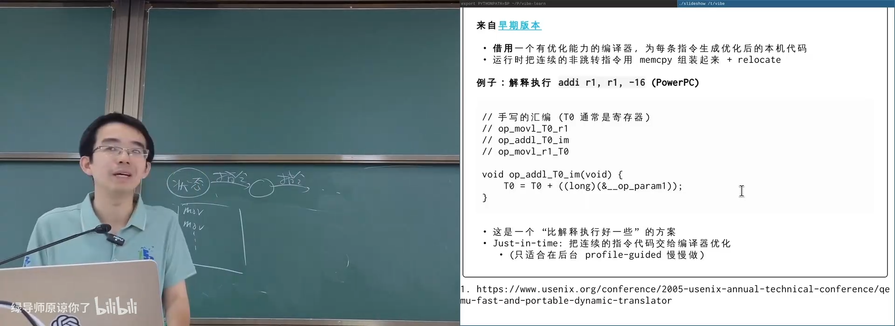

### 2.2 单条 Guest 指令拆成三条本机操作

*(参考时间: 00:10)*

以 `addi r1, r1, -16` 为例：

```c
// T0 is a temporary host register.
void op_addl_T0_im(void) {
    T0 = T0 + ((long)(&__op_param1));
}
```

对应步骤：

```text
1. mov T0, guest_r1
2. add T0, immediate
3. mov guest_r1, T0
```

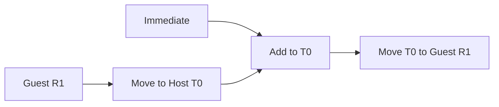

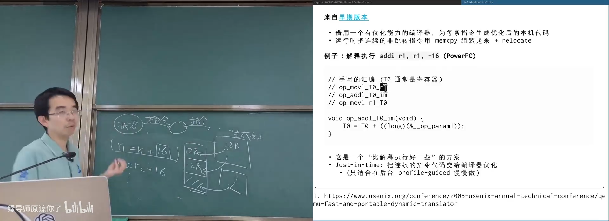

### 2.3 Placeholder 与 relocation

*(参考时间: 00:12)*

模板先编译成一段本机机器码，并把未知立即数留作 placeholder：

```text
mov T0, guest_r1
add T0, 0x00000000   ; patch location
mov guest_r1, T0
```

运行时：

1. 复制模板；
2. 找到 relocation 位置；
3. 写入真实立即数；
4. 执行拼接后的 basic block。

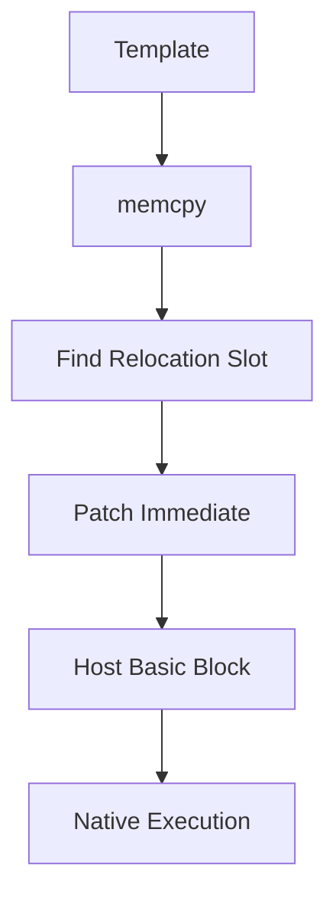

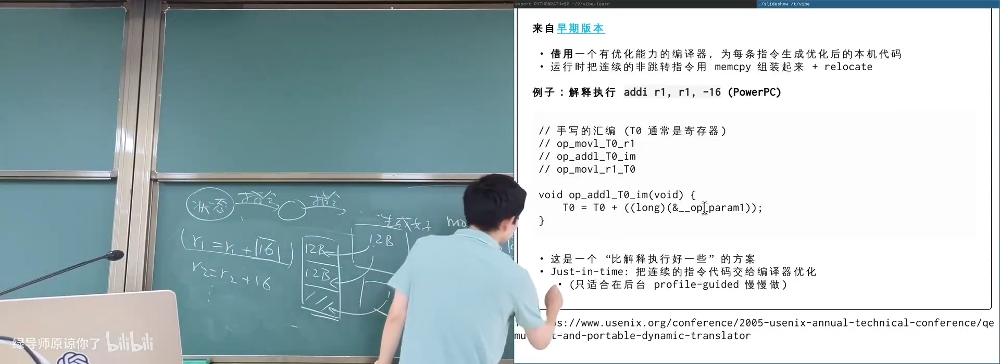

---

## 3. Disco、VMware 与虚拟化的黄金时代

### 3.1 1970 年代的想法重新复活

*(参考时间: 00:16)*

Disco（SOSP '97）重新提出 Virtual Machine Monitor：

- 一台物理机运行多个完整操作系统；
- 每个 Guest OS 看到独立的虚拟硬件；
- 通过直接执行和受控陷入获得接近原生的性能。

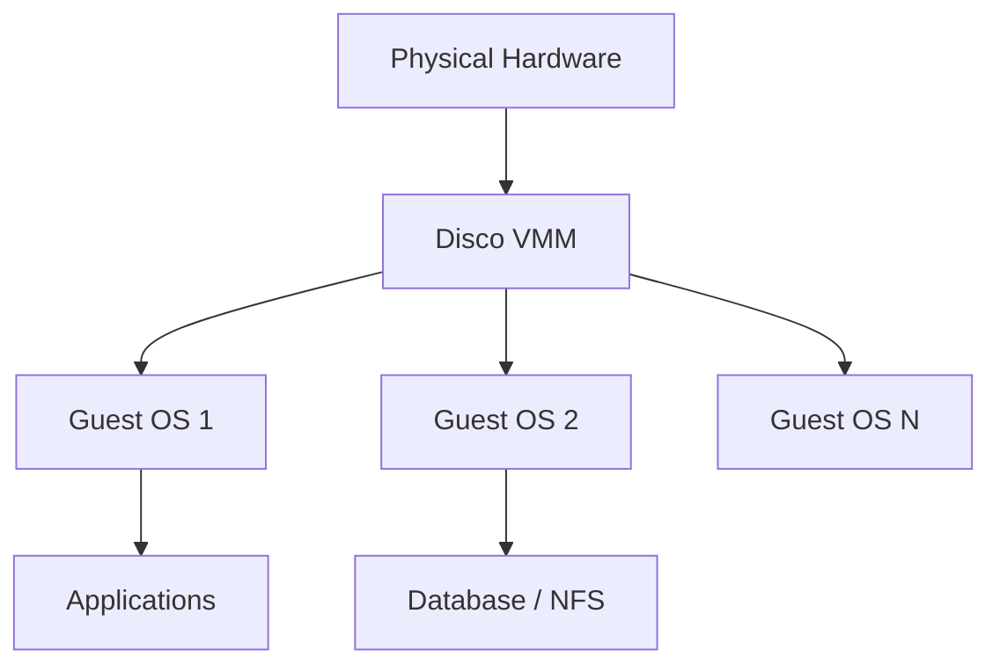

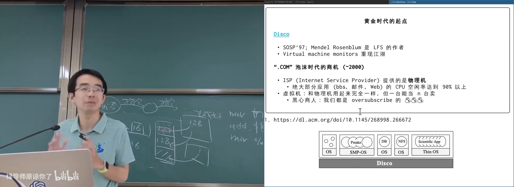

### 3.2 Dot-com、ISP 与超卖

*(参考时间: 00:19)*

2000 年前后：

- 应用常由 ISP 租用物理服务器；
- BBS、邮件、网页服务 CPU 空闲率经常超过 80% 到 90%；
- 虚拟机可以承诺“与物理机使用体验相同”；
- 一台物理机切分后卖给多个用户；
- 云厂商会进一步 `oversubscribe`。

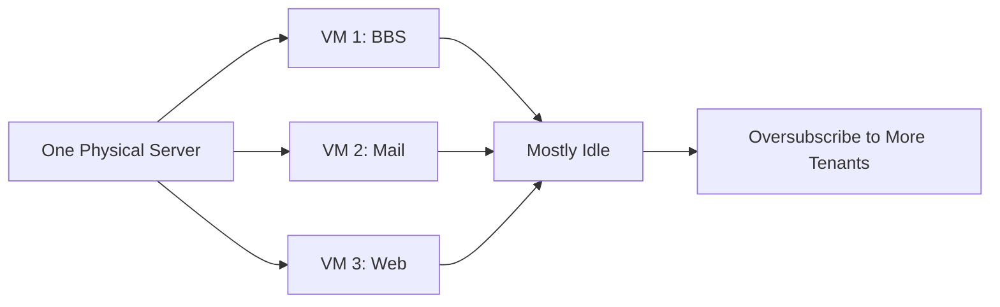

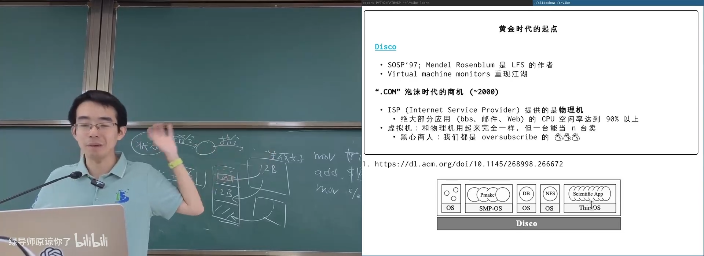

### 3.3 VMware

*(参考时间: 00:24)*

Mendel Rosenblum 与团队的 Disco 技术最终催生 VMware：

- 虚拟机和物理机使用方式一致；
- Guest OS 无需修改；
- VM 成为数据中心基础设施；
- 后续影响 CPU 硬件虚拟化。


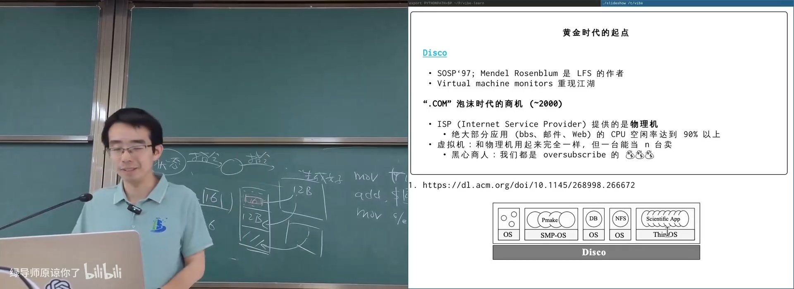

### 3.4 大学、论文与品味

*(参考时间: 00:28)*

讲师在这里插入一段关于科研的评论：

- 论文不是给项目凑数；
- 不应隐藏不利数据或选择性报告；
- Benchmark crime 会污染后续研究；
- 好的工作往往“复活一个过去无法实现的想法”。

Disco 的价值不只是实现了虚拟化，还重新点燃了 1970 年代虚拟机监控器的路线。

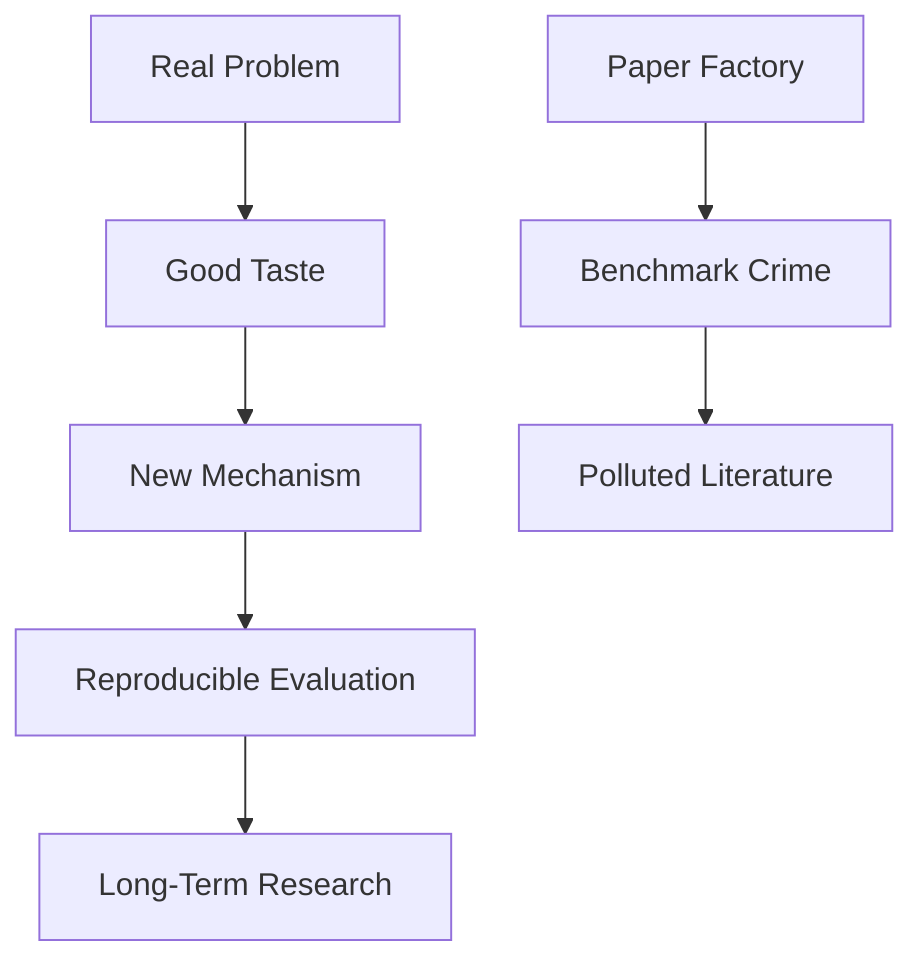

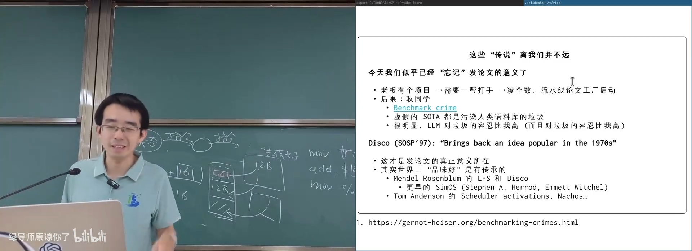

### 3.5 Y Combinator 与“元机制”

*(参考时间: 00:26)*

课程提到 Paul Graham 创办 Y Combinator，并用 Y 组合子作为名字：

```python
def Y(f):
    def wrapper(*args):
        return f(wrapper)(*args)
    return wrapper

factorial = Y(lambda f: lambda n: 1 if n < 2 else n * f(n - 1))
```

讲师把它类比为“能够不断生成方法的元机制”：

- 技术浪潮会变化；
- 选择正确问题的方法仍会重复出现；
- 会学习、会迁移，比死记结论更重要。


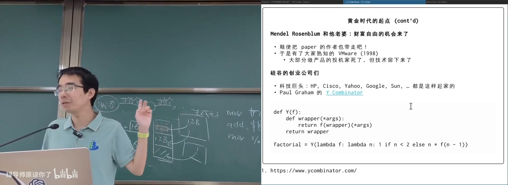

### 3.6 从分数到更大的世界

*(参考时间: 00:38)*

讲师回应“最后两个实验考试会考吗”，指出分数通常很重要，但不应成为唯一动力：

- 评价标准变化后仍要能选择问题；
- 环境和见闻会影响品味；
- 好的技术工作可以改变世界；
- 不要只做 reward hacking。

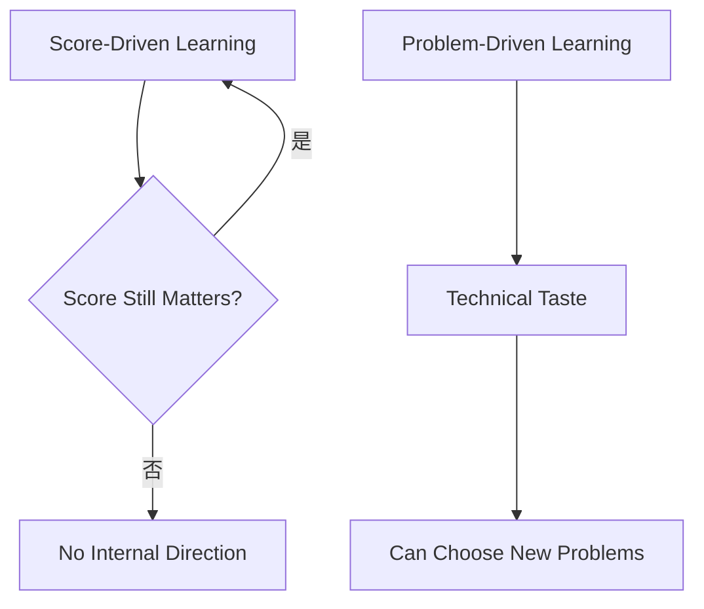

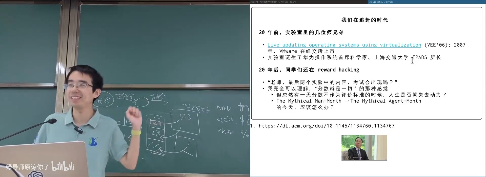

---

## 4. VMM 直接执行与影子页表

### 4.1 用户代码可以直接执行

*(参考时间: 00:40)*

同架构下，Guest 用户态代码与 Host 用户态代码可以使用同一套指令：

- Guest Ring 3 代码在 Host Ring 3 执行；
- 普通计算无需模拟；
- 系统调用等特权边界需要拦截。

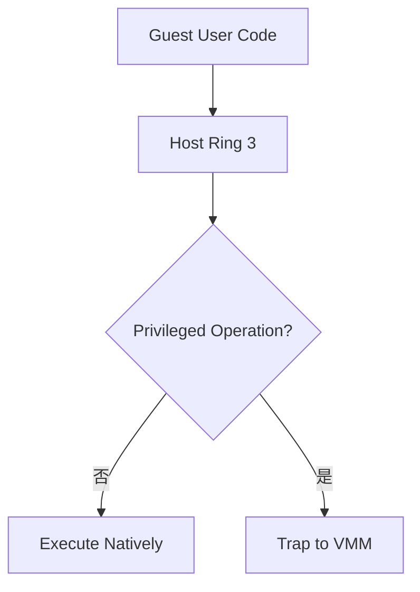

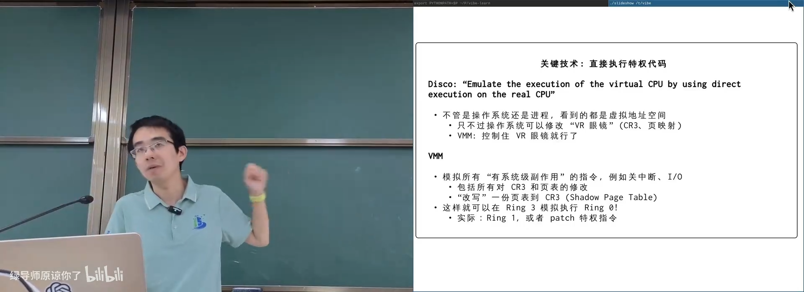

### 4.2 页表就是 VR 眼镜

*(参考时间: 00:42)*

页表把虚拟页映射到物理页，并附带权限：

```text
Virtual Page 1 -> Physical Page 1
Virtual Page 2 -> Physical Page 3
Virtual Page 3 -> Physical Page 8
```

Guest OS 认为自己拥有物理内存，并可以修改 CR3、页表项和其他控制寄存器。

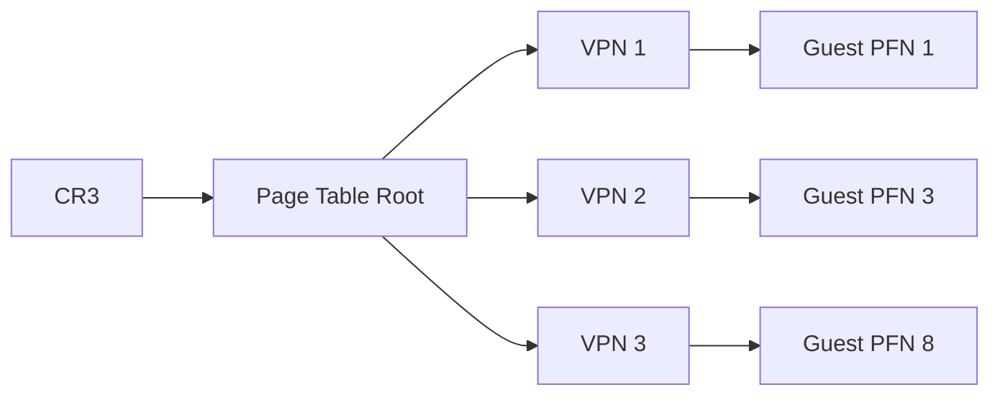

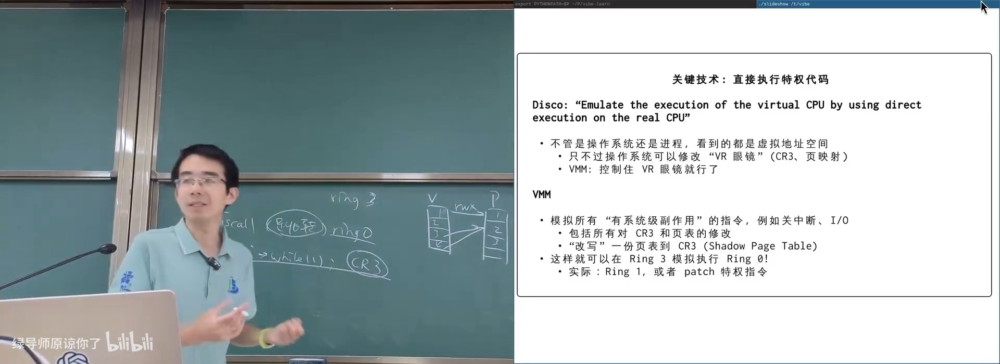

### 4.3 Ring 1、指令扫描与 Trap

*(参考时间: 00:45)*

VMware 式方案把 Guest Kernel 放在较低权限，使特权操作陷入 VMM。若硬件权限级不够，还可以：

- 扫描 Guest Kernel；
- 对危险指令打补丁；
- 用 breakpoint 式机制替换成 trap；
- 在 trap 中模拟或修正行为。

只有少数特权操作需要陷入，绝大多数内核代码仍以本机速度执行。

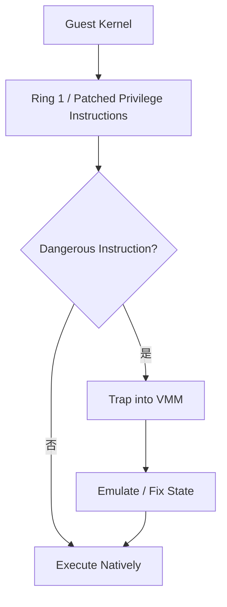

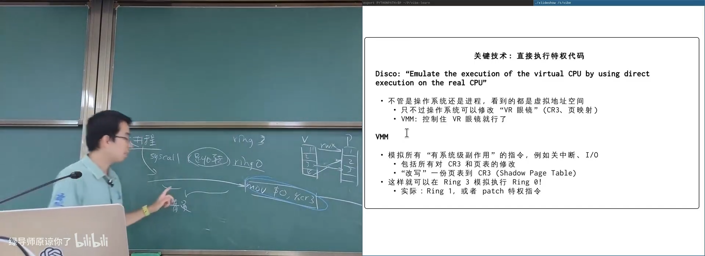

### 4.4 Shadow Page Table

*(参考时间: 00:47)*

Guest 的“物理地址”仍然是 Host 的虚拟地址，因此 VMM 必须维护影子页表：

```text
Guest VPN 1 -> Guest PFN 1 -> Host PFN 4
Guest VPN 2 -> Guest PFN 3 -> Host PFN 8
Guest VPN 3 -> Guest PFN 8 -> Host PFN 12
```

Guest 修改自己的页表时，VMM 拦截并更新影子页表；Guest 切 CR3 时，VMM 装入对应的影子页表。

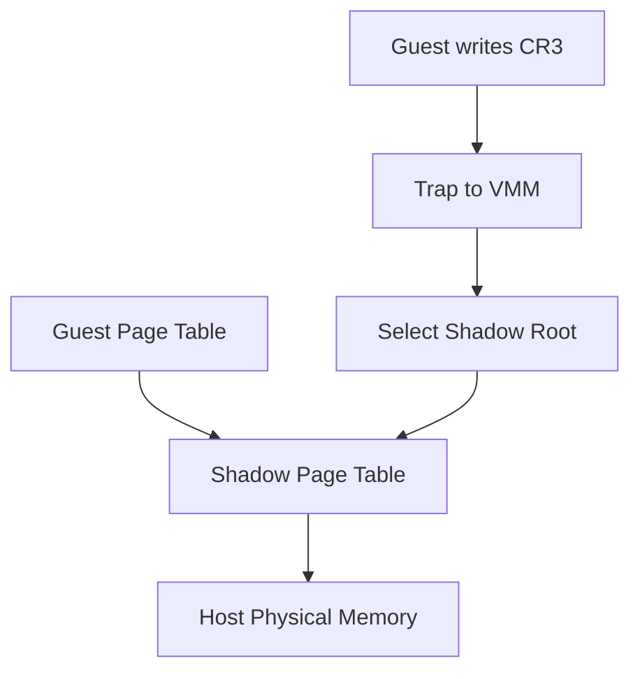

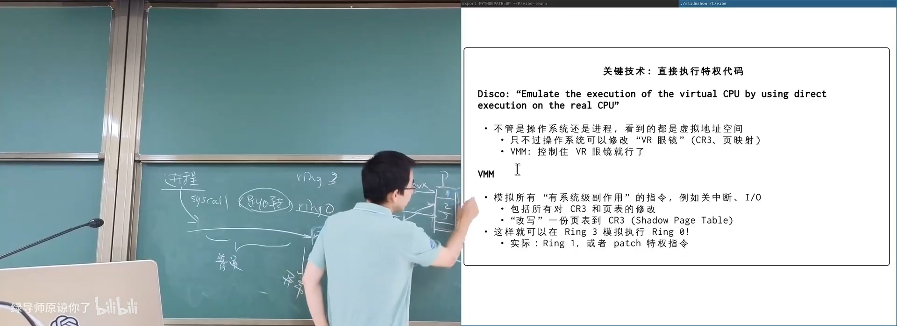

### 4.5 硬件虚拟化

*(参考时间: 00:49)*

硬件逐渐加入支持：

- Intel VT-x（2005）；
- VT-d（2006）；
- EPT（2008）；
- Xen paravirtualization；
- VIRTIO 虚拟 I/O。

CPU 可以原生执行部分特权操作，只在必要事件上产生 VM Exit；二级页表由硬件完成。

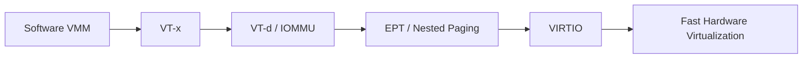

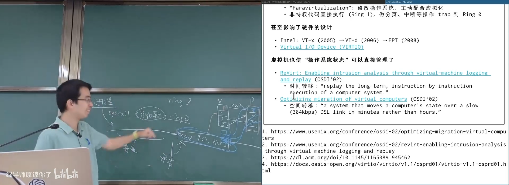

### 4.5 ReVirt：记录并重放整台机器

*(参考时间: 00:52)*

ReVirt 记录虚拟机执行中的非确定性外部输入：

- 中断；
- 设备输入；
- 时间；
- 网络数据。

记录这些事件后，可以逐指令重放整个系统。

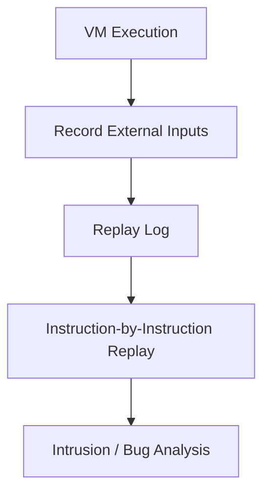

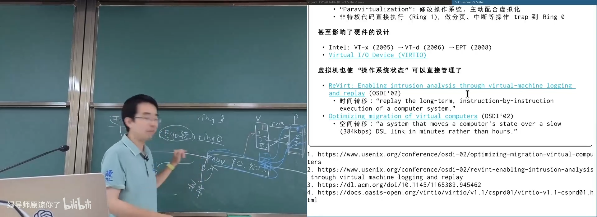

### 4.6 空间迁移

*(参考时间: 00:53)*

虚拟机状态可以看作一块内存：

1. 暂停 VM；
2. 断开或重定向设备；
3. 把内存和状态迁移到另一台机器；
4. 在新机器恢复执行。

这就是 Live Migration 的基础。

```mermaid
flowchart LR
    A["Source Host VM"] --> B["Pause / Snapshot"]
    B --> C["Transfer Memory + State"]
    C --> D["Destination Host VM"]
    D --> E["Resume"]
```

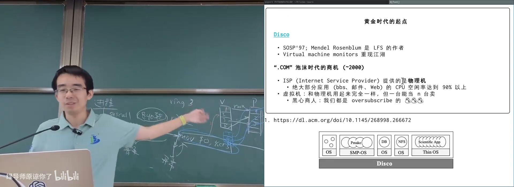

---

## 5. 换一条路线：操作系统自己虚拟化自己

### 5.1 OSID：为每个对象增加命名空间编号

*(参考时间: 00:54)*

虚拟机把整台机器虚拟化；操作系统级虚拟化则直接让多个“小操作系统”共享一个内核。

概念模型：

```c
struct proc {
    int pid;
    int osid;
    // ...
};
```

所有对象都属于某个 OSID：

- 进程；
- 用户；
- 文件系统视图；
- IPC；
- 网络；
- 时间与主机名。

```mermaid
flowchart TD
    K["One Kernel"] --> O1["OSID 1"]
    K --> O2["OSID 2"]
    O1 --> P11["PID 1"]
    O1 --> P12["PID 2"]
    O2 --> P21["PID 1"]
    O2 --> P22["PID 2"]
```

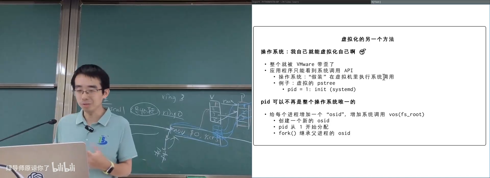

### 5.2 PID 隔离示例

*(参考时间: 00:56)*

每个 OSID 都可以有自己的 `PID 1`：

- 从一个 OSID 出发，只能看到同 OSID 的进程；
- `kill`、`wait`、`proc` 遍历都受到 OSID 过滤；
- 新进程继承父进程 OSID；
- 全局可以重新编号 PID，也可以为每个命名空间单独分配。

```mermaid
flowchart TD
    A["Process with OSID 1"] --> B["List / Kill"]
    B --> C{"Target OSID == 1?"}
    C -- "是" --> D["Visible / Accessible"]
    C -- "否" --> E["Not Found"]
```

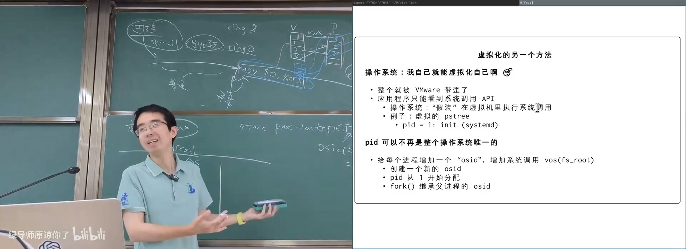

### 5.3 PID 是 leaky abstraction

*(参考时间: 00:58)*

PID 会被回收，经典 TOCTTOU：

```bash
ps | grep SomeProcess
sleep ...
kill <pid>
```

如果原进程退出且 PID 被复用，`kill` 可能杀掉另一个进程。

```mermaid
sequenceDiagram
    participant User
    participant Kernel
    User->>Kernel: ps, read PID 31181
    Kernel-->>User: PID 31181
    Kernel->>Kernel: process exits
    Kernel->>Kernel: PID reused
    User->>Kernel: kill 31181
    Kernel-->>User: kills wrong process
```

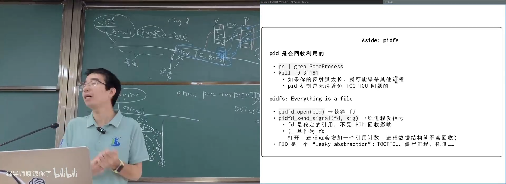

### 5.4 `pidfd`

*(参考时间: 01:00)*

Linux 增加：

```c
int fd = pidfd_open(pid, 0);
pidfd_send_signal(fd, SIGTERM, NULL, 0);
```

`pidfd` 是稳定引用，持有期间进程结构不会被回收，因此不会误杀复用 PID。

```mermaid
flowchart LR
    A["PID"] --> B["pidfd_open()"]
    B --> C["Stable FD Reference"]
    C --> D["pidfd_send_signal()"]
    D --> E["Correct Process"]
```

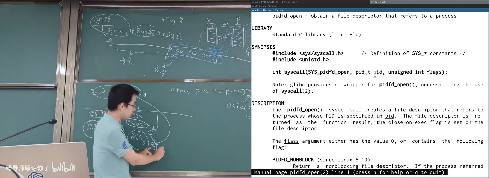

---

## 6. chroot：最早的文件命名空间隔离

*(参考时间: 01:01)*

Version 7 Unix 已提供：

```c
chroot("/path/to/new/root");
```

进程看到的 `/` 变成指定目录：

```text
Host /srv/container
  bin/
  lib/
  home/

Process sees:
  /bin
  /lib
  /home
```

```mermaid
flowchart TD
    A["Host Filesystem"] --> B["/srv/container"]
    B --> C["New Root"]
    C --> D["/bin"]
    C --> E["/lib"]
    C --> F["/home"]
```

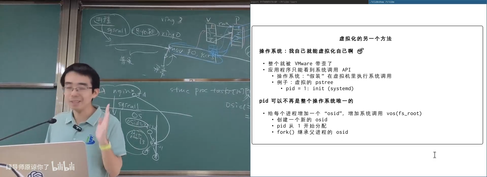

### 6.1 chroot 的限制

*(参考时间: 01:03)*

chroot 只隔离文件系统视图：

- PID 未隔离；
- 用户未隔离；
- 网络未隔离；
- IPC 未隔离；
- 逃逸手段很多。

尝试 `chroot` 到一个不完整的目录时，连 shell 所需的 `/bin/sh` 都不存在。

```mermaid
flowchart TD
    A["chroot only"] --> B["Filesystem View"]
    A --> C["Shared PID"]
    A --> D["Shared Users"]
    A --> E["Shared Network"]
    A --> F["Shared IPC"]
```

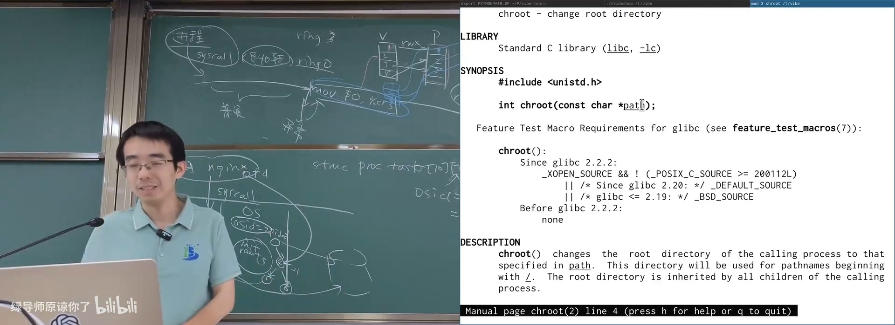

---

## 7. Linux Namespaces

### 7.1 需要隔离哪些对象

*(参考时间: 01:04)*

从操作系统对象出发，可以枚举命名空间：

- **pid**：进程 ID；
- **user**：用户和组；
- **mnt**：挂载点与文件系统；
- **ipc**：信号量、消息队列、共享内存；
- **net**：网络设备、协议栈、端口；
- **time**：系统时间和时区；
- **uts**：主机名和域名；
- **cgroup**：cgroup 视图。

```mermaid
flowchart TD
    A["Namespace Types"] --> B["pid"]
    A --> C["user"]
    A --> D["mnt"]
    A --> E["ipc"]
    A --> F["net"]
    A --> G["time"]
    A --> H["uts"]
    A --> I["cgroup"]
```

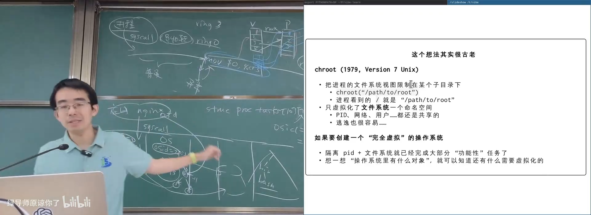

### 7.2 创建和切换命名空间

*(参考时间: 01:05)*

常用 API：

```c
clone(..., CLONE_NEWPID | CLONE_NEWNS | CLONE_NEWNET, ...);
unshare(CLONE_NEWPID | CLONE_NEWNET);
setns(fd, CLONE_NEWNET);
```

```mermaid
flowchart LR
    A["clone(CLONE_NEWXXX)"] --> B["New Namespace at Process Creation"]
    C["unshare(CLONE_NEWXXX)"] --> D["Move Current Process"]
    E["setns(fd, CLONE_NEWXXX)"] --> F["Join Existing Namespace"]
```

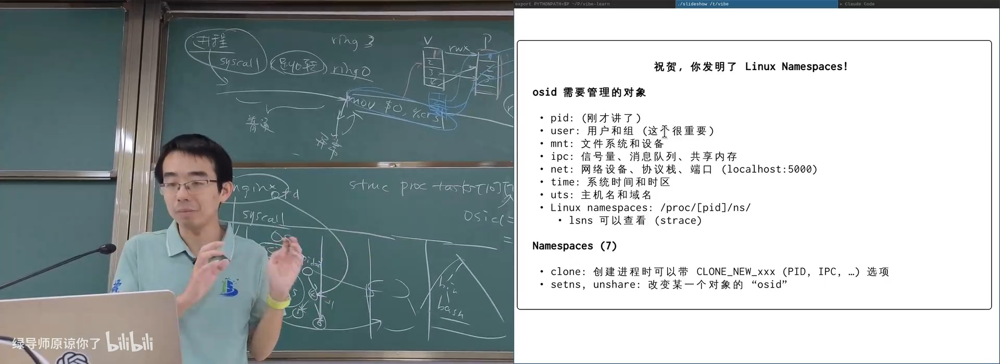

### 7.3 `/proc/[pid]/ns/`

*(参考时间: 01:06)*

每个进程都有命名空间引用：

```text
/proc/<pid>/ns/
  pid
  user
  mnt
  ipc
  net
  uts
  time
  cgroup
```

`lsns` 可以列出系统中的命名空间。

```mermaid
flowchart TD
    A["/proc/pid/ns"] --> B["pid"]
    A --> C["mnt"]
    A --> D["net"]
    A --> E["user"]
    A --> F["ipc"]
    A --> G["uts"]
    A --> H["time"]
    A --> I["cgroup"]
```

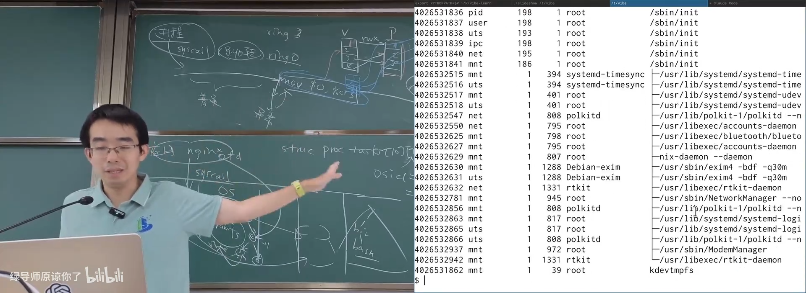

### 7.4 命名空间可以组合

*(参考时间: 01:08)*

两个进程可以：

- 共享 `net`；
- 使用不同 `mnt`；
- 使用不同 `ipc`；
- 使用不同 `user`。

不必所有命名空间都一起隔离。

```mermaid
flowchart LR
    P1["Process 1"] --> N1["Shared Net NS"]
    P2["Process 2"] --> N1
    P1 --> M1["Mount NS A"]
    P2 --> M2["Mount NS B"]
    P1 --> U1["User NS A"]
    P2 --> U2["User NS B"]
```

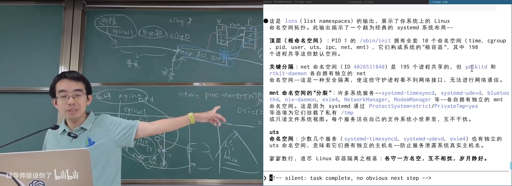

---

## 8. cgroups：资源控制

### 8.1 命名空间不等于资源限制

*(参考时间: 01:09)*

命名空间解决“看不看得见”，但不解决“能用多少资源”：

- CPU 时间；
- 内存；
- 文件系统带宽；
- 网络带宽；
- 进程数量；
- 文件描述符。

```mermaid
flowchart LR
    A["Namespaces"] --> B["Visibility Isolation"]
    C["cgroups"] --> D["Resource Control"]
    B --> E["Container Isolation"]
    D --> E
```

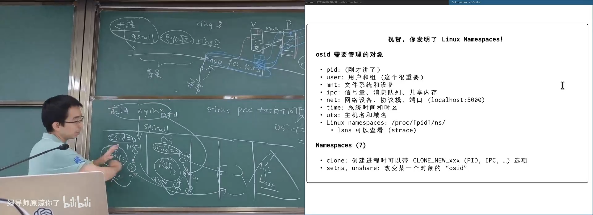

### 8.2 CPU 计费

*(参考时间: 01:10)*

cgroup 可以把一组进程看作一个调度实体：

```text
cgroup A: CPU time count
cgroup B: CPU time count
cgroup C: CPU time count
```

策略可以规定：

- 最多使用 20% CPU；
- 多个 cgroup 公平分享；
- cgroup 之间分层调度；
- 设置 memory/IO 上限。

```mermaid
flowchart TD
    ROOT["Root cgroup"] --> A["Group A"]
    ROOT --> B["Group B"]
    A --> A1["Process 1"]
    A --> A2["Process 2"]
    B --> B1["Process 3"]
    B --> B2["Process 4"]
```

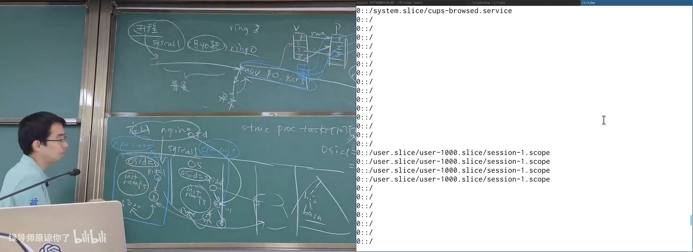

### 8.3 cgroup v2 的树结构

*(参考时间: 01:11)*

```text
/sys/fs/cgroup/
  system.slice/
  user.slice/
  docker/
    container-a/
    container-b/
```

每个层级可以采用不同分配策略。

```mermaid
flowchart TD
    R["Root"] --> S["System Slice"]
    R --> U["User Slice"]
    S --> D["Docker"]
    D --> A["Container A"]
    D --> B["Container B"]
```

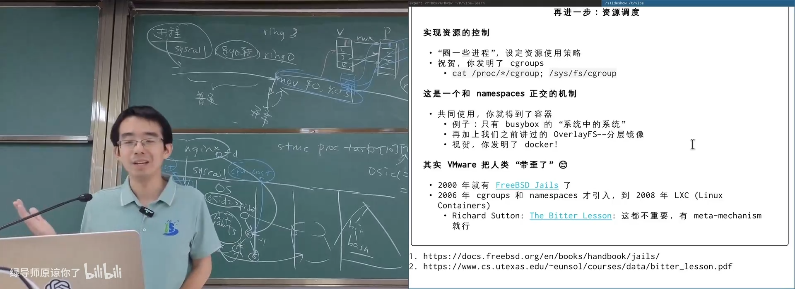

---

## 9. 容器：Namespaces + cgroups + OverlayFS

### 9.1 组合出 Docker

*(参考时间: 01:12)*

容器需要：

1. namespaces：隔离对象视图；
2. cgroups：控制资源；
3. OverlayFS：共享只读镜像层，写时复制；
4. chroot/pivot_root：构造独立的根文件系统。

```mermaid
flowchart LR
    A["Namespaces"] --> D["Container"]
    B["cgroups"] --> D
    C["OverlayFS / Image Layers"] --> D
    E["chroot / pivot_root"] --> D
```

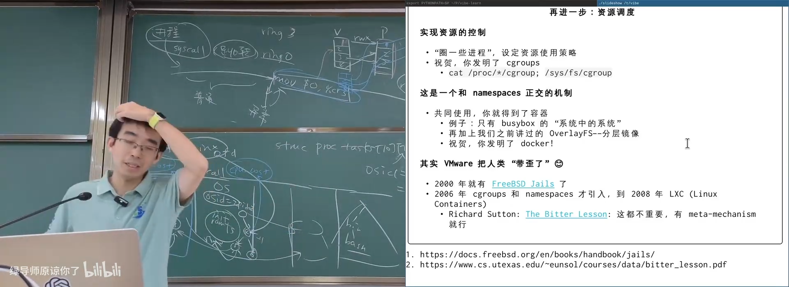

### 9.2 容器与虚拟机

*(参考时间: 01:13)*

| 维度 | 虚拟机 | 容器 |
|---|---|---|
| 隔离层 | 虚拟硬件 + Guest Kernel | 共享 Host Kernel |
| 启动开销 | 高 | 低 |
| 内存开销 | 高 | 通常更低 |
| 隔离强度 | 更强 | 依赖内核隔离 |
| 密度 | 较低 | 较高 |

容器更轻量，但 Host Kernel 漏洞会影响隔离：

- 越权读取其他容器；
- 耗尽全局 fd 等资源；
- 对其他容器形成 DoS。

```mermaid
flowchart TD
    A["Host Kernel"] --> B["Container A"]
    A --> C["Container B"]
    D["Kernel Vulnerability"] --> E["Cross-Container Impact"]
    F["VM Hypervisor"] --> G["Guest Kernel A"]
    F --> H["Guest Kernel B"]
```


### 9.3 FreeBSD Jails、LXC 与 Docker

*(参考时间: 01:14)*

时间线：

```text
1979  chroot
2000  FreeBSD Jails
2006  Linux namespaces + cgroups
2008  LXC
2013+ Docker / OCI / Kubernetes
```

```mermaid
flowchart LR
    A["chroot 1979"] --> B["FreeBSD Jails 2000"]
    B --> C["Namespaces + cgroups 2006"]
    C --> D["LXC 2008"]
    D --> E["Docker"]
    E --> F["Cloud Native"]
```


### 9.4 The Bitter Lesson 与 meta-mechanism

*(参考时间: 01:15)*

课程再次引用 The Bitter Lesson：

- 不要只堆积人类手工知识；
- 寻找能随算力和规模增长的 meta-mechanism；
- Docker 与云原生是技术演进中的一种 meta-mechanism。

```mermaid
flowchart TD
    A["Hand-Crafted Mechanism"] --> B["Limited Scaling"]
    C["Meta-Mechanism"] --> D["Learns / Scales with Resources"]
    D --> E["Long-Term Advantage"]
```


---

## 10. Kubernetes：容器编排

### 10.1 声明式管理无状态 Pod

*(参考时间: 01:18)*

Kubernetes 的目标：

- 动态调度容器；
- 自动伸缩；
- 节点故障时重新部署；
- 健康检查；
- 负载均衡；
- 统一访问和服务发现。

```mermaid
flowchart TD
    D["Desired State"] --> K["Kubernetes Control Plane"]
    K --> N1["Node 1"]
    K --> N2["Node 2"]
    K --> N3["Node 3"]
    N1 --> P1["Pod A"]
    N2 --> P2["Pod A'"]
    N3 --> P3["Pod B"]
```


### 10.2 Gateway 与服务路由

*(参考时间: 01:19)*

客户端只需请求服务名：

```text
request -> Gateway API -> Correct Pod
```

系统负责：

- 服务发现；
- 路由；
- 健康检查；
- 故障转移；
- 负载均衡。

```mermaid
flowchart LR
    C["Client"] --> G["Gateway API"]
    G --> S["Service Name"]
    S --> P1["Pod 1"]
    S --> P2["Pod 2"]
    S --> P3["Pod 3"]
```


### 10.3 容器调度是背包问题

*(参考时间: 01:20)*

每个容器有多维资源需求：

```text
(CPU, Memory, GPU, IO, ...)
```

调度器希望用尽可能少的机器放下所有容器：

- 多维 Bin Packing；
- NP-hard；
- 集群动态变化；
- 容器频繁创建、销毁和迁移；
- 用户随时扩缩容。

```mermaid
flowchart TD
    C1["Container: CPU / RAM"] --> B["Bin Packing"]
    C2["Container: CPU / RAM"] --> B
    C3["Container: CPU / RAM"] --> B
    B --> N1["Node 1"]
    B --> N2["Node 2"]
    B --> N3["Node 3"]
```


### 10.4 静态论文假设与现实系统

*(参考时间: 01:22)*

如果把容器调度写成静态整数线性规划，容易假设：

- 某一瞬间知道全部容器；
- 资源需求不变；
- 节点稳定；
- 不存在自动扩缩容；
- 看不到厂商的隐藏压缩与超卖。

真实集群中这些假设往往不成立，因此研究工作必须理解实际系统。

```mermaid
flowchart TD
    A["Static Optimization Paper"] --> B["Fixed Container Set"]
    B --> C["Fixed Node Capacity"]
    C --> D["Offline ILP"]
    E["Real Cluster"] --> F["Dynamic Containers"]
    F --> G["Elastic Scaling"]
    G --> H["Failures / Migration / Oversubscription"]
```


---

## 11. 总结：三条虚拟化路线

### 11.1 完整模拟

- 指令级解释；
- basic block JIT；
- 模板拼接与 relocation；
- 跨架构、灵活但开销大。

### 11.2 虚拟机监控器

- Guest 用户代码直接执行；
- 特权操作陷入；
- 影子页表；
- 硬件虚拟化、EPT、VIRTIO；
- 强隔离，适合异构操作系统。

### 11.3 操作系统级虚拟化

- OSID / namespaces；
- cgroups；
- chroot / OverlayFS；
- Docker、LXC、Kubernetes；
- 轻量、密集、适合云原生服务。

```mermaid
flowchart LR
    A["Full Emulation"] --> D["Isolation"]
    B["VMM"] --> D
    C["OS-Level Virtualization"] --> D
    D --> E["Cloud / Containers"]
    E --> F["Scale Out"]
```

最终结论：

> 虚拟化不仅是“把一台机器变成多台”，更是不断重新定义边界：哪些状态要模拟，哪些代码可以直接执行，哪些资源可以共享，哪些对象必须隔离。

---

## 附：官方参考与延伸阅读

- [PA4 x86 JIT 视频](https://www.bilibili.com/video/BV1aWVN6uEoY)
- [QEMU: A Fast and Portable Dynamic Translator](https://www.usenix.org/conference/2005-usenix-annual-technical-conference/qemu-fast-and-portable-dynamic-translator)
- [Disco: Running Commodity Operating Systems on Scalable Multiprocessors](https://dl.acm.org/doi/10.1145/268998.266672)
- [Y Combinator](https://www.ycombinator.com/)
- [Benchmark Crimes](https://gernot-heiser.org/benchmarking-crimes.html)
- [Live updating operating systems using virtualization](https://dl.acm.org/doi/10.1145/1134760.1134767)
- [Xen and the Art of Virtualization](https://dl.acm.org/doi/10.1145/1165389.945462)
- [VIRTIO 1.1](https://docs.oasis-open.org/virtio/virtio/v1.1/csprd01/virtio-v1.1-csprd01.html)
- [ReVirt](https://www.usenix.org/conference/osdi-02/revirt-enabling-intrusion-analysis-through-virtual-machine-logging-and-replay)
- [Optimizing the Migration of Virtual Computers](https://www.usenix.org/conference/osdi-02/optimizing-migration-virtual-computers)
- [FreeBSD Jails](https://docs.freebsd.org/en/books/handbook/jails/)
- [The Bitter Lesson](https://www.cs.utexas.edu/~eunsol/courses/data/bitter_lesson.pdf)

官方课程资料：

- [课程主页](https://jyywiki.cn/OS/2026/)
- [第 29 讲讲义：虚拟机和容器](https://jyywiki.cn/OS/2026/lect29.md)
- [视频：29 - 虚拟机和容器](https://www.bilibili.com/video/BV1uaEB66EAH/)

> **版权与署名**：本讲课程材料由蒋炎岩（jyy）编写。课程讲义与幻灯片采用 [Creative Commons BY-NC 4.0](http://creativecommons.org/licenses/by-nc/4.0/) 许可；本电子书保留课程出处、作者署名与许可说明。
